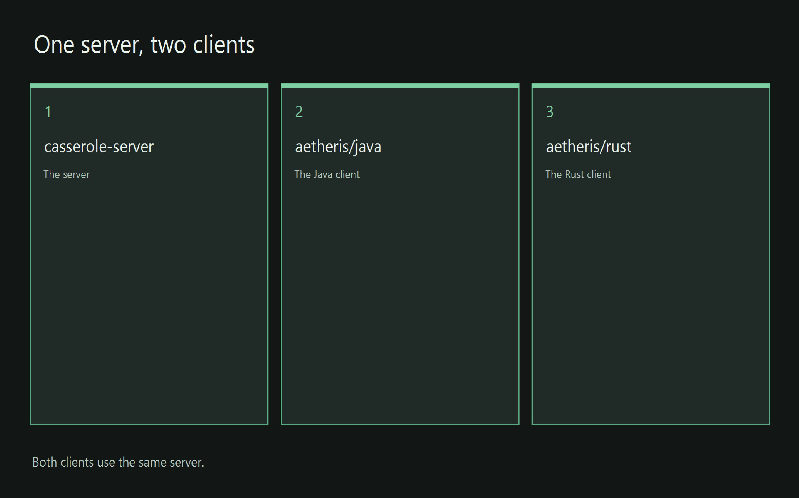
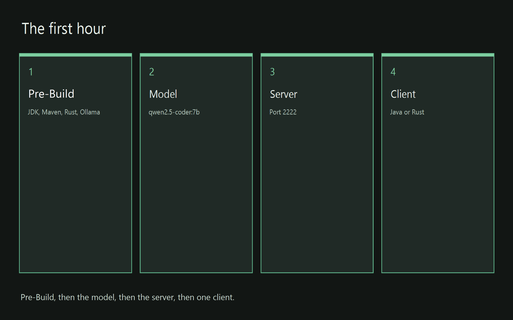

# Casserole AI CHAT/SSH/MCP Server & Aetheris Canvas

***Casserole*** and ***The Aetheris Canvas*** is a **Sovereign** local conversation platform for working with language models. Instead of a browser tab whose history lives in someone else’s service, it gives you a Java agentic server (using SpringAI) and two desktop clients (a pure-Java Swing version and a matching Rust binary) that you build and run on a machine you control. The conversation, the terminal session, and the durable record of what you asked, received, and decided **all stay on your disk.**

You sit at the Aetheris desktop: one window that pairs a real VT100 terminal with a notebook-style canvas of cells. Each cell holds a single turn—the prompt, the result, and the choices you made. You decide which cells enter the next prompt (the working set, *mixing multiple models in the same conversation if you choose to)*, so last month’s tangent never silently becomes today’s design. The server pages long terminal sessions to disk automatically, via the custom drop-in replacement for *SpringAI Chat* named **Roux Chat Memory,** leveraging a Reichenbach Sink pattern to keep the edges of the conversation locked into the attention heads of the AI model.  It routes work to a local Ollama model by default (or to a frontier model such as Grok when you explicitly allow it), allows multi-model chat communication and server based management of sessions that survive crashes, and never opens the client-side vault that holds the canvas history. One SSH login, two scopes, and a clean separation between what the machine did and what you decided to keep.

The entire system was built from ***English specifications first*** (**Architecture-Augmented Spec-Driven Development** and **English-Native Intermediate Representation**). Those pages remain the controlling record (and are included in the repo); the Java and Rust code are the emitted result. If you want a conversation whose history belongs to you, precise control over context, a terminal you already trust, and the option to stay air-gapped or reach out only when you choose, this is the ultimate desktop application enabling a new rich experience to AI chat. One that the user wholly controls with precise control over every turn.

The system as it stands presently provides a complete self-contained Sovereign AI Chat desktop platform with *local and remote* support for Ollama, full Grok Model API support, and a built in ACP gateway to the local Grok Build environment via *local and remote* Grok agents using websockets as transport. It is a foundational pillar for future expanded **out-of-the-box** SpringAI agentic MCP processing with integrated automatic AI chat window management, coming to a repo near you soon.

The automatic chat window management with spill-to-disk and recovery is implemented in this version, utilizing the new **Java FFM API** *bypassing* Java Heap and managing memory directly, (no GC pauses for chat memory), and is featured in the **Roux** chat memory package. The platform leverages the **SpringBoot** ecosystem to afford customization from the base foundation to a users requirements in their personal agentic deployments.

A careful first run from a fresh clone takes about thirty minutes tops usually, or less, depending on your experience level.

## Getting Started

Everyone is accustomed now to using a language model in a browser tab. The conversation lives in that tab. As a programmer and one who lives at the command line, a terminal you still keep open sits in a second window. The words from the tab never arrive in that console window, so the terminal has no record that the conversation happened. Except through cut-and-paste.

The history of the thought is kept by a service you do not run. Getting it back means exporting a file. The export lays Tuesday's argument down beside Thursday's correction. You then have to remember which folder you trusted with that file.

A thought you have already settled does not remain one record. What remains is a paste into some other file. Once the result you wanted exists, the paste and the chat window disagree. Each of them holds a different version of the same thought. The industry calls that split “*AI interaction*.”

This repository is the inversion of that notion. In this repo you are looking at a sovereign conversation, which means the thought belongs **to you**. The currency on the desk is the thought. The idea that follows the thought is the next currency unit.

A conversation here may be about code. When the subject is code, the code still travels as chat. A future version will feature code generation capabilities, this is the version 1.0 base layer a newer layer will be built upon. It provides sophisticated sovereign chat among many models simultaneously. Aimed at local models but also is built to integrate with frontier LLMs. Grok API and Grok CLI Build via ACP integration is already provided. Using discrete interface contracts to support other providers in the future. Or if you wish to implement one for yourself, the contract is provided and support provided for it in Casserole.

What you came for is **freedom from the browser**. What you came for is **a record that belongs to you**. The question is stored on the computer in front of you. The answer is stored on that same computer. The decision to keep either one is stored there too.

> **Public copy**

> Note: The files in this tree are the public copy of Casserole & Aetheris. This tree is not the private master repository. This is the public shareable repo only. You build the product from these files, and you run it from these files, on a computer you control. The private master is not required for that work. Nothing on this repo and documentation depends on the private master.

If you can read a build page and follow instructions to type the commands it lists, you can stand this system up. The page is written for an engineer, and it is written for an operator. This page is the first page. The sections under it are the steps, in order. The specification is linked from here when you want that behavior, to enhance and modify the repo for your purposes using AI-assisted spec-driven development.

Casserole is the agentic server product in this repository, it is the Java server at the center of that product. It is also the chat conversational platform for the Java & Rust Aetheris clients. The name carries both jobs on purpose. At a keyboard the word may mean the whole conversation, or it may mean the process that is answering. The answering process is what keeps the conversation honest.

> **Three programs, one conversation**

> The product is the Java server and two desktop clients. You build them on a machine you can inspect, and you run them on that machine. The disk, the process table, and the home directory are open to that inspection. It is composed of a local terminal and a local conversation with a language model. The history of that work stays on that computer, because the architecture puts it there. It never lives or relies on another chat provider's browser window tab or cache layer. The conversation is always persisted to **your** computer. It belongs **to you**.

One specification produced  all of the programs, the directories they live in, and the steps that build them. The specification was written in English. The English was written before the source was accepted. That order is how the platform was made. This page introduces those programs. It does not hand you a workshop that generates a codebase.

The practice utilized to build this project is **Architecture-Augmented Spec-Driven Development** (***AA-SDD***), which writes the specification first, *in English*. Source Code is accepted when it does what the specification says. The name of the specification in files is **English-Native Intermediate Representation** (***EN-IR***). EN-IR is the English form the build follows. It is the ***LOCKED ByteCode***. The true source code of the repo. The Java and Rust code are merely the emittance of the structured prose in the EN-IR specs.

The section [The programs and the specification](#the-programs-and-the-specification) specifies what AA-SDD & EN-IR mean in this tree. It states what is frozen, what may move, and how you check a claim against the files. The build you run is the result of this construction through specification, FIRST. The specification document was carried out. The programs referenced on this page are what was produced. With precision.

## The desktop you sit at

Aetheris is the desktop Client you sit at and use to interact with models via an elegant cell based canvas modeled after the flow of Jupyter Notebooks. This client layer is specifically designed to give the user the ability to control every aspect of the entire conversation, turn-by-turn.

The desktop client app  is one window. The window has two surfaces, and the two surfaces share one login. One surface is a classic terminal window, designed to operate like an iTerm2 styled terminal interface for AI chat conversations. A standard VT100 console *can* connect to Casserole and engage in chat, but without the special modifications. The other surface is a canvas, a notebook of cells beside the terminal via a tabbed interface, and the canvas is the controllable conversation. The shared login means you do not keep a browser for one surface and a separate window for the other. And conversations may transfer from one to the other instantly.

A cell is one unit of that notebook, kept small on purpose. The cell holds the prompt for that turn, the result for that turn, and the choices you made for that turn. The cell is the turn. It is a distinct unit of the session, and treated as such to provide deterministic control over which cells are part of a given prompt transaction.

You can see the cell and you can keep it. You can leave it out of the next prompt, and you can bring it back when it has earned a place there. The working set is the list of cells that enter the next prompt. A cell you leave out does not enter that prompt. The working set is how you conduct a thought. The model is *not obliged* to *read every earlier cell* which may include thoughts you don’t want to be included in a given prompt cycle. This offers precise control of the overall interactive conversation context.

> **Two clients, one server**

> The Java client is Aetheris Shell. It is a pure Java Swing implementation, using ONLY the standard Java window toolkit and library. The class that opens the window is `SshClientApp`. The Rust Aetheris Shell, an exact replica of the Java implementation,  is the program `aetheris-client`. It uses Rust libraries for UI rendering with egui on winit. egui lays out the window, and winit opens the native window. Both clients open a session on the same Casserole server. Both clients use the same login method via a unified and muxed SSH protocol over the wire. The protocol is owned and the wire contract is enforced by the Casserole server.

If you are interested in true cross platform operation of the Aetheris shell you have the Java Client. It will run on ANY standard OpenJDK or Oracle JVM. If you are not fond of using a system runtime for your app, there is the Rust client implementation, pure binary. A session opened from either client is  the same session protocol, managed by the server. The server keeps the session. It does care which client opened it. The protocol is pure VT100 control codes over SSH and the custom wire protocol for Aetheris being AMWP (Aetheris Multiplexed Wire Protocol).

## The terminal

The terminal is the interface an engineer already trusts. It sits in the same window as the conversation, on the same login. The terminal window has its own chat session separate from the Aetheris Canvas, over pure VT100 ssh protocol.

> **VT100**

> The terminal surface is a real VT100 session. VT100 is the classic terminal contract: a screen, a keyboard, and the control sequences a terminal program already understands. The cursor means what the host said it means. In this contract the host is the server that accepted the login. A control sequence stays a control sequence. It is not a hint that a web view may honor if it feels like it. Your shell runs in this session. Your commands run in this session. Habits from the years before still apply here. The terminal client is modeled off the behavior of iTerm2, with split panes for multiple simultaneous logins.

If you manage machines and operating systems, you will recognize this part of the desktop first. You can open a plain `ssh` session from a computer that has never heard of the canvas. The server still gives that login the terminal. And have a conversation with a model at the terminal. That is the default mode. The notebook appears when the user asks for it via the canvas tab in the Aetheris Shell. The terminal stays a terminal. The canvas chat stays the chat.

## The host

The server is a Java process. It accepts a Secure Shell (SSH) login on this machine. SSH is the encrypted login a terminal uses to reach a host. The server uses SSH because tools you already have speak that login. You do not have to learn a new one.

The server keeps the terminal conversation in paged memory, so a long session is allowed to stay long. When the conversation no longer fits in RAM, the server writes it to disk (automatic spill and recovery mechanics via the Roux Memory layer leveraging Java FFM, No java heap dependencies). The server pages the conversation. It does not pretend that memory is infinite.

The server sends the model's work to the model, via ollama or a frontier model integration, Grok API is supported in this repo. The model lives where you choose to put it. The call does not have to leave the room. The conversation goes to Casserole, and Casserole does the heavy-lifting relative to the model's work.

> **Air gap**

> The path on this page uses that local model. A cloud target stays off unless you later allow the call. The machine in front of you is the default. A remote model is a target you may allow. Naming the remote model in a configuration file does not turn the call on. You are the person who allows the call. Until you allow it, the call stays off.

The server remains a standard SSH (MCP/REST) host when no desktop is connected. A standard terminal login is able to connect to that host after the window is closed. A probe will see a ssh server. The desktop is a client of the server. The desktop is not what keeps the server alive, the core behavior for all chat window management is controlled server-side.

The server does not open the client's vault. The vault is the file on your computer that keeps the canvas history (separate from the ssh session, which IS managed by Casserole). The canvas history stays with the client. The host that runs the model does not receive a right to browse the notebook. The vault file stays shut.

## One login, two scopes

The clients and the server use one wire protocol. A wire protocol is the written contract for the bytes they exchange. You can point at that contract when two implementations disagree.

> **AMWP**

> The contract is named AMWP (Aetheris Multiplexed Wire Protocol). One SSH login carries two scopes. The terminal scope carries the terminal bytes. The canvas scope carries the canvas, and it also carries the request you send on to the model. A login that does not speak AMWP still reaches the terminal as a standard SSH connection. The canvas stays unavailable on that login.

The protocol does not leak a structured frame into the terminal byte stream. A terminal emulator can treat that stream as terminal bytes. Your automation still receives a terminal. An unusual client still receives a terminal. A plain `ssh` still receives a terminal. The notebook is present when the Aetheris client connects to it.

## The sovereign desktop

A sovereign desktop means the person at the keyboard owns the thought, the code, and the cognitive history. Cognitive history is the record of questions, answers, and decisions that were kept. The record is the trail of what was asked, what came back, and what was chosen. The record is kept where that person can open it next month. Opening the record does not require a negotiation with a vendor. Nor do you pay rent to access your thoughts.

When the talk was about code, the code is yours because the talk was yours. The code lives in the chat, on your machine. The currency on the desk is still the thought. Code is one of the things a thought can be.

Those records sit on that person's computer. A cloud model is a target the person may call, in the same way you may call a colleague who works in another building. The colleague does not move into the house. The history stays on the computer.

> **Local vault**

> The words "local vault" name the file where the canvas history sits. The vault is not a cryptographic storage system. It is the local storage layer on YOUR computer, which is the local storage vault for your thoughts. It does not reside on a provider's storage layer behind a web tab or cloud storage. The notebook has an address on a disk you control. The Casserole server does not open that address. A week of conversation is a file you can find. It is not a demonstration that disappears because someone treated RAM as the record.

Nothing on this page asks the file to attest to itself, to sign itself, or to prove to a stranger that the notebook is unaltered. You can find the file. You can keep the file. The server cannot open the file.

## Three pillars

The vision is three pillars on one connection. The connection is one login, and the login serves three functions simultaneously. Leave the three jobs separate, this is an intentional design decision. Merging them into one unified protocol means you will spend the next quarter pulling them apart.

The terminal pillar is the VT100 session already described. It is where you work the machine. The terminal stays a terminal while you are talking. The terminal stays a terminal when you are not.

The canvas pillar is the notebook of cells. You choose which cells enter the next prompt, and that choice is the working set. The working set keeps last month's tangent out of today's prompt. Without that choice, a model can treat an old aside as today's question.

Memory endures when you keep the durable vault. Endures means the notebook is still there after the process exits.

> **Two vault files**

> The Java vault is on disk by default, under the home directory. The server does not open that file. The Rust vault is its own file under the same home directory. The Rust client does not open the Java vault. Neither client calls a model host on its own. The conversation goes to Casserole over the wire. Casserole does the model's work on that path.

The two programs keep two files, and one client does not read the file that belongs to the other. One place on that path can see the call. That place can limit the call. That place can record the call when you ask for the record. A single source of truth for each.

The third pillar is the local host inside Casserole. Agentic means the host carries a turn onward. The host takes the turn you framed and routes it to the model. You talk. The host carries the conversation to the model. You keep what you decide to keep.

> **A later direction**

> Carrying a turn onward into a build process is the direction this pillar is shaped to take. A build, in this sentence, means a tool that changes a tree of files. That direction is not the session this page describes. That functionality is not available yet. The local model engine in use today is Ollama. A remote model is a target you reach through this same host when you allow the API call. You open the call via Aetheris. The server does not open it for you. When a page in the specifications says a cell may call a tool, that tool lives on this host. You can see the call, you can limit the call, and you can keep the trace of a call you chose to keep.

The trace is a record you elected to keep. It is not a recording that starts because the software was uneasy. The terminal remains the view of the machine. The canvas remains the notebook. The host remains the part that carries the turn. None of the three does the job of the others.

The speed you notice comes from the desktop, because the window runs on the local machine. The control is the working set. You decide what the model is allowed to attend to. The durability aspect is the local vault. The conversation outlives the process, on a disk you can find, under a home directory you already know how to back up. Speed, control, and durability are the three results. A window that offers only the speed is a demonstration. This application is a desktop where you can think.

## Two records

Two conversations may share one username. They do not share one store.

> **Two stores**

> The terminal transcript lives in the server's paged memory on Casserole. The canvas lives in the client vault on local disk. Canvas bytes do not enter the terminal transcript. The terminal transcript does not become the canvas history.

The two records are evidence of different things. The terminal transcript is evidence of what the machine did: the commands, the output, and the trail a session leaves behind. The canvas is evidence of what you decided: the question you asked, what came back, and which cells you were willing to send forward.

The SSH shell and the Aetheris Canvas do not share the same chat memory model. The SSH conversation with a model is stored and managed by the Casserole server completely. The Aetheris Canvas holds the entire conversation in a local vault store. It pushes the next prompt to the API every turn, nothing is persisted about the conversation relative to the canvas in the Roux memory layer in Casserole. This is an intentional design feature. The entire conversation thought stream belongs to you, on the computer you own. Not a provider's chat memory layer subject to compaction on a whim.

## The programs and the specification

Each program lives in a project directory of its own. These pages call that directory a silo, one project directory with its own build, its own install, and its own start script. The project directory calls the shared toolchain at the repository root, the folder that contains `pom.xml`. With an IntelliJ or other compliant IDE, one can load and build the entire project from the root pom.

The layout is oriented to a mono-repo format. Each application has its own directory and tool chain associated with it. None of the silos depend on another to operate or build. Each one is a self contained code and build structure.

> **Three project directories**

> The server project directory is `casserole-server`. The Java client project directory is `aetheris/java`. The Rust client project directory is `aetheris/rust`. One toolchain sits at the repository root. You can build one program, or you can build all three. A program you did not start does not block a program you did start.

The specification was written for the Java server first, and for the Java client before Rust was a consideration. The Rust client was a later decision and it mirrors the Java client in look and feel and functionality. And is carried forward to stay in-sync with new functionality as added to the Java Client. With Java being the root emittance language form for this project. The order of the prose in the spec is the history of the work. The order of spec prose is also the rule you use when you read. When a sentence about the host and a sentence about the Rust window seem to diverge, the server specs settle the host sentence. The server remains the reference for how the host behaves. The Rust client follows that same English.

> **One contract, two windows**

> The Rust client is a thin language-specific translation layer. Thin means the interesting language-specific decisions were settled once, and were not argued a second time in the second language. The Java side renders with Pure Java Swing and builds with Maven. The Rust side renders with egui and builds with Cargo. The frames on the wire remain one contract. You receive one contract, and two ways of rendering the client that speaks the protocol. The Rust client speaks the identical wire contract as the Java client.

The record of the work is the EN-IR spec written in English. The page is not kept in a compressed form, and it is not encoded as a base64 string. JSON does not stand in for the spec. XML does not stand in for the spec. A second schema does not stand in for the spec.

**English is the encoding.**

The spec is the record. A person who cannot read the spec is not looking at an EN-IR specification. No JSON, No AST, no other conventional translational layer is required. Structured Locked English prose **IS THE SOURCE CODE** of the project. Java, Rust, the implementation is pure emittance.

You do not have to have practiced **AA-SDD** before you stand up the system and open a conversation. You utilize the practice when you want to start building on top of what is provided in this repo. You use it again when a later change to these programs has to begin and conform to the same **English ByteCode**. The spec page defines a term in the sentence that needs the term.

The *costly argument* (read as token-burn) about these programs was held in English, in the ***native language and syntax*** of the AI, before a class was accepted. A wrong wrap, a wrong font, and a wrong default are local defects. You repair the local defect. You do not reopen the English ruling in order to repair it. The ruling remains where it was written. The local detail is the part that moves and is recorded as the additional requirement. That split is what keeps the platform the platform.

> **How a page is read**

> The specification is written in versioned Markdown. You seek one heading, and you read the first sentence under that heading. That sentence is the requirement. A quotation under the sentence records the decision. A second requirement is a second heading. One heading carries one ruling sentence. A sentence you cannot follow is not the requirement.

An ***English-Native Intermediate Representation*** is the form this repository uses for **ALL specifications** for this repo. In a compiler, an intermediate representation is the form a build follows after the requirements are settled and before the compiler emits the source of the product. In this repository that form is **English**. ***Locked Structured English prose***. The spec is the record the build of these programs follows. If you skip the spec, the next change is whatever the AI may interpolate what the moment suggests, and will likely drift. If you keep the spec, the next change still has a ruling to match. Zero Drift. Intent is LOCKED at the semantic level in the specified prose.

The specification settles how the server behaves. It settles how both clients behave. It settles the steps that compile the programs. The steps put the built files where a start script can find them, and the steps start the programs. The behavior and the build are one record. You can check the claim against the files in this tree. [SPEC.md](docs/specs/semantic-key-index.md) is the index of the behavior. The scripts carry out the steps the pages describe. The run configurations launch the server, the Java client, and the Rust client. If a spec states a behavior and the tree does not perform it, the mismatch is a defect with a name. The spec is where the next session looks.

> **Where the pages live**

> The specifications are the pages in [docs/specs/](docs/specs/README.md). Those spec pages are the source from which these programs were written, and the source for a later enhancement of these programs. [SPEC.md](docs/specs/semantic-key-index.md) is the index of every page in that directory. [docs/specs/README.md](docs/specs/README.md) is the entry page for that directory. A comment in the source cites the page by its unique public id, the identifier that page carries. The comment also cites the path under `docs/specs/`.

A later enhancement changes these programs from the same specs. If the specs cannot drive the change, the programs themselves become the only accurate description to reconcile against. The specs are how you avoid that outcome. The spec pages sit together in one directory, and they are written in English. They are read before these programs are generated. They are read again before the programs are changed. That second reading is how a later build remains the same system.

## The specification and the source

The spec pages and the source code are **one** fact, kept in two places. The English says what these programs do. The source does what the English says. A comment on the class names the page that ruled the class, the public id of the page, and the path of the spec under `docs/specs/`. The requirement on the page carries a key, the identifier that pairs the sentence with the class. The comment on the class carries the same key.

An index lists every citation. A citation names the source file, the line where the comment sits, the class that carries the comment, and the page the comment points at. You begin at the class and you arrive at the sentence. You begin at the sentence, and the index names every class that cites it. Both directions name the same things, because the index is rebuilt from the lines in the source. The index is not a second list kept from memory. It is a managed byproduct to aid the AI and Human in future sessions.

> **Bi-directional round trip**

> You can begin on either side and reach the other side. The specification reaches the source through the citation on the class. The source reaches the specification through the index those citations build. The two directions together are a living truth. Another AI that can read the English, and that can read a diff, can pick the graph up and comprehend it. The arrangement is a bi-directional round-trip engineering specification. The page is not a keepsake from a meeting nobody can find again. The class is not a leftover from that meeting. Each side can name the other side.

The citations are *semantic links*, the edges of *a knowledge graph,* as a set of semantically interlinked specification files, on disk. The nodes are the sentences and the classes. One heading is one ruling sentence. One ruling sentence is one citation. One citation is one row in the index. That size is the grain this repository was built at. A spec that puts two rulings under one heading has not yet stated either ruling. A class that acts and cites no spec has not yet joined the graph. A later reader does not have to guess which sentence built which class.

The same grain is how these three programs were accepted. The English was written first. The source was written next. The citation was written on the class in that same turn, and the index was rebuilt from the source after the citation. After the rebuild, both directions named the same things.

The AI cohort is the program that assists you in this repository. The cohort keeps the graph in step. The cohort can read the page, and the cohort can read the diff. When the source moves, the cohort follows the citation already on the class and asks whether the sentence still says what the class now does. When the sentence moves, the cohort follows that citation the other way and asks whether the class still does what the sentence now says. The index is then rebuilt from the source. After that rebuild, both directions still name the same things. **The cohort is not a second author of the product. The cohort keeps the two copies of the one fact from drifting apart.**

*Changing the code is allowed, **including a hand edit by an engineer.*** The cohort writes the change back into the specification. The link that was already there remains. A new behavior receives a new sentence, and a new link beside the link already there. The sentence that first built the class is not erased to make room for the sentence that changed it. Intent already written down stays written down. Intent that has just arrived is written beside the older intent. The path between the sentence and the class was drawn before the edit. The cohort follows that path. Git is leveraged by the cohort to maintain long-term memory and revision history to keep everything in order. There are times when the cohort may synthesize statements for efficiency, and I often guide my cohort to do so to ensure there is no confusion relative to a requirement. It is best to let the cohort resolve the prose and you simply agree or disagree, until the argument is settled in locked prose

> **A contradiction comes back to you**

> A contradiction is brought back to you. One resolution is that the code returns to the sentence. The other resolution is that the sentence is rewritten so the intent is not lost. The cohort does not choose a winner in silence. The index is rebuilt after the choice, from the source. Both directions are asked to name the same things again. A graph that swallows a disagreement and then prints a tidy row has stopped being a specification. That’s how so-called hallucinations may appear and drift from a human's intended goal. Nailing the disagreement into an agreement on the prose between the human and the AI cohort  FIRST in English is how precision is achieved in code generation. Using the semantic prose the AI chooses, to ensure intent is locked. If humans can understand the AI cohort, everything is good.

This arrangement is how the repository tells the truth about itself. It is also how a later change to these programs stays the same system. Another AI can open one page and one class and see that both are the same decision. Another engineer can make that same reading. The decision is one sentence. The class is one citation. The index is the list of every time that pairing was made. The files carry the decision.

The Aetheris desk in front of you is still the conversation, encoded into specs. The terminal beside the desk is still a VT100 session. The graph is how this tree keeps its own account. The graph is not a second product under the window. The graph is not a bench that takes one session of chat and emits a repository. That is the solution path of the upcoming third pillar. That layer is not available yet. What the graph affords today is that the truth of these three programs can be picked up whole and intact unto itself. You can start from the spec, or you can start from the class. Either path reaches the same decision.

A careful stand-up of the server and a client and first run fits in about thirty minutes. The run starts from a fresh clone and finishes with a server that is up and one client open. The steps are written for an engineer who will build the programs and run them, and for an operator who will do the same. The steps give the names, the reason the pieces are split, and the command that makes a claim true.

The sections below this introduction are those steps, in order. Follow them when you want a process you can see in the next thirty minutes, and a window you can type into. When you want to understand the behavior under the hood itself, read [SPEC.md](docs/specs/semantic-key-index.md). This spec defines precisely how to build the program. The specification is why the program  executes and runs as it does.

In order to run the applications, they need to be built first. The start script SHOULD handle that for you automatically, for each silo. Start with Casserole. Following are the instructions to start up each layer.

> **What the start script prints**

> [VERSION.md](VERSION.md) is the version record for this tree. The Java build version is `1.0.0`. The Rust crates `aetheris-term` and `aetheris-client` are at `1.0.0`. Version `1.0.0` is the release candidate being prepared. A start script prints the build identifier of the program it launches. A build identifier names the bits you are starting.

If you are familiar with standing up applications from github repos, use the [fast path](#fast-path). The fast path is the list of commands necessary to stand up the layers to start playing. The list contains every command the numbered sections use. The numbered sections repeat each command, and beside each command they quote the line the script prints when the step finishes and the line it prints when the step fails. The sentence after the failed line is the fix. Use the numbered sections the first time on a machine. Use the fast path after you recognize those lines.

Note: I designed the start scripts to check the install environment for all dependencies, including maven, and if missing automatically set those dependencies up for you. For Java and or Rust. Try just executing the start script for Casserole. Then the start script for either Aetheris client and see if it magically stands up. It works on my machine, but of course those are famous words from every developer, ‘it worked on my machine’.. LOL. I did hammer on it to make it as bullet-proof as possible. However I can’t yet account for every contingency, I don’t presently have a formal test lab. I am optimistic. 🙂

If you prefer the IDE approach, I use [IntelliJ IDEA](#intellij-idea), the project is set up to load and run effortlessly. The fast path and IntelliJ IDEA both start the same two Java programs: the Java server, the Java client. Rust is always from a PowerShell command line.



*One server, shared by two clients. The steps under [Windows 11](#windows-11) and [Linux](#linux) are the commands you type to stand up via the console.*

## Fast path

The start script is the convenience. It is designed to check the environment, check the pre-build, build, bind and install, and run the program in one operation. Check the environment selects the Java or Rust toolchain. Check the pre-build prints those tools on one screen. Build compiles the program. Bind and install places the built program in the app folder the start launches. The goal is to get you up and running fast.

On Windows the Casserole Server start is [app/start-casserole.ps1](app/start-casserole.ps1). On Linux it is [app/start-casserole.sh](app/start-casserole.sh). Leave that window open. The log that stays open is the Casserole Server. Then start one Aetheris Client. The Java Aetheris Client start is [app/start-aetheris.ps1](app/start-aetheris.ps1) or [app/start-aetheris.sh](app/start-aetheris.sh). Both Java programs launch the same fat jar, `app/casserole.jar`. A fat jar is the one packaged program that already contains its runtime libraries. The Rust Aetheris Client start is [rust/aetheris/app/start.ps1](rust/aetheris/app/start.ps1) or [rust/aetheris/app/start.sh](rust/aetheris/app/start.sh). Run each start from the repository root, the folder that contains this file and [pom.xml](pom.xml).

If a start runs into trouble, walk the checklist below, one script at a time. The checklist is the same commands the start script runs, written out so you can see which step stopped. A script is a file in this repository, and you run it from a terminal, the PowerShell window or the shell window the text comes back into. Nothing is written between the commands. In order, the scripts set up Java and Rust, print a one-screen check of those tools, download the Ollama model `qwen2.5-coder:7b`, build the one Java module and the Rust Aetheris Client, and start the Casserole Server.

Each script is finished only when the window shows one particular line. The Java toolchain finishes at `java-env ready`. The Rust toolchain finishes at `rust-env ready`. The pre-build check is the one-screen check of the tools, and it finishes at `pre-build-check finished`. The Casserole Server is up when the window shows `casserole-server 1.0.0` and the log keeps printing. `1.0.0` is the build identifier of the Casserole Server, the version string of the bits you just launched. Leave that window open. The log that stays open is the Casserole Server.

An Aetheris Client is up when a second window shows `aetheris-java 1.0.0` or `aetheris-client 1.0.0` and the program's own window opens. `aetheris-java 1.0.0` is the build identifier of the Java Aetheris Client. `aetheris-client 1.0.0` is the version of the Rust Aetheris Client. Sign in to `localhost` port `2222` as the user `admin` with the password `demo-admin`. `localhost` means this same machine. Port `2222` is the Secure Shell port the Casserole Server opens. Secure Shell, written SSH, is the encrypted login a terminal uses to reach a host.

The numbered sections under Windows 11, and the matching sections under Linux, run these scripts one at a time and quote the finished line beside the command. They also quote the line a failed run usually prints, and the next sentence is the fix. `Maven is not on PATH` means Maven is missing. Maven is the Java build tool. Install Apache Maven 3.9 or newer, open a new terminal, and run that script again. On Windows, a path to `OllamaSetup.exe` means the model installer stopped so you can run that file. `OllamaSetup.exe` is the Windows installer for Ollama. Ollama is the program that runs a language model on this computer.

When a start runs into trouble, use the numbered sections under Windows 11 and the matching sections under Linux. Run one script and read the window. When the text matches the quoted line, go to the next script. When the text matches the failure line, do the fix written there and run the same script again. A line you do not recognize belongs with the script that prints it. The other starter accounts are in [Accounts](#accounts).

Windows 11, from the repository root, in Windows PowerShell. The shell is the PowerShell that Windows 11 ships. The repository root is the folder that contains this file and [pom.xml](pom.xml). The scripts are [bin/java-env.ps1](bin/java-env.ps1), [bin/rust-env.ps1](bin/rust-env.ps1), [bin/pre-build-check.ps1](bin/pre-build-check.ps1), [bin/install-ollama.ps1](bin/install-ollama.ps1), [bin/install.ps1](bin/install.ps1), [rust/aetheris/bin/install.ps1](rust/aetheris/bin/install.ps1), and [app/start-casserole.ps1](app/start-casserole.ps1).

```powershell
powershell -File bin\java-env.ps1
powershell -File bin\rust-env.ps1
powershell -File bin\pre-build-check.ps1
powershell -File bin\install-ollama.ps1
powershell -File bin\install.ps1
powershell -File rust\aetheris\bin\install.ps1
powershell -File app\start-casserole.ps1
```

Leave that window open. In a second window, start one Aetheris Client. The Java Aetheris Client start script is [app/start-aetheris.ps1](app/start-aetheris.ps1). It launches the same fat jar the Casserole Server just started. The Rust start script is [rust/aetheris/app/start.ps1](rust/aetheris/app/start.ps1).

```powershell
powershell -File app\start-aetheris.ps1
```

```powershell
powershell -File rust\aetheris\app\start.ps1
```

Linux uses the same order from the repository root. The scripts are [bin/java-env.sh](bin/java-env.sh), [bin/rust-env.sh](bin/rust-env.sh), [bin/pre-build-check.sh](bin/pre-build-check.sh), [bin/install-ollama.sh](bin/install-ollama.sh), [bin/install.sh](bin/install.sh), [rust/aetheris/bin/install.sh](rust/aetheris/bin/install.sh), and [app/start-casserole.sh](app/start-casserole.sh).

```bash
source bin/java-env.sh
source bin/rust-env.sh
bash bin/pre-build-check.sh
bash bin/install-ollama.sh
bash bin/install.sh
bash rust/aetheris/bin/install.sh
bash app/start-casserole.sh
```

Source means the shell runs the file and keeps the values the file set. In a second terminal, start one Aetheris Client with `bash app/start-aetheris.sh` or `bash rust/aetheris/app/start.sh`. Those scripts are [app/start-aetheris.sh](app/start-aetheris.sh) and [rust/aetheris/app/start.sh](rust/aetheris/app/start.sh).

## IntelliJ IDEA

Use this section when you want the editor window before you run a script. IntelliJ IDEA is the editor. This section and the fast path both start the same three programs: the Casserole Server, the Java Aetheris Client, and the Rust Aetheris Client.

Open the directory that contains [pom.xml](pom.xml) and let IntelliJ import it as a Maven project. Maven is the Java build tool. The import produces one Java module. The module `casserole` comes from [pom.xml](pom.xml). The Rust workspace is [rust/aetheris/Cargo.toml](rust/aetheris/Cargo.toml). A Cargo workspace is the Rust build file that names the packages Cargo compiles together. Cargo is the Rust build tool.

Point the Project SDK at a JDK 26. A JDK is the Java development kit. [bin/java-env.ps1](bin/java-env.ps1) or [bin/java-env.sh](bin/java-env.sh) prints the `JAVA_HOME` it selected. `JAVA_HOME` is the folder where that JDK is installed. That home is a suitable SDK.

The `.idea` directory stays on the machine. It holds the editor state. It is not part of this repository. A run configuration is a saved command in the IDE. It names the program to start, the module that owns that program, and the directory the process uses as its working directory. You start a program from the IDE's run menu or from the gutter on the main class. The classpath is the list of jars and resources Java searches while the process runs.

| Run this | It starts | Module |
|---|---|---|
| Casserole Server | [CasseroleApplication](src/main/java/org/casserole/CasseroleApplication.java) | `casserole` |
| Aetheris Java Shell | [SshClientApp](src/main/java/org/casserole/app/ui/ssh/SshClientApp.java) | `casserole` |
| Aetheris Rust Client | [main.rs](rust/aetheris/aetheris-client/src/main.rs) | `rust/aetheris` |

Start **Casserole Server** first. When the log is up, start **Aetheris Java Shell**. The window connects to `localhost` port `2222` as the user `admin` with the password `demo-admin`. The Rust configuration runs `cargo run --bin aetheris-client` with the working directory `rust/aetheris`. `--bin aetheris-client` names the window binary.

You can also use the gutter on the main class. The gutter is the margin beside the source line, where the IDE offers a run icon for the class on that line. The one Java module compiles the tree, so a gutter run of [CasseroleApplication](src/main/java/org/casserole/CasseroleApplication.java) stays on `casserole`. That module carries the roster and the example configuration on its classpath. A roster is the list of names and passwords the SSH login accepts.

| Resource | On the Java module |
|---|---|
| Roster | [users.yaml](src/main/resources/users.yaml) |
| Example configuration | [application.yaml](src/main/resources/application.yaml) |
| Casserole Server log configuration | [log4j2.properties](src/main/resources/log4j2.properties) |
| Java Aetheris Client log configuration | [log4j2-shell.properties](src/main/resources/log4j2-shell.properties) |

[UserAccounts](src/main/java/org/casserole/config/UserAccounts.java) loads the first roster it finds. The first place is `users.yaml` in the working directory. The second place is `~/.casserole/users.yaml`. The third place is the classpath resource. The example configuration leaves the SSH password empty, so that pair is not a roster. The classpath file is what a fresh tree uses.

A Make in the IDE copies the module resources into the module output. The named **Casserole Server** configuration uses the `casserole` module and sets the working directory to the repository root. Either click reaches a roster. The script install is a separate path from the IDE run. [bin/install.ps1](bin/install.ps1) packages one fat jar from that module and copies it to `app/casserole.jar`. A jar is the packaged Java program. A fat jar already contains the runtime libraries, including JediTerm. JediTerm is the library that draws the terminal inside the Swing window. [app/start-casserole.ps1](app/start-casserole.ps1) launches [CasseroleApplication](src/main/java/org/casserole/CasseroleApplication.java) from that jar. [app/start-aetheris.ps1](app/start-aetheris.ps1) launches [SshClientApp](src/main/java/org/casserole/app/ui/ssh/SshClientApp.java) from that same jar. Both classes live in that same tree.

> **Failed line**
>
> `casserole.ssh fallback user/password is not usable` means the process found no roster.

Confirm the classpath contains [users.yaml](src/main/resources/users.yaml). Confirm that a file at `~/.casserole/users.yaml` is one you meant the Casserole Server to read. An empty password in [application.yaml](src/main/resources/application.yaml) does not satisfy the fallback.

> **Failed line**
>
> Port 2222 is already taken.

Another process is already listening on that port. Stop that other listener and start again. The first start creates `hostkey.ser` in the working directory. `hostkey.ser` is the host key the SSH login uses, and that file stays on your machine.

A model reply can come from the Grok API, from Grok Build ACP via the pool, or from Ollama. The Grok API is Grok's hosted programming interface. Grok Build ACP via the pool is Grok Build reached through the Agent Client Protocol. ACP is that protocol. The pool is the agent connection for that protocol. The Casserole Server opens that connection. The Aetheris Client is the Sovereign Desktop in this repository. That Aetheris Client is the Java program or the Rust program. One Aetheris Client carries more than one conversation at the same time. Those conversations stay unified on that desktop. The desktop can use more than one of those models at the same time. The local example uses Ollama and the model `qwen2.5-coder:7b`. [bin/install-ollama.ps1](bin/install-ollama.ps1) or [bin/install-ollama.sh](bin/install-ollama.sh) prepares that model. The Casserole Server process itself comes up when the roster loads. The example configuration names that model on `spring.ai.ollama.chat.model` and on `spring.ai.ollama.chat.options.model`. It names the host `http://localhost:11434`. It names the pull strategy `never`. It names `num-ctx` as `8192`. `num-ctx` is the context length the local model is asked to keep. A pool turn can use a Grok agent on another machine on your network. That setup is [Remote Grok agent](#remote-grok-agent). The Ollama host, the Grok API key, and the pool keys are also under [Model settings](casserole-server/README.md#model-settings).

## Remote Grok agent

A remote Grok agent is a `grok agent serve` process on another machine on your network. Casserole dials that process when a card uses the pool. The desktop does not dial it. The Java Aetheris Client sends the pool turn to casserole. The Rust Aetheris Client sends that same turn. Casserole opens the connection.

The machine that runs casserole holds the settings below. The machine that runs the agent starts the agent. Leave that window open. A blank `casserole.pool.host` does not dial the other machine. A blank host makes casserole start a local `grok agent stdio` child on the casserole machine. On Windows that child is `cmd.exe /c grok agent stdio`. On any other system that child is `grok agent stdio`. You do not type that line for this setup.

### The Casserole Server file

The Casserole Server file is [application.yaml](src/main/resources/application.yaml). The **Casserole Server** run configuration loads that file from the `casserole` module. A gutter run of the Casserole Server class loads that same file. A start script runs the jar built from that module. That jar carries the copy from the build that produced it. Edit the copy the process you started actually loads. Build again when that process is the jar. Restart casserole after you change the host, the port, or the token. Those three are read when casserole starts.

A set host dials `ws://host:port/ws`. The host is an address the casserole machine can reach. The example below uses `192.0.2.10`. That address is a documentation address. Replace it with the address of the machine that runs the agent. Write an IPv6 address as the host, without brackets. Casserole adds the brackets. The port stays a separate field.

`casserole.pool.port` is the port on that host. A value below 1 or above 65535 is read as `2419`. `2419` is the port `grok agent serve` uses when you do not name another port. `casserole.pool.secret` is the token. The same token is the `--secret` you pass when you start the agent. Casserole sends it as the header `Authorization: Bearer` and the token. The token is not placed in the URL. A blank token sends no header. A token that contains a line break is read as blank. Casserole waits 10 seconds for the agent to accept the connection.

`casserole.pool.context-window` is the context size a pool card shows beside its token estimate. The published example is `256000`. The desktops read that number. They do not read the host, the port, or the token.

```yaml
casserole:
  pool:
    host: 192.0.2.10
    port: 2419
    secret: your-pool-token
    context-window: 256000
```

Replace `your-pool-token` with a token you choose. Use the same token in the agent command below. Ollama and the Grok API key are separate settings. They are under [Model settings](casserole-server/README.md#model-settings).

### The Aetheris Client file

The Aetheris Client file is the home file of the account that starts casserole. On Windows that file is `%USERPROFILE%\.aetheris.yaml`. On Linux it is `$HOME/.aetheris.yaml`. Casserole reads that file on each pool turn. Casserole does not read `aetheris.yaml` in the project directory. The sample in the repository is [aetheris.yaml](aetheris.yaml). Copy it when you want a starting file. Then set the air-gap line in the home file.

An air gap, on this product, is the `air-gap` switch in that home file. Set it to `false` when this casserole may use a pool agent on another machine. A missing `air-gap` key is a refusal. The turn then answers with the word `air-gap`. The file uses spaces. A tab in the file stops the read.

```yaml
aetheris:
  network:
    air-gap: false
  notebook:
    burner-key: false
```

`notebook.burner-key` is not the pool switch. Leave it `false`. A burner is an ephemeral card. A pool card for this setup is a normal card. Leave the burner box unchecked. An ephemeral pool card is refused. The status is `burner denied`.

The desktop loads its own copy for the facts line. The first file is the path after `--aetheris-yaml`, when you passed that flag and the file exists. The second file is `aetheris.yaml` in the working directory. The third file is the home file. A difference between the desktop word and the Casserole Server word is marked on the facts line. That mark does not stop the send. Casserole still judges the turn from the home file.

Choose Pool on the card. The card does not take a pool host. Restart casserole after the Casserole Server file changes. Then send the turn.

> **Failed line**
>
> The word `air-gap` on a normal pool card means the home file casserole read has no `air-gap` key.

Set `air-gap: false` in that home file. The account is the account that started casserole.

> **Failed line**
>
> `burner denied` means the pool card is ephemeral.

Leave the burner box unchecked and send the turn again.

> **Failed line**
>
> `pool down` means casserole could not keep the agent connection.

Confirm the host, the port, and the token. Confirm the agent window is still open. Allow inbound TCP `2419` on the agent machine when the other machine cannot connect.

### Start the agent on Windows

Open Windows PowerShell on the machine that should answer. `grok` must be on `PATH`. The default listen address is `127.0.0.1:2419`. That address accepts only the same machine. A casserole on another machine needs a listen address that includes your network.

```powershell
grok agent serve --bind 0.0.0.0:2419 --secret your-pool-token
```

`0.0.0.0:2419` listens on every IPv4 interface on port `2419`. `--secret` is the token in `casserole.pool.secret`. Leave the window open. The agent is the process in that window. The environment variable `GROK_AGENT_SECRET` supplies the same token when you omit `--secret`. If you omit both, the agent creates a token of its own. Casserole does not learn that token. Pass `--secret`.

> **Failed line**
>
> `grok` is not recognized.

Install Grok, open a new PowerShell, and run the command again.

### Start the agent on Linux

Open a terminal on the machine that should answer. `grok` must be on `PATH`. The command is the same text.

```bash
grok agent serve --bind 0.0.0.0:2419 --secret your-pool-token
```

Leave the window open. The listen address, the port, and the token are the ones in the Windows section.

> **Failed line**
>
> `grok: command not found`

Install Grok, open a new terminal, and run the command again.

## Windows 11

These steps use Windows PowerShell, the PowerShell that Windows 11 ships. Run them from the repository root, the folder that contains [pom.xml](pom.xml) and this file. These numbered steps are the checklist. Use them when a start script runs into trouble. The [fast path](#fast-path) runs these same commands in one operation so you are up and running fast.

### 1. Toolchain

[bin/java-env.ps1](bin/java-env.ps1) requires Maven on `PATH`. A `JAVA_HOME` that already names a Java 26 JDK stays. An older JDK is set aside, and the script selects a Java 26 JDK, downloading Azul Zulu 26 when that JDK is not already on the machine. The download is a JDK, because Maven compiles with `javac`. The script places that JDK's `bin` at the front of `PATH`. [bin/rust-env.ps1](bin/rust-env.ps1) requires Cargo. When Cargo is missing, the script installs rustup with toolchain `1.99.1`. rustup is the installer that places the Rust compiler and Cargo on the machine. The pin is [rust/aetheris/rust-toolchain.toml](rust/aetheris/rust-toolchain.toml). A pin is a file that names the exact compiler a directory expects.

```powershell
powershell -File bin\java-env.ps1
powershell -File bin\rust-env.ps1
```

> **What appears**
>
> A line `JAVA_HOME=` followed by a JDK 26 folder, then the line `java-env ready`, then the line `rust-env ready` and a Cargo version.

> **Failed line**
>
> `Maven is not on PATH` means Maven is missing.

Install Apache Maven 3.9 or newer, open a new PowerShell, and run the two commands again. The Java script fetches Azul Zulu 26 when no JDK 26 is already on the machine. Azul Zulu 26 is the JDK build the script downloads.

### 2. Pre-build check

The pre-build check prints the tools on one screen so you can see a gap before a build spends itself on it. [bin/pre-build-check.ps1](bin/pre-build-check.ps1) loads both toolchain scripts and prints one screen: JDK, Maven, Cargo, rustc, and Ollama. rustc is the Rust compiler that Cargo calls.

```powershell
powershell -File bin\pre-build-check.ps1
```

> **What appears**
>
> One line for each tool, then the line `pre-build-check finished`.

If Ollama is missing, the last line says so and names the script that installs it.



*Pre-build check, then the model, then the Casserole Server, then one Aetheris Client.*

### 3. Local model

This step installs Ollama when that engine is missing. When you do not name another Ollama model, the script pulls `qwen2.5-coder:7b`. A chat can also use the Grok API or Grok Build ACP via the pool. The Sovereign Desktop carries more than one conversation at the same time. Those conversations stay unified. The desktop can use more than one model at the same time. [bin/install-ollama.ps1](bin/install-ollama.ps1) installs the engine when it is missing, then pulls that model.

```powershell
powershell -File bin\install-ollama.ps1
```

> **What appears**
>
> Ollama pulls `qwen2.5-coder:7b`.

> **Failed line**
>
> The script prints a path to `OllamaSetup.exe` and stops.

Run that installer, open a new PowerShell, and run the same command again. To pull a different model later, pass its name: `powershell -File bin\install-ollama.ps1 llama3.2`.

### 4. Build and install

Each install script loads the Java or Rust toolchain in its own window, so a new PowerShell can run the install directly. The Java install is [bin/install.ps1](bin/install.ps1). It packages the one module and copies the fat jar to `app\casserole.jar`. The Rust install is [rust/aetheris/bin/install.ps1](rust/aetheris/bin/install.ps1).

```powershell
powershell -File bin\install.ps1
powershell -File rust\aetheris\bin\install.ps1
```

> **What appears**
>
> Maven's test and package log, then the line `casserole installed to app`.

Cargo then tests and builds the Rust Aetheris Client. The release binary is copied into `rust\aetheris\app`. A release binary is the compiled program built for running. Both Java programs launch the fat jar in `app`.

> **Failed line**
>
> A test failure stops the script and names the module.

Fix the failure and run that install again. On Windows the Rust build reads [aetheris.jpg](src/main/resources/icons/aetheris.jpg). A missing JPEG stops that build.

### 5. Start the Casserole Server

Leave this window open. The Aetheris Clients in the next step look for the process whose log you are watching. [app/start-casserole.ps1](app/start-casserole.ps1) prints the build identifier, then runs `java -jar app\casserole.jar` with the repository root as the working directory. The roster is inside the jar. See [Accounts](#accounts).

```powershell
powershell -File app\start-casserole.ps1
```

> **What appears**
>
> The line `casserole-server 1.0.0`, then the Casserole Server log.

The SSH port is 2222. The first start creates `hostkey.ser` in the working directory. That file stays on this machine. When `app\casserole.jar` is absent, start runs [bin/install.ps1](bin/install.ps1), then starts the Casserole Server. If port 2222 is already taken, stop the other listener and start again.

### 6. Start one Aetheris Client

In a second PowerShell, from the same root, start one Aetheris Client. [app/start-aetheris.ps1](app/start-aetheris.ps1) launches the Java Aetheris Client from the same fat jar. Swing is the Java library that draws the window. [rust/aetheris/app/start.ps1](rust/aetheris/app/start.ps1) launches the Rust Aetheris Client. When the jar or the binary is absent, that start runs its install, then opens the window.

```powershell
powershell -File app\start-aetheris.ps1
```

> **What appears**
>
> The line `aetheris-java 1.0.0`, then the Java Aetheris Client window.

Connect to `localhost` port `2222` as the user `admin` with the password `demo-admin`.

```powershell
powershell -File rust\aetheris\app\start.ps1
```

> **What appears**
>
> The line `aetheris-client 1.0.0`, then the window.

The host, the port, and the account are the same ones the Java Aetheris Client used.

### 7. Air gap

An air gap, on this product, is a switch in the operator's home configuration. When the switch is on, the Casserole Server refuses a model target that is not on this machine. The local model still answers. The sample [aetheris.yaml](aetheris.yaml) sets `network.air-gap` to `true`. The Casserole Server does not read that sample in place. The live file the Casserole Server reads is `~/.aetheris.yaml`. Copy the sample into place when you want that policy:

```powershell
Copy-Item aetheris.yaml "$env:USERPROFILE\.aetheris.yaml"
```

`Copy-Item` writes the sample to `%USERPROFILE%\.aetheris.yaml`. Restart the Casserole Server. A cloud target is refused, and the local model still answers. Turn the air gap off by setting `air-gap: false` in that home file and restarting. The value stored on a card stays as you left it. A pool card that reaches a Grok agent on another machine is [Remote Grok agent](#remote-grok-agent).

### 8. Demo canvas

[demo/first-canvas.toon](demo/first-canvas.toon) is a version-1 canvas export with three cells. Import it from an Aetheris Client after you are connected. The cells are a hello, an air-gap question, and an empty next prompt. The vault file itself stays on your machine. It is not in this repository.

## Linux

Open a terminal in the repository root, the folder that contains `pom.xml`. Maven reads that file to build the Java programs. In that same terminal, run `source bin/java-env.sh` and then `source bin/rust-env.sh`. Source means the shell runs the file and keeps the values the file set. One of those values is `JAVA_HOME`, the folder where JDK 26 is installed. A terminal you open later has an empty `JAVA_HOME` until you source the two files again in that new terminal.

After that, the steps are the Windows 11 steps, in the same order. The files are the `.sh` scripts. Run the toolchain files with `source`. Run the rest with `bash`. The finished lines are the same text. The toolchain finishes with `java-env ready` and `rust-env ready`. The pre-build check finishes with `pre-build-check finished`. The Casserole Server finishes with `casserole-server 1.0.0` and stays in that terminal so the log remains visible. If the toolchain prints `Maven is not on PATH`, install Maven 3.9 or newer from your distribution, open a new terminal, source the two files again, and continue.

### 1. Toolchain

[bin/java-env.sh](bin/java-env.sh) keeps a `JAVA_HOME` that already names a Java 26 JDK. An older JDK is set aside, and the script selects JDK 26. The download is Azul Zulu 26, and it is a JDK, because Maven compiles with `javac`. The script places that JDK's `bin` at the front of `PATH`. [bin/rust-env.sh](bin/rust-env.sh) selects the Rust toolchain pinned in [rust/aetheris/rust-toolchain.toml](rust/aetheris/rust-toolchain.toml).

```bash
source bin/java-env.sh
source bin/rust-env.sh
```

> **What appears**
>
> The line `JAVA_HOME=` and the line `java-env ready`, then the line `rust-env ready` and a Cargo version.

> **Failed line**
>
> `Maven is not on PATH` means Maven is missing.

Install Maven 3.9 or newer from your distribution, open a new shell, and source the two scripts again. The Java script downloads Azul Zulu 26 when it cannot find a JDK 26.

### 2. Pre-build check

```bash
bash bin/pre-build-check.sh
```

[bin/pre-build-check.sh](bin/pre-build-check.sh) prints JDK, Maven, Cargo, rustc, and Ollama on one screen, then the line `pre-build-check finished`.

### 3. Local model

```bash
bash bin/install-ollama.sh
```

[bin/install-ollama.sh](bin/install-ollama.sh) installs Ollama when it is missing, then pulls `qwen2.5-coder:7b`. A chat can also use the Grok API or Grok Build ACP via the pool. The Sovereign Desktop carries more than one conversation at the same time. Those conversations stay unified. The desktop can use more than one model at the same time. A later model is a name on the same command: `bash bin/install-ollama.sh llama3.2`.

> **Failed line**
>
> The engine install needs a network and permission to install.

After the engine is installed, run the script again. A failed pull throws `ollama pull failed`.

### 4. Build and install

```bash
bash bin/install.sh
bash rust/aetheris/bin/install.sh
```

The scripts are [bin/install.sh](bin/install.sh) and [rust/aetheris/bin/install.sh](rust/aetheris/bin/install.sh). The Java install copies the fat jar to `app/casserole.jar`. Both Java start scripts launch that file. The Rust install copies the release binary into `rust/aetheris/app/`. [app/start-casserole.sh](app/start-casserole.sh) and [app/start-aetheris.sh](app/start-aetheris.sh) launch the fat jar. [rust/aetheris/app/start.sh](rust/aetheris/app/start.sh) launches the Rust binary.

> **Failed line**
>
> A test failure stops the script and names the module.

Fix the failure and run that install again.

### 5. Start

```bash
bash app/start-casserole.sh
```

[app/start-casserole.sh](app/start-casserole.sh) prints `casserole-server 1.0.0` and the Casserole Server log. The Casserole Server listens on port 2222. The first start creates `hostkey.ser` in the working directory. When `app/casserole.jar` is absent, start runs [bin/install.sh](bin/install.sh), then starts. In a second terminal, run [app/start-aetheris.sh](app/start-aetheris.sh) or [rust/aetheris/app/start.sh](rust/aetheris/app/start.sh).

```bash
bash app/start-aetheris.sh
```

```bash
bash rust/aetheris/app/start.sh
```

The Java Aetheris Client window prints `aetheris-java 1.0.0`. The Rust window prints `aetheris-client 1.0.0`. Sign in as the user `admin` with the password `demo-admin`.

### 6. Air gap and the demo

```bash
cp aetheris.yaml "$HOME/.aetheris.yaml"
```

`cp` writes the sample to `$HOME/.aetheris.yaml`, which is the home file the Casserole Server reads. Restart the Casserole Server. A cloud target is refused, and the local model still answers. A pool card that reaches a Grok agent on another machine is [Remote Grok agent](#remote-grok-agent). Import [demo/first-canvas.toon](demo/first-canvas.toon) from an Aetheris Client after you connect. The cells are a hello, an air-gap question, and an empty next prompt. The vault file stays on your machine.


## Accounts

An account is a name and a password the Casserole Server accepts on the SSH login. The list of accounts is the roster. The roster is a YAML file, which is a plain-text list a person can edit. The Casserole Server starts with four accounts. The roster the package and the IDE both ship is [src/main/resources/users.yaml](src/main/resources/users.yaml). A gutter run finds that same file. [UserAccounts](src/main/java/org/casserole/config/UserAccounts.java) is the class that loads the file.

| Name | Password |
|---|---|
| admin | demo-admin |
| user | demo-user |
| guest | demo-guest |
| dev | demo-dev |

These passwords are for a local start. Change them before anyone but you can reach the Casserole Server. The Casserole Server reads the first roster it finds.

1. `users.yaml` in the working directory.
2. `~/.casserole/users.yaml`.
3. The classpath resource linked above.

A name uses letters, digits, `.`, `_`, and `-`. A password is required. Each name appears once. To add a user, open the file the Casserole Server will read and add a row under `users`.

```yaml
  - name: newname
    password: newpassword
```

To remove a user, delete that row. Leave at least one user. An empty roster will not start. The Casserole Server reads the roster when it starts, so a change is there on the next start. When no roster file is present, the Casserole Server uses the SSH username and password from [src/main/resources/application.yaml](src/main/resources/application.yaml). The example leaves the password empty. Put a local password there only on your machine, or keep using the roster.

## Reference

Two papers travel with this repository as reference material for the practice behind the programs. The sections above are how you build and run Casserole. These papers are where you read the practice. [The AA-SDD white paper, version 1.1](docs/aa-sdd-white-paper.ver1.1.pdf) is the account of the practice. [The Art of Computational War](docs/art-of-computational-war.paper.final.pdf) is the companion paper on the same practice. Both files sit in [docs/](docs/). The specifications sit in [docs/specs/](docs/specs/README.md).

## Where to read next

| You want | Page |
|---|---|
| The sovereign desktop | [The introduction](#the-sovereign-desktop) |
| The AA-SDD white paper | [docs/aa-sdd-white-paper.ver1.1.pdf](docs/aa-sdd-white-paper.ver1.1.pdf) |
| The Art of Computational War | [docs/art-of-computational-war.paper.final.pdf](docs/art-of-computational-war.paper.final.pdf) |
| The specifications | [docs/specs/README.md](docs/specs/README.md) |
| The whole map | [semantic key index](docs/specs/semantic-key-index.md) |
| The version record | [VERSION.md](VERSION.md) |
| The Casserole Server | [Casserole Server](casserole-server/README.md) |
| The Java Aetheris Client | [Java Aetheris Client](aetheris/java/README.md) |
| Casserole Server scripts | [casserole-server/bin/docs/README.md](casserole-server/bin/docs/README.md) |
| The Java documentation | javadoc/index.html |
| The user guide | [user-guide-tree/README.md](docs/user-guide/README.md) |
| The Rust Aetheris Client | [Rust Aetheris Client](rust/aetheris/README.md) |
| The Rust documentation | [javadoc/rust/index.md](javadoc/rust/index.md) |
| Application Scripts | [Scripts Documentation](bin/docs/README.md) |
| An optional starter kit | [starter-kits/README.md](starter-kits/README.md) |

The Java documentation is the Javadoc of the Java sources. The path is javadoc/index.html. The Rust documentation is the Rustdoc of the Rust sources. [javadoc/rust/index.md](javadoc/rust/index.md) is the top of that tree, and the page is markdown.

The license is MIT. See [LICENSE](LICENSE) and [NOTICE](NOTICE).
