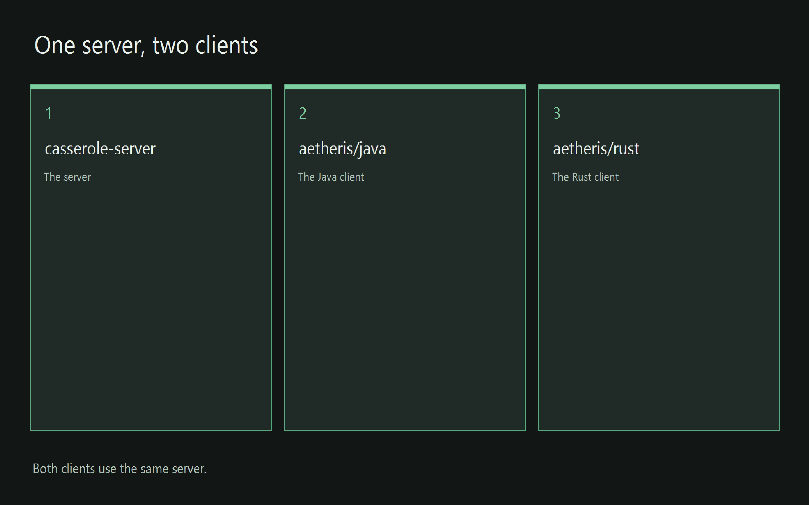

# Java Aetheris Client

This page is the Java Aetheris Client. The Java Aetheris Client is a Swing program. Swing is the Java library that draws the window, the menus, and the text. The window opens a Secure Shell connection to the Casserole Server. Secure Shell, written SSH, is the encrypted login a terminal uses to reach a host. The window then shows two surfaces that share that login. One surface is the terminal. The other surface is the canvas, the card-based conversation beside the terminal.

Start the Casserole Server before the Java Aetheris Client. The Casserole Server is the process that accepts the login. The Casserole Server page is [Casserole Server](../../casserole-server/README.md). The root page is the steps for the whole product. Those steps take about thirty minutes from a fresh clone. The page is the [root page](../../README.md). The introduction on that page says what Casserole is, what Aetheris is, and what the sovereign desktop means.

The Java source is one project at the repository root. This page is the Java Aetheris Client. The Java Aetheris Client and the Casserole Server share that project and the fat jar `app/casserole.jar`. A fat jar is the packaged program that already contains its runtime libraries. The start script is `app/start-aetheris`. It calls the shared Java toolchain at the repository root, then starts the Java Aetheris Client. It does not pull Ollama. The repository root is the folder that contains `pom.xml`.

The behavior the Java Aetheris Client must match is written with the source. The window class lives in [org.casserole.app.ui.ssh](../../docs/specs/java/org/casserole/app/ui/ssh/ssh.spec.md). The Swing drawing package is [org.aetheris.swing](../../docs/specs/java/org/aetheris/swing/swing.spec.md). That package paints the window and the canvas beside the terminal. Those pages, in [docs/specs/](../../docs/specs/), are the specifications for the Java Aetheris Client, and they are the source for a later enhancement of the Java Aetheris Client. [The index](../../docs/specs/semantic-key-index.md) lists every requirement and the source lines that cite it. [docs/specs/README.md](../../docs/specs/README.md) is the entry page for that directory. The build version of this tree is on the [root page](../../README.md).

The class that opens the window is [SshClientApp](../../src/main/java/org/casserole/app/ui/ssh/SshClientApp.java). The file lives in the one Java tree. The Maven module file is [pom.xml](../../pom.xml). Maven is the Java build tool. Maven reads that file to compile the module, run its tests, and package the jar. A jar is the packaged Java program. The shell log configuration is [log4j2-shell.properties](../../src/main/resources/log4j2-shell.properties). The window icon is [aetheris.jpg](../../src/main/resources/icons/aetheris.jpg).



*The Java Aetheris Client is the second card. The steps below build and start that card.*

## The locked head

The locked head is the run of canvas cards you lock so those turns stay at the start of every request the Casserole Server sends to a model. A turn is one stored message. The Java Aetheris Client draws the lock as a small padlock on the far left of the card's button bar, after the label that names the turn. A vertical divider sits between the padlock and the letters I, E, P, and O.

The letter I marks the card as included. The letter E marks the card as excluded. The letter P sends the prompt only. The letter O sends the reply only. The padlock does not change those four letters. The part of the card that its letter already sends is the part that stays in the locked head.

The padlock is grey, and the shackle is open, while the card is unlocked. The padlock is green, and the shackle is closed, while the card is locked. The Java Aetheris Client draws the padlock only when `casserole.chat.head-count` is greater than `0` and the card is one of the cards that count allows. The count is how many cards, from the top of the canvas, may be locked. A card you have excluded is skipped by that count. A press on the next open padlock in that run locks the card. A press on the last locked padlock unlocks that card. Any other press in the run leaves the locks as they stand. The locked cards stay a packed prefix. A packed prefix is the first eligible cards in order, with no unlocked card between them. Excluding a locked card drops that lock.

A language model gives more of its attention to the start of the text it reads and to the end of that text. The middle of a long text receives less of that attention. An attention head is one parallel reading the model makes over the same text. Those readings gather at the two edges. You lock a card when that turn is an invariant you want the start of the request to keep. An invariant is a turn that must still be present when the model answers. The locked start stays the same from one request to the next until you change the locks. A model service that keeps a prefix cache can reuse the computation it already did for that unchanged start. The prefix cache is that saved computation. The newest turns fill the other edge. Those newest turns are the part that changes.

The Reichenbach sink is the part of Roux that fits the request to a token allowance. Roux is the paged memory on the Casserole Server that holds the conversation. A token is the unit a model uses to measure text. The allowance is the value `casserole.chat.managed-tokens` in the Casserole Server file `application.yaml`. On each request the sink measures the locked turns and subtracts that measure from the allowance. It then fills the remainder from the newest turns that still fit as whole turns. You set the allowance once. The size of that newest run changes by itself.

A turn is sent as a whole turn, or it is left off that request. The text of a turn is not cut short to make the turn fit. Your line and the reply that follows it stay one pair. When that pair does not fit in what remains, the sink leaves the pair out and stops adding older turns. A turn left off the request stays in Roux. The card stays on the canvas. Roux may move a full page of turns from memory onto disk when the page no longer fits in memory. The page keeps a pointer. A pointer is the address the Casserole Server uses to read that page back. The record keeps the turn. The sink does not replace a turn with a summary. In the terminal, `message list` still lists the turn. `message show <seq>` still prints it. `seq` is the turn's number.

The sink chooses this slice only when the allowance is greater than `0` and at least one turn is locked. The Casserole Server page names the two keys, the value `0` that turns the selection off, and the terminal commands that lock a turn. That page is [The Reichenbach sink](../../casserole-server/README.md#the-reichenbach-sink) on the Casserole Server page.

## Fast path

[app/start-aetheris.ps1](../../app/start-aetheris.ps1) on Windows and [app/start-aetheris.sh](../../app/start-aetheris.sh) on Linux are the start scripts for the Java Aetheris Client. A start script is designed to check the environment, check the pre-build, build, bind and install, and run the Java Aetheris Client in one operation. Check the environment selects the Java toolchain. Check the pre-build prints the tools on one screen. Build compiles the Java Aetheris Client. Bind and install places the jar in the app folder the start launches. The goal is to get you up and running fast. Run the start from the repository root after the Casserole Server is up. The Casserole Server is up when its terminal still shows `casserole-server 0.0.1-SNAPSHOT`, the log is still printing, and port `2222` is open on this machine. `0.0.1-SNAPSHOT` is the build identifier of the Casserole Server. Port `2222` is the SSH port the Casserole Server opens. Start that process from the Casserole Server page.

If that start runs into trouble, walk the checklist in this section, one script at a time. The commands are the same commands the numbered sections run. The numbered sections quote the finished line and the failed line beside each command. Match the window to the quote after each script. The finished lines to recognize are `java-env ready`, the installed line, and `aetheris-java 0.0.1-SNAPSHOT`.

The toolchain script is finished when the window shows a line beginning `JAVA_HOME=` and then the line `java-env ready`. `JAVA_HOME` is the folder where the JDK is installed. A JDK is the Java development kit the Java Aetheris Client is built with. The line `java-env ready` means the script finished and that JDK is the one later commands will use. If the window says `Maven is not on PATH`, Maven is missing. Install Apache Maven 3.9 or newer, open a new terminal, and run that script again.

The install script is finished when the window shows `casserole installed to app`. The fat jar is then `app/casserole.jar`. There is no `app/lib`. A test failure stops the script and prints the module name. Fix that test and run the install again. The start script is finished when the window shows `aetheris-java 0.0.1-SNAPSHOT` and the Java Aetheris Client window opens. `0.0.1-SNAPSHOT` on that line is the build identifier of the Java Aetheris Client. Connect to `localhost` port `2222` and sign in as the user `admin` with the password `demo-admin`. `localhost` means this same machine.

Windows 11, from the repository root. The scripts are [bin/java-env.ps1](../../bin/java-env.ps1), [bin/install.ps1](../../bin/install.ps1), and [app/start-aetheris.ps1](../../app/start-aetheris.ps1).

```powershell
powershell -File bin\java-env.ps1
powershell -File bin\install.ps1
powershell -File app\start-aetheris.ps1
```

Linux, from the repository root. The scripts are [bin/java-env.sh](../../bin/java-env.sh), [bin/install.sh](../../bin/install.sh), and [app/start-aetheris.sh](../../app/start-aetheris.sh).

```bash
source bin/java-env.sh
bash bin/install.sh
bash app/start-aetheris.sh
```

Source means the shell runs the file and keeps the values the file set.

## IntelliJ IDEA

Use this section when you want the editor window before you run a script. Open the root [pom.xml](../../pom.xml) and let IntelliJ import the Maven project. The `.idea` directory stays on the machine and is not part of this repository. The run configuration Aetheris Java Shell starts [SshClientApp](../../src/main/java/org/casserole/app/ui/ssh/SshClientApp.java) on the `casserole` module. The working directory of that configuration is the repository root. Start Casserole Server first, then start this configuration.

The one module compiles the tree, so a gutter run of [CasseroleApplication](../../src/main/java/org/casserole/CasseroleApplication.java) stays on `casserole`. The gutter is the margin beside a source line, where the IDE offers to run the class on that line. The roster [users.yaml](../../src/main/resources/users.yaml) is on that classpath. A roster is the list of names and passwords the SSH login accepts. The example [application.yaml](../../src/main/resources/application.yaml) is on that classpath as well. The fuller account is on the [root page](../../README.md#intellij-idea).

## Windows 11

Run these commands from the repository root, the folder that contains [pom.xml](../../pom.xml). These numbered sections are the checklist. Use them when [app/start-aetheris.ps1](../../app/start-aetheris.ps1) or [app/start-aetheris.sh](../../app/start-aetheris.sh) runs into trouble. The Casserole Server should already be listening before the last step.

### 1. Toolchain

The toolchain script is the first command, because the install that follows wants a JDK it can name.

```powershell
powershell -File bin\java-env.ps1
```

[bin/java-env.ps1](../../bin/java-env.ps1) prints a line beginning `JAVA_HOME=` and then the line `java-env ready`. A `JAVA_HOME` that already names a Java 26 JDK stays. An older JDK is set aside, and the script selects a JDK 26. When no JDK 26 is already on the machine, the script fetches Azul Zulu 26. Azul Zulu 26 is the JDK build the script downloads. The download is a JDK, because Maven compiles with `javac`. The script places that JDK's `bin` at the front of `PATH`.

> **What appears**
>
> A line `JAVA_HOME=` followed by a JDK 26 folder, then the line `java-env ready`.

> **Failed line**
>
> `Maven is not on PATH` means Maven is missing.

Install Apache Maven 3.9 or newer and run the command again. The install script loads the toolchain in its own window, so a new PowerShell can run the install directly.

### 2. Build and install

```powershell
powershell -File bin\install.ps1
```

[bin/install.ps1](../../bin/install.ps1) runs Maven, then copies the fat jar to `app\casserole.jar`. A jar whose name contains `original` is not copied. There is no `app/lib`.

> **What appears**
>
> Maven's test and package log, then the line `casserole installed to app`.

That line confirms the copy into `app`.

> **Failed line**
>
> A test failure stops the script.

Fix the failure and run the install again. If the Java sources fail to compile, the build stops, because the one module compiles that tree. `casserole jar was not produced` means the build did not write the fat jar the copy expects. `casserole build failed` means the package step did not finish.

### 3. Start

```powershell
powershell -File app\start-aetheris.ps1
```

[app/start-aetheris.ps1](../../app/start-aetheris.ps1) prints `aetheris-java 0.0.1-SNAPSHOT` and opens the Java Aetheris Client window. It runs `java -Dloader.main=org.casserole.app.ui.ssh.SshClientApp -jar app/casserole.jar` with the repository root as the working directory. `loader.main` names the class PropertiesLauncher starts. Spring Boot is the framework that packages the fat jar. PropertiesLauncher is the Spring Boot class named in the fat jar manifest. The manifest start class stays [CasseroleApplication](../../src/main/java/org/casserole/CasseroleApplication.java). The class the window opens is [SshClientApp](../../src/main/java/org/casserole/app/ui/ssh/SshClientApp.java). If `app/casserole.jar` is absent, start runs the install, then opens the window. The installer still runs alone when you call it by itself. That call only installs. It does not pull Ollama. If the window cannot connect, start the Casserole Server and use port 2222. Sign in as the user `admin` with the password `demo-admin`. Import [demo/first-canvas.toon](../../demo/first-canvas.toon) after you are connected. The file is a version-1 canvas export with three cells. The cells are a hello, an air-gap question, and an empty next prompt. The vault file stays on your machine. The vault file is not in this repository.

## Linux

Open a terminal in the repository root, the folder that contains `pom.xml`. Source the toolchain so the shell keeps `JAVA_HOME`, then install, then start.

```bash
source bin/java-env.sh
bash bin/install.sh
bash app/start-aetheris.sh
```

[bin/java-env.sh](../../bin/java-env.sh) selects the JDK and prints `java-env ready`. [bin/install.sh](../../bin/install.sh) produces the same Maven result as the Windows install. The fat jar lands at `app/casserole.jar`. [app/start-aetheris.sh](../../app/start-aetheris.sh) prints `aetheris-java 0.0.1-SNAPSHOT` and opens the window.

> **Failed line**
>
> `Maven is not on PATH` means Maven is missing.

Source the toolchain in a new shell and run the command again. If `app/casserole.jar` is absent, start runs the install, then opens the window. It does not pull Ollama. Connect to `localhost` port `2222` as the user `admin` with the password `demo-admin`. Import [demo/first-canvas.toon](../../demo/first-canvas.toon) after you are connected.

## Dev path

From the repository root, with the toolchain loaded, this command runs the tests of the one Java module. It does not copy the fat jar into `app/`.

```powershell
mvn test
```

```bash
mvn test
```

The command uses [pom.xml](../../pom.xml). There is no second Java module to name. A JetBrains IDE imports that root POM.
