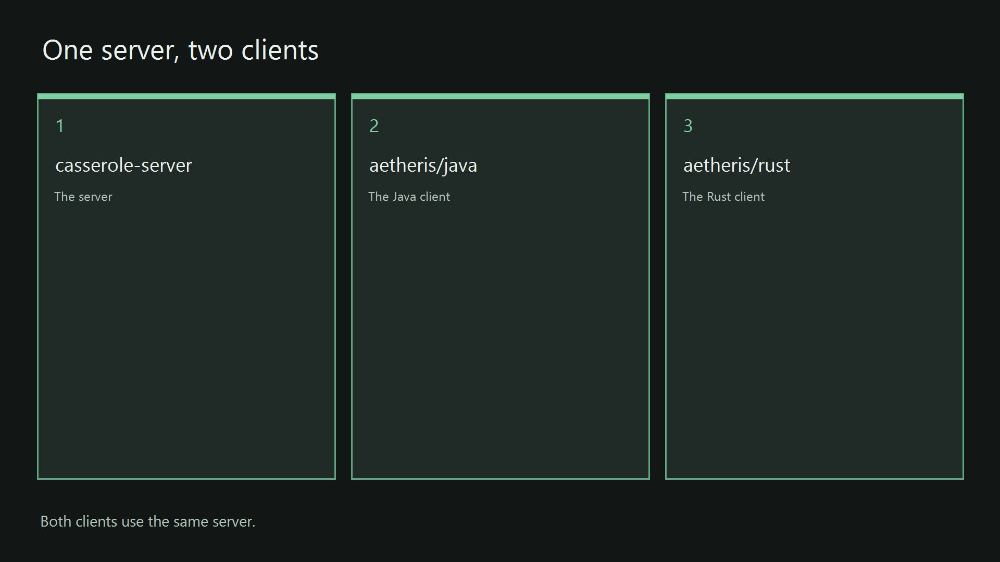

# aetheris/rust

This directory is the Rust desktop client. It opens a window, connects to the Casserole server with the same Secure Shell login the Java client uses, and shows the terminal and the canvas. Secure Shell, written SSH, is the encrypted login a terminal uses to reach a host. The canvas is the card-based conversation beside the terminal.

Start the server before this client. The server page is [casserole-server/README.md](../../casserole-server/README.md). The path for the whole product is the [root page](../../README.md). Those steps take about thirty minutes from a fresh clone. The introduction on that page says what Casserole is, what Aetheris is, and what the sovereign desktop means.

A silo is one project directory with its own build script, its own install script, and its own start script. This directory is the Rust client silo. It calls the shared Rust toolchain at the repository root, then does this client's work. The repository root is the folder that contains `pom.xml`.

The workspace file [Cargo.toml](Cargo.toml) names two crates. A crate is one Rust package. Cargo, the Rust build tool, compiles that package. [aetheris-term](aetheris-term/Cargo.toml) is the terminal library. [aetheris-client](aetheris-client/Cargo.toml) is the window. The binary you launch is the window crate.

The behavior this client must match is written with the source. The window crate is [aetheris-client](../../docs/specs/rust/aetheris/aetheris-client/aetheris-client.spec.md). The terminal library is [aetheris-term](../../docs/specs/rust/aetheris/aetheris-term/aetheris-term.spec.md). The window chrome is [chrome](../../docs/specs/rust/aetheris/aetheris-client/src/chrome.spec.md). The chrome is the frame around that terminal and that canvas. Those pages, in [docs/specs/](../../docs/specs/), are the specifications for this client, and they are the source for a later enhancement of this client. [The index](../../docs/specs/semantic-key-index.md) lists every requirement and the source lines that cite it. [docs/specs/README.md](../../docs/specs/README.md) is the entry page for that directory. The build version of this tree is on the [root page](../../README.md).

The binary starts at [main.rs](aetheris-client/src/main.rs). That file is the Rust file that contains the program entry point. The toolchain pin is [rust-toolchain.toml](rust-toolchain.toml). A pin is a file that names the exact Rust compiler this directory expects. The channel in that file is `1.99.1`. The root Rust script installs that channel when Cargo is missing.



*The Rust client is the third card. The steps below build and start that card.*

## The locked head

The locked head is the run of canvas cards you lock so those turns stay at the start of every request the server sends to a model. A turn is one stored message. This client draws the lock as a small padlock on the far left of the card's button bar, after the label that names the turn. A vertical divider sits between the padlock and the letters I, E, P, and O.

The letter I marks the card as included. The letter E marks the card as excluded. The letter P sends the prompt only. The letter O sends the reply only. The padlock does not change those four letters. The part of the card that its letter already sends is the part that stays in the locked head.

The padlock is grey, and the shackle is open, while the card is unlocked. The padlock is green, and the shackle is closed, while the card is locked. This client draws the padlock only when `casserole.chat.head-count` is greater than `0` and the card is one of the cards that count allows. The count is how many cards, from the top of the canvas, may be locked. A card you have excluded is skipped by that count. A press on the next open padlock in that run locks the card. A press on the last locked padlock unlocks that card. Any other press in the run leaves the locks as they stand. The locked cards stay a packed prefix. A packed prefix is the first eligible cards in order, with no unlocked card between them. Excluding a locked card drops that lock.

A language model gives more of its attention to the start of the text it reads and to the end of that text. The middle of a long text receives less of that attention. An attention head is one parallel reading the model makes over the same text. Those readings gather at the two edges. You lock a card when that turn is an invariant you want the start of the request to keep. An invariant is a turn that must still be present when the model answers. The locked start stays the same from one request to the next until you change the locks. A model service that keeps a prefix cache can reuse the computation it already did for that unchanged start. The prefix cache is that saved computation. The newest turns fill the other edge. Those newest turns are the part that changes.

The Reichenbach sink is the part of Roux that fits the request to a token allowance. Roux is the paged memory on the server that holds the conversation. A token is the unit a model uses to measure text. The allowance is the value `casserole.chat.managed-tokens` in the server file `application.yaml`. On each request the sink measures the locked turns and subtracts that measure from the allowance. It then fills the remainder from the newest turns that still fit as whole turns. You set the allowance once. The size of that newest run changes by itself.

A turn is sent as a whole turn, or it is left off that request. The text of a turn is not cut short to make the turn fit. Your line and the reply that follows it stay one pair. When that pair does not fit in what remains, the sink leaves the pair out and stops adding older turns. A turn left off the request stays in Roux. The card stays on the canvas. Roux may move a full page of turns from memory onto disk when the page no longer fits in memory. The page keeps a pointer. A pointer is the address the server uses to read that page back. The record keeps the turn. The sink does not replace a turn with a summary. In the terminal, `message list` still lists the turn. `message show <seq>` still prints it. `seq` is the turn's number.

The sink chooses this slice only when the allowance is greater than `0` and at least one turn is locked. The server page names the two keys, the value `0` that turns the selection off, and the terminal commands that lock a turn. That page is [The Reichenbach sink](../../casserole-server/README.md#the-reichenbach-sink).

## Fast path

[app/start.ps1](app/start.ps1) on Windows and [app/start.sh](app/start.sh) on Linux are the start scripts for this client. A start script is designed to check the environment, check the pre-build, build, bind and install, and run the client in one operation. Check the environment selects the Rust toolchain. Check the pre-build prints the tools on one screen. Build compiles the client. Bind and install places the binary in the app folder the start launches. The goal is to get you up and running fast. Run the start from the repository root when the server is already running. The server is up when its terminal still shows `casserole-server 0.0.1-SNAPSHOT`, the log is still printing, and port `2222` is open on this machine. Port `2222` is the SSH port the server opens. The client will ask for `localhost` and that port. `localhost` means this same machine.

If that start runs into trouble, walk the checklist in this section, one script at a time. The numbered sections repeat the scripts and put the finished lines beside them. Match the window to the quote after each script. The finished lines to recognize are `rust-env ready`, the installed line, and `aetheris-client 0.1.0`.

The toolchain script is finished when the window shows `rust-env ready` and a line that prints the Cargo version. `cargo is not on PATH after rustup` means the install landed and the current window cannot see Cargo yet. rustup is the installer that places the Rust compiler and Cargo on the machine. Open a new PowerShell and run the toolchain script again. The install script is finished when the window shows `aetheris-client installed to aetheris\rust\app`. On Windows the build reads `aetheris/java/src/main/resources/icons/aetheris.jpg`. A missing file stops the build. The start script is finished when the window shows `aetheris-client 0.1.0` and the client window opens. `0.1.0` is the version of the Rust client crate. The login is `localhost` port `2222`, user `admin`, password `demo-admin`.

Windows 11, from the repository root. The scripts are [bin/rust-env.ps1](../../bin/rust-env.ps1), [bin/install.ps1](bin/install.ps1), and [app/start.ps1](app/start.ps1).

```powershell
powershell -File bin\rust-env.ps1
powershell -File aetheris\rust\bin\install.ps1
powershell -File aetheris\rust\app\start.ps1
```

Linux, from the repository root. The scripts are [bin/rust-env.sh](../../bin/rust-env.sh), [bin/install.sh](bin/install.sh), and [app/start.sh](app/start.sh).

```bash
source bin/rust-env.sh
bash aetheris/rust/bin/install.sh
bash aetheris/rust/app/start.sh
```

Source means the shell runs the file and keeps the values the file set.

## IntelliJ IDEA

Open the root [pom.xml](../../pom.xml) so the Java modules and this Cargo workspace are in one project. The shared configuration [Aetheris Rust Client](../../.idea/runConfigurations/Aetheris_Rust_Client.xml) runs `cargo run --bin aetheris-client` with the working directory `aetheris/rust`. `--bin aetheris-client` names the window binary. Start the server first. The server and the Java client have their own configurations, described on the [root page](../../README.md#intellij-idea).

## Windows 11

Run these commands from the repository root. These numbered sections are the checklist. Use them when [app/start.ps1](app/start.ps1) or [app/start.sh](app/start.sh) runs into trouble. The server should already be listening before the last step.

### 1. Toolchain

```powershell
powershell -File bin\rust-env.ps1
```

[bin/rust-env.ps1](../../bin/rust-env.ps1) prints `rust-env ready` and a Cargo version. When Cargo is missing, the script installs rustup with toolchain `1.99.1` from [rust-toolchain.toml](rust-toolchain.toml).

> **What appears**
>
> The line `rust-env ready`, and a line that prints the Cargo version.

> **Failed line**
>
> `cargo is not on PATH after rustup` means the install landed and this window cannot see Cargo yet.

Open a new PowerShell and run the command again.

### 2. Build and install

The install is the release binary the start script launches. A release binary is the compiled program built for running. The dev build is a different script. [bin/build.ps1](bin/build.ps1) runs `cargo test`, then `cargo build -p aetheris-client`. `cargo test` runs the crate tests. `cargo build -p aetheris-client` compiles the window crate without copying a release binary into `app/`. Use install when you want the binary in `app/`.

```powershell
powershell -File aetheris\rust\bin\install.ps1
```

[bin/install.ps1](bin/install.ps1) loads the Rust toolchain, runs `cargo build --release -p aetheris-client`, and copies the release binary into `aetheris\rust\app`. `--release` tells Cargo to compile the binary you run.

> **What appears**
>
> A release build of `aetheris-client`, then the binary copied into `aetheris\rust\app`.

The line `aetheris-client installed to aetheris\rust\app` confirms the copy.

> **Failed line**
>
> A test failure or a compile error stops the script and names the crate.

`release build failed` means the release compile did not produce the binary. Fix the failure and run the install again. On Windows the build embeds [aetheris.jpg](../java/src/main/resources/icons/aetheris.jpg). [build.rs](aetheris-client/build.rs) reads that file. A missing JPEG stops the build. The binary name on Windows is `aetheris-client.exe`.

### 3. Start

```powershell
powershell -File aetheris\rust\app\start.ps1
```

[app/start.ps1](app/start.ps1) prints `aetheris-client 0.1.0` and opens the window. The binary's entry point is [main.rs](aetheris-client/src/main.rs). When the client binary is absent, start runs the install, then opens the window. Connect to `localhost` port `2222` as the user `admin` with the password `demo-admin`. Import [demo/first-canvas.toon](../../demo/first-canvas.toon) after you are connected. The file is a version-1 canvas export with three cells. The cells are a hello, an air-gap question, and an empty next prompt. The vault file stays on your machine.

## Linux

Open a terminal in the repository root, the folder that contains `pom.xml`. Source the Rust toolchain, then install, then start.

```bash
source bin/rust-env.sh
bash aetheris/rust/bin/install.sh
bash aetheris/rust/app/start.sh
```

[bin/rust-env.sh](../../bin/rust-env.sh) prints `rust-env ready`. [bin/install.sh](bin/install.sh) places the release binary in `aetheris/rust/app`. [app/start.sh](app/start.sh) prints `aetheris-client 0.1.0` and opens the window. The binary name on Linux is `aetheris-client`.

> **Failed line**
>
> Cargo is missing, or the window prints `cargo is not on PATH after rustup`.

Source [bin/rust-env.sh](../../bin/rust-env.sh) again in a new shell after rustup finishes, then run the install. `release build failed` means the release compile did not produce the binary. Connect to `localhost` port `2222` as the user `admin` with the password `demo-admin`. Import [demo/first-canvas.toon](../../demo/first-canvas.toon) after you are connected.

## Dev path

From `aetheris/rust`, this is the dev build. It runs the tests and compiles the client. It does not copy a release binary into `app/`.

```powershell
cargo test
cargo build -p aetheris-client
```

```bash
cargo test
cargo build -p aetheris-client
```

The workspace file is [Cargo.toml](Cargo.toml). The client package is [aetheris-client/Cargo.toml](aetheris-client/Cargo.toml). The script page for this project directory explains each script. It quotes the finished line and the failed line. The page is [bin/docs/README.md](bin/docs/README.md).
