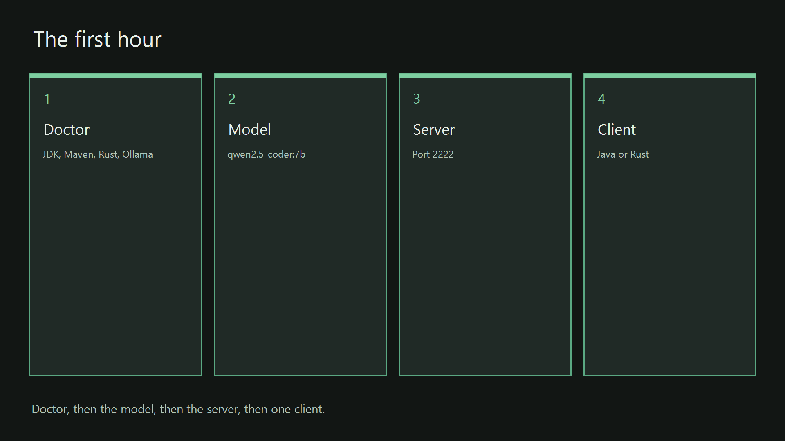

# Root scripts

These scripts prepare the machine and report what is already installed. They live in `bin/` at the repository root, the folder that contains [pom.xml](../../pom.xml). Maven, which is the Java build tool, reads that file when it builds the Java programs. These scripts do not build the server, and they do not build either client. They select the Java Development Kit and the Rust compiler, then print whether those tools, Maven, and Ollama are present. A JDK is the Java development kit, the set of tools that compile and run Java. Ollama is the program that runs a language model on this computer. That program is the local engine. A chat can also use the Grok API or Grok Build ACP via the pool. The Grok API is Grok's hosted programming interface. Grok Build ACP via the pool is Grok Build reached through its shared pool. The Aetheris client is the Sovereign Desktop in this repository. That client is the Java program or the Rust program. One client carries more than one conversation at the same time. Those conversations stay unified on that desktop. The desktop can use more than one of those models at the same time. Cargo is the Rust build tool.

A silo is one project directory with its own build script, its own install script, and its own start script. Each silo calls the scripts on this page, and then that silo does its own build, install, and start. The three script pages for those directories are linked below.

- [casserole-server/bin/docs/README.md](../../casserole-server/bin/docs/README.md)
- [aetheris/java/bin/docs/README.md](../../aetheris/java/bin/docs/README.md)
- [aetheris/rust/bin/docs/README.md](../../aetheris/rust/bin/docs/README.md)

The path that uses them in order, from a fresh clone through a running client, is the [root page](../../README.md). Those steps take about thirty minutes from a fresh clone. Opening the same tree in IntelliJ is [IntelliJ IDEA](../../README.md#intellij-idea) on that page.



*The pre-build check reports the tools. The model, the server, and the client are built by the project scripts linked above.*

## Fast path

The start script for each program is the convenience. It is designed to check the environment, check the pre-build, build, bind and install, and run that program in one operation. The goal is to get you up and running fast. The server start is [casserole-server/app/start.ps1](../../casserole-server/app/start.ps1) or [casserole-server/app/start.sh](../../casserole-server/app/start.sh). The Java client start is [aetheris/java/app/start.ps1](../../aetheris/java/app/start.ps1) or [aetheris/java/app/start.sh](../../aetheris/java/app/start.sh). The Rust client start is [aetheris/rust/app/start.ps1](../../aetheris/rust/app/start.ps1) or [aetheris/rust/app/start.sh](../../aetheris/rust/app/start.sh).

If a start runs into trouble, walk the checklist on the [root page](../../README.md#fast-path) and the sections on this page. This page is the environment and the pre-build part of that checklist. The block under this heading is that part, with nothing written between the commands. Compare the window with the quoted line after each script.

Windows 11, from the repository root. The scripts are [java-env.ps1](../java-env.ps1), [rust-env.ps1](../rust-env.ps1), and [pre-build-check.ps1](../pre-build-check.ps1).

```powershell
powershell -File bin\java-env.ps1
powershell -File bin\rust-env.ps1
powershell -File bin\pre-build-check.ps1
```

Linux, from the repository root. The scripts are [java-env.sh](../java-env.sh), [rust-env.sh](../rust-env.sh), and [pre-build-check.sh](../pre-build-check.sh).

```bash
source bin/java-env.sh
source bin/rust-env.sh
bash bin/pre-build-check.sh
```

Source means the shell runs the file and keeps the values the file set. The pre-build check is finished when the window shows the line `pre-build-check finished`.

## java-env

Run this script before any Java build, because the later scripts want a JDK they can name. [java-env.ps1](../java-env.ps1) and [java-env.sh](../java-env.sh) require Maven. When `JAVA_HOME` already names a JDK, on Windows or on Linux, that home is kept. `JAVA_HOME` is the folder where the JDK is installed. The script places that folder's `bin` directory on `PATH`, so the `java` command in this process is the JDK the variable names. A trailing slash on the `JAVA_HOME` folder is ignored.

When `JAVA_HOME` does not already name a JDK, the script looks for a Zulu 26 directory or a JDK 26 directory. When none is present, the script downloads Azul Zulu 26. Azul Zulu 26 is the JDK build the script downloads. On Windows the download lands under `%LOCALAPPDATA%\casserole\zulu26`. On Linux the download lands under `~/.local/share/casserole/zulu26`.

Windows:

```powershell
powershell -File bin\java-env.ps1
```

Linux. Source the script so the shell keeps `JAVA_HOME`.

```bash
source bin/java-env.sh
```

> **What appears**
>
> A line `JAVA_HOME=` followed by the JDK folder the script selected, then the line `java-env ready`.

The line `JAVA_HOME=` is the folder the script selected. The line `java-env ready` means the script finished. On Windows this script runs as its own process, so the `JAVA_HOME` it set ends when that process ends. A later install loads the toolchain again in its own window. On Linux you source the script, and the shell that sourced it keeps `JAVA_HOME` for the commands you type next in that same window.

> **Failed line**
>
> `Maven is not on PATH` means Maven is missing.

Install Apache Maven 3.9 or newer and open a new shell. The script sets the toolchain for the process that loaded it. Each project install loads the toolchain again.

## rust-env

The Rust client will not compile until Cargo can see the compiler this repository pins. [rust-env.ps1](../rust-env.ps1) and [rust-env.sh](../rust-env.sh) require Cargo. When Cargo is missing, the script installs rustup with toolchain `1.99.1`. rustup is the installer that places the Rust compiler and Cargo on the machine. A pin is a file that names the exact compiler a directory expects. The pin file is [aetheris/rust/rust-toolchain.toml](../../aetheris/rust/rust-toolchain.toml). The channel written in that file is the compiler the script installs when Cargo is missing.

Windows:

```powershell
powershell -File bin\rust-env.ps1
```

Linux:

```bash
source bin/rust-env.sh
```

> **What appears**
>
> The line `rust-env ready`, and a line that prints the Cargo version.

The line `rust-env ready` means the script finished and Cargo can see the pinned compiler.

> **Failed line**
>
> `cargo is not on PATH after rustup` means the install landed and this window cannot see it yet.

Open a new shell and run the script again.

## pre-build-check

The pre-build check is the screen you read before you spend a build. It does not install the product. It tells you which tool is already here. [pre-build-check.ps1](../pre-build-check.ps1) and [pre-build-check.sh](../pre-build-check.sh) load both toolchain scripts, then print one screen: JDK, Maven, Cargo, rustc, and Ollama. rustc is the Rust compiler that Cargo calls. When Ollama is present, the screen includes the output of `ollama list`, which is the list of models already pulled on this machine. When Ollama is missing, the last line names [casserole-server/bin/install-ollama.ps1](../../casserole-server/bin/install-ollama.ps1) and [casserole-server/bin/install-ollama.sh](../../casserole-server/bin/install-ollama.sh). Those scripts install the Ollama engine and pull an Ollama model. They do not install the Grok API or Grok Build ACP via the pool.

Windows:

```powershell
powershell -File bin\pre-build-check.ps1
```

Linux:

```bash
bash bin/pre-build-check.sh
```

> **What appears**
>
> A line for each tool, then the line `pre-build-check finished`.

The line `pre-build-check finished` means the screen is complete.

> **Failed line**
>
> A toolchain line says `missing`.

Run the matching env script, install the tool that line names, and run the pre-build check again.
