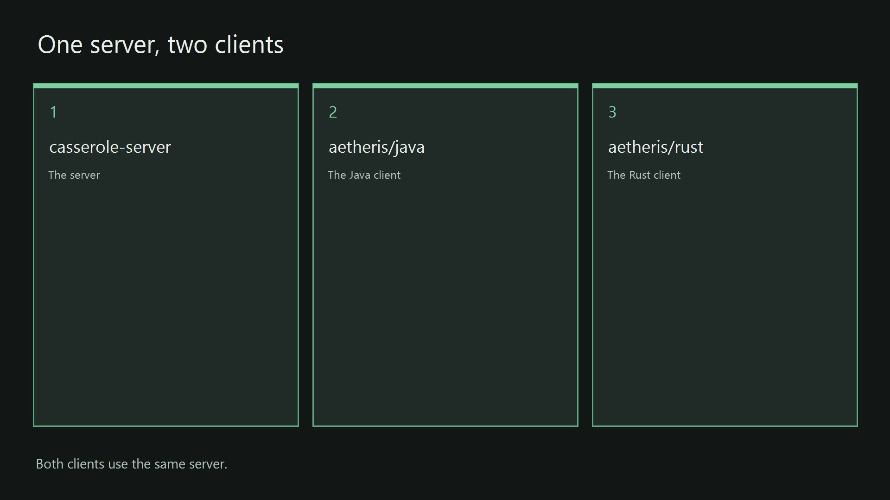

# casserole-server

This directory is the server. The server is the Java process both desktop clients share. It listens for a Secure Shell login. Secure Shell, written SSH, is the encrypted login a terminal uses to reach a host. The server keeps the conversation in paged memory, so a long session can spill to disk when it no longer fits in RAM. RAM is the memory the process holds while it is running. The server sends a reply to any supported integration. A supported integration is the Grok API, Grok Build ACP via the pool, or Ollama. The Grok API is Grok's hosted programming interface. Grok Build ACP via the pool is Grok Build reached through its shared pool. Ollama is a program that runs a language model on this computer. The Aetheris client is the Sovereign Desktop in this repository. That client is the Java program or the Rust program. One client carries more than one conversation at the same time. Those conversations stay unified on that desktop. The desktop can use more than one of those models at the same time.

This page is how you build the server and start it. The path for the whole product, including both clients, is the [root page](../README.md). Those steps take about thirty minutes from a fresh clone. The introduction on that page says what Casserole is, what Aetheris is, and what the sovereign desktop means.

A silo is one project directory with its own build script, its own install script, and its own start script. This directory is the server silo. It calls the shared Java toolchain at the repository root, then does the server's work. The repository root is the folder that contains `pom.xml`.

The behavior the server must match is written with the source, one package at a time. The server package is [org.casserole](../docs/specs/java/org/casserole/casserole.spec.md). The wire contract is [org.aetheris.wire](../docs/specs/java/org/aetheris/wire/wire.spec.md). The wire contract is the bytes a client and the server exchange. Reply layout is [org.casserole.format](../docs/specs/java/org/casserole/format/format.spec.md). Paged memory is [org.roux](../docs/specs/java/org/roux/roux.spec.md). The local model package is [org.casserole.ollama](../docs/specs/java/org/casserole/ollama/ollama.spec.md). Those pages, under [docs/specs/](../docs/specs/), are the specifications for this program, and they are the source for a later enhancement of this program. [The index](../docs/specs/semantic-key-index.md) lists every requirement and the source lines that cite it. [docs/specs/README.md](../docs/specs/README.md) is the entry page for that directory. The build version of this tree is on the [root page](../README.md).

Read the specifications when you want the behavior. The steps below are how you compile and launch the program that is supposed to match them. The class that boots the process is [CasseroleApplication](src/main/java/org/casserole/CasseroleApplication.java). The Maven module file is [pom.xml](pom.xml). Maven is the Java build tool. Maven reads that file to compile the module, run its tests, and package the jar. A jar is the packaged Java program. The roster is [users.yaml](src/main/resources/users.yaml). A roster is the list of names and passwords the SSH login accepts. The example configuration is [application.yaml](src/main/resources/application.yaml). [UserAccounts](src/main/java/org/casserole/config/UserAccounts.java) is the class that loads the roster.



*The server is the first card. The steps below build and start that card.*

## The Reichenbach sink

The Reichenbach sink is the part of the server that chooses which stored turns go out on the next request to a model. Roux is the paged memory that holds those turns. A turn is one stored message in the conversation. The sink runs inside Roux. Roux still keeps every turn. The sink only chooses the slice of that record that rides on one request.

A language model gives more of its attention to the start of the text it reads and to the end of that text. The middle of a long text receives less of that attention. An attention head is one parallel reading the model makes over the same text. Those readings gather at the two edges. The sink keeps the locked turns at the start, where that attention stays on the same text from one request to the next. The newest turns fill the end. The turns between those two edges can leave the request. They do not leave the record.

The locked head is the run of turns a person has locked. Those turns are the invariants. An invariant is a turn that must still be present when the model answers. The locked start stays in the same order until the locks change. A model service that keeps a prefix cache can reuse the computation it already did for that unchanged start. The prefix cache is that saved computation. The tail of the request is what changes. The tail is the newest turns that still fit.

The allowance is the value `casserole.chat.managed-tokens` in [application.yaml](src/main/resources/application.yaml). The value is a count of tokens. A token is the unit a model uses to measure text. On each request the sink measures the locked turns and subtracts that measure from the allowance. It fills the remainder from the newest stored turns, and it stops when the next whole turn would pass the allowance. You set the allowance once. That fill is how the window changes size on its own.

The request goes out in four parts, in this order. The system text stays first. The system text is the instruction kept at the front of the request. The locked head comes next. The newest turns that still fit come after the head. The line being sent now comes last. When the system text and the locked turns are already larger than the allowance, the sink still sends those turns and the line you are sending. It adds no older tail. The terminal then prints `The head is over the allowance.`

A turn goes out whole, or it stays off the request. The text of a turn is not cut short to make the turn fit. A person's line and the reply that follows it stay one pair. When that pair does not fit, the sink leaves the pair out and stops. A turn that stays off the request stays in Roux. The canvas still shows the card. Roux may move a full page of turns from memory onto disk when the page no longer fits in memory. The page keeps a pointer. A pointer is the address Roux uses to read the page back. `message list` still lists the turn. `message show <seq>` still prints it. `seq` is the turn's number. The sink does not replace a turn with a summary.

The sink selects only when `casserole.chat.managed-tokens` is greater than `0` and at least one turn is locked. Set `casserole.chat.managed-tokens` to `0` and the selection stays off. A missing `managed-tokens` key is the same as `0`. The request then keeps the turns the server would have sent without this selection.

`casserole.chat.head-count` is how many turns, from the top, may be locked. A public copy of this repository sets that key to `3` in the example [application.yaml](src/main/resources/application.yaml). Set the key to `0` and the server offers no locks. A missing `head-count` key is the same as `0`. With no locked turn, the sink does not select, even when the allowance is greater than `0`.

On the canvas, the padlock on a card is how you lock that card. The Java page is [The locked head](../aetheris/java/README.md#the-locked-head). The Rust page is [The locked head](../aetheris/rust/README.md#the-locked-head). In the terminal, `message lock <seq>` locks the next open turn in the allowed run. A lock that is accepted prints `locked` and the turn number. `message unlock <seq>` unlocks the last turn in the locked run. An unlock that is accepted prints `unlocked` and the turn number. A miss leaves the locks as they are.

A system turn prints `A system turn stays in the pin.` The pin is the system text kept at the front. A system turn is not a turn you lock. A turn past the allowed run prints a line that begins with `Seq ` and ends with ` is outside the eligible run.` A lock that would leave a gap prints `A lock keeps a packed prefix.` An unlock that is not the last locked turn prints `An unlock keeps a packed prefix.` A missing number on a lock prints `Usage: message lock <seq>`. A missing number on an unlock prints `Usage: message unlock <seq>`.

The provider's own context window stays a separate limit. The allowance is the budget this sink uses, and it is meant to sit inside that window. The sink does not raise the provider's window. Restart the server after you change [application.yaml](src/main/resources/application.yaml). The file is read when the process starts.

## Fast path

[app/start.ps1](app/start.ps1) on Windows and [app/start.sh](app/start.sh) on Linux are the start scripts for this server. A start script is designed to check the environment, check the pre-build, build, bind and install, and run the server in one operation. Check the environment selects the Java toolchain. Check the pre-build prints the tools on one screen. Build compiles the server. Bind and install places the jar in the app folder the start launches. The goal is to get you up and running fast. Run the start from the repository root, the folder that contains [pom.xml](../pom.xml).

If that start runs into trouble, walk the checklist in this section, one script at a time. The block under this heading is that checklist. You paste one line into the terminal, the PowerShell window or the shell window the text comes back into, and the script prints its result into that same window. A script is finished when the text in the window matches the line named below. The numbered sections below are these scripts, one at a time, with those lines quoted beside the command. A line you do not recognize belongs in the numbered section for that script, where the fix is written next to the failure line.

The toolchain script is finished when the window shows a line beginning `JAVA_HOME=` and a JDK 26 folder, then the line `java-env ready`. `JAVA_HOME` is the folder where the JDK is installed. JDK 26 is the Java development kit this server is built with. The line `java-env ready` means the script finished and that JDK is the one later commands will use. If the window says `Maven is not on PATH`, Maven is missing. Install Apache Maven 3.9 or newer, open a new terminal, and run the toolchain script again.

The model script is finished when Ollama finishes pulling `qwen2.5-coder:7b`. That name is the Ollama model the server calls when you do not name another Ollama model. The Grok API and Grok Build ACP via the pool stay available. On Windows, a path to `OllamaSetup.exe` means the script stopped so you can run the installer. Run that installer, open a new PowerShell, and run the model script again.

The install script is finished when the window shows `casserole-server installed to casserole-server\app`. The built jar is then in that `app` folder. If a test fails, the script stops and prints the module name. Fix that failure and run the install script again.

The start script is finished when the window shows `casserole-server 0.0.1-SNAPSHOT` and the server log, and the window stays open. `0.0.1-SNAPSHOT` is the build identifier of the server, the version string of the bits you just launched. The log staying open is the server, waiting for a login. Port `2222` is that login. The first start creates `hostkey.ser` in the working directory. `hostkey.ser` is the host key the SSH login uses. Leave that file where it is. Sign in as the user `admin` with the password `demo-admin`. The other accounts are on the [root page](../README.md#accounts).

Windows 11, from the repository root, in Windows PowerShell. Windows PowerShell is the PowerShell that Windows 11 ships. The scripts are [bin/java-env.ps1](../bin/java-env.ps1), [bin/install-ollama.ps1](bin/install-ollama.ps1), [bin/install.ps1](bin/install.ps1), and [app/start.ps1](app/start.ps1).

```powershell
powershell -File bin\java-env.ps1
powershell -File casserole-server\bin\install-ollama.ps1
powershell -File casserole-server\bin\install.ps1
powershell -File casserole-server\app\start.ps1
```

Linux, from the repository root. The scripts are [bin/java-env.sh](../bin/java-env.sh), [bin/install-ollama.sh](bin/install-ollama.sh), [bin/install.sh](bin/install.sh), and [app/start.sh](app/start.sh).

```bash
source bin/java-env.sh
bash casserole-server/bin/install-ollama.sh
bash casserole-server/bin/install.sh
bash casserole-server/app/start.sh
```

Source means the shell runs the file and keeps the values the file set.

## IntelliJ IDEA

Use this section when you want the editor window before you run a script. Open the root [pom.xml](../pom.xml) and import the Maven project. The shared configuration [Casserole Server](../.idea/runConfigurations/Casserole_Server.xml) starts [CasseroleApplication](src/main/java/org/casserole/CasseroleApplication.java) on the `casserole-server` module. The working directory is the module directory. The roster on the classpath is [users.yaml](src/main/resources/users.yaml). The classpath is the list of files Java searches while the process runs.

A gutter run can attach to `aetheris-java`, because that module compiles these sources as well. The gutter is the margin beside a source line, where the IDE offers to run the class on that line. The same roster and the same [application.yaml](src/main/resources/application.yaml) are on that module's classpath. Either click starts the server. The fuller account of the two modules is on the [root page](../README.md#intellij-idea). Point the Project SDK at a JDK 26 before the first run. Start the server, then start a client.

## Windows 11

Run these commands from the repository root, the folder that contains [pom.xml](../pom.xml). These numbered sections are the checklist. Use them when [app/start.ps1](app/start.ps1) or [app/start.sh](app/start.sh) runs into trouble, and compare the window with the quote after each script.

### 1. Toolchain

The toolchain script is the first command, because the install that follows wants a JDK it can name. [bin/java-env.ps1](../bin/java-env.ps1) requires Maven. When `JAVA_HOME` already names a JDK, that home is kept. Otherwise the script selects a JDK 26. When no JDK 26 is already on the machine, the script fetches Azul Zulu 26. Azul Zulu 26 is the JDK build the script downloads.

```powershell
powershell -File bin\java-env.ps1
```

> **What appears**
>
> A line `JAVA_HOME=` and a JDK 26 folder, then the line `java-env ready`.

> **Failed line**
>
> `Maven is not on PATH` means Maven is missing.

Install Apache Maven 3.9 or newer, open a new PowerShell, and run the command again. The install script loads this toolchain again in its own window. You can open a new PowerShell and run the install directly.

### 2. Local model

This step installs the local Ollama model. The server can also answer through the Grok API or through Grok Build ACP via the pool. The Sovereign Desktop carries more than one conversation at the same time. Those conversations stay unified. The desktop can use more than one model at the same time. [bin/install-ollama.ps1](bin/install-ollama.ps1) installs Ollama when it is missing, then pulls `qwen2.5-coder:7b` when you do not name another Ollama model.

```powershell
powershell -File casserole-server\bin\install-ollama.ps1
```

> **What appears**
>
> Ollama pulls `qwen2.5-coder:7b`.

> **Failed line**
>
> The script prints a path to `OllamaSetup.exe` and stops.

`OllamaSetup.exe` is the Windows installer for Ollama. Run that installer, open a new PowerShell, and run the same command again. A later model is a name on the same command: `powershell -File casserole-server\bin\install-ollama.ps1 llama3.2`.

### 3. Build and install

[bin/install.ps1](bin/install.ps1) runs the build, then copies the jar into `app/`.

```powershell
powershell -File casserole-server\bin\install.ps1
```

> **What appears**
>
> Maven's test and package log, then the line `casserole-server installed to casserole-server\app`.

The jar lands in `casserole-server\app\casserole-server.jar`. That installed line confirms the copy.

> **Failed line**
>
> A test failure stops the script and names the module.

Fix the failure and run the install again.

### 4. Start

Leave this window open. The log in it is the server the clients will find. [app/start.ps1](app/start.ps1) prints the build identifier, loads the toolchain, and runs the jar with the repository root as the working directory. No production release is cut, so the script prints the build identifier of the bits you are starting.

```powershell
powershell -File casserole-server\app\start.ps1
```

> **What appears**
>
> The line `casserole-server 0.0.1-SNAPSHOT`, then the server log.

The first start creates `hostkey.ser` in the working directory. That file stays on this machine. When `casserole-server.jar` is absent, start runs the install, then starts the server. If port 2222 is already taken, another process is already listening there. Stop that other listener and start again.

### 5. Air gap

An air gap, on this product, is a switch in the operator's home configuration. When the switch is on, the server refuses a model target that is not on this machine. The local model still answers. [aetheris.yaml](../aetheris.yaml) sets `network.air-gap` to `true`. The server does not read that sample in place. It reads the copy in your home directory.

```powershell
Copy-Item aetheris.yaml "$env:USERPROFILE\.aetheris.yaml"
```

`Copy-Item` writes the sample to `%USERPROFILE%\.aetheris.yaml`, which is the home file the server reads. Restart the server. A cloud target is refused, and the local model still answers. Turn the air gap off by setting `air-gap: false` in that home file and restarting. The value stored on a card stays as you left it. Ollama, the Grok API key, and the pool address are [Model settings](#model-settings).

## Linux

Open a terminal at the repository root, the folder that contains `pom.xml`. Maven reads that file to build the Java programs. In that same terminal, run `source bin/java-env.sh`. One of the values that file sets is `JAVA_HOME`, the folder where JDK 26 is installed. A terminal you open later has an empty `JAVA_HOME` until you source the file again in that new terminal. After that, the steps are the Windows 11 steps, in the same order. The files are the `.sh` scripts. Run the toolchain file with `source`. Run the rest with `bash`. The finished lines are the same text.

### 1. Toolchain

```bash
source bin/java-env.sh
```

[bin/java-env.sh](../bin/java-env.sh) keeps an existing `JAVA_HOME` when it names a JDK, and otherwise selects JDK 26. It prints `JAVA_HOME=` and `java-env ready`. The script downloads Azul Zulu 26 when it cannot find a JDK 26.

> **Failed line**
>
> `Maven is not on PATH` means Maven is missing.

Install Maven 3.9 or newer, open a new shell, and source the script again.

### 2. Local model

```bash
bash casserole-server/bin/install-ollama.sh
```

[bin/install-ollama.sh](bin/install-ollama.sh) installs Ollama if it is missing, then pulls `qwen2.5-coder:7b`. A chat can also use the Grok API or Grok Build ACP via the pool. The Sovereign Desktop carries more than one conversation at the same time. Those conversations stay unified. The desktop can use more than one model at the same time. A later model is a name on the same command: `bash casserole-server/bin/install-ollama.sh llama3.2`.

> **Failed line**
>
> The engine install needs a network and permission to install.

After the engine is installed, run the script again. A failed pull throws `ollama pull failed`.

### 3. Build and install

```bash
bash casserole-server/bin/install.sh
```

[bin/install.sh](bin/install.sh) produces the same Maven result as on Windows. The jar lands in `casserole-server/app/casserole-server.jar`. The line `casserole-server installed to casserole-server\app` confirms the copy.

> **Failed line**
>
> A test failure stops the script and names the module.

Fix the failure and run the install again.

### 4. Start

```bash
bash casserole-server/app/start.sh
```

[app/start.sh](app/start.sh) prints `casserole-server 0.0.1-SNAPSHOT` and the server log. The server listens on port 2222. The first start creates `hostkey.ser` in the working directory. When the jar is absent, start runs the install, then starts. If port 2222 is already taken, stop the other listener and start again.

### 5. Air gap

```bash
cp aetheris.yaml "$HOME/.aetheris.yaml"
```

`cp` writes the sample to `$HOME/.aetheris.yaml`, which is the home file the server reads. Restart the server. A cloud target is refused, and the local model still answers. Ollama, the Grok API key, and the pool address are [Model settings](#model-settings).

## Model settings

The example configuration is [application.yaml](src/main/resources/application.yaml). The same keys sit on the Java client module at [application.yaml](../aetheris/java/src/main/resources/application.yaml). The casserole process reads the copy on its own classpath. The **Casserole Server** configuration uses the server module. A jar from [bin/install.ps1](bin/install.ps1) or [bin/install.sh](bin/install.sh) carries the server copy from that build. Edit that file. Build again when you start from the jar. Restart the server after that build. The three blocks below are Ollama, the Grok API, and the pool.

### Ollama

Ollama is the program that runs a language model on a computer. The server calls it over HTTP. The published example uses this machine.

```yaml
spring:
  ai:
    ollama:
      base-url: http://localhost:11434
      init:
        pull-model-strategy: never
      chat:
        model: qwen2.5-coder:7b
        options:
          model: qwen2.5-coder:7b
          num-ctx: 8192
```

`base-url` is the Ollama address. `http://localhost:11434` is Ollama on this machine, on port `11434`. `pull-model-strategy` set to `never` means the server does not download a model when it starts. The checklist script pulls `qwen2.5-coder:7b`. `chat.model` is the model name. `chat.options.model` is the same name. Keep the two names the same. `num-ctx` is the context length sent on an Ollama request. The published example is `8192`. Restart the server after you edit this block. When Ollama runs on another machine, set `base-url` to that machine. An example is `http://192.0.2.20:11434`.

### Grok API

The Grok API is Grok's hosted programming interface. A card whose family is Grok uses this key. A pool card does not use this key.

```yaml
casserole:
  grok:
    api-key: your-grok-api-key
```

`your-grok-api-key` is the placeholder. Replace it with your own key. A blank value is a miss. The server then reads the environment variable `XAI_API_KEY`. A miss there reads the file `~/.aetheris/grok.key`. A miss there reads the file `~/.casserole/grok.key`. The first value found is the token. The token is not written to the log. The chat request is `POST https://api.x.ai/v1/chat/completions`. The header is `Authorization: Bearer` and the token. The model list is `GET https://api.x.ai/v1/language-models`. Restart the server after you change the key in this file. A local pool child is started without `XAI_API_KEY`. The pool does not send this key.

`casserole.grok.context-windows` is the map of context sizes shown for a Grok model id. A missing id stays unreported. The pool does not use that map.

### Pool

The pool is Grok Build reached through a shared agent. A blank host keeps a local agent that casserole starts. A set host dials an agent you started on another machine. The Windows command and the Linux command for that second case are [Remote Grok agent](../README.md#remote-grok-agent) on the root page.

```yaml
casserole:
  pool:
    host: ""
    port: 0
    secret: ""
    context-window: 256000
```

An empty `host` is the local agent. Casserole starts `grok agent stdio` for that case. You do not start it yourself. A host such as `192.0.2.10` dials `ws://192.0.2.10:2419/ws` when `port` is `0`. The same URL is used when `port` is `2419`. A port below 1 or above 65535 is read as `2419`. `secret` is the token the agent was started with. A blank secret sends no `Authorization` header. `context-window` is the context size shown for a pool card. The published example is `256000`. The desktops read that number. They ignore the host, the port, and the token. Restart the server after you change the host, the port, or the token.

The home file still governs the air gap. That file is `%USERPROFILE%\.aetheris.yaml` on Windows. On Linux it is `$HOME/.aetheris.yaml`. Set `air-gap` to `false` under `aetheris.network` when a pool turn may leave this machine. A missing key is a refusal. The turn answers `air-gap`. The copy steps and the agent commands are [Remote Grok agent](../README.md#remote-grok-agent). The air-gap sections above still copy the sample that sets the switch on.

## Dev path

From the repository root, with the toolchain loaded, this command runs the server tests without packaging the jar.

```powershell
mvn -pl casserole-server -am test
```

```bash
mvn -pl casserole-server -am test
```

`-pl casserole-server` names this module. `-am` builds the modules this module needs. The command uses [pom.xml](pom.xml) through the root [pom.xml](../pom.xml). Personal IDE files stay on your machine. The shared configuration stays in the tree.

The script page for this project directory explains each server script. It quotes the finished line and the failed line. The page is [casserole-server/bin/docs/README.md](bin/docs/README.md). The root script page, for the shared JDK and Rust toolchain, is [bin/docs/README.md](../bin/docs/README.md).

The example [application.yaml](src/main/resources/application.yaml) sets `casserole.grok.api-key` to `your-grok-api-key`. The SSH password in that file stays empty. Ollama, the Grok API key, and the pool address are [Model settings](#model-settings). The keys `casserole.chat.managed-tokens` and `casserole.chat.head-count` in that file are explained under [The Reichenbach sink](#the-reichenbach-sink). When a roster file is present, sign-in uses the roster. Logging for the server process is [log4j2.properties](src/main/resources/log4j2.properties). The way to add or remove a user is on the [root page](../README.md#accounts). [demo/first-canvas.toon](../demo/first-canvas.toon) is a version-1 canvas export with three cells. Import it from the client after you are connected. The cells are a hello, an air-gap question, and an empty next prompt. The vault file itself stays on your machine. It is not in this repository.
