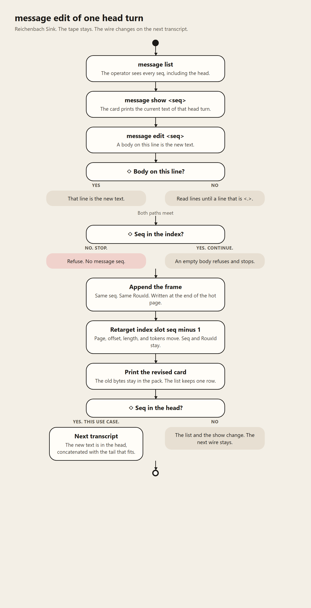

# Roux

[Server](server.spec.md). [Index](../common.spec.md). [Rust client and the desk](rust.spec.md).

## What stays out

**Intent**
Extend the ROUX (Roo) paged memory manager with a protected-head + Reichenbach-fall spill pattern. The goal is deterministic, reversible eviction of context without compaction, while preserving a region whose contents remain fixed relative to the attention geometry of the window unless the user explicitly changes them.

**Attention Principle (Leveraged)**
Models assign the strongest attention to the head and the tail of the context window. The head functions as the frame: it supplies the preconditions, constraints, and standing rules that shape everything that follows. The tail holds the live, fluctuating state of the current turn. The middle receives the weakest attention and is the region most subject to degradation or loss.

This architecture treats that geometry as a design constraint rather than a limitation. The protected head is placed where attention is strongest and most stable so that whatever is locked there continues to govern the session. The fuzzy middle is placed where attention is weakest so that content there may be relocated with the least semantic cost. The tail remains the active edge.

**Fuzzy Middle**
Everything between the protected head and the live tail is the fuzzy middle.
This is the only region eligible for spill.
Because it sits where attention is weakest, content here may be relocated without corrupting the frame or the live edge, provided its pointers remain intact.

**Reichenbach Fall**
When head pressure or window limits require eviction, content in the fuzzy middle undergoes a Reichenbach fall.
The fall is a gradient, not a cliff:
- Content slides toward a defined barrier that sits immediately below the protected head.
- Upon hitting the barrier it is spilled to disk (or the configured spill store) with full pointer metadata.
- The spill is relocation, not deletion. Each spilled block carries a return address (pointer index) that allows deterministic rehydration.

The fall is reversible. Any spilled block may be rolled back into the fuzzy middle (or higher) by pointer, on demand, without reconstruction or summarization.

**Spill Contract**
- Spill target is always the fuzzy middle.
- Protected head is never a spill source and is never modified by the paging mechanism.
- Only an explicit user operation may alter the protected head.
- Tail remains live and is the last region to be considered for any eviction.
- No stop-the-world compaction is permitted. Eviction is a pointer move only.
- Crash recovery must restore the protected head from its durable form and re-attach any in-flight spill pointers so the fall can be resumed or rolled back cleanly.

**Layer Placement**
Implement the protected-head barrier and Reichenbach-fall logic in ROUX layer two, above the basic head/tail spill already working.
The barrier is a hard wall in the eviction path; the fall is the only legal way content leaves the active window.

# Reichenbach Sink pre-plan 001

- **State:** sketch. Filed. The formal plan is not stamped. Java is not written. Rust is not written.

- **Source:** `reichenbach-sink.draft.001.md`. The headings are the behavior. Where this page is thinner, the serial wins.

- **What it is:** the sketch the Sink plan is cut from. One class. Two doors. One packed prefix.

- **What it is not:** the plan. The crate. An F-number. A license to write code. A second memory engine.

## 2. What this build is

One package-private class, `ReichenbachSink`, in `org.roux`. `ChatSession.buildPrompt` calls it for the SSH tape. `AmwpFacade` calls it on the assembled list before `holdRoux` and before the provider call. Both clients keep sending the working set they send today. The host trims.
**semantic-key:** PK-701
**semantic-key:** PK-701
**semantic-key:** PK-701

## 2. What this build is

The sink selects only when `managed-tokens` is set and a head is designated. Otherwise the walk and the bars stay as they are today.

The head on both doors is a packed prefix. Zero locks means that send has no head. A shorter prefix than `head-count` is still a head. The locked turns ride in ascending order after the system pin. The tail is the newest whole atoms that fit. The walk stops at the first atom that does not. The live line is charged before that tail, and it rides.

## 3. What stays

`windowIds` keeps its signature and stays the walk when the sink is not selecting. `chat.max-messages` is passed only into that walk. The manifest stays 112 bytes. `head.yaml` is not `clip.bin`. The clip-range floor is retired. That page stays the filed history. A build does not stack a floor seq on the designated head.

## 4. The sketch

| ID | Work | Serial seat |
|---|---|---|
| RS-01 | Lines `managed-tokens` and `head-count` on the session facts, beside `num-ctx`. Absent or `0` means unset. Both decoders ignore a line they do not know. | Head count config, Unset size, Rust bar |
| RS-02 | `head.yaml` version 1, fields `count` and `seqs`, beside `manifest.bin`. Temp file and move. An empty list means no head. The list is the packed prefix. | Side file |
| RS-03 | `ReichenbachSink` selects in this order: system pin, designated head ascending, live line, then whole tail atoms. Stop at the first atom that does not fit. | Two call sites, System pin, Tail fit, Live line, Head order |
| RS-04 | The gate. Size set and a head designated, or the caller keeps today's walk. | Unset walk, Head default, Unset size |
| RS-05 | A designated head returns `replaceTranscript` before the clear. The sink never reads `moodPins`. The word `head` stays the splice seat. | Mood clear, Mood pin word |
| RS-06 | The Java inspector calls the same class. The heatbar has the three bands. The numerator is the sink's sum while the sink is selecting. | Three surfaces, One counter |
| RS-07 | The Rust inspector paints from a private reading of the same rule. That reading supplies the numerator while the sink is selecting. The send stays the working set. | Rust bar |
| RS-08 | The canvas lock sits beside the letter. The vault stores it. Execute writes `head: true` for each locked cell already in the working set. Excluded stays out. | Canvas gesture, Canvas record, Working set |
| RS-09 | `message lock <seq>` and `message unlock <seq>`. `message list` and `messages` show the eligible rows and the locks. A miss returns a yellow error and changes nothing. | SSH lock |
| RS-10 | `message edit <seq>`. The end tag is `<.>`. The frame is appended. Slot `seq - 1` moves. The lock stays. The edit does not send. | Edit command, Edit end, Edit of a head turn, Dead page |
| RS-11 | Order: assemble, then the sink when it is selecting, then encode, then `AmwpCodec.fits`. A miss keeps the mood triple. | Channel cap |
| RS-12 | The canvas sink drops omitted turns before `holdRoux`. The SSH sink is a read filter. | Two regions |
**semantic-key:** PK-702
**semantic-key:** PK-702

## 4. The sketch

The plan cuts the proofs. This is the order.

1. Unset size, or zero locks: the walk and the bars stay as they are today.
2. Size set and no head: the denominator is `managed-tokens`. The walk stays today's walk.
3. The sink selecting: pin, packed head, live line, whole tail atoms. The crossing atom stays off.
4. Pin and head over the allowance: the historical tail is empty, the live line rides, and the console says the head is over the allowance.
5. `message lock` and `message unlock` keep a packed prefix. A hole, a system turn, a missing seq, and a seq outside the eligible run return a yellow error and change nothing.
6. `message edit` appends a frame, retargets slot `seq - 1`, and leaves the lock as it is. The prior bytes stay in the pack.
7. A canvas lock is a packed prefix of eligible cards from the top of the deck. An excluded card stays out. A locked card spends one of the count.
8. The Java inspector lists the sink transcript. `message list` still lists every stored turn.
9. One tape. The Rust inspector rows match the host list. The working set that leaves the Rust client stays that working set.

One class does the trim. The Rust function paints. A yaml key is not the managed size and is not the head count. `head.yaml` is not `clip.bin`. The lock is not a fifth letter. The manifest does not grow. The build does not add a public type. The build does not punch a page.

# Reichenbach Sink — draft serial 001

**What this file is:** The requirements and the shape of the Reichenbach Sink. The component that chooses the transcript sent on the wire.
**What it is not:** A page compactor, a second memory engine, or a license to build.
**Token:** `ReichenbachSink`
**Pre-plan:**
**Family:** Code. The realization language is Java. Rust stays.

# Reichenbach Sink — draft serial 001

The memorandum below is the nut, collected. The headings below it are the laws. The first sentence under a heading is the law. The quote under it is the receipt. The headings are frozen. A build waits for a stamped plan.

The tape is the Roux region. It stays append-only. In the VT100 console, `message list` and `messages` still list the whole conversation. `message show <seq>` still opens one turn, including a turn the provider will never see. Rolling the sketchpad is opening a seq. A new turn still appends at the live end. What was before that seq, and what is after it, stays on the tape.

The sink is the basin that chooses the wire. The lip is the line under the locked head. The transcript is the head concatenated with the tail that still fits. Every seq between those two has fallen past the lip. It stays listed. It stays showable. It stays off the wire. Casserole and Roux own that size. The operator keeps the managed window smaller than the provider context, so the provider is never the one who clips.

The head is a count of turns the operator designates. Those turns stay on every wire until the operator changes them. The pager has no writer there. The change is a console edit of one seq. The revised text is a new frame. The index row for that seq follows the new frame. The list keeps one row, and that row shows the current text. The previous bytes stay in the pack.

Page spill stays the motion that moves bytes. A hot page still moves into `pages.bin` when the next frame will not fit. The fall does not start a second spill, and it does not slide bytes toward a barrier inside a page. The return address is the seq.

## Attention geometry — frozen

The head and the tail are the spans a model attends, and the middle is the span it attends least.

> Models assign the strongest attention to the head and the tail of the context window. The middle receives the weakest attention.

## Wire — frozen

The transcript on the wire is the locked head concatenated with the tail that fits.

> only the head region and what can actually fit from the tail up with the content of the head concatted, is the transcript sent over the wire.

## Managed window — frozen

The operator sets that transcript smaller than the provider context.

> We can even define the allowed size for the middle and tail for a user-tunable experience on their notion of the size of a window is which can be a smaller managed region relative to the larger actual window to never encounter a context clipping scenario.

## Inspector — frozen

The Inspector shows only the transcript the sink will send, and it reads that list on the client.

## Head count config — frozen

The locked head is a count of turns set at config time, and that count is not a token size. The host reports it as the line `head-count` on the session facts beside `managed-tokens` and `num-ctx`. The client reads that line on connect. Absent or `0` means no count. That integer is the count both doors use.

> The number of turns the locked head is set to. Irrespective of token size. The user inserts context into these turns.

## Heatbar budget — frozen

The SSH heatbar and the canvas heatbar use the managed token size as the budget in the estimated-token calculation.

> This then is what is used in the SSH AND Canvas est token to budget calcs, instead of the chat window size like we do now.

## Provider window — frozen

The provider window stays a config fact, and the operator sets the managed size so it falls inside that allocation.

> The size of the api window is a factor of course in terms of config. But the user sets the window size typically to fall within the providers window space allocation in tokens.

## Head width — frozen

The locked head's token width is the content of those turns.

> The locked head can be of variable token width, it's dependent on the content it holds as to size.

## Head width duty — frozen

The user manages the token width of the locked head.

> The size can be arbitrary. It's up to the user to manage the token size of the locked turn region for the fixed head.

## Tail budget — frozen

The remainder of the managed size, after the head's token width, is the token budget that selects turns from the tail upward for the wire.

> The remaining allocated space for the managed frame is what is available on a token budget to determine which turns from the tail up are included in what is sent over the wire.

## Client clip — frozen

The client does not clip the transcript. The sink does.

> This way the client never manages the clipping to the sink, and we handle two birds with one hand.

## Two doors — frozen

One sink serves the SSH tape and the canvas push.

> two birds with one hand.

## SSH door — frozen

On the SSH tape, a turn the sink leaves off the wire stays in the region, and the pack persists it.

> In ssh, it spills to disk, for persistence.

## Canvas door — frozen

On a canvas push, a turn the sink leaves off the wire stays in the vault and is left out of the push.

> For canvas roux push, it spills to bit-bucket, since the conversation lives in the vault.

## Canvas lock — frozen

The canvas is where the user designates the locked turns for that vault, and the vault still shows every turn.

> We will have to define a way for a user to set the locked turns in the canvas, and canvas may show all the history as per the vault

## Canvas push — frozen

The sink trims the canvas list before `holdRoux` adds it, and the provider receives that trimmed list.

> when transcript is pushed to roux for push to the api provider, the sink kicks in and automatically sinks the earlier messages that won't fit into the bit-bucket, for canvas only, since it owns the push.

## No summary — frozen

The sink does not replace an omitted turn with a summary. The turn stays itself.

> No lost intent from compaction to summaries.

## Sovereign tape — frozen

The user owns the tape. An older turn enters the conversation when the user adds it through Aetheris.

> If user wants to add an older message, he can, via the app, user can explcitly control at any step in Aetheris what goes in the conversation. Then... no need for compaction. Being user is sovereign, they own the tape.

## Laminar flow — frozen

The sink selects as part of the read and as part of the push. No compaction pass runs.

> And no compaction hits.. it's pure automatic laminar flow baby!

## Head — frozen

The head is the turns the operator designates, and the count of those turns is the size the operator sets.

## Head lock — frozen

Those designated turns stay on every wire until the operator changes them.

## Pager — frozen

The paging mechanism leaves a designated head turn untouched.

> The paging and spill mechanisms themselves have no authority to alter, move, or evict anything in this region.

## Mood — frozen

After the head is designated, mood and the system prompt leave those seqs alone.

> Only an explicit user operation may alter the protected head.

## Edit — frozen

The operator changes the current text of one seq from the console.

> So a user will need to be able to modify a message from the console by message id.

## Edit frame — frozen

The revised text is a new frame, and the index row for that seq follows the new frame.

> Roux stays append only, we already can scroll back and forth by turn id, yes?

## Prior bytes — frozen

The previous bytes of an edited seq stay in the pack.

> The spill is relocation, not deletion.

## One row — frozen

The console list keeps one row for that seq, and that row shows the current text.

> we can list the entire conversation.

## Tail — frozen

The tail is the newest turns that still fit after the head, and a user line travels with its assistant reply.

> the tail turns are the most relevant.

## Tail last — frozen

The tail is the last span the sink drops when the allowance is spent.

> Tail remains live and is the last region to be considered for any eviction.

## Middle — frozen

Every seq between the designated head and the tail stays off the wire.

> Everything between the protected head and the live tail is the fuzzy middle. This is the only region eligible for spill.

## Reel — frozen

`message list` and `messages` still list every turn, and `message show <seq>` still opens any seq.

> in ssh mode in VT100 pane, we can list the entire conversation. This reichenbach pattern allows us to STILL list all messages, and view them via the console cmd's, but the active window is managed by teh reichenback logic as to what is ACTUALLY transmitted, the sizing and which turns are managed by Casserole and Roux.

## Sketchpad — frozen

Opening a seq is the roll of the tape, and a new turn appends at the live end.

> The middle acts like an old school sketchpad with a roll on each side. where you can roll in one direction, and slide a certain section pf the paper/tape in view and add to it or whatever. You can roll in either direction what was before and after are always there, viewable etc

## Page spill — frozen

A page moves into the pack when the next frame will not fit, and the sink does not start a second spill.

> above the basic head/tail spill already working.

## Compaction — frozen

The sink does not compact, summarize, or delete a turn.

> No compaction hit, we care about locking the invariants in the fixed head region. No stop-the-world compaction is permitted. Eviction is a pointer move only.

## Durable head — frozen

The head count and the designated seqs persist in a side record on the region, and the manifest stays 112 bytes.

> The size of the protected head is user-settable at runtime and persists across session recovery.

## Reattach — frozen

Reattach restores the frames, and the side record restores the head.

> Crash recovery must restore the protected head from its durable form and re-attach any in-flight spill pointers so the fall can be resumed or rolled back cleanly.

## Layer — frozen

> Implement the protected-head barrier and Reichenbach-fall logic in ROUX layer two, above the basic head/tail spill already working. The barrier is a hard wall in the eviction path; the fall is the only legal way content leaves the active window.

## Clip range — frozen

Receipt: is the filed proposal on that seat.

## Contract

A later build matches these headings. Until that build lands, the tree stays on today's `windowIds`.

## Forbidden invention

A synthesis pass does not compact the pack, grow the manifest, add a public type, or place a middle seq on the wire.

> Compaction is eliminated.

With no head designated, `windowIds` walks as the tree walks it today.

Receipt: `RouxEngine.windowIds` is that walk.

The eligible run is the first `head-count` non-system turns, in seq order. Zero locks means the SSH send has no head, and the walk stays the one it uses today. A shorter locked prefix than the count is still a head. The canvas head is the locked prefix of eligible cards.

> a specified number of turns

The console verb is `message edit` followed by the seq.

> modify a message from the console by message id.

## Edit end — frozen

A multi-line `message edit` ends on a line that is exactly `<.>`, that line is not body text, a line that is `.` is body text, and the lines before the tag join with LF.

> A lone dot to signal end is not clear enough when editing a message in VT100. It should be a `<.>` dot tag like that. That is unambiguous relative to a text terminal input.

The operator revises one designated head turn from the VT100 console, and the next transcript uses that text.

> please update the doc with how you see the user editing and changing the content of one of the header messages via `message edit`.

The operator lists the tape, opens the seq, and then edits that seq. A body on the same line is the new text. A bare seq reads lines until a line that is exactly `<.>`. An empty body refuses. A seq the index does not hold refuses. The pack stays append-only. `MonotonicIndex.append` still mints only `size + 1`. The edit does not call it, and it does not mint a RouxId. The new frame is written at the end of the hot page. The index slot for that seq, slot `seq - 1`, moves to the new page, offset, length, and token count. The seq stays. The RouxId stays. The role stays. `nextMessageId` stays. The page high-water id stays the newest seq. The previous bytes stay at the old offset, and the current row no longer points at them. When the seq is in the designated head, the next wire reads the new text. The edit itself does not send. The edit leaves the lock as it is.
**semantic-key:** PK-703
**semantic-key:** PK-703



The picture is the edit flow. The main column is a designated head seq. The side branch is a seq that is on the tape and outside the head.

When the designated head alone exceeds the managed window, the wire sends the head, the tail is empty, and *the console says the head is over the allowance.*

> never encounter a context clipping scenario.

The component name stays Reichenbach Sink.

> `ChatShell.runLlmTurn` builds the prompt through `windowIds`. `AmwpFacade.execute` sends the assembled list. That call does not read `windowIds`.
**semantic-key:** PK-704
**semantic-key:** PK-704

When the sink selects, the leading system run stays pinned the way `windowIds` pins it today, those rows are not head turns, their tokens are spent before the tail budget, and the pin rides with the head when the two together exceed the managed size.

> `windowIds` pins the leading system run, or the last system message when that run is empty. Pinned rows stay out of the non-system cap. If the pins already exceed `max-tokens`, the walk still takes the first tail atom.

The proposal is to call that same pin first. Those tokens are spent before the head. A designated system seq is already in the pin and is not taken a second time. When the pin and the head together exceed the managed size, the historical tail stays empty, the live line still rides, and the console says the head is over the allowance.

A tail atom is the atom `windowIds` already keeps, an assistant frame and the user, tool, or tool-call frame in front of it, and an atom that does not fit stays off the wire. The unset walk still includes the atom that crosses `max-tokens`.

The proposal is that the tail walk uses that same atom and spends what remains after the pin, the head, and the live line. An atom is added only when the whole atom fits. The walk stops at the first atom that does not. Today's `windowIds` stays the path when the sink is not selecting, and that path still includes the crossing atom.

When the sink selects, the user line being sent is the newest tail atom, its tokens come out of the tail budget, and it rides when it has no assistant reply. The unset walk still appends that line after the window and does not charge it against `max-tokens`.

The proposal is to charge the unsent user line before the historical tail is filled. The line rides when it has no reply, and it rides when it is larger than the remainder. The historical tail is then empty. The console reports the head only when the pin and the head themselves exceed the managed size. The unset path still appends the line after `windowIds` and does not charge it.

When the managed size is unset, the heatbars keep today's budgets and the SSH walk keeps today's `windowIds`. A set size is the budget the heatbars use, and it is the token cap the sink spends.

> The canvas bar uses `selectedHeatBudget`, the model window. The Swing SSH bar uses 131072 when the engine word contains ollama, and 0 otherwise. The Rust SSH bar uses session `num-ctx`. `chat.max-tokens` is 0.

The proposal is that absent or `0` means unset, and the sink does not select. The bars keep the budgets in the receipt. `buildPrompt` keeps today's `windowIds`. A set size is the line `managed-tokens` on the session facts the host already sends beside `num-ctx`. Both decoders ignore a line they do not know, so an old client still seats. A value above zero is the denominator. It is the token cap only when a head is also designated.

When the sink is selecting, `max-messages` does not take a second bite out of the tail. The unset walk still honors `max-messages`, and a pair still rides when that count is 1.

> Checked-in `chat.max-messages` is 200. The code default when the key is absent is 40. `windowIds` with `max-messages` 1 still returns both frames of the newest pair.

The proposal is that `buildPrompt` passes `max-messages` only into today's `windowIds`. The sink's walk does not read that count. The pair that rides when the count is 1 stays inside that existing walk.

Designated head turns ride in ascending seq order. The SSH designation is a packed prefix, so the list has no hole. A seq that is not designated, and is older than the newest tail atom, is middle.

> The frozen head names the turns the operator designates. It does not name their order. Today's walk sends one contiguous newest span.

The proposal is to sort the designated seqs ascending and place that run after the pin. The tail walk skips those seqs, walks what remains newest first, and places the atoms that fit after the head in chronological order. The SSH list is a packed prefix, so a hole is not in that list. The canvas prefix stays packed.

A mood move does not clear the region, and it does not rewrite a designated head seq. The clear-and-append path stays off a designated head.

> `ChatSession.replaceTranscript` clears the region and appends the tape again. A mood move uses that path. `MonotonicIndex.append` mints `size + 1` and would assign new seqs.
**semantic-key:** PK-705
**semantic-key:** PK-705

The proposal is that `replaceTranscript` returns before the clear when a head is designated. Mood still seats the prompt copy after the sink returns. The stored bytes of a designated seq stay. When no head is designated, `replaceTranscript` stays the clear-and-append it is today.

The mood pin value `head` chooses which user turn wears the splice. It is not the locked head.

> `moodPins` value `head` is that splice seat. The tree has no designated-seq record.

The proposal is that the sink never reads `moodPins`. The value `head` stays the splice seat `MoodDesk` already applies to the prompt copy. SSH seqs come from `head.yaml`. A canvas turn carries `head: true` when the operator locked that cell.

The proposal is three bands. Unset keeps today's numerator and today's denominator. A set size with no head designated changes only the denominator to `managed-tokens`, and the numerator stays today's count. When the sink is selecting, the Java numerator is the sink's sum: the index token count for a stored frame, and `HeuristicTokenCounter` for the unsent line and for a canvas body that is not in the index yet.

The inspector's turn list is the wire transcript. The yellow mood status row stays. The canvas cards still show every vault turn. `message list` and `messages` still list every stored turn. A turn the sink omitted is not an inspector row.

> The inspector paints the kept working set, newest first, cut by `inspectorLineChars`. The yellow mood row is a separate first row. Debug Mood paints the invitation above the spliced user block.

> A Java execute that does not fit sets the cell to `too-large` and returns. The comment on that check says a long canvas keeps the mood triple. The Rust `fit_blocks` path returns no frame and does not drop the mood seat.

The proposal is the order assemble, then the sink when it is selecting, then encode, then `AmwpCodec.fits`. A miss sets `too-large` and returns. The mood triple is seated at assemble and stays through that miss.

The proposal is that `holdRoux` keeps clearing only `user.aetheris`. The canvas sink drops omitted turns from the list before that add, so those turns are never written there. The SSH sink is a read filter on the UUID region. The turns stay in that region.

The Rust inspector paints from a client-only reading of the same selection, and the client still sends the working set it sends today. The host reports the managed size on the session facts both clients already read, and the Rust heatbar uses that report. A yaml key the Rust reader drops is not that report.

The sink trims turns that are already in the working set. Excluded stays out. Input only and Output only stay one half. A locked designation does not override those marks, and it does not put an excluded turn on the wire.

> The card letters are Included, Excluded, Input only, and Output only. The pin bar writes Excluded. The locked head is not one of those letters.

The proposal is that the client applies those letters before the turn enters the working set, as it does today. A locked cell that was excluded never enters the set. The host sees only the turns that arrived. A turn may carry `head: true`. Absent means the turn is not designated. Today's decoder ignores that line.

On a disk SSH region the head count and the designated seqs live in `head.yaml` beside `manifest.bin`, a RAM region keeps those fields in memory for the life of the region, the file is not `clip.bin`, and `manifest.bin` stays 112 bytes.

The proposal is version 1, with `count` and `seqs`. A missing file, a version other than 1, a count of 0, and an empty list mean no head. A count above zero with an empty list means no head. A list is the locked prefix, in seq order, with no hole. A shorter prefix than the count is still a head. The file's `count` is the same integer as `head-count`. The server fact is the count the client reads on connect. The write uses a temp file and a move, and a version other than 1 is left unread. A RAM region keeps the same two fields in memory and drops them with the region.

The canvas designation is stored with the vault. It is not stored on `user.aetheris`, because that region is replaced on each push.

> `holdRoux` clears `user.aetheris` and adds the prompt. The vault turns are the cell records. Those seqs are not the Roux seqs of that region.

The proposal is that the vault stores the lock on the cell. On execute the client writes `head: true` for each locked cell that is already in the working set. The host does not read the vault, and it does not write the lock onto `user.aetheris`.

The designated head is the only extra cursor on the SSH walk. This serial is accepted, and that acceptance retires the clip-range floor. The clip-range page stays the filed history. A build does not stack a floor seq on top of the designated head.

> `roux-clip-range.md` proposes a floor seq on `windowIds`. The tree has no floor field.

The proposal is that the sink does not read `clip.bin` and does not take a floor seq. `windowIds` keeps the signature it has. This serial is accepted. The floor is retired. The clip-range page stays the filed history.

The edit does not punch a page. A later prune may punch a page that no live index row names. The sink does not call that prune.

> The edit leaves the previous bytes in the pack. The dead-page plan punches a page no live index row names.

The proposal is that the edit appends the frame and retargets slot `seq - 1` in place. It does not call the prune. A later prune may punch a page that no live index row names, including a page whose only frames were superseded. The select path never punches.

The canvas lock sits beside the letter on a packed prefix of eligible cards from the top of the deck. Zero locks means that push has no canvas head.

`message lock <seq>` locks the next open seq in the eligible run, and `message unlock <seq>` releases the last locked seq. Zero locks means that SSH send has no head.

> `message list`, `messages`, `message show`, and `message find` are the console verbs in the tree. `message edit`, `message lock`, and `message unlock` are not registered.

The proposal is that `message list` and `messages` still list every stored turn. A row in the eligible run shows that it may lock, and a locked row shows the lock. The eligible run is the first `head-count` non-system turns, in seq order. A system turn stays in the pin and is not eligible. One seq spends one of the count. `message lock <seq>` locks the first eligible seq that is still open. `message unlock <seq>` releases the last locked seq. `message edit` changes the text and leaves the lock as it is. A new turn becomes eligible only when it sits inside that eligible run. The header text is written there by the conversation or by `message edit`, and then locked. A shorter prefix than the count is still a head. Zero locks means that SSH send has no head, and the walk stays the one it uses today. A miss returns a yellow error and changes nothing: a missing seq, a system turn, a seq outside the eligible run, a lock that would skip ahead, or an unlock that would leave a hole. The locked seqs ride in ascending order after the pin. The seq list in `head.yaml` is that prefix. An empty list means no head.

Notes mode. The client leaves the clipping to the sink. The SSH door keeps an omitted turn in the region, and the pack persists it. The canvas door leaves an omitted turn in the vault and out of the push. `holdRoux` adds the trimmed list. The ledgers are unchanged.

Notes mode. An omitted turn stays itself. The sink does not summarize it. The user owns the tape, and an older turn enters the conversation when the user adds it through Aetheris. The ledgers are unchanged.

Notes mode. The selection is laminar. It runs with the SSH read and with the canvas push. No compaction pass runs. The ledgers are unchanged.

Notes mode. A multi-line edit ends on the line `<.>`. A line that is a lone dot stays in the body. The text pseudocode is off this page. The picture is the flow. The Inspector shows the wire transcript and reads it on the client. The head count is a count of turns. The user manages the token width of that head. The tail budget already states the subtraction, so that line is not a second law. The ledgers are unchanged.

Rust inspector reading. The Rust bar stays open. The inspector paints from a client-only reading of the same selection. The client still sends the working set it sends today. The host runs `ReichenbachSink`. A private function beside `paint_inspector` supplies that reading and the numerator while the sink is selecting. The Rust code doc on that function notes that it borrows the idea of the sink from the core implementation in Java. No Java. No Rust.

# Roux 1.1 — identity + real RAM/disk paging (design, not a plan)

**Mode:** brainstorm. **1.1 decisions locked** in §12–18. No plan/code until you ask.

**Locked from prior agreement:** two-key identity (`seq` locator + `idHi`/`idLo` UUIDv7 pair). See `roux-message-identity.md`.

**This slice’s job:** make spill a **complete, accurate** RAM↔disk page mechanic for live agentic sessions, and give the prompt window a few sharp edges without a second engine.

The layers are on this page. Version 1 is the live pager. That layer is what a version 1 publish can stand on. The requirements are. Stage stays the Casserole plan.

# Roux 1.1 — identity + real RAM/disk paging (design, not a plan)

Face. The window in the tree is already the dual cap and the turn atom. The clip range stays the later layer on.

## Layers

**Clip range.**. Not an L-row. The head rolls. The reel stays listable. Not this layer.

**Out.** Encryption as a product, COW snapshots, a Roux CLI, a custom collector, mmap as the primary pager, a node id in place of the two longs, evict-on-add, summarize-and-drop, a vector index.

Where an older section on this page disagrees with this map, this map wins. The older sentences stay as the worked reasoning.

Section 3's `{pageId}.pg` tmp-and-rename is the 1.0 picture. Version 1 publishes a slot in `pages.bin`.

Section 14's `{pageId}.hot` file is the earlier sketch. Version 1 checkpoints the hot slot in `pages.bin` and does not unmap it.

## 0. What 1.0 actually is (honesty)

It is **not** yet a foundation you should trust:

2. **No atomic file publish.** Write is truncate-in-place to `{id}.pg`. A crash mid-write can leave a torn file with the same name as a good page.
3. **Hot page is RAM-only until full.** A crash mid-session loses the current page (and the RAM index). Spilled files may remain as orphans; 1.0 never reattaches them.
4. **No page-in.** Once unmapped, a page never returns to an `Arena`. Every later window hit on old turns pays `FileChannel` + heap copy.
5. **Identity not on the frame.** Spilled bytes are not self-describing as cluster-unique messages.
6. **Token window exists and is unused.** SSH still uses message count only.
7. **One frame > `pageBytes-64` fails.** Agentic tool blobs can be larger than a page.

1.1 should close (1)–(6) tightly. (7) is an option, not a requirement.

## 1. Picture: two keys, one log, a working set

```
idHi,idLo (identity — cluster unique, two longs)
| never used to find bytes
region UUID ---- seq 1..N ---- index row ---- pageId + offset
locator pointer
window walk STABLE across spill / page-in
+-----------------+------------------+
HOT Arena SPILLED file
MemorySegment {dir}/{region}/{pageId}.pg
^ |
| page-in (copy file→Arena) |
+------------------------------------+
working set: hot + recently touched spilled pages
```

**Invariant:** `seq` and `(idHi,idLo)` never change because a page moved. Only `Page.segment` vs `Page.file` changes.

That is why two keys “fit spilling across frame/page boundaries” better than a fat pointer: the **log is the truth**, the **index is a RAM cache of pointers**, residency is a cache of **pages**.

## 2. Identity in 1.1 (locked mechanics)

- Mint `(idHi, idLo)` in `RouxIdGenerator` at `appendMessage` (UUIDv7 bits, no hex, no `UUID` object).
- Write them on the **frame** and in the **index row** (stride 40 → 56).

## 2. Identity in 1.1 (locked mechanics)

- Do **not** put RouxId in TOON text. TOON stays `m[1]{r,ts,tok,x}:`.

## 3. Spill as a transaction (must)

Order today is wrong. 1.1 order:

```
rotateHot(old, nextId):
waitUnpinned(old) // readers finish
if crypto.enabled: FAIL // still stub

write {dir}/{region}/{pageId}.pg.tmp
copy usedBytes, header CRC already correct
FileChannel.force(true)
fsync directory (best effort on Windows)
rename tmp -> {pageId}.pg // publish
verify: read header magic+CRC from file // optional but cheap

old.file = published path
old.unmapRam // THEN drop Arena
mark Page.spilled = true // object flag, not a lie in RAM header
hot = new Page(nextId)
```

## 3. Spill as a transaction (must)

`spill.enabled=false`: skip file; old page stays RAM; still open a new hot page (same as 1.0), but see working-set cap below.

## 4. Disk ↔ RAM: working set (the missing half)

1.0 is **write-through archive**: full pages go to disk and stay there. Reads of old turns always hit the file.

For agentic loops, the **prompt window is almost always the tail**, and the tail **is the hot page** (plus maybe page N-1 if the window crosses a boundary). So:

```
Resident pages per region (cap = roux.resident-pages, default 2)

[ page N HOT writable ]
[ page N-1 optional page-in of last spilled, immutable ]
[ page 0..N-2 disk only ]
```

**Page-in:** if `readFrameBytes` needs a spilled page **and** resident count < cap, copy `.pg` usedBytes into a new `Arena` `MemorySegment`, set `segment` again, keep `file` (source of truth). Immutable — no dirty bit.

**Page-out:** if we need a slot, unmap the **coldest non-hot** resident (file already exists). Never page-out hot.

**Why this is elegant, not LRU-as-a-product:**

- Cap 2 is enough for “window crossed a page boundary.”
- `message list` of a huge history can stay FileChannel (or page-in one page at a time, then drop).
- No third engine. Same `Page` object, same index pointers.

Default `resident-pages: 2`. `1` = 1.0 behavior (hot only). `0` invalid.

## 5. Hot-page durability (option — pick one)

Crash before the hot page fills **loses seqs on that page** in 1.0.

| Option | Behavior | Cost |
|---|---|---|
| **H0** none (1.0) | Lose hot page on crash | Zero |
| **H1** checkpoint after successful LLM **commit** | After `appendUser`+`appendAssistant`, copy hot `usedBytes` to `{pageId}.hot.tmp` rename `{pageId}.hot` | Extra write per turn, aligned with existing commit gate |
| **H2** checkpoint every append | Safer, slower | Probably too chatty |
| **H3** mmap hot file | OS is the pager | You asked not to make mmap the primary design |

On region start: if `{n}.hot` exists, it is a recovery artifact — **1.1 may ignore it** (session still drop-on-disconnect) *or* we only use it if we later add resume. For “complete paging **during** a session,” H1 still helps a **process crash + same process restart with the same region** — which we do **not** have yet.

Pragmatic 1.1: implement H1 **write** so the bytes are there, **do not** auto-resume. Resume stays a later slice. Foundation without pretending we have session recovery.

If H1 feels extra: **H0** + solid rotateHot is still a coherent 1.1.

## 6. Window sliding — what to add (whiz, low mass)

Already have: pin last **system**, tail of non-system, `max-messages`; token walk **implemented but not wired**.

### 6.1 Dual cap (should)

```
window = pin(system)
 + tail non-system until
count == max-messages
OR tokens == max-tokens (0 = off)
```

Yaml:

```yaml
casserole.chat:
max-tokens: 0 # 0 = message cap only
```

Uses **stored** heuristic token counts (already on the index). No retokenize. First limit that fires wins.

### 6.2 Turn atom (should — cheap elegance)

Never split a user/assistant pair at the window edge.

Walk tail by **turns**: if including an assistant would drop its user (or vice versa), take both or neither.

Agentic bonus: if the last non-system is `TOOL` / `TOOL_CALL`, pin that **with** the following assistant if present. Tool results are exactly the bytes you do not want half-evicted from context.

### 6.3 Page-aligned hint (could)

When the window would touch 3+ pages, still allow it (correctness), but page-in only the **newest** spilled page (working-set cap). No new window math.

### 6.4 Identity-stable cursor (could, later)

`windowIds` returns `seq[]` today. Could also return RouxIds for telemetry. Not needed for Prompt assembly.

### 6.5 Do not do in 1.1

- Evict-on-add (Spring MessageWindowChatMemory)
- Summarize-and-drop (that’s a later agent, not paging)
- Recency decay scores
- Vector index

## 7. Frames vs pages (large agent payloads)

Today: one message must fit in `pageBytes - 64`.

| Option | 1.1? |
|---|---|
| **F0** keep reject, clear error, yaml `roux.max-frame-bytes` | Yes, default |
| **F1** jumbo page: if frame > remaining **and** > leftover, allocate a **one-off larger** page, then back to normal size | Possible; messy caps |
| **F2** `CONT` frames: same `seq` + same RouxId, `type=CONT`, payload chunks; reader concatenates | Real “across frame boundaries”; more code |

## 7. Frames vs pages (large agent payloads)

## 8. Read path after 1.1

```
window / get
walk index (RAM, seq)
for each seq:
page = pages[ptr.pageId]
if page.hot or page.resident:
copy from MemorySegment
else:
if workingSet has room: pageIn(file)
else FileChannel.read
CRC payload
ToonCodec.decode → mapper → Message
```

Prompt still unmarshals. TOON never in `getText()`.

## 9. Coherent 1.1 “must / should / could”

**Must (the foundation)**

1. Two-key identity on frame + index, page version 2, generator.
2. Transactional spill: pin wait → tmp → force → rename → unmap. Failure leaves region as before the rotate.
3. CRC check on disk reads (already on payload; also verify page header CRC after spill).
4. `spill.enabled=false` does not lie about flags; optional resident cap still applies.

**Should (agentic window + working set)**

5. `resident-pages` (default 2) + page-in of last spilled page when the window crosses a boundary.
6. Dual window: `max-messages` + `max-tokens` (0 = off).
7. Turn-atomic tail (don’t split user/assistant; pin trailing tool+assistant).

8. Hot checkpoint after successful commit (H1), no resume.
9. `findById(hi,lo)` RAM hash.
10. CONT frames (F2).

`[NEW ON 2026-11-01]`

## 9. Coherent 1.1 “must / should / could”

**Out of 1.1**

- Reconnect resume, encryption, COW snapshots, Roux CLI, custom OTel collector, mmap-primary, node-id TSID instead of two longs.

## 10. Config sketch (when we build)

```yaml
roux:
page-bytes: 1048576
resident-pages: 2
spill:
dir: ${user.home}/.casserole/roux
crypto:
enabled: false

max-tokens: 0
```

## 11. Why this is a complete piece

After 1.1, a live session can:

- Name every message uniquely in a cluster (`idHi/idLo`) without hex or node yaml.
- Find every message’s bytes in O(1) via `seq` whether the page is RAM or disk.
- Rotate pages **without corrupting** the hot page on failure.
- Build a prompt from a **correct** sliding window (count, optional tokens, whole turns).
- Touch disk for cold history and keep the **tail** in registers/RAM.

That is a memory manager you can hang agentic workflows on. Resume, CLI, and encryption are products on top of this log, not prerequisites.

## 12. Locked decisions (this brainstorm round)

| Topic | Lock |
|---|---|
| Log is source of truth | Yes. Index and residency are caches. |
| Absolute persist / ack / fsync-cluster | **Future layer.** Core must not block it (identity on frame, seq on frame, versioned pages, atomic publish). |
| Spill transaction | **MUST.** tmp → `force` → rename → then unmap. Failure = no state change. Fast path: `ReentrantLock` per region + `PinTable` + `AtomicLong` generator. No extra consensus. |
| Working set size | Yaml `roux.resident-pages` (default **2**). |
| Durability | Yaml `roux.durability`: `hot-only` (H0) \| `commit` (H1) \| `append` (H2). Default **`commit`**. |
| Section 6 windows | All **shoulds + coulds**: dual cap, turn-atomic (+ tool pair), page-aligned page-in, identity-stable `windowIds` can also expose RouxId. Still no evict-on-add / summarize / vectors. |
| Section 7 large message | **F0 only.** Reject oversize frames. Clear error. Yaml max. No CONT implementation. `FrameType.CONT` stays reserved. |
| findById | **In 1.1.** RAM map `(idHi,idLo) → seq`. |
| CONT frames | **Not implemented.** Reserved type + shared RouxId is the layer point. |
| Resume / encryption / CLI / OTel / mmap | Out. |
**semantic-key:** PK-706
**semantic-key:** PK-706
**semantic-key:** PK-706

## 12. Locked decisions (this brainstorm round)

**CONT vs F0:** F0 wins. findById is the “could 9” we keep. Type 10 stays a hook, not code.

## 13. Recovery — account now, build later

Goal: 1.1 is **functionally correct** for a live session. Catastrophic “every message ack’d on N disks” is a **layer**, not this slice.

### 13.1 What 1.1 must put in the bytes

So a later recovery layer can scan without us:

```
Page file / hot checkpoint
header: magic, VERSION=2, pageId, usedBytes, CRC, nextPageId
frames: seq | idHi | idLo | role | ts | tokens | type | toon payload | crc
```

Index is **rebuildable**: walk pages in `pageId` order, read frames, insert `seq → pointer`.
Identity is **on the frame**, so spilled pages are self-describing even if the RAM hash is gone.

Session UUID still names the directory. Hangup still **deletes** the region (product 1.0). Recovery layer later = “don’t delete + rebuild index + reopen.” We do not open that door in 1.1 except by **not** painting ourselves into a corner.

### 13.3 Spill locking (keep it boring)

Per-region `ReentrantLock` on mutate (append/rotate/clear/free).
Readers: pin + copy, no exclusive lock.
Id generator: `AtomicLong` last-ms + 12-bit counter (already in identity spec).
**Not** in 1.1: `StampedLock` cleverness, striped locks, group commit. Coherence > cute. If H2 is chatty, one lock still serializes appends (true today: one LLM worker per SSH session).

## 14. Durability levels (Cassandra-shaped, one knob)

```yaml
durability: commit # hot-only | commit | append
```

| Value | Like | When hot bytes hit disk | Lose on process crash |
|---|---|---|---|
| `hot-only` (H0) | ANY / memory | Only on **page rotate** (spill) | Whole hot page |
| `commit` (H1) | ONE | After **successful** user+assistant append pair (LLM commit gate) | In-flight turn only (already not in Roux) |
| `append` (H2) | closer to ALL-on-one-node | After **every** `appendMessage` | Almost nothing on the hot page |

All three share **one** helper: `checkpointHot(region)` = copy `usedBytes` to `{pageId}.hot.tmp` → force → rename `{pageId}.hot`.
H0 never calls it. H1 calls it from Casserole **after** both appends succeed (or from engine if we pass a `commit` flag). H2 calls it at the end of `appendMessage`.

**Complexity:** small if it is literally that helper + a switch. Not a second pager. Default **`commit`**.

**Gotcha:** H2 + paste/`message add` of a huge blob = a disk write per message. Dev yaml can set `hot-only`. Production agentic: `commit`.

## 15. Locked yaml (play + prod)

```yaml
system-prompt: "You are the Casserole assistant. Be concise and useful."
max-messages: 40 # prompt window, non-system count
max-tokens: 0 # 0 = off; else dual cap with max-messages
# existing spinner / format keys unchanged

page-bytes: 1048576 # page capacity; frame must fit in page-bytes - 64
max-frame-bytes: 0 # 0 = page-bytes - 64; else reject sooner
resident-pages: 2 # working set: hot + N-1 page-ins
```

Tune without code: smaller `page-bytes` (e.g. 64k) to **force spill in tests**; `resident-pages: 1` for 1.0 residency; `durability: hot-only` for bench; `max-tokens` to exercise dual window.

## 16. SSH inspect (advise — in 1.1 command slice, same foundation)

Today `message list [all|user|assistant|system]` prints `[n] TYPE:` + text. Seq in the bracket is **list index**, which happens to match Roux `seq` if the filter is `all` and nothing is missing. **Gotcha:** with a filter, `[1]` is not `seq=1`.

**Keep** `message list` as the human transcript.

**Add** (longest-name match, same processor — not the later `roux memory *` tree):

| Command | Role |
|---|---|
| `message list` | Unchanged text dump; optional `meta` token: one line of seq/id/page per message |
| `message show <seq>` | Full inspect of **this session** by locator |
| `message find <idHi> <idLo>` | Inspect via `findById` (decimal longs, **no hex required**; hex later if we want) |

`message show` payload (debug, VT100):

```
seq: 12
id: <idHi> <idLo> # two decimals
role: ASSISTANT
ts: 1710000000000
tokens: 84
type: MSG
page: 1 offset: 4096 length: 512
residency: HOT | RESIDENT | SPILLED
crc: ok | fail
text:
...unmarshalled...
```

`status` extras (cheap, no new subsystem):

```
conversation: <uuid>
roux: pages=3 hot=2 spilled=1 resident=2 durability=commit seq=128
```

**Out of 1.1 console:** dump raw TOON (can add `message toon <seq>` as a one-liner later), hex RouxId, cross-session find (region is hangup-scoped).

This is the right place for findById: operator debug, not the Prompt path.

## 17. Gaps and gotchas (this pass)

1. **Filtered `message list` vs seq.** Inspect must take Roux `seq`, not the filtered row number. Document in `help`.
2. **Windows rename.** `Files.move(..., REPLACE_EXISTING)` is the publish; if rename fails after force, keep RAM, delete tmp. Same as spill transaction.
3. **Unsigned compare of `idHi`.** Time in the top 48 bits stays positive for centuries; still compare as unsigned if we sort identities.
4. **H2 + region lock.** Fine for one LLM thread/session. Don’t invent group commit.
5. **`spill.enabled=false` + `resident-pages`.** Old pages stay RAM until cap; then we must either spill anyway or refuse rotate. **Lock:** if spill is off and resident cap would be exceeded, **fail the rotate** with a clear error (don’t silently delete RAM pages with no file). Dev either enables spill or raises `resident-pages` / `page-bytes`.

## 17. Gaps and gotchas (this pass)

8. **Turn-atomic + `max-tokens=1`.** A user+assistant pair may exceed budget; **lock:** include the whole turn even if slightly over token cap (never half a turn). Count cap: same — pair is one atom.
10. **CRC fail on read.** Skip frame, increment `dirtyFrames`, do not crash the shell; `message show` reports `crc: fail`.
11. **Paste as one add.** One frame; H2 checkpoints once. F0 if paste > max-frame.
12. **`get()` for message list vs window.** List = all seq; prompt = window. Inspect uses seq, not window position.

## 18. Nice-to-haves (not 1.1 unless free)

- `message toon <seq>` dump stored payload

## 18. Nice-to-haves (not 1.1 unless free)

- `status` page table (id, used, HOT/SPILL)

## 19. Filesystem layout vs paging (due diligence)

**Current 1.0 on-disk shape:** `{spill.dir}/{regionUuid}/{pageId}.pg` plus, in 1.1, `{pageId}.pg.tmp`, `{pageId}.hot`. One **inode per spilled page**.

### 19.1 When that is fine

Live SSH session, `page-bytes: 1MiB`, hangup deletes the dir:

- ~1 KiB frames → ~1000 messages/page → 100 spilled files ≈ 100 MB history
- ext4 htree / NTFS handle that without thinking
- `rmdir` of one UUID folder is the drop-on-hangup story

The directory-of-files problem shows up when **page-bytes is small**, sessions **run long**, **resume** leaves thousands of regions, or Windows Defender stats every new `.pg`. A 64 KiB page and 8 GiB history ≈ **131k files in one folder**. `ls`, `open`, and antivirus then dominate our “blazing” path.

### 19.2 What actually hurts I/O (more than “lots of files”)

A **page** in memory is a **contiguous `pageBytes` range**. On disk, one file per page does **not** give you adjacent block ranges for page 4 then page 5. The FS is free to put `5.pg` in another cylinder group.

Keep **`{spill.dir}/{regionUuid}/`** (isolation, hangup = delete the folder).

Change the **payload** from N files to **one pack file** whose **byte offset is the page id**:

```
{spill.dir}/{regionUuid}/
pages.bin # sparse; slot P starts at P * page-bytes
```

```
pages.bin
[ page 0 | page 1 | page 2 |... ]
^
offset = pageId * pageBytes
first usedBytes of the slot are valid (header.usedBytes)
tail of the slot may be a hole (sparse)
```

That **is** “page = block range”: working-set read of hot and previous page is two `pread`s in one inode, usually one or two extents if pageIds are sequential (they are).

**Publish a sealed page (still a transaction):**

```
wait unpinned
pwrite(pages.bin, pageId * pageBytes, bytes. The layer map above is the seat. Stage stays the Casserole plan. This line still does not cut code.

# Roux clip range

**Status:** proposal. Filed 2026-11-01 14:54. `[NEW ON 2026-11-01]`.

**This turn:** the page, the index, and the ledgers. No Java. No Rust. No F-row. No FEAT row. The build waits until a later sentence names it.

`[NEW IN roux-clip-range]`

The runtime chat window is a tape head. It reads only the span that fits the estimated and configured size. The tape that has passed the head is spooled onto the reel. The reel can rewind. The logical view stays the span that fits. The whole tape stays on the message list. `message show` still opens one frame, including a frame the head is not reading.

## 0. The batch

1. Estimate the remaining tokens. At 1 percent remaining, or when a truncation-related error is thrown, roll the head.
2. The head keeps only the messages that fit the chat window. The init messages stay. When the mood is on, the current mood is seated the way the shell already seats it.
3. The roll is automatic. The server owns it. The SSH session that owns the region is the session the roll coordinates with.
4. A message that has left the head still appears on the message list. The operator can still show that message.
5. The spool uses the FFM pages already in the region. A new section is added only for the clip record the pages cannot hold.

## 1. As built

The nut, taken from the tree on 2026-11-01. These sentences describe the code. The later build keeps them true.

**Region.** One Roux region per conversation. Disk-backed, the region id is the sanitized SSH username. RAM-only, the region id is a UUID for that shell. `conversationId` is the region key. It is not stored on a frame.

## 1. As built

**Index.** `MonotonicIndex.STRIDE` is 56. The row holds message id, page, offset, length, token count, timestamp, role, type, flags, and the two RouxId longs. The index stays in RAM. It does not spill. Flags at offset 34 are not a clip mark.
**semantic-key:** GK-2310
**semantic-key:** GK-2311
**semantic-key:** GK-2312

**Spill.** A frame that will not fit the remaining hot-page bytes rotates the hot page. `RouxEngine.rotateHot` calls `RegionPack.publishPage`. The bytes land in `{spill.dir}/{regionId}/pages.bin`. The default directory is `${user.home}/.casserole/roux`. The index still addresses the frame. A later read uses the segment when the page is hot, and the pack when the page has been published. Token budget, `max-messages`, idle, and OS pressure do not spill a page. `SpillWriter` still names `{pageId}.pg`. The engine does not call it. This clip follows `RegionPack`.
**semantic-key:** GK-2313
**semantic-key:** GK-2314
**semantic-key:** GK-2315
**semantic-key:** GK-2316

**Manifest.** `manifest.bin` is 112 bytes. The CRC covers bytes `[0, 104)`. That size stays. Growing it would change every pack already on disk.

**Window at read.** `ChatShell.handleChatLine` reads `max-messages` and `max-tokens` and runs `runLlmTurn` on the LLM worker. The SSH loop stays free. `ChatSession.buildPrompt` calls `RouxChatMemory.getWindow`, which calls `RouxEngine.windowIds`. The live user line is appended and is not stored yet. `windowIds` pins the leading system run. When the log does not open on a system message, it pins the last system message. Pinned rows stay out of the non-system cap. Their token counts count toward `max-tokens`. The walk takes the newest non-system frames in turn atoms: an assistant frame and the user, tool, or tool-call frame in front of it stay together. The atom that crosses `max-tokens` is included, then the walk stops. `max-tokens <= 0` leaves that cap off. `max-messages <= 0` leaves the count cap off.
**semantic-key:** GK-2318
**semantic-key:** GK-2319
**semantic-key:** GK-2320

**Init.** `ChatSession.ensureSystemPrompt` writes the configured system prompt as the first system frame on an empty region. A blank prompt writes nothing. A region that already holds a system frame is left as it is.

**Mood.** The activate line is `Activate the mood above. Use that mood as the shape of your responses.` `setMoodLine` rewrites the region through `composeMood`: host, then the mood string and the activate line when the mood is on, then the turns. `buildPrompt` unseats stored mood pairs and reseats the in-memory mood line when it is set. A blank mood leaves the pair off. The pair rides outside the non-system cap because those frames are system frames in the leading run.

**Store timing.** User and assistant frames are appended only after a successful complete. A cancelled turn is not written. A thrown error is not written. `formatError` writes the message and the first stack frame, then the prompt returns.

**List and show.** `message list` and `messages` walk `session.getMessages()`, the full region. Terse output stops the printed body at `list-preview-chars` (default 120). `0` prints the body. That cap is a display cap. `message show <seq>` reads one frame by seq through `inspect`, including a frame on a published page. Seq, page, residency, crc, and text are the card.

**Mux.** The shell for a connection is `ChatShell`. Busy, Ctrl-C, the spinner, the reply box, and the command-line history file stay on that shell. Channel A and the VT100 grid are the client paint. Bantha copies the prompt `completeTurn` already built into the region `{user}.aetheris`. Bantha does not read the chat region and does not insert a mood.

**What the tree does not do.** Nothing estimates remaining tokens against the configured window and rolls at 1 percent. Nothing classifies a provider truncation and rolls. `windowIds` recomputes the tail on every read. It does not store a head origin. A published page is a full page, not a selected span of the chat window.

## 2. Beside the locked design

`spillover-semantics.md` stays the page-full account. `roux-1.1-paging.md` stays the paging design. Its window lines stay shoulds. This page does not build 1.1 and does not treat 1.1 as built.

The clip is a later layer on that lock. The head is which frames the next prompt includes. The reel is the frames the head has passed. Those frames stay indexed. They stay listed. They stay showable. The roll does not delete a row, does not renumber a seq, and does not clear the region.

## 3. Preserve

These stay, on a region with no clip record and on a region with one.

- `windowIds` with no floor walks the way section 1 describes. The atom that crosses `max-tokens` is still included, then the walk stops. Pinned system rows stay pinned.
- `buildPrompt` still appends the live user line, unseats stored mood pairs, and reseats the in-memory mood when it is set.
- `setMoodLine` and `composeMood` stay the only mood writers.
- `ensureSystemPrompt` stays the init writer.
- Append stays after a successful complete.
- `message list` stays the full region. The terse display cap stays `list-preview-chars`.
- `message show <seq>` stays an inspect. It does not move the head.

## 3. Preserve

- The SSH loop, the busy line, Ctrl-C, the spinner, the reply box, the command-line history file, channel A, and the VT100 grid stay.
- A roll on one region leaves every other region alone, including `{user}.aetheris`.
- `HeuristicTokenCounter` stays the counter. jtokkit stays out.
- `roux.spill.enabled=false` still creates no pack.

## 4. The tape

| Piece | Meaning |
|---|---|
| Tape | Every MSG frame in the region, in seq order. |
| Head | The frames the next prompt will send. Init, the mood pair when the mood is on, the tail that fits, and the live user line. |
| Reel | Frames whose seq is behind the head origin, still indexed, still listed, still showable. |
| Configured size | Section 5. The capacity the percent is taken from. |
| Rewind | An operator move of the head origin. Section 7. |

The head origin is a seq. Frames at or after that seq are eligible for the tail. The leading system run stays on the head even when its seq is behind the origin. Origin `0` means no floor. The read is the section 1 walk.

## 5. Triggers

Both triggers are automatic. The operator does not have to ask.

**Capacity.** When `casserole.chat.max-tokens` is positive and the seated provider is Ollama with a positive `num-ctx`, capacity is the smaller of the two. When only one of those is positive, capacity is that one. Grok and pool use `max-tokens` only. When neither integer is positive, the percent trigger stays quiet for that turn. `max-messages` still caps the head through the existing walk. The truncation trigger still runs.

## 5. Triggers

**One percent.** The percent trigger fires when capacity is positive and `remaining * 100 <= capacity`. The arithmetic is integer. At exactly 1 percent it fires. Above 1 percent it does not.

**When it fires.** `runLlmTurn` builds the prompt as it does today, then estimates. On a fire, it rolls, rebuilds the prompt from the new head, and sends the rebuilt prompt. One roll before the call. The pre-roll prompt is not sent.

**Truncation.** In the existing catch, before `formatError` is written, the message is classified. A provider message matches when its lowercased text contains `context length`, `truncat`, `maximum context`, or `num_ctx`, and does not contain `AMWP` or `paste exceeds`. A match rolls, then the existing error line is written, then the prompt returns. The failed turn stays unstored. The turn is not sent again. The next turn uses the rolled head. A match still rolls when the percent key is 0.

`list-preview` display cuts, paste caps, and AMWP short reads are not this trigger.

**Floor of the roll.** The roll drops older tail atoms until remaining is above 1 percent, or until the tail is the newest atom. It does not drop the leading system run. It does not drop the mood pair when the mood is on. It does not split an atom. It does not drop the live user line. When the head cannot shrink further and remaining is still at or under 1 percent, that prompt is the one that is sent. The truncation path is the backstop.

## 6. The roll

1. Take the prompt section 1 already builds.
2. Estimate it against the capacity in section 5.
3. On a fire, choose the oldest tail seq that still satisfies the floor of the roll. That seq is the new head origin. Origin `0` when the existing walk already fits.
4. Leave every index row in place.

## 6. The roll

6. When spill is off, or the region is RAM-only, the origin still clips the next prompt. No pack is created to hold the bytes. The hot segments stay hot until the existing resident-page rule says otherwise.
7. Write the clip record (section 9).
8. Rebuild the prompt with that origin as the floor. `buildPrompt` still appends the live user line and still runs the mood unseat and seat.

A roll does not call `setMoodLine`. The mood pair stays where `setMoodLine` put it. `buildPrompt` still reseats the in-memory line on the prompt list, so a mood that is on is on the prompt the provider sees.

## 7. Rewind

Rewind moves the head origin. It does not copy bytes into a second region. A published page is read by the path `readFrameBytes` already uses.

| Command | Effect |
|---|---|
| `message rewind <seq>` | The seq must exist and must sit outside the leading system run. The next prompt pins that run, seats the mood the way `buildPrompt` already seats it, and takes atoms from that seq forward under `max-messages`, `max-tokens`, and the percent floor. A span that is too long keeps the newest atoms that fit at or after the seq. |
| `message rewind` | Origin returns to `0`. The next prompt is the section 1 walk. |

A successful complete returns the head to auto. The new turn is stored in the region as it is today. The operator can rewind again. A failed turn does not clear a rewind that was set and not yet used.

`message show <seq>` stays the way to read one frame the head is not sending. Showing a frame does not move the origin.

`status` gains one line, `head:`, with the origin, `auto` or `rewind`, the capacity, the estimate, and the remaining count. The lines `status` already prints stay.

## 8. Message list

`message list`, `messages`, and `message list meta` keep walking the full index. A reeled frame keeps its seq, its role, its page, and its residency. The terse cap stays a display cap. Verbose still prints the body. The operator sees the tape. The provider sees the head.

## 9. The new section

The page header, the frame header, and the index stride cannot hold a head origin without changing packs that already load. The clip record is a new sibling in the region directory.

**File.** `clip.bin`, beside `manifest.bin` and `pages.bin`.

**Size.** 64 bytes.

## 9. The new section

An absent file means no clip. The session uses the section 1 walk. A CRC miss leaves the record unread and the session on that same walk. The write uses a temp file and a move, the same discipline `manifest.bin` uses, so a crash leaves the previous record.

RAM-only regions keep the same fields on the in-memory region for the life of the shell. Hangup drops them with the region. No `clip.bin` is written.

## 10. Server and the SSH session

No new SSH channel. No new AMWP type. No new mux scope. One user's roll does not write another user's region.

## 11. Implementation proposal

The later build, when a sentence names it. This filing does not do these steps.

## 11. Implementation proposal

2. `RouxEngine.windowIds` keeps its present signature and its present walk. An overload takes a floor seq. Floor `0` delegates to the present method. `ChatSession.buildPrompt` passes a floor only when the clip record has an origin.
**semantic-key:** GK-2328
**semantic-key:** GK-2329

5. `runLlmTurn` estimates after `buildPrompt` and before the provider call. On a fire it rolls, rebuilds, and sends the rebuilt prompt. The catch classifies truncation, rolls, writes `formatError`, and returns. No second send.

7. `message rewind` and `message rewind <seq>` as section 7. A successful complete clears bit 1 and sets the origin to `0`.
8. `status` prints the `head:` line.
10. `application-yaml.md` gains the key on the turn that edits the yaml. `roux-design.md`, `spillover-semantics.md`, and `roux-1.1-paging.md` stay as they are. A later sentence can add a pointer. This filing does not.

**Done means.** A disk-backed SSH session whose prompt reaches 1 percent of the configured size rolls before the send. The provider receives the rebuilt head. Init stays. A mood that is on is on that prompt, seated by the existing unseat and seat. The message list still lists the reeled frames. `message show` still opens one of them. `message rewind <seq>` scopes the next prompt and a successful complete returns the head to auto. A truncation match rolls and writes the error the shell already writes. A region with no `clip.bin` prompts the way it does today. A second SSH session on the mux is untouched. Bantha still receives the prompt the chat shell already built.

## 12. Config sketch

The later build. Not written to the yaml on this filing.

```yaml
clip-remaining-percent: 1
```

`clip-remaining-percent: 0` leaves the percent trigger quiet. The truncation trigger stays. `max-tokens: 0` leaves the Roux token cap off. The percent trigger then uses a positive Ollama `num-ctx` when the seated provider is Ollama, and stays quiet for Grok and pool until `max-tokens` is positive or a truncation error arrives.

## 13. Depends

- `roux/roux-design.md` — full history, window at read, evict-on-add is a v1 non-goal.
- `roux/spillover-semantics.md` — page-full spill. The live publisher is `RegionPack.publishPage`.
- `roux/roux-1.1-paging.md` — paging design. Not this clip. Not treated as built.
- `org.roux.RouxEngine.windowIds`, `rotateHot`, `RegionPack.publishPage`.
- `org.casserole.chat.ChatSession.buildPrompt`, `setMoodLine`, `ensureSystemPrompt`.
- `org.casserole.ssh.shell.ChatShell.runLlmTurn`.
- `MessageListCommand`, `MessageShowCommand`.
- `org.roux.token.HeuristicTokenCounter`.
- `org.roux.session.RegionManifest` — sibling file, size 112 stays.

# Roux dead-page prune

**This turn:** the page, the layer row, and the ledgers. No Java. No Rust. No F-row.

`[NEW ON 2026-11-04]`

A page that no live index row names is dead weight. The sweep punches that page out and returns the disk. The pack keeps spilling forward. The sweep is the housekeeping that follows behind.

> we just punch it out when it is completely dead. Then it frees disk for other use.

## 2. What is dead

A page is dead when every live index row names some other page id. One live frame keeps the whole slot. The slot is `page-bytes`. The address stays `pageId * page-bytes`.

The hot page is the write cursor. The latest edit sits at its tail, so that page is mixed until a later page holds every live row. The sweep leaves the hot page in place.

A pinned page waits. The same pin wait `rotateHot` already uses applies here. A page that is still pinned is left for the next pass.

A region with no pack is skipped. That is a RAM-only region, and a region whose spill is off.

## 3. What the punch does

`RegionPack.releaseSlot` is the writer.

A dead run at the tail of `pages.bin` is `FileChannel.truncate` back to the first page that is still live or still hot. The file length an admin sees comes back.

A dead slot in the middle is a sparse hole over `[slotOffset, slotOffset + page-bytes)`. The file is marked sparse on the first hole. The clusters go back to the volume. The logical length stays, and the later page ids stay put. Size on disk is the number an admin can check.

A sweep that slides later pages down to close the gap is a different plan. Page ids would move, and every index row would move with them. This layer does not do that.

After a release, the slot reads as zeros. The `ROUX` magic is gone. The next sweep sees the missing magic and leaves the slot alone.

## 4. Order

The superseding frame is already forced before the old slot is released. A crash in between would otherwise lose the only remaining copy of that seq.

The manifest stays 112 bytes. Deadness is a scan of the index. There is no free-slot table.

## 5. One pass

The sweep holds the region lock long enough to copy the dead set, then releases one slot at a time. Before each release it checks again. The page is still dead, still not hot, and still not pinned. A page that gained a live row between the copy and the release stays.

```
sweep(region):
if the region has no pack:
return
under the region lock:
live = the page ids named by index rows
hot = the hot page id
dead = issued page ids outside live and outside hot
drop any id whose pin count is above zero
drop any id whose slot has no ROUX magic
if any live row was written after the last force of the hot page:
for id in dead, from the highest id downward:
under the region lock, re-check dead, not hot, not pinned
releaseSlot(id)
force that one slot
count the slots released
```

## 6. Lifecycle

`DeadPagePrune` in `org.roux` is the bean. It starts with the Spring context and stops with the context. It owns one thread. It does not add a scheduler framework, and it does not take a pool.

The thread runs one sweep of every open region when the context has started. It runs one sweep of a region when that region opens. It then sleeps for `roux.prune.interval` and sweeps the open regions again.

`roux.prune.enabled` defaults to true. `roux.prune.interval` defaults to `20m`. `5m` is a legal setting of the same key. A value below one minute is refused, and the bean does not start.

When the interval elapses during a sweep, that tick waits. The thread does not run two sweeps at once. On stop, the thread finishes the slot already in hand and does not start another slot.

```
prune:
interval: 20m
```

## 7. What this layer leaves alone

Version 1 still spills forward when the hot page cannot hold the next frame. The index still finds a live frame. `message list` and `message show` still follow the current row. The Sink still chooses the wire. Compaction, evict-on-add, and summarize-and-drop stay on the Out list.

# Project Roux — Memory Engine Design (locked iteration)

**Status:** locked for v1 implementation (2026-08-25). Source of truth for Roux. The pasted Gemini spec is **superseded**. Implementation plan: R0–R4 in this file §16.

**Package:** `org.roux` — memory manager only. No SSH, no ChatShell, no command objects, no Ollama, no Spring types in the engine.

**Spring surface:** `org.roux.spring` — `ChatMemory` adapter only.

**Casserole:** `org.casserole` consumes Roux. Chat behavior stays here.

**Java:** **25** (current LTS with finalized FFM / `java.lang.foreign`, no `--enable-preview`). Casserole moves with Roux.

## 0. Locked product calls (iteration closed)

### 0.1 TOON in the LLM prompt vs unmarshal (question 9)

**Locked:** store TOON in frames; unmarshal at the Spring/Casserole edge. Do not put TOON in `ChatMemory.get()` text.

### 0.1 TOON in the LLM prompt vs unmarshal (question 9)

Why not feed TOON as each message body in v1:

- Drop-in `ChatMemory` means `get()` returns semantically typed messages. TOON-in-`getText()` breaks every Spring orchestrator.
- Paying both Spring role wrappers **and** TOON syntax is worse than either approach.
- Models vary. Tabular TOON is good as a **block of history**, not as a fake `assistant:` turn.
- Unmarshalling N messages at prompt time is cheap next to Ollama. The win from TOON storage is pages/index/spill, not prompt microseconds.

**Later (not v1):** `casserole.chat.prompt-encoding: messages | toon`. `toon` would inject `exportToonWindow(...)` as one compact block. Design the codec so that path is a config switch, not a layout change.

**Listing:** always unmarshal.

### 0.2 Tiers / spill in v1 (question 10)

**Locked: one page format, two residencies — hot RAM and spilled file.** Seal is an **operation**, not a third engine. No mmap-primary, no LRU, no encryption, no COW.

Simplest v1 that still spills:

1. Hot page lives in an FFM `Arena` `MemorySegment`.
2. When the next frame does not fit: CRC the page, write the used bytes to `{roux.data-dir}/{regionId}/{pageId}.pg`, unmap that RAM page, open a new hot page.
3. Cursor: `pageId` in RAM → read segment; else `FileChannel` read at `offset`/`length` from the index (no `List`, no mmap).
4. Monotonic index stays RAM-resident.

If spill I/O is noisy during first wiring, `roux.spill.enabled=false` keeps every page hot; the cursor still goes through `PageStore` so enabling spill does not rewrite callers. Encryption / snapshot / restore remain stubs.

### 0.3 `conversationId` (question 7)

**Session key only.** It names the Roux region for this SSH connection. It is **not** stored on frames or in TOON, and it is not a message field.

- **Disk-backed:** Roux `regionId` / Spring `conversationId` is the sanitized SSH username. A UUID lives in `manifest.bin` for `status` (`region-uuid:`). Hangup **keeps** `{spill.dir}/{user}/`.

### 0.3 `conversationId` (question 7)

- `status` prints `conversation:` (region id) and `ssh-user:`. Disk-backed also prints `region-uuid:`.
- `message list` is session-implicit; no UUID typing; no per-message mapping.

## 1. Goals and non-goals

### 1.1 Goals (v1)

1. Production-shaped **off-heap paged store** with append-only frames and a **monotonic id → offset index** (no vector DB, no embeddings).
2. TOON as the **payload encoding** inside frames (structured, token-efficient blobs, page-bounded).

### 1.1 Goals (v1)

3. Spring AI 1.1 `ChatMemory` adapter (`add` / `get` / `clear` on `List<Message>`). Marshalling is `ToonCodec` + `RouxMessageMapper` only — not a `PackedMessage` subtype of Spring `Message`.
**semantic-key:** GK-2339
**semantic-key:** GK-3062

5. Direct engine APIs for inspect / layout / state / lifecycle (CLI binds later).
6. Honest allocation: off-heap pages + index; heap only at contract edges.
7. Concurrent readers vs one writer without torn frames (seqlock + page generation). Stale / dead-log addresses fail cleanly.

9. Reserved frame types for policy / telemetry / ACL (not implemented).
10. Primitive counters for telemetry; custom OTel collector **not** in v1.

### 1.2 Non-goals (v1)

- Vector / embedding index.
- Roux CLI commands (accounted for, later slice).
- Custom OTel collector (later slice).
- Policy engine, TTL, ACL enforcement.
- Named sessions / user-admin product (restore slice covers happy-path persist by username).
- Compact TOON prompt injection as default.
- `Unsafe`, JNI, preview FFM.
- Chat behavior inside `org.roux`.
- Evict-on-add (Spring `MessageWindowChatMemory` deletion). Store is full history until `clear` / region drop.
- Separate build tool named Roux.

### 1.3 Binding constraints (from Casserole + this iteration)

- No lambdas in Casserole **or** Roux types (anonymous classes).
- Explicit Java; primitives on the hot path.
- No JUnit unless asked.
- Encryption **default OFF**.
- I-prefix dropped (`MemoryInspector`, not `IMemoryInspector`).
- Append **after successful LLM complete** in Casserole (cancelled turns never written).

## 2. Locked decisions

| # | Decision |
|---|---|
| Index | Monotonic `messageId` + fixed-stride offset index. No vector DB. |
| Page format | **One** format: append-only frames + RAM index. TOON is payload, not a second store. TOON **export** rebuilds a table from the index. |
| Spring | `org.roux.spring.RouxChatMemory implements ChatMemory`. Engine stays packed/frames. |
| Tokenizer | V1 for Ollama: **heuristic only** (`max(1, (len+3)/4)`), stored at write. `TokenCounter` SPI so jtokkit can be added later — not in v1. |
| Window | Full region persist. Window/token budget **at read**. `get()` with no limit = all (message list). Prompt uses window + pinned system. |
| Disconnect | Disk-backed: checkpoint + manifest, keep `{spill.dir}/{user}/`. RAM-only: unmap only. |
| conversationId | Session/region key only. Disk-backed: SSH username. RAM-only: UUID per shell. Not on frames or TOON. `status` may show it. List commands implicit. |
| Add timing | Casserole writes user+assistant only after successful complete. |
| Prompt v1 | Unmarshal to Spring `Message` / `Prompt`. TOON compact prompt later, config-gated. |
| Spill v1 | Hot RAM + spill-to-file when a page fills. No mmap. Encrypt/COW/snapshot stubbed. `roux.spill.enabled` can force RAM-only. |
| Interfaces | No `I` prefix. |
| Policy frames | `type` byte reserved; implement later. |
| Roux CLI | Designed, not built. |
| OTel | Primitive counters now; custom collector later. |
| Java | 25. |
| GC honesty | Pages/index off-heap. `List<Message>` and TOON export `String` may allocate. |
**semantic-key:** GK-2341
**semantic-key:** GK-3064

## 2. Locked decisions

## 3. System shape

```
org.casserole.chat org.roux.spring
ChatShell / commands RouxChatMemory
(Prompt, message list) implements ChatMemory
+----------------+-------------------+
org.roux
+------------------+------------------+------------------+
| MemoryInspector | MemoryLayout | MemoryState | MemoryLifecycle
+--------------------+--------------------+
| PageStore (hot RAM + spill-to-file) |
| Frame log (TOON payload) |
| Monotonic Index (off-heap, RAM) |
+-----------------------------------------+
```

Casserole never walks an `ArrayList<Message>` for history. It holds:

- `conversationId` (UUID)
- `active` flag (idle vs chat) — **not** Roux
- `RouxChatMemory` (or engine `Region` + mapper)

`~/.casserole/history` (Up/Down line file) is **unchanged**. Not Roux.

## 4. Package map

```
api MemoryInspector, MemoryLayoutManager, MemoryStateController, MemoryLifecycleManager
model BitAddress, RegionDescriptor, LockToken, FrameType, Role,
MemoryTelemetry, AllocationResult, OperationResult,...
(no PackedMessage type — marshalling is ToonCodec / RouxMessageMapper)
page PageHeader, Page, PageStore, RamPageStore, FilePageStore
index MonotonicIndex // messageId → pageId + offset + header fields
frame FrameHeader, FrameCursor
toon ToonCodec // static encode/decode, no Spring
token TokenCounter, HeuristicTokenCounter // jtokkit later, not v1
lock RegionSeqLock, PinTable
tel RouxCounters // LongAdder / volatile longs; no OTel SDK in v1
spill SpillWriter // hot page used-bytes → file
crypto CryptoSink // stub, disabled
RouxEngine // process-wide; many regions; implements the four APIs

org.roux.spring
RouxChatMemory // ChatMemory
RouxMessageMapper // static Spring Message ↔ role/ts/tokens/text
```

No `org.roux.cli`. Casserole will add `roux …` commands in a later slice against `org.roux.api`.

## 5. Storage: pages, frames, TOON, index

### 5.1 Why not two layouts

The Gemini spec mixed a bit-packed stream and a columnar TOON arena. **Rejected.**

- **Page** = byte-bounded container (default **1 MiB**, yaml `roux.page-bytes`, 8-byte aligned).

### 5.1 Why not two layouts

- **Index** = dense array of fixed-stride entries, `messageId` = `seq` starting at 1, slot = `seq - 1`.
- **TOON export** = walk index, decode payloads, emit one tabular document.

### 5.2 Page header (64 bytes, start of every page)

| Offset | Size | Field |
|---|---|---|
| 0 | 4 | magic `ROUX` (`0x524F5558`) |
| 4 | 2 | format version (`1`) |
| 6 | 2 | header size (64) |
| 8 | 4 | `pageId` (region-local, monotonic from 0) |
| 12 | 4 | `generation` (seqlock; **odd = writer in progress**) |
| 16 | 4 | flags: HOT, SPILLED, RETIRED, DIRTY_SUSPECT |
| 20 | 4 | `usedBytes` (from 0, includes header) |
| 24 | 4 | CRC32C of bytes `[0, usedBytes)` excluding this field (seal time; 0 while HOT) |
| 28 | 4 | `frameCount` |
| 32 | 8 | `firstMessageId` |
| 40 | 8 | `lastMessageId` |
| 48 | 4 | `nextPageId` (0 = none) |
| 52 | 12 | reserved (policy generation, etc.) |

### 5.3 Frame (8-byte aligned)

```
length u32 total bytes of this frame including padding
type u8 1=MSG 2=POLICY 3=TELEM 4=ACL 5=CONT (reserved)
flags u8 bit0=hasChecksum
role u8 0=none 1=system 2=user 3=assistant 4=tool 5=tool_call
pad u8 0
messageId u64
timestamp u64 epoch ms
tokenCount u32 stored at write
payloadLen u32
crc32c u32 CRC of payload (always in v1 — dirty detection)
padding to 8
```

`type` other than `MSG`: payload still length-prefixed; v1 writers never emit them; v1 readers **skip** unknown types so later policy frames do not break scans.

### 5.4 TOON payload (per frame, not whole conversation)

Use TOON spec **4.1** tabular form for a **single-row** object so encode/decode is one code path as export.

Frame payload (MSG):

```
m[1]{r,ts,tok,x}:
user,1710000000000,12,Hello world
```

- `r` — role name
- `ts` — epoch ms
- `tok` — token count (redundant with frame header; header wins for budget math; payload copy is for export)
- `x` — message text; quoted per TOON rules when the text contains delimiter/newline

`ToonCodec` (static, no instances on the hot path):

- `int encode(MemorySegment dest, long offset, int role, long ts, int tokens, String text)`
- `Decoded decode(MemorySegment src, long offset, int payloadLen)` — `Decoded` is a small mutable holder or primitive out-params + a **lazy** text `String` only when the caller needs heap text
- `String exportTable(FrameCursor cursor)` — conversation-level `messages[N]{r,ts,tok,x}:` for CLI later

Do **not** put Spring types in `ToonCodec`.

Text with newlines/commas: TOON quoting. Binary/media: **not v1** (Casserole is text chat).

### 5.5 Monotonic index (lightweight, not a vector index)

Off-heap `MemorySegment`, fixed stride **40 bytes** (example):

| Offset | Size | Field |
|---|---|---|
| 0 | 8 | `messageId` |
| 8 | 4 | `pageId` |
| 12 | 4 | `offset` in page |
| 16 | 4 | `length` (frame total) |
| 20 | 4 | `tokenCount` |
| 24 | 8 | `timestamp` |
| 32 | 1 | `role` |
| 33 | 1 | `type` |
| 34 | 2 | `flags` |
| 36 | 4 | reserved |

Dense: `entry(id) = base + (id - 1) * STRIDE`. `O(1)` lookup. Window = walk `id` downward. Token budget = walk downward summing `tokenCount` until budget (system pin applied in Casserole/adapter, not in the index).

Index grows by allocating a larger segment and memcpy of used bytes (index is small). Not stored in the page. **Not spilled in v1** (rebuilt on restore later; v1 has no restore).

This replaces any thought of FAISS/Lucene/embeddings. “Radix store” in the old spec = this index + frame log.

### 5.6 Marshalling (not a message subtype)

There is **no** `PackedMessage` in the engine and **no** Spring `Message` subclass.

- Pages/index/frames are the structure.
- `ToonCodec` (static): UTF-8 TOON ↔ role, timestamp, tokens, text at a `MemorySegment` offset (or file buffer).
- `org.roux.spring.RouxMessageMapper` (static): Spring `Message` ↔ those fields. Used only at `ChatMemory` / Casserole edges.

Window/token walks use the **index** (role, tokenCount, pageId, offset). Decode TOON only when the edge needs `String` / `Message`.

## 6. Tiers (one format, two residencies)

| Tier | V1 | Notes |
|---|---|---|
| HOT | Yes | Arena segment, writable, seqlock |
| SPILLED | Yes | After a page fills: write used bytes to file, drop RAM, cursor reads via `FileChannel` |
| Encrypted spill | Stub | `roux.crypto.enabled=false` |
| COW snapshot | Stub | UNSUPPORTED |
| Cross-session restore | No | Disconnect deletes region files |
| mmap | No | Not v1 |

`PageStore` API (engine, not chat):

- `PageRef acquireHot(regionId)`
- `void spill(PageRef)` — CRC header, write used bytes to file, unmap RAM; if `roux.spill.enabled=false`, keep the full page in RAM and still allocate a new hot page (no file)
- `PageRef open(pageId)` — RAM or file
- `void retire(pageId)` — dead-log
- `FrameCursor cursor(regionId, fromId)`

**Cursor** is the answer to “read a page from disk without `List`.” Spring `get()` may still assemble a list at the edge. Internal window/token packing walks the cursor.

## 7. Concurrency, dirty, dead-log

Casserole v1: one LLM worker + SSH thread per region. Still design for a later operator thread.

### 7.1 Seqlock on HOT pages

Writer (`append`):

1. `generation++` (odd)
2. Write frame at `usedBytes`, pad, bump `usedBytes` / `frameCount` / lastId
3. Append index entry (index has its own mutex; index writes are short)
4. `generation++` (even)

Reader:

1. Load even `generation` (spin if odd, bounded)
2. Read frame bytes
3. Reload `generation`; if changed, retry

### 7.1 Seqlock on HOT pages

SPILLED pages: generation frozen even; file is immutable. CRC written before the file write.

### 7.2 Region mutex

`append` / `clear` / `seal` take the region write lock (ReentrantLock). Cursor reads do **not** take exclusive lock; they use seqlock + pin.

**Do not** fail chat after 50 ms. Chat waits. Operator exclusive (later CLI) is explicit and should show in `status` as `memory: locked` rather than throwing into the prompt path.

### 7.3 Pins (not JNI)

`PinTable`: in-flight cursor/prompt holds `pageId`. Spill/unmap of a pinned page **waits** or copies-then-retires. Prevents use-after-unmap (the real SIGSEGV analogue for FFM).
**semantic-key:** GK-2343
**semantic-key:** GK-3068

### 7.4 Dead-log / stale views

When a page is RETIRED (v1: after region `clear` or drop):

- `pageId` must not be reused **until** pin count is 0
- `BitAddress` / cursor with old `pageId` + old generation → `OperationStatus.STALE_VIEW`
- Never interpret leftover bytes as frames

`clear`: bump region **epoch**, allocate new page 0, new index; old pages retired then unmapped/deleted. In-flight `get` from Casserole is single-threaded with write after LLM, so this is mostly for later CLI.

### 7.5 Dirty

- Magic mismatch → not a page
- CRC mismatch → skip frame, count `dirtyFrames`
- Partial last frame (`usedBytes` vs last frame length) → treat as torn write, ignore tail (power loss on spill)

## 8. Engine APIs (no I-prefix)

**MemoryInspector** — non-mutating

- `MemoryTelemetry getTelemetry`
- `List<RegionDescriptor> listRegions`
- `RegionDescriptor getRegion(String regionId)` // null if missing

- `BitAddress` views via cursor
- `HealthReport verifyIntegrity(String regionId)`

**MemoryLayoutManager**

- `AllocationResult allocateRegion(regionId, capacityHintBytes, accessMode)`

- `OperationResult safeFreeRegion(regionId, force)`
- `OperationResult defragment(regionId)` // v1: UNSUPPORTED or no-op
- `void setPinned(regionId, pinned)`

No `HEAP` segment type. Residencies: `HOT`, `SPILLED`. Drop `FLOATING_REGISTER` / `RADIX_STORE`; the index **is** the lookup.

**MemoryStateController**

- `void clearRegion(regionId)`
- `LockToken tryAcquireLock(regionId, LockLevel, timeoutMs)` // null on timeout
- `boolean releaseLock(LockToken)`

**MemoryLifecycleManager**

- `SnapshotHandle createAtomicSnapshot(...)` // v1 UNSUPPORTED
- `OperationResult restoreSnapshot(...)` // v1 UNSUPPORTED
- `OperationResult exportHeapDump(Path)` // v1: dump page files + index image if useful, or stub
- `void shutdown(boolean forceUnmap)`

## 9. Spring adapter (`org.roux.spring`)

```
RouxChatMemory implements org.springframework.ai.chat.memory.ChatMemory
```

| Method | Behavior |
|---|---|
| `add(id, List<Message>)` | Token-count each, TOON-encode, append frames. **Does not evict.** |
| `get(id)` | All MSG frames, unmarshal to `Message` list, order by `messageId` |
| `clear(id)` | `clearRegion` |

Extra methods **on the adapter** (not on Spring’s interface), used by Casserole:

- `List<Message> getWindow(id, maxNonSystem, pinSystem)`
- `List<Message> getByTokenBudget(id, maxTokens, pinSystem)`
- `int countByRole(id, role)`
- `String exportToon(id)` // for later CLI

System pin: when building a window, include the latest `SYSTEM` frame(s) then tail of non-system until N or token budget. Matches today: system is always in the prompt; `max-messages` applies to non-system.

Tool roles: map Spring tool/assistant-tool to `role=tool` / `tool_call`. Unknown types stored as `user` with a flag **or** rejected — prefer map to `tool` and preserve text.

## 10. Casserole integration

```
ChatSession
conversationId UUID string
active boolean
RouxChatMemory memory
systemPromptText String // also written as first SYSTEM frame on create/reset
```

| Today | v1 Roux |
|---|---|
| `new ChatSession(prompt)` | allocate region, `add` system message |
| `buildPrompt(max, newUser)` | `getWindow(max, pinSystem)` + **new user not in store** |
| `appendUser` / `appendAssistant` after success | `memory.add` both |
| Ctrl+C / error | no add |
| `reset` / `chat start` | `clear` + add system |
| `clearTurns` | `clear` + add system |
| `stop` | `active=false` only |
| `getMessages` | `memory.get(id)` |
| `countByType` | `countByRole` |
| destroy SSH | `persistClose` (keep user dir when persist on) |

Prompt: still `new Prompt(messages + current UserMessage)`.

Yaml additions (Casserole `application.yaml`):

```yaml
token-counter: heuristic # v1: heuristic only
```

`casserole.chat.max-messages` remains the **read window** for prompts.

Java 25: bump `pom.xml` `<java.version>25</java.version>` in the implementation slice.

## 11. Tokenizer

V1 is Ollama-oriented: **heuristic only**.

## 11. Tokenizer

Stored on the frame/index at write. Budget walks stored integers. No jtokkit dependency in v1 (SPI allows adding it later).

## 12. Telemetry (v1 counters, collector later)

`RouxCounters` (per process, primitive):

- `pagesAllocated`, `pagesSealed`, `pagesSpilled`
- `framesAppended`, `indexEntries`
- `seqlockRetries`, `dirtyFrames`, `staleViews`
- `spillBytes`, `spillNanos`
- `lockWaitNanos`
- `usedBytesHot`, `usedBytesSpilled`

`MemoryTelemetry` is a snapshot of those plus fragmentation (1 - used/capacity of hot page).
**semantic-key:** PK-495

## 12. Telemetry (v1 counters, collector later)

No OTel SDK in v1. Later slice: custom collector **reads these counters** (do not put reflection on the append path).

## 13. Roux CLI (later slice — accounted only)

| Command | API |
|---|---|
| `roux memory telemetry` | `getTelemetry` |
| `roux memory regions list` | `listRegions` |
| `roux memory region free --id=` | `safeFreeRegion` |
| `roux memory lock acquire --id=` | `tryAcquireLock` |
| `roux memory toon export --id=` | adapter `exportToon` |
| `roux memory snapshot create` | stub until lifecycle exists |

Not built in v1. Region UUID from `status` is why conversationId exists.

## 14. Security (v1)

- Encryption off. Stub `CryptoSink`.
- On region free / clear / process shutdown: `MemorySegment.fill((byte) 0)` then `Arena.close()` before file delete.
- Spill files are **cleartext** in `roux.spill.dir`. Document that.
- No mlock v1 (swap exposure accepted).

## 15. What we explicitly dropped from the Gemini paste

- `com.Roux` package, `I*` interfaces, `Optional` as required style
- `RouxChatMemory` inside the engine with `PackedMessage` as the Spring contract
- Columnar in-page TOON stride vs packed stream dual format
- `BitVector(byte[])`
- `Arena.ofShared` named confined
- 50 ms lock throw on `add`
- JNI pin story
- Zero-GC / P99.9 µs as acceptance tests
- Custom OTel collector in v1
- `HEAP` / `FLOATING_REGISTER` types
- Evict-on-add
- `ollama run`-style anything (unrelated)
- Vector indexes

## 16. Implementation slices (v1 plan)

Build **bottom-up**. Casserole history cutover is **last** so SSH chat keeps working until R4.

## 16. Implementation slices (v1 plan)

| Slice | Deliverable | Done when |
|---|---|---|
| **R0** | Java 25; `roux.*` yaml + `RouxProperties`; empty `org.roux` packages compile | `mvn -DskipTests compile` |
| **R1** | Page/frame/ToonCodec/monotonic index/RAM PageStore/seqlock/CRC/pins/`RouxEngine` append+cursor | Can append TOON frames and read them back via cursor (no Casserole) |
| **R2** | Spill-to-file + FileChannel cursor; `roux.spill.enabled` | History survives a page fill; yaml false keeps all pages hot |
| **R3** | `HeuristicTokenCounter` + `RouxMessageMapper` + `RouxChatMemory` (`ChatMemory`) | add/get/clear/`getWindow`/`countByRole` on Spring `Message` |
| **R4** | `ChatSession` uses Roux; list/clear/start/status; add-after-success; drop on hangup | SSH behavior matches today + `conversation` on status |
| **R5+** | CLI, OTel collector, crypto, resume, compact TOON prompt | **Not this plan** |
**semantic-key:** GK-2350
**semantic-key:** GK-2351
**semantic-key:** GK-2352
**semantic-key:** GK-3075
**semantic-key:** GK-3076
**semantic-key:** GK-3077

Config class: `org.roux.RouxProperties` bound as `roux` (or nested under Casserole if Boot scan prefers one prefix — prefer standalone `@ConfigurationProperties(prefix = "roux")` next to `CasseroleProperties`).
**semantic-key:** GK-2353
**semantic-key:** GK-3079

## 17. Acceptance (v1, end-to-end, no JUnit mandate)

1. SSH chat behaves as today: system pinned, `max-messages` window on the **prompt**, `message list` shows **all**, yellow replies, cancel does not store.
2. `status` shows conversation UUID and Roux-backed counts.
3. Hang up: region gone, spill files for that id gone.
4. With spill on: after enough data to seal a page, next turns still read history (cursor hits file).

## 17. Acceptance (v1, end-to-end, no JUnit mandate)

6. Engine has no dependency on `org.casserole` or `org.springframework.ai` except the `org.roux.spring` adapter module/package.

*End of Roux design. This file is the spec for the v1 plan. Do not revive the Gemini paste as source of truth.*

# Roux layer 2. Reattach

**This turn:** the page and the ledgers. No Java. No Rust. No F-row. No FEAT row. No plan in `docs/plans/`.

Reattach rebuilds the RAM index and `byId` from the frames in a leftover pack. A clean close with `session.persist` and `session.restore` already does that walk. The hole is a crash, or any close that never wrote a matching manifest. The forced slots can sit in `pages.bin` while the manifest is missing, stale, or still describing the previous session.

## 0. The five calls

|---|---|---|---|
| P1 Close | Keep the tree. Persist on leaves the directory. Persist off deletes it. | `persistClose` already does this. Requirement 15 still calls it an open weigh. | The sentence. No code. |
| P3 When | Scan when that region opens and restore is on. No Boot sweep. No `message reindex`. | The scan already runs on open. | The trigger. No code. |
| P4 Bad frame | Stop that page. Keep the good prefix. Open short. Unknown version refuses the region. | `scanFrames` already stops the page. A bad manifest version already refuses the open. | The frame rule. No code on the happy path. |
| P5 Short manifest | The pack walk is the bound. A longer walk wins. A missing manifest with a valid pack is walked. A manifest that names a slot the walk cannot see refuses the region. | `pageCount` is the only bound. A missing manifest refuses the pack. Bytes past `pageCount` are invisible, and the next spill can overwrite them. | The build, when he also names the build. |

## 1. The seat

The frame already carries `seq`, the Roux id (`idHi`, `idLo`), and a CRC. The page header is 64 bytes, magic `ROUX`, version 2. The frame header is 56 bytes. The pack is one `pages.bin`. Slot `P` starts at `P * page-bytes`. `findById` is the RAM map `region.byId`. It dies with the region. A rebuild is a walk of the frames. That is requirement 12.

`manifest.bin` is 112 bytes. The CRC covers ` already locked this for the restore slice. The code matches that lock. Requirement 15 on still says the design and the tree disagree, and it leaves the weigh open. P1 closes that weigh in favor of the tree and of the restore page.

## 5. P2. The boundary

**Other reading.** File one restore layer and retire the split. The tree already runs them as one open. A single page would match the code. It would also make a frame-scan change carry the session policy, and the map would have to be rewritten.

## 6. P3. When the scan runs

**Proposal.** The scan runs inside `openRegion`, and only when `session.restore` is true. One region. The region the caller named. No walk of sibling directories under `spill.dir`. No scan at Boot. `message reindex` stays off this layer. Restore false keeps today's refusal: the leftover is not attached, the files stay, the message names the directory.

**Why.** The shell that is connecting is the shell that can use the index. A Boot sweep would map every user's pack into RAM, take locks for users who are not connected, and pay the walk before anyone asks. `message reindex` on a live region would rebuild the index under a shell that already has it. The scan on open is that rebuild.

**Other readings.**

- The map's sentence, taken wide: on Boot, scan every leftover directory. That attaches sessions nobody opened.
- §18 of the paging page: an explicit `message reindex`. That is a console. It does not help a reconnect by itself. A later sentence can add it. This proposal leaves it off.

## 7. P4. A bad frame

**Proposal.** Three outcomes.

1. **Refuse the region. Do not delete the files.** The pack cannot be trusted as a whole. One of `pages.bin` or `manifest.bin` is missing, until P5 says otherwise for a missing manifest. The manifest CRC fails. `page-bytes` disagree. The manifest format version disagrees. The owner disagrees. `pageCount` or `hotPageId` is nonsense. A slot read throws. The walk ends with no hot page. Any walked slot whose header is present and whose version is not 2 refuses the region. A mixed pack is not a version 1 pack.

2. **Stop that page.** The first frame whose length does not fit, whose CRC does not match, or whose `seq` is not the next index id stops that page. Frames already taken on that page stay. The walk goes on to the next page. A later page whose first `seq` does not line up adds nothing. The region opens short. `nextMessageId` is the count of frames actually indexed. The manifest's `nextSeq` does not raise that count and does not fill the hole.

## 7. P4. A bad frame

Do not skip one bad frame and continue. The next frame would fail the seq check, and the log is not rewritten. Do not mark the stopped tail as `dirtyFrames`. That counter is the later read of a frame that was indexed and then fails its CRC. A frame the scan refused was never indexed.

**Why.** The durability contract is to lose the in-flight turn and keep the committed prefix. A torn last frame is that loss. Refusing the whole region for a torn tail would force the operator to delete a pack that still holds the session. Skipping a frame would punch a hole in `seq` or require a renumber. Unknown version is a different layout. Refusing the region is the safe call. Gotcha 9 on the paging page said a later layer skips an unknown version. This proposal asks to refuse instead.

- Refuse the region on any short page. A torn tail then blocks the reconnect. The operator deletes the directory or reverts yaml. Nothing silent. The committed prefix is stranded with the torn tail.
- Skip the bad frame, increment `dirtyFrames`, and continue. The following `seq` still stops the page. The skip does not recover the tail.
- Skip an unknown page version and keep walking. A middle slot with a foreign layout breaks `seq`. Later pages drop. The foreign slot is the reason to refuse.

## 8. P5. A short or missing manifest

**Proposal.** The walk finds the slots. The manifest is a check, not the only bound.

1. Start at slot 0. Pitch is `page-bytes` from the manifest when the manifest is valid, otherwise from yaml.
2. Read 64 bytes at `P * page-bytes`. A short read is the end of the pack.
3. Magic `ROUX`, version 2, and page id `P` means the slot is taken.
4. Magic `ROUX` with a version other than 2, or with a page id other than `P`, refuses the region. That is the P4 version rule, plus a corrupted id.
5. Any other header, including zeros in a hole, is the end. Page ids are issued in order. Do not skip a hole to look further out.
6. **Missing manifest, pack present, slot 0 valid.** Walk. Do not refuse. Owner is the directory name. The region uuid is minted when the next manifest is written. The frames do not carry that uuid.
7. **Manifest present, pack absent.** Refuse. There is nothing to scan.
8. **Both present, and the walk is longer than `pageCount`.** The extra slots are publishes the manifest missed. Take them. The hot page is the highest taken id. `nextMessageId` is the indexed count.
9. **Both present, and the walk is shorter than `pageCount`.** The manifest names a slot the pack does not have. Refuse. Do not invent an empty page to fill the count. Do not open a short region over a manifest that promised more.
10. **Both present, and the counts match.** Keep today's hot id when that slot was taken. A nonsense hot id still refuses.
11. **`page-bytes` or owner or manifest format version disagree.** Refuse, as today.
12. After a successful walk that repaired the bound, write the manifest. A failed write leaves the region open. The same swallow as today. The walk remains the recovery if the process dies again before a later close.

File length is the wrong bound. A publish writes the used bytes, padded to `align-bytes`, at `P * page-bytes`. It does not fill the slot. `size / page-bytes` can see zero pages on a pack that holds a valid slot 0. The header walk is the bound.

**Why.** This is the crash path. P1 through P4 leave it as it is. A forced slot past the old `pageCount` is invisible, and the next spill can overwrite it. A pack with no manifest is refused, which deletes the operator's only recovery by telling them to delete the directory. The header walk uses the bytes version 1 already put on the page.

- Keep the tree. `pageCount` is the only bound. A missing manifest refuses. Document the hole and wait. A crash then loses the session's spills even though `commit` forced them. The next spill can overwrite the stranded slots.
- Trust the file length. Rejected above. The pitch is not the written length.
- On a short walk, open anyway and ignore the extra names in the manifest. That hides a truncated pack. The proposal refuses that case so a promised page cannot vanish quietly.
- Rewrite the manifest on every `publishPage` and every `checkpointHot`, and leave the open walk alone. A crash then loses at most the page that was in flight. A torn manifest still needs a fallback, and today's fallback can delete the manifest before the new one lands. The walk is the fallback either way. This proposal keeps the open as the recovery and does not add a manifest write to the hot path.

## 9. What a named build changes

- Discover slots by the header walk. Stop at the first short header or the first header without magic `ROUX`. A `ROUX` header whose version is not 2, or whose page id disagrees, refuses the region.
- A missing manifest with a valid slot 0 is walked.
- A walk longer than `pageCount` is taken. The hot page is the highest taken id.
- A walk shorter than a valid `pageCount` refuses.
- A present header whose version is not 2 refuses the region.

## 9. What a named build changes

- The scan wins `nextMessageId`.
- A successful repair writes the manifest. A failed write leaves the region open.
- Refuse still leaves the files in place.

`hot-only` still loses the unforced hot page. The highest forced slot is the recovered hot page. The next append rotates when that page cannot hold the frame.

## 10. What stays

The session policy on. Exclusive login. The username key. `clear`. RAM-only. The persist flag. The restore flag.

Version 1 requirements 1 through 14. The pack, the force, the working set, the durability knob, the turn atom, F0, and `findById` as a RAM map.

No new frame field. No new manifest field. No second pack. No replica. No repair that rewrites a frame. No renumber of `seq`.

## 12. The bake

`walkSlots` reads headers from slot 0. A short read or a header without magic ROUX ends the walk. Magic with a version other than 2, or a page id that is not that slot, refuses the region. A missing manifest with a valid slot 0 is walked. A longer walk is taken and the hot page is the highest taken id. A shorter walk than pageCount refuses. A matching count keeps the manifest hot id. A repair writes the manifest. A failed write leaves the region open. The files stay on a refuse.

# Roux message identity — two-key solution

**Status:** final analysis for agreement. Not implemented. No plan, no code until you say so.

**Goal:** blazing page I/O **and** cluster-unique message ids, using only primitives, **no hex parse**, **no node-id registry**.

## 1. Decision

| Key | Type | Job | Cluster |
|---|---|---|---|
| **`seq`** | `long` | Locator: dense index slot, window walk, page pointer via index | Unique **inside one region only** |
| **`idHi`, `idLo`** | `long`, `long` | Identity: UUIDv7 bit layout as two registers | Unique **across a Casserole cluster** with no key service |

`seq` stays what Roux already is (`1..N`, `slot = seq - 1`).
Identity is a **128-bit word pair** stored next to the frame, compared as two `long`s, never as `java.util.UUID` or `"018f5c2e-…"` on the engine path.

Page access always:

```text
regionId + seq → MonotonicIndex → pageId + offset → RAM segment or.pg FileChannel
```

## 2. Why this split

Gemini’s `millis << 16 | counter` is one register and time-sortable, but:

- not unique across hosts (no node bits, no entropy)
- wraps at 65 536 ids / ms
- cannot be a dense array index
- does not encode `pageId+offset`
- native addresses die on `unmapRam`

Fusing “UUID + page pointer + time” into 64 bits is impossible: region is already 128 bits, a 1 MiB page needs ~20 bits of offset, and spill **invalidates** any FFM address.

So:

- **I/O key** = small monotonic `seq` (what paging actually needs)
- **Public unique key** = 128-bit time-ordered entropy (what clustering actually needs)
- **Page pointer** = index row, not either id

Minimal key management: **no** worker id, **no** central ticker, **no** string codec on add/get.

## 3. Identity bit layout (UUIDv7 / RFC 9562)

Sixteen bytes, two native `long`s, big-endian field order matching the RFC (same as `UUID.getMostSignificantBits()` / `getLeastSignificantBits()` if we ever convert at a boundary).

```
idHi (64) idLo (64)
+------------------+----+----------+--+------------------------------+
| unix_ts_ms 48 | ver4 | rand_a 12 | var2 | rand_b 62 |
| | 0111 | counter | 10 | random |
```

| Field | Bits | Role |
|---|---|---|
| `unix_ts_ms` | 48 | Millis since Unix epoch. Makes `idHi` increase with time → sort by `hi` then `lo`. |
| version | 4 | Constant `7`. Interop if something later wraps a JDK `UUID`. |
| `rand_a` | 12 | **Monotonic counter in the same millisecond** (RFC 9562 §6.2). Not random on the hot generator. |
| variant | 2 | Constant `10` (RFC). |
| `rand_b` | 62 | CSPRNG (or a buffered `SecureRandom` / `ThreadLocalRandom` policy — see §6). Cluster uniqueness lives here. |

**No hex, no Base32, no Crockford, no dashes** in `org.roux`. Optional hex only in a CLI/status formatter later.

Compare / sort (primitives only):

```
cmp(a, b):
if a.idHi != b.idHi: return sign(a.idHi - b.idHi) // unsigned compare
return sign(a.idLo - b.idLo)
```

Equality: `hi == hi && lo == lo`.

## 4. Locator (`seq`) — unchanged job

Per `Region`:

```
nextSeq starts at 1
on append: seq = nextSeq++
index slot = seq - 1
```

Window (SSH `max-messages`): walk `seq` from `size` down to 1, pin system, ignore identity.

Index row today (40 bytes). **Add 16 bytes** for identity so window/CLI can see ids without touching the page:

```
offset size field
0 8 seq
8 4 pageId ← page pointer
12 4 offset ← page pointer
16 4 length
20 4 tokenCount
24 8 timestamp
32 1 role
33 1 type
34 2 flags
36 8 idHi ← NEW
44 8 idLo ← NEW
52 4 pad
────────────────
STRIDE 56
```

## 4. Locator (`seq`) — unchanged job

## 5. Page access path (must stay this)

```
add / getWindow / message list
seq (or walk all seq)
+-- pageId, offset, length
Region.pages.get(pageId)
+-- HOT: MemorySegment.copy(offset, length)
+-- SPILL: FileChannel.read(file, offset, length)
```

Identity is **not** consulted to find the page.
A future `findById(hi, lo)` is an optional RAM map `id → seq`, not a disk format change.

## 6. Generator (cluster unique, no node id)

One process-wide generator (not static spaghetti: a `@Component` with instance state).

```
state:
lastMs: long
counter: int // 12-bit, 0..4095
rng: 64-bit draws for rand_b

next:
now = System.currentTimeMillis
if now > lastMs:
lastMs = now
counter = rng() & 0xFFF          // RFC: seed counter, don't start at 0 always
// same ms or clock went backward
counter = (counter + 1) & 0xFFF
if counter wrapped:
wait until currentTimeMillis > lastMs
lastMs = that; counter = rng & 0xFFF
hi = (lastMs << 16) | (0x7 << 12) | counter
lo = (0b10L << 62) | (rng64() & ((1L<<62)-1))
return (hi, lo)
```

Properties:

| Property | How |
|---|---|
| Same-ms uniqueness **on this JVM** | 12-bit counter; wait for next ms on wrap (4096/ms/process is far above chat) |
| Uniqueness **across the cluster** | 62-bit `rand_b` (+ 12-bit `rand_a` seed). No two nodes share a counter. Birthday bound at one ms is astronomical for our rates |
| Clock rollback | Stay on `lastMs` and increment; never emit a smaller `hi` than the last one from this process |
| Node registry | **None** |
| Hex | **None** on this path |
| Allocation | Two `long`s; no `UUID` object unless a Spring/debug edge asks |

Do **not** use `UUID.randomUUID()` (v4, not sortable).  
Do **not** call `toString`.
JDK 26 `UUID.ofEpochMillis` is acceptable **only** if we immediately take `getMost/LeastSignificantBits()` and drop the object — prefer a Roux generator with no heap UUID.

## 7. Uniqueness story (honest “absolute”)

- **In one region:** `(regionId, seq)` is unique by construction.
- **In one process:** identity `(hi, lo)` is unique by the generator.
- **Across a cluster:** uniqueness is **probabilistic**, same class as UUID — not a central lock. 62+ random bits at chat/MCP rates is the industry definition of “won’t collide.”
- **Not guaranteed:** two hosts with a broken/constant RNG, or someone writing ids by hand. We do not add a network consensus protocol.

If a future requirement is **cryptographic** uniqueness or coordinated exactly-once ids, that is a different product (ticket server). Not this.

## 8. Class / API sketch (for later implementation, not a plan)

```
org.roux.id.RouxId // two longs, compare/equals/write/read MemorySegment
org.roux.id.RouxIdGenerator     // next() -> RouxId, instance, thread-safe
```

Hot methods stay primitive-friendly:

```
RouxId next
void write(MemorySegment s, long offset, RouxId id)
RouxId read (MemorySegment s, long offset)
int compare(RouxId a, RouxId b)
```

## 8. Class / API sketch (for later implementation, not a plan)

`RouxEngine.appendMessage` takes or mints a `RouxId`, writes it on the frame, copies `hi/lo` into the index row.
`RouxChatMemory` / `message list` keep showing **seq-based** `[1] [2] [3]` unless we later add an optional id column.
Spring `Message` metadata may carry `hi/lo` later; **do not** put hex in `getText()`.
**semantic-key:** GK-2363
**semantic-key:** GK-2364
**semantic-key:** GK-3083

CLI (later): print ids as decimal pair or hex **only at the VT100 edge**.

## 9. Impact on current code (when built)

| Piece | Change |
|---|---|
| `seq` / `nextMessageId` | Unchanged |
| `rotateHot` / spill | Unchanged (pointer is still `pageId+offset`) |
| `MonotonicIndex.STRIDE` | 40 → 56 |
| `FrameHeader.SIZE` | 36 → 52 (two longs) |
| Frame CRC / length | Recalculate; old pages are a format bump (**version** in page header already exists) |
| `ToonCodec` | Leave TOON body as `r,ts,tok,x`. Do **not** stuff 128-bit ids into the TOON string on the hot path |
| Page format version | Bump `PageHeader.VERSION` so old 36-byte frames are not misread |
**semantic-key:** GK-2365
**semantic-key:** GK-2366

## 9. Impact on current code (when built)

Format bump means: new regions only, or a one-time “v1 seq-only vs v2 seq+id” reader. Prefer bump version; v1 regions die on SSH hangup anyway.

## 10. What we refuse

- Hex/Base32 in `org.roux` core
- `java.util.UUID` on append/window
- Node-id yaml unless we later **choose** 8-byte TSID instead
- Encoding `MemorySegment` address in any id
- Encoding `pageId+offset` in the public id
- Replacing dense `seq` with a snowflake as the array index
- Central ID service

## 11. Optional 8-byte fallback (not recommended now)

If 16 bytes ever hurts: **TSID** (`long` only) + **required unique `roux.node-id`**. That is more key management, which you asked to avoid. Stay on two `long`s.

## 12. Summary

```
idHi,idLo (UUIDv7, two registers)
uniqueness + time sort
never used to find bytes
region UUID ---- seq 1..N ---- index row ---- pageId+offset ---- RAM /.pg
locator page pointer
window walk spill-stable
```

**Speed:** page I/O stays seq + 56-byte index row + FileChannel.
**Uniqueness:** 128-bit v7, no cluster config.
**Footprint:** 16 extra bytes per message in index and frame.
**Touch points:** one generator component; no hex; no node registry.

That is the solution to implement when you want it.

*End of identity spec. Agree or amend before any plan/code.*

# Roux session restore — implementation plan

**Mode:** formal build plan. Design is locked in `roux-session-restore.md` §10. Yaml reference: `application-yaml.md`.

**Do not start coding until this plan is accepted.** No JUnit. No lambdas in `org.roux` / `org.casserole` types. Java 25. Roux engine stays Spring-free except `org.roux.spring`.

## 0. Goal

Happy-path persist + reload:

1. Hangup / Boot stop **keeps** `{roux.spill.dir}/{sshUsername}/` when durability is disk-backed.
2. Next SSH login as that user **rebuilds** the RAM index from `pages.bin` + `manifest.bin`.
3. Same username, second live SSH: **refuse** (disk-backed only).

## 0. Goal

This is lifecycle policy + one manifest + scan-rebuild + exclusive connect. **Not** a new pager.

## 1. Out of this slice

Torn-pack / bit-rot repair, replica ack, named sessions (`chat session foo`), CONT, sharing one Arena across users or shells, user-admin / multi-user **config** (password lists, roles, accounts DB), encryption, COW, Roux CLI, OTel.

No migration of leftover 1.1 `{uuid}/` folders. 1.1 hangup already deleted them; crash leftovers stay ignored.

## 2. Key decisions (already locked)

| Decision | Choice |
|---|---|
| Disk region key | Authenticated SSH username, sanitized `[A-Za-z0-9._-]+` |
| RAM-only region key | Existing `ChatSession` UUID (not MINA session id) |
| Exclusive | Disk-backed only; in-process = Roux region map; two JVMs = `FileLock` on `{user}/.lock` |
| RAM-only | `hot-only` **or** `spill.enabled=false`: no rotate spill, no close checkpoint, no restore attach, pack frozen |
| Manifest | SIZE 112, CRC last over `[0,104)`, atomic tmp+rename |
| Mismatch / half-present | Refuse reopen; do not clobber |
| Scan vs manifest | Log wins; `pageCount` bounds walk; first bad frame CRC stops that page |
| `clear` / `chat start` | Wipe in place (disk) or wipe that RAM region only (hot-only); re-insert yaml system prompt |
| Close | Idempotent (`ChatShell.destroy` and `RouxEngine.@PreDestroy` may both run) |
| User admin | Not this slice. Tenanting = folder + exclusive lock |
**semantic-key:** GK-2368
**semantic-key:** GK-2369

## 2. Key decisions (already locked)

`isRamOnly()` = `normalizedDurability() == "hot-only"` **or** `!spill.enabled`. Else **disk-backed**. Durability is process-wide yaml; a Boot process is not mixed-mode.

## 3. As-built vs target

| Today (1.1) | Restore slice |
|---|---|
| `ChatSession` mints UUID, `ensureSystemPrompt()` immediately | Disk: region id = username, open pack first, system prompt only if empty. RAM: keep UUID |
| `ChatShellFactory.createShell` ignores username | Read `channel.getServerSession().getUsername()` **here** (available before `start`) |
| `safeFreeRegion` / `shutdown` / `clearRegion` call `regionPack.deleteRegion` | Persist close: checkpoint + manifest + unmap + drop lock, **keep dir**. RAM-only: unmap only, do not touch frozen pack |
| `rotateHot` publishes whenever `spill.enabled` | **Skip publish when ram-only** (hot-only must not write even if spill is on) |
| Folder = region UUID | Folder = sanitized username |
| No manifest | `{user}/manifest.bin` |
| Two SSH as `clay` = two UUID regions | Disk: second refused. RAM: two UUID regions (today’s isolation) |
**semantic-key:** GK-2370
**semantic-key:** GK-2371

## 3. As-built vs target

Username is already captured in `ChatShell.start` for `ssh-user:` status. Region keying must happen in **`createShell`**, because `ChatSession` currently allocates the Roux region in its constructor.
**semantic-key:** GK-2372
**semantic-key:** GK-2373

## 4. Shape (where things live)

```
org.roux.session
RegionOwner sanitize / validate username (memory-only, path-safe)
RegionManifest FFM 112-byte header, CRC, atomic write
OpenResult NEW | RESTORED | REFUSED + counts / reason

org.roux.spill.RegionPack
FileLock on {user}/.lock
keep directory (no delete on persist close)
wipePackInPlace for clear

org.roux.RouxEngine
isRamOnly
openRegion(regionId) scan or create
persistClose(regionId) checkpoint + manifest + unmap; no delete
rotateHot no pack I/O if ram-only
shutdown persistClose each region
clearRegion wipe pack in place if disk-backed

org.roux.spring.RouxChatMemory
thin wrappers: open, persistClose, isRamOnly

org.casserole.ssh.shell
ChatShellFactory username + exclusive + open vs ephemeral
RejectShell red line + exit (invalid user, exclusive, refuse reopen)
ChatShell.start banner Restored N / New session

org.casserole.chat.ChatSession
factory: forUser(username, openResult) vs ephemeral()
restored flag + display UUID
```

Roux does not learn SSH. Exclusive for one JVM is `regions.containsKey(username)` because the disk key **is** the username. `FileLock` is only for a second Boot JVM on the same `spill.dir`.

## 5. Work packages (ordered, each compile-green)

Implement on the current branch as one slice. The packages are the review/commit boundaries; later ones depend on earlier ones.

### P1 — Yaml + properties (no behavior change)

Add nested `roux.session`:

| Key | Default | Bind |
|---|---|---|
| `persist` | `true` | hangup/shutdown keep files when disk-backed |
| `restore` | `true` | reopen pack on connect when disk-backed |
| `exclusive` | `true` | refuse second disk-backed shell for that user |

Helpers on `RouxProperties` (no lambdas):

- `normalizedDurability` — already exists
- `isRamOnly()` — hot-only **or** spill disabled
- `isDiskBacked` — `!isRamOnly`
- `sessionPersist()` / `sessionRestore()` / `sessionExclusive()` — true when omitted

`persist=false` on disk-backed keeps today’s delete. `restore=false` leaves files idle (do not auto-delete). Exclusive yaml is ignored when ram-only.

Move `application-yaml.md` session keys from “proposed” to current.

### P2 — Owner + manifest + pack lock (library, still unused by engine)

**New:** `org.roux.session.RegionOwner`, `RegionManifest`

**Edit:** `RegionPack`

`RegionOwner.sanitize(String raw)`:

- null/blank → fail
- allow `[A-Za-z0-9._-]+` only
- reject `..` and any `/\\`
- return the same string if valid

`RegionManifest` — primitives, `CRC32C`, little-endian FFM (`RouxLayout`), **no JSON**:

```
SIZE = 112
magic RXM1, metaVersion 1, flags 0
pageBytes, pageCount, hotPageId, hotUsedBytes
nextSeq, lastWriteEpochMs, createdEpochMs
formatVersion (2), pad
regionUuid hi/lo
owner utf-8 padded 32
crc32c of 0,104)
pad to 112
```

API (explicit types, no lambdas): `write(Path dir, fields)`, `read(Path dir)` → null if missing, throw/fail object if CRC/magic bad. Write `manifest.bin.tmp` → `FileChannel.force(true)` → replace `manifest.bin` (Windows: delete target then move if `ATOMIC_MOVE` fails).

`RegionPack`:

- `lockFile(regionId)` → `{dir}/.lock`
- `tryLock(regionId)` — open `.lock`, `tryLock()`; fail → “session already open”
- `unlock(regionId)` — release + close lock channel; **idempotent**
- Keep `pages.bin` channel as today
- Add `wipePack(regionId)` — delete `pages.bin` + `manifest.bin`, **keep** directory and lock
- `deleteRegion` stays for `persist=false` only

### P3 — Engine persist / restore / ram-only I/O

**Files:** `RouxEngine.java`, `RouxChatMemory.java`, maybe `MemoryStateController` / `MemoryLayoutManager` if a new method belongs on an interface

**Open** (`openRegion(regionId)`):

Ram-only: today’s `allocateRegion` (empty hot page). Never open pack, never `tryLock`.

Disk-backed:

1. Sanitize already done by caller; engine still treats `regionId` as folder name.
2. If live `regions.containsKey(regionId)` → REFUSED exclusive.
3. `packExists = pages.bin`, `manifest = read`.

### P3 — Engine persist / restore / ram-only I/O

5. One without the other, or CRC/magic fail, or `pageBytes != yaml`, or `formatVersion` unknown, or owner ≠ regionId → REFUSED (do not allocate, do not clobber). If `restore=false` and files exist: do not attach; treat as REFUSED or NEW-without-touch — **lock: do not attach, do not delete; start ephemeral only if we choose NEW-without-touch. Prefer REFUSED with red line so leftover bytes are obvious.** Operator deletes the user dir.
6. Both valid → `tryLock`; fail → REFUSED. Scan:

```
for pageId in 0.. pageCount-1:
pread slot header → usedBytes (PageHeader.SIZE bound)
if pageId != hotPageId: Page.spilled(pageId, pageBytes, packFile)
walk offset = 64.. usedBytes:
read FrameHeader; if length invalid or CRC fail: stop this page
index.append(seq, pageId, offset,...); byId.put(rouxId, seq)
load hotPageId slot into Arena (writable); that is region.hot
nextMessageId = max(manifest.nextSeq, maxSeqSeen+1)
nextPageId = pageCount
```

No TOON decode on scan. Header readers already exist on `FrameHeader`; `RouxId.read` exists.
**semantic-key:** GK-2375
**semantic-key:** GK-2376

Return RESTORED + `index.size()` + uuid from manifest.

**Close** (`persistClose(regionId)`), idempotent:

- Missing region → ok
- Ram-only: `destroyRegion` (unmap), remove from map, **no** `deleteRegion`, **no** unlock of a lock we never took
- Disk-backed + `persist`: `checkpointHot` (even though live `hot-only` is ram-only — disk-backed is commit/append), write manifest, `destroyRegion`, `closeChannel`, `unlock`, remove from map, **keep dir**
- Disk-backed + `!persist`: today’s `deleteRegion`

**`checkpoint(regionId)`** during a turn: unchanged (no-op if hot-only). Disk-backed commit still checkpoints after a successful LLM pair.

**`rotateHot`:** if `isRamOnly()`, take the spill-disabled path (keep old page in RAM, fail if `resident-pages` cap). Do **not** `publishPage`.

**`clearRegion`:** ram-only = RAM reset only (do not `deleteRegion`). Disk-backed = `closePages`, reset index/counters, new page 0, `wipePack`, rewrite empty manifest (same uuid + owner), keep lock.

**`shutdown` / `@PreDestroy`:** `persistClose` each region, not `deleteRegion`.

**`Region` extra fields:** `UUID regionUuid`, `long createdEpochMs`, `boolean closed` (idempotent).

**`RouxChatMemory`:** `open(String regionId) → OpenResult`, `persistClose(String)`, `isRamOnly()`. `closeConversation` becomes persist-close, not free-delete.
**semantic-key:** GK-2377
**semantic-key:** GK-2378

### P4 — Casserole wiring + exclusive + banner

**Files:** `ChatShellFactory.java`, `ChatSession.java`, `ChatShell.java`, new `RejectShell.java`, `StatusCommand.java`

`ChatShellFactory.createShell(ChannelSession channel)`:

1. Username from `channel.getServerSession().getUsername()`.

### P4 — Casserole wiring + exclusive + banner

2. `RegionOwner.sanitize` — fail → `RejectShell` red line, exit.
**semantic-key:** GK-2379
**semantic-key:** GK-2380

3. Ram-only → `new ChatSession(ephemeral UUID, …)` as today (`ensureSystemPrompt`).
4. Disk-backed:
 - `OpenResult r = memory.open(sanitized)`
 - REFUSED → `RejectShell` with the engine message (`session already open` / `page-bytes mismatch` / `incomplete pack` …)
 - NEW / RESTORED → `ChatSession.forUser(sanitized, r, systemPrompt, memory)`
 `ensureSystemPrompt` only if SYSTEM count is 0 (restore skips).

Factory must catch `RuntimeException` as today (print + rethrow) so MINA does not show a bare `shell request failed`.

### P5 — Docs + UML

- `roux-session-restore.md`: mode = implemented (after code); keep §10 as the lock.
- `roux-design.md`: hangup no longer deletes; conversationId is username when disk-backed.
- `spillover-semantics.md`: `safeFreeRegion` / close row.
- `application-yaml.md`: session keys live.
- Regen `docs/design/*.drawio` via `generate-uml.ps1` after new types exist.

## 6. API sketches (normative enough to code)

```
public final class RegionOwner {
public static String sanitize(String raw); // throws IllegalArgumentException
public static boolean isValid(String raw);

public final class OpenResult {
public static final int NEW = 0;
public static final int RESTORED = 1;
public static final int REFUSED = 2;
int kind;
int messageCount; // RESTORED
UUID regionUuid; // disk
String reason; // REFUSED

// RouxEngine
public boolean isRamOnly;
public OpenResult openRegion(String regionId);
public OperationResult persistClose(String regionId);
```

No lambdas. No streams. Explicit loops. FFM longs 8-byte aligned (manifest layout already is).

- `session already open for {user}`
- `invalid username`
- `roux pack page-bytes mismatch (manifest {n}, yaml {n})`
- `roux pack incomplete or corrupt; delete {dir} or revert yaml`

## 7. Sequencing gotchas (must not miss)

3. **`close()` idempotent.** SSH `destroy` then Boot `@PreDestroy` (or the reverse if the channel is already gone).
4. **Hot-only + `spill.enabled=true` still must not write.** Exclusive is waived only because there is no pack writer. `rotateHot` / persist close / restore attach all skip pack.
5. **Two RAM shells cannot share username as `regionId`.** Keep UUID. MINA `getSessionId()` is a transport id (shared by every channel on that connection) — status label only, not the map key.
6. **`clear` must not drop the exclusive lock** (disk). Second SSH still refused.
7. **Windows:** close `pages.bin` **and** `.lock` channels before process exit so reconnect can open. `ATOMIC_MOVE` may fail; fallback delete+move.
8. **Scan usedBytes** from the slot header, not blindly `manifest.hotUsedBytes`. Manifest bounds *which* slots; header bounds *how far* in the slot.
9. **System prompt:** restore does not rewrite frame 1. `clear` / `chat start` re-insert yaml text.
10. **`message list` / window / inspect** unchanged once the index exists. No TOON on the restore path.

## 8. Verification (no JUnit)

`mvn -q -DskipTests compile` after every package.

| # | Steps | Expect |
|---|---|---|
| 1 | Login, one turn, `exit`, Boot still up, login again | Banner `Restored N`, `status` seq ≥ that N, last turn visible in `message list` |
| 3 | A `exit`, B login | B restores A’s history |
| 4 | `clear` or `chat start`, `exit`, login | Restored empty-ish: system prompt only, not old turns |
| 5 | Stop Boot (clean), start Boot, login | History from last persist close |
| 7 | `hot-only` hangup, login again | `New session` (frozen pack if any leftover from commit is **not** attached) |
| 8 | Change `page-bytes`, login against an existing pack | Red mismatch, files untouched |
| 9 | `status` | `ssh-user`, `conversation` = username (disk) or UUID (ram), `roux: seq=` nonzero after restore |

If a browser/UI is not in play, this SSH list is the verification. Client JediTerm is unchanged.

## 9. Constraints (carry forward)

- No JUnit, no test source added for this slice
- No lambdas / streams / method-refs in Casserole or Roux
- No Spring types in `org.roux` except `org.roux.spring`
- Frame header stays 56 bytes; do not cram manifest into page 0
- Do not add user-management commands or a second yaml password
- Do not implement catastrophe repair if a CRC fails mid-scan: stop that page

## 10. PR plan (if split)

| PR | Title | Depends | Ships |
|---|---|---|---|
| 1 | `roux.session` yaml + `RouxProperties` helpers | — | Config only |
| 2 | `RegionOwner`, `RegionManifest`, pack FileLock / wipe-in-place | 1 | Unused library |
| 3 | Engine open/persistClose/scan + ram-only no I/O + shutdown keep | 2 | Roux behavior; Casserole still UUID+delete until 4 |
| 4 | ChatSession keying, RejectShell, exclusive, banner, status | 3 | End-to-end restore |
| 5 | Spec/UML catch-up | 4 | Docs |
**semantic-key:** GK-2387
**semantic-key:** GK-2388

## 10. PR plan (if split)

On this POC branch, landing 1–5 as sequential commits on `POC_2026_08_25_00` is fine.

## 11. Definition of done

- Disk-backed hangup keeps `{spill.dir}/{user}/pages.bin` + `manifest.bin`
- Reconnect as that user restores history; banner + `status` agree
- Second disk-backed login as the same user is refused; another username is independent
- `hot-only` allows multiple sessions; no pack writer; UUID isolation
- `mvn -q -DskipTests compile` green
- Yaml keys documented as live, not proposed

*Implemented on `POC_2026_08_25_00` (P1–P5).*

# Roux session restore — happy-path persistence (brainstorm)

**Mode:** implemented (see [`roux-session-restore-plan.md`). Design lock remains §10. Not 1.1 (identity + pager). This slice: restart Boot, reconnect, history is back.

**Yaml:** full key/options reference is `application-yaml.md`. This slice adds `roux.session.persist` / `restore` / `exclusive` (documented there).

**Scope:** standard persist + reload. No catastrophe (torn `pages.bin`, bit rot, clock jump, two writers). Ack/replication stays a later layer.

## 1. Why it does not restore today

On disk, a live region can already hold message bytes (`pages.bin` slots). On the way out we **throw them away**:

## 1. Why it does not restore today

- `ChatShell.destroy` → `ChatSession.close()` → `safeFreeRegion` → **delete the directory**
**semantic-key:** GK-2389
**semantic-key:** GK-2390

- Boot `@PreDestroy` destroys every region the same way
- Directory name is a **random UUID**, not the SSH user, so even leftover files would not be found on the next login

RAM-only today (gone on restart even if files survived):

| Structure | Role |
|---|---|
| `MonotonicIndex` | `seq → pageId + offset` |
| `byId` hash | RouxId → seq |
| Hot `Arena` | writable tail |
| `nextMessageId` / `nextPageId` | counters |
| `conversationId` UUID | region key |

**Low-hanging fruit is not a new log.** It is: **stop deleting**, **name the folder by session owner**, **rebuild the RAM caches from the log**.

## 2. Product change (the only real policy shift)

| Event | 1.1 | Restore slice |
|---|---|---|
| SSH hangup / `exit` | Delete region dir | **Disk-backed:** checkpoint hot + write manifest + unmap RAM. Keep files. **RAM-only:** unmap only; pack frozen. |
| Boot stop | Delete all | Same per open region |
| `clear` / `chat start` | Wipe + new page 0 | **Still wipe** (user asked to forget) |
| Process crash | Hot page only as durable as `roux.durability` | Same; happy path assumes clean shutdown or `commit`/`append` |

Reconnect as the same SSH user → open that user’s pack → history at `chat>`.

## 3. On-disk layout (additive)

Keep the pack file. Add a tiny sibling **manifest** — do not cram this into page 0 (that would shift every slot offset).

```
{roux.spill.dir}/
pages.bin # existing: slot = pageId * pageBytes
manifest.bin # NEW: small fixed header, primitives only
```

Do **not** key the folder on the ephemeral UUID. Store the UUID *inside* the manifest if we still want it for `status`.

## 4. Manifest — metadata to capture

Fixed binary, 8-byte aligned longs/ints (same FFM discipline). No JSON required. **CRC is last** and covers every byte before it (UUID + owner included). SIZE **112**.

```
0 4 magic 'RXM1'
4 2 meta version (1)
6 2 flags (0)
8 4 pageBytes # MUST match yaml on reopen or refuse
12 4 pageCount # slots that exist (nextPageId)
16 4 hotPageId # last writable slot
20 4 hotUsedBytes # hint; slot header / scan wins
24 8 nextSeq # hint; log wins
32 8 lastWriteEpochMs
40 8 createdEpochMs
48 4 formatVersion # page header version (2)
56 8 regionUuid hi # display only; lookup key is username
64 8 regionUuid lo
72 32 owner utf-8 padded # must match folder / SSH user
104 4 crc32c of bytes [0,104)
108 4 pad to 112
```

Write as `manifest.bin.tmp` → `force` → atomic replace `manifest.bin` (same discipline as 1.1 page publish). Do not rewrite `pages.bin` to publish metadata.

**Minimum that actually reloads:**

1. `pageBytes` — refuse if yaml changed
2. `pageCount` / `hotPageId` — how far to scan / which slot is hot
3. `hotUsedBytes` — hint only
4. `nextSeq` — hint; **log wins** if scan finds a higher seq
5. `formatVersion` — refuse unknown
6. `crc` of the whole header except the CRC word
7. `owner` — must equal sanitized SSH username (folder vs user mismatch → refuse)

`nextSeq` and index contents are **hints**. Happy-path reopen **scans frames** and treats the log as truth. Manifest is so we do not scan a 4 GiB hole of sparse file blindly: we only walk `0.. pageCount-1`. Slot `usedBytes` is the walk bound per page; first bad frame CRC **stops that page** (no repair, no walking garbage).

## 4. Manifest — metadata to capture

## 5. Happy-path flows

### 5.1 Close (hangup or Boot stop)

```
checkpointHot()                 # same helper as durability
writeManifest(pageCount, hotPageId, hotUsedBytes, nextSeq, pageBytes)
unmap all Arenas
close FileChannel
DO NOT delete directory
```

If durability is `hot-only`, still **checkpoint once on close** so restart can see the tail. That is the cheap “make restore work” rule. Live `hot-only` stays RAM-only *during* the session.

```
path = spill.dir / sanitize(username)
if pages.bin and manifest missing:
new region, seq=1, write system prompt # today's behavior
read+crc manifest
if pageBytes != yaml: error to shell, start empty OR refuse # pick one; recommend refuse + red line
open FileChannel on pages.bin
pread slot header → usedBytes
walk frames in slot:
index.append(seq, pageId, offset,...)
byId.put(rouxId, seq)
load hotPageId slot into Arena (writable)
nextSeq = max(manifest.nextSeq, maxSeqSeen+1)
```

No TOON decode required to rebuild the index (headers only). Decode on first `get` / `message list` as today.

### 5.3 `clear` / `chat start`

Wipe frames (new page 0), rewrite manifest empty, **keep** the user folder. Next restart is an empty chat, not a resurrected ghost.

## 6. What we get for free from 1.1

- Frames already have `seq`, `idHi/idLo`, role, ts, tokens, CRC
- `pages.bin` already random-access by `pageId`
- `RegionPack` already has a cached channel
- Durability already knows how to `pwrite` the hot slot

This slice is mostly **lifecycle policy** + **one manifest file** + **scan-rebuild**, not a new pager.

## 7. Gaps / gotchas (sealed for this slice)

Exclusive is a **disk-tenant lock**, not a global “one human login” rule. User **B** may connect while user **A** is live. Each **disk-backed** user has one folder + one live writer: `{spill.dir}/{user}/`. There is **no** user-admin product in this slice (no accounts DB, roles, password file, or “add user” commands). Auth stays whatever Boot already does; tenanting is directory isolation + exclusive lock so a later user-management slice can hang on the same layout.

**RAM-only** (`roux.durability: hot-only`, aliases `h0`; also when `roux.spill.enabled: false`): **no pack writes** (no rotate spill, no close checkpoint, no `FileLock` on `{user}/`). The same username **may** open multiple SSH sessions. Each is an independent ephemeral Roux region (not one shared Arena). Hangup drops that session’s RAM. Any existing `{user}/` pack is **frozen** (not opened, not restored, not overwritten) until durability is disk-backed again.

## 7. Gaps / gotchas (sealed for this slice)

**Out of this slice:** torn-pack / bit-rot repair, replica ack, named sessions (`chat session foo`), CONT, sharing one region across users, user-admin UI / multi-user **config** (password lists, roles). Tenant **layout** is in.

## 8. Console (tiny, if we touch commands)

- `status` already has `roux: seq=…`; after restore those numbers should be nonzero
- `clear` remains the way to forget

No new command required for restore itself.

## 9. Slice shape (when you want a plan)

1. Manifest read/write (primitives, CRC).
2. `close` = checkpoint + manifest + unmap, **no delete**.
3. `open(username)` = scan `pages.bin` → RAM index + hot Arena.

## 9. Slice shape (when you want a plan)

4. `ChatSession` / `ChatShellFactory` pass SSH username as region key (or map user → folder, UUID in manifest).
**semantic-key:** GK-2393
**semantic-key:** GK-2394

5. Exclusive connect **when disk-backed**; RAM-only allows N sessions per username. `clear` wipes files in place (disk-backed only).

## 10. Locked for the restore slice (approved)

| Topic | Lock |
|---|---|
| Persist on hangup / Boot stop | **Disk-backed:** checkpoint hot + write manifest (atomic) + unmap + close channel + drop lock. **Do not delete** the user dir. **RAM-only:** unmap only; do not write or delete the pack. |
| Restore on SSH connect | **Disk-backed:** open `{spill.dir}/{sanitizedUsername}/` if `pages.bin` **and** valid manifest exist; else new empty region. Half-present or CRC fail → **refuse** (do not clobber). **RAM-only:** do not open the pack; new ephemeral RAM session (frozen pack stays put). |
| Region / ChatMemory key | **Disk-backed:** authenticated SSH username (not yaml `casserole.ssh.username` hard-coded, not a new UUID each connect). Manifest UUID is display-only; reused across reconnects. **RAM-only:** keep today’s `ChatSession` UUID as Roux `regionId` / ChatMemory `conversationId` — already minted per `ChatShell` and already isolated in `RouxEngine`’s region map. Username is a label only. MINA `Session.getSessionId()` is a transport id (`byte[]`, one per SSH connection, shared by every channel on that connection); optional on `status` for correlation, **not** the engine key. |
| Tenanting | Disk-backed: one folder + one live Roux writer **per username**. Concurrent **different** users are allowed. No cross-user reads. RAM-only: N independent RAM regions; pack frozen. Engine already holds N regions; this slice uses that. |
| User management / multi-user **config** | **Not this slice.** No accounts DB, roles, ACLs, extra passwords, or admin commands. Auth stays as today. Layout is ready when that product exists. |
| Exclusive login | **Disk-backed only.** One live SSH shell per username; second connect as the **same** user: refuse (red line). Another username: own channel, own `{dir}/{otherUser}/`. **RAM-only (`hot-only` / spill off):** exclusive **off** — same username may open multiple sessions. |
| Exclusive mechanism | Disk-backed: in-process map `username → live session` **plus** OS `FileLock` on `{user}/.lock`. Crash / process death releases the lock → take over. Second Boot JVM on the same dir is refused. RAM-only: no map entry as exclusive, no file lock, no pack open. |
| `clear` / `chat start` | **Disk-backed:** wipe pack in place; keep the user folder; exclusive lock stays held. **RAM-only:** wipe that shell’s RAM region only (do not touch a frozen pack). Re-insert yaml system prompt. Restore does **not** re-insert system prompt over existing history. |
| Manifest | SIZE 112, CRC last over `0,104)`. Fields in §4. Scan is source of truth; manifest bounds the scan. Owner must match username. |
| `page-bytes` mismatch | **Refuse reopen** (red line). Operator reverts yaml or deletes that user dir. |
| `hot-only` (RAM-only) | **No pack I/O.** No rotate spill, no close checkpoint, no restore attach, no exclusive. Multiple sessions per username, each ephemeral RAM. This **supersedes** the earlier “checkpoint hot-only on close” idea — that would re-introduce a disk writer. Kill -9 / hangup loses that session. `commit` / `append` keep persist + exclusive + restore. |
| Index vs log | Frame scan wins; `nextSeq = max(manifest, maxSeqSeen+1)`. Slot `usedBytes` bounds each page. First bad CRC stops that page. |
| Working set on restore | Map pack, rebuild RAM index from headers only (no TOON decode), load **hot** page into Arena. Cold pages page-in on demand (1.1). |
| Close | **Idempotent.** SSH `destroy` and Boot `@PreDestroy` may both fire. |
| Yaml | `roux.session.persist` / `restore` / `exclusive` (see `application-yaml.md`). Defaults all `true` for this slice. |
| Banner | `Restored N messages for {user}` vs `New session`. `status` already shows `roux: seq=…`. |
| Out | Torn-pack repair, replicas, named sessions, CONT, sharing one region across users, user-admin / multi-user config product. |
**semantic-key:** GK-2395
**semantic-key:** GK-2396
**semantic-key:** GK-2397
**semantic-key:** GK-2398
**semantic-key:** GK-2399

## 10. Locked for the restore slice (approved)

*Restore slice implemented. Lock: §10. Plan: [`roux-session-restore-plan.md`.*

# Roux version 1

**Status:** requirements. `[NEW ON 2026-11-01]`. The publish layer.

## 0. The batch

Version 1 is the live pager. A session can name a message, find its bytes, rotate a page without losing the hot page on a failed write, build a prompt from a whole turn, and keep the tail in RAM.

The tree already runs this layer. This page records the requirements so the next review can weigh them. It does not open a build.

Close is requirement 15. Persist on leaves the directory. Persist off deletes it.

## 1. Requirements

1. Two keys. `seq` is the locator. `(idHi, idLo)` is the identity. Neither changes because a page moved.

2. The identity is on the frame and on the index row. The index stays in RAM.

3. One region directory. One pack file, `pages.bin`. Slot `P` starts at `P * page-bytes`.

## 1. Requirements

5. One cached channel per region. Reads of a spilled page use that channel.

6. The working set is `roux.resident-pages`. The default is 2. The hot page stays mapped. A spilled page may be copied back into RAM while the cap allows. The coldest non-hot resident is the one that unmaps.

7. `spill.enabled=false` does not drop a RAM page that has no file. A rotate that would pass the resident cap fails with a clear error.

8. Durability is one knob. `hot-only` writes a page when it rotates. `commit` also writes the hot slot after a successful user and assistant pair, and leaves the page mapped. `append` writes the hot slot at the end of each append. The default is `commit`.

9. A failed hot checkpoint does not roll back the append. The hot page stays in RAM. The next checkpoint or the next spill is the retry.

10. The prompt window pins the leading system run. It takes the newest non-system frames until `max-messages` or `max-tokens`. `0` leaves that cap off. A user and assistant pair is one atom. The atom that crosses the token cap is included, then the walk stops.

11. An encoded frame larger than `max-frame-bytes` fails the add. `0` means `page-bytes - 64`. The type byte `CONT` stays reserved. Writers emit `MSG`.

12. `findById` is a RAM map from the two longs to `seq`. It dies with the region.

13. `message show <seq>` reads one frame in this session. `message find <idHi> <idLo>` uses the map. Both take the Roux locator, not a filtered row number.

14. A bad CRC on a shown frame is reported. It does not crash the shell.

15. Close keeps the tree. `session.persist` true writes the hot slot and the manifest and leaves the directory. `session.persist` false deletes the directory. RAM-only unmaps and does not touch a frozen pack. `session.restore` true rebuilds the index and `byId` from the frames on the next open of that region. A bad frame CRC, a length miss, or a seq gap stops that page. A header whose version is not 2 refuses the region. A walk longer than the manifest count is taken. A walk shorter than that count refuses. A missing manifest with a valid slot 0 is walked. The factory yaml has persist and restore true. The older sentence that hangup deletes the directory yields to this sentence.

## 2. As seated

Taken from the tree on 2026-11-01. These sentences describe the code. A later build of this layer keeps them true.

## 2. As seated

**Window.** `windowIds` pins the system run and walks turn atoms under `max-messages` and `max-tokens`.

**Frame cap.** `total > maxFrameBytes()` fails the add with `frame larger than max-frame-bytes`. `FrameType.CONT` is byte 5. The writer passes `FrameType.MSG`.
**semantic-key:** GK-2404
**semantic-key:** GK-3086

**Inspect.** `inspect` returns seq, RouxId, role, time, tokens, type, page, offset, length, residency, crc, and text. `message show` and `message find` are the shell commands.

**Status.** `memoryStatusLine` reports pages, hot, spilled, resident, durability, and seq.

**Close.** `persistClose` with `session.persist` calls `checkpointHot`, writes the manifest, and keeps the directory. `writeManifest` swallows a failed manifest write. With persist off, close deletes the directory, including `pages.bin`. `openRegion` with `session.restore` scans each slot. `scanFrames` rebuilds the index row and `byId`. The hot page is mapped. A spilled page is scanned and left unmapped. The first bad CRC, length, or seq gap stops that page.

## 3. Abstractions

These are the seats. Version 1 does not add a second pager beside them.

## 3. Abstractions

## 4. Config the layer already reads

```yaml
max-frame-bytes: 0
durability: commit
align-bytes: 4096
session:
persist: true
restore: true
exclusive: true

```

This filing does not edit `application.yaml`.

## 5. Later layers

Named on. Not requirements of this page. Stage stays the Casserole plan. The L-numbers are §13.2 on the paging page.

- Clip range is. Not an L-row.

## 6. Depends

- stays the locked design beside this layer.
- stays the two-key agreement.
- stays the layer plan. Where it still shows a `{pageId}.pg` rename or a `.hot` file, the layer map on that page wins, and this page is the requirement.
- stays a later layer. It is not a dependency of the publish layer.
- stays the page-full account.

# Roux RAM-to-disk spill semantics (as built)

**Status:** describes the **current** implementation (`RouxEngine.rotateHot` + `SpillWriter`), not a future mmap/COW design.

**Trigger:** a message `add` whose encoded **frame will not fit** in the remaining bytes of the region’s **hot** page.

**Not a trigger:** token budget, `max-messages`, idle time, or OS memory pressure. Spill is **page-full**, nothing else.

## 1. What is paged vs what stays in RAM

```
Region (one conversationId / SSH session)
+-- MonotonicIndex ALWAYS RAM (off-heap MemorySegment, never spilled)
+-- pages: Map<pageId, Page>
+-- page 0..N-1 SPILLED -> file {spill.dir}/{regionId}/{pageId}.pg
+-- page N        HOT      ->  Arena.ofShared() + MemorySegment
writable, seqlock generation
```

- **One format** on RAM and disk: 64-byte page header + append-only frames.
- **Frames do not span pages.** If the next frame is larger than remaining hot space, rotate (spill old, open new), then write the frame on the new hot page.
- If a **single** frame is larger than `pageBytes - 64`, add **fails**. No continuation frames in v1.
- **Index does not spill.** After spill, lookups still use RAM; payload bytes come from `FileChannel` at the index offset.

Default page size: `roux.page-bytes` = **1048576** (1 MiB).

## 2. Configuration

```yaml
enabled: false # if true, rotateHot refuses (UNSUPPORTED)
```

| `spill.enabled` | When the hot page is full |
|---|---|
| `true` | CRC page, write `{dir}/{regionId}/{pageId}.pg`, `Arena.close()`, new hot page |
| `false` | Keep old page **in RAM**, still allocate a **new** hot page (no file) |

Disk path for page 0 of region `abc`:

```
{user.home}/.casserole/roux/abc/0.pg
```

## 3. Class dependencies on the add-that-spills path

Callers at the Casserole edge; everything below `RouxChatMemory` is `org.roux`.

```
ChatSession.appendUser / appendAssistant
RouxChatMemory.add org.roux.spring
|-- RouxMessageMapper.textOf/roleOf
|-- TokenCounter.count HeuristicTokenCounter
|
RouxEngine.appendMessage <<interchange>>
|-- RouxEngine.allocateRegion (if region missing)
|-- ToonCodec.encode
|-- FrameHeader.totalLength
|-- Region.lock (ReentrantLock)
|-- Page.remaining
|-- RouxEngine.rotateHot *** spill happens here ***
| |-- CryptoSink.assertDisabled
| |-- PageHeader.setFlags SPILLED
| |-- PageHeader.setNextPageId
| |-- PageHeader.writeCrc
| |-- PinTable.waitUnpinned (5s)
| |-- SpillWriter.write
| | |-- RouxProperties.spill.dir
| | |-- PageHeader.writeCrc (again)
| | |-- MemorySegment.copy -> byte[]
| | |-- FileChannel + force(true)
| |-- Page.setFile
| |-- Page.unmapRam Arena.close
| |-- new Page(nextId, pageBytes)
| |-- RouxCounters (spill + pagesAllocated)
|-- Page.beginWrite / FrameHeader.write / PageHeader setters / Page.endWrite
|-- MonotonicIndex.append still RAM
|-- PinTable.pin/unpin on the NEW hot page
|-- RouxCounters.framesAppended
```

## 3. Class dependencies on the add-that-spills path

## 4. Page and frame layout (what hits disk)

```
HOT MemorySegment /.pg file (capacity = pageBytes, typically 1 MiB)
+------------------+--------------------------------------------------+
| PageHeader 64 B | magic ROUX | version | pageId | generation |
| | flags | usedBytes | crc | frameCount |
| | firstId | lastId | nextPageId | reserved |
| Frame 0 | length | type | flags | role | pad | messageId |
| | ts | tokenCount | payloadLen | crc32c |
| | TOON UTF-8 payload | pad to 8 |
| Frame 1... | append-only |
| unused | remaining = capacity - usedBytes |
```

TOON payload (one message):

```
```

Index row (40 bytes, RAM only):

```
messageId | pageId | offset | length | tokenCount | timestamp | role | type | flags
```

`offset` is the byte offset of the **frame** in the page (including header). After spill, `readFrameBytes` uses that offset into the `.pg` file.

## 5. When remaining space is enough (no spill)

```
hot.remaining >= frameTotal
pin(hot.pageId)
beginWrite generation odd
FrameHeader.write(...) TOON already encoded
bump usedBytes, frameCount, lastId
endWrite generation even
index.append(...) RAM
unpin
```

ASCII before/after (same page):

```
BEFORE AFTER
remaining >= total usedBytes += total
```

## 6. When remaining space is **not** enough (spill)

### 6.1 Sequence (happy path, `spill.enabled=true`)

```
ChatSession.appendAssistant("...")
RouxChatMemory.add
tokens = HeuristicTokenCounter.count(text)
RouxEngine.appendMessage(regionId, ASSISTANT, now, tokens, text)

appendMessage:
payload = ToonCodec.encode(...)
total = align8(36 + payload.length)

if total > pageBytes - 64:
FAIL frame larger than page // never rotate

lock region

if hot.remaining < total:
rotateHot(region) // <-- spill
crypto must be disabled
mark old page SPILLED, nextPageId = upcoming id
header CRC
wait until pinCount(old) == 0 (timeout 5000 ms)
SpillWriter.write -> {dir}/{regionId}/{oldPageId}.pg
unmapRam // Arena.close
hot = new Page(nextPageId, pageBytes)
pages.put(nextPageId, hot)

write frame onto NEW hot page
index.append(messageId, NEW pageId, offset,...)
unlock
```

### 6.2 Before / after (region)

```
BEFORE rotate
=======
Region
hot --------> Page 0 [RAM Arena] used ~ 1 MiB, remaining < total
pages { 0 -> Page 0 }
index [ id=1 page=0 off=64 ] [ id=2 page=0 off=... ]...

rotateHot

AFTER rotate, before new frame
hot --------> Page 1 [RAM Arena] used = 64 (header only)
pages { 0 -> Page 0 SPILLED file=.../0.pg segment=null
1 -> Page 1 HOT }
index UNCHANGED (still points at page 0 offsets)

AFTER new frame written
index + [ id=N page=1 off=64 length=total... ]
```

### 6.3 Disk vs RAM after spill

```
RAM DISK
+----------------------------------+ +---------------------------+
| MonotonicIndex (all ids) | | ~/.casserole/roux/<uuid>/ |
| Page 1 HOT MemorySegment | | 0.pg (full usedBytes) |
^ ^
new frames old frames via FileChannel
```

## 7. Pseudocode (matches `RouxEngine` + `SpillWriter`)

```
function ChatMemory.add(conversationId, messages):
now = currentTimeMillis
for each message:
text = RouxMessageMapper.textOf(message)
role = RouxMessageMapper.roleOf(message)
tokens = HeuristicTokenCounter.count(text) // persisted, not a spill trigger
engine.appendMessage(conversationId, role, now, tokens, text)

function RouxEngine.appendMessage(regionId, role, ts, tokens, text):
allocateRegion(regionId) if missing
payload = ToonCodec.encode(role, ts, tokens, text)
total = FrameHeader.totalLength(payload.length) // 8-byte aligned

if total > pageBytes - PageHeader.SIZE:
return FAIL("frame larger than page")

try:
if region.hot.remaining < total:
result = rotateHot(region)
if result failed: return result

return FAIL("hot page too small") // defensive

offset = region.hot.usedBytes
messageId = region.nextMessageId
page = region.hot

pins.pin(page.pageId)
page.beginWrite // odd generation
FrameHeader.write(segment, offset, total, MSG, role, messageId, ts, tokens, payload)
PageHeader.setUsedBytes(segment, offset + total)
PageHeader.setFrameCount(+1)
set firstId if first frame on this page
PageHeader.setLastId(messageId)
page.endWrite // even generation
index.append(messageId, page.pageId, offset, total, tokens, ts, role, MSG, 0)
region.nextMessageId += 1
bump counters
finally:
pins.unpin(page.pageId)
return OK
unlock region

function rotateHot(region):
if RouxProperties.crypto.enabled:
return FAIL(UNSUPPORTED) // v1: encryption not implemented

old = region.hot
if old.segment != null:
flags |= SPILLED
nextPageId field = region.nextPageId // id we are about to allocate
PageHeader.writeCrc(old.segment)

if spill.enabled:
if not pins.waitUnpinned(old.pageId, 5000ms):
return FAIL(BLOCKED_BY_PIN)
file = SpillWriter.write(region.id, old)
mkdir {spill.dir}/{regionId}
copy usedBytes from MemorySegment to heap byte[]
FileChannel write + force(true)
return path.../{pageId}.pg
old.file = file
old.unmapRam()                                  // Arena.close(); segment = null

// if spill disabled: old stays in RAM, still in pages map, still readable

next = new Page(region.nextPageId, pageBytes())     // new Arena, header init used=64
region.nextPageId += 1
region.hot = next
region.pages.put(next.pageId, next)
counters.pagesAllocated++
```

## 8. Read after spill (why the index matters)

Window / `message list` never scans the `.pg` file linearly. They walk **index ids**, then:

```
function readFrameBytes(region, IndexEntry e):
page = region.pages.get(e.pageId)
pins.pin(e.pageId)
if page.segment != null: // HOT (or spill disabled)
copy segmente.offset.. e.offset+e.length)
else if page.file != null: // SPILLED
SpillWriter.read(file, e.offset, e.length) // FileChannel, heap buffer
staleViews++
return null
pins.unpin(e.pageId)
```

## 8. Read after spill (why the index matters)

Then CRC check, `ToonCodec.decode`, `RouxMessageMapper.toSpring`.
**semantic-key:** GK-2406
**semantic-key:** GK-2407

```
getWindow / get
engine.windowIds(...) // RAM index only (no disk)
for each id:
readMessage -> readFrameBytes // RAM or FileChannel
ToonCodec.decode -> Message
```

So: **index = always RAM transit map; page payload = RAM or file.**

## 9. Concurrency during spill

| Lock / fence | Role |
|---|---|
| `Region.lock` | Exclusive for append / rotate / clear / free. Chat waits (no 50 ms throw). |
| `Page.generation` seqlock | Odd while `beginWrite`…`endWrite` on the **hot** page. Spill does not run a seqlock write loop; it sets flags/CRC then unmaps. |
| `PinTable` | `append` pins the page it writes. `rotateHot` **waits up to 5 s** for the **old** page pin count to hit 0 before `unmapRam`. Prevents `Arena.close()` under a concurrent `readFrameBytes`. |
| `mapLock` | Protects the process-wide region map only (`require` / `allocateRegion`). |
**semantic-key:** GK-2408
**semantic-key:** GK-2409
**semantic-key:** GK-2410

## 9. Concurrency during spill

```
Thread A append (holds region.lock)
remaining < total
waitUnpinned(page 0) ----+
| Thread B getWindow
| pin(page 0)
| copy bytes / FileChannel
| unpin(page 0)
unmapRam(page 0) <------+
new Page 1
write new frame on page 1
```

Because append already holds `region.lock`, a second **writer** cannot overlap. Overlap is **reader vs spill** on the old page. `get`/`window` pin around the copy.

## 10. Failure modes (as built)

| Condition | Result | Hot page after |
|---|---|---|
| Frame > `pageBytes - 64` | `CORRUPTED_SEGMENT`, no rotate | Unchanged |
| `roux.crypto.enabled=true` | `UNSUPPORTED`, no spill | Unchanged (flags not written if we return at assert — actually flags are written **after** crypto check; crypto is first) |
| Pin timeout 5 s | `BLOCKED_BY_PIN` | Header may already be marked SPILLED **in RAM**; file not written; `unmapRam` not called; **hot pointer still old page** |
| `SpillWriter.write` `IOException` | `CORRUPTED_SEGMENT` | Same: flags SPILLED in RAM, still mapped, no new hot page, **add aborted** |
| Spill disabled | No file; old page stays RAM; new hot page created | Two (or more) RAM pages |
**semantic-key:** GK-2411
**semantic-key:** GK-2412

## 10. Failure modes (as built)

Pin-timeout / I/O failure after `setFlags(SPILLED)` is a known sharp edge: the in-RAM header can say SPILLED while the page is still the hot writable page. The add that triggered rotate **does not** write its frame.

## 11. Lifecycle vs spill files

Disconnect **keeps** the user pack when durability is disk-backed (`commit`/`append`). `hot-only` does not write or attach the pack.

## 12. What does **not** cause spill

- `casserole.chat.max-messages` (prompt window only)
- Heuristic `tokenCount` (stored on frame/index; unused for paging)
- `get` / `message list` / `buildPrompt` (read-only; may `FileChannel.read` spilled pages)
- Compaction, LRU, mmap, encryption (stubs / not implemented)

## 13. End-to-end ASCII (one add that overflows)

```
chat>... assistant reply succeeds...
RouxEngine.appendMessage
+-- total > remaining on Page 0 ?
| |
| YES
| v
| rotateHot
| |
| +-- 0.pg written, Arena 0 closed
| +-- Page 1 allocated (hot)
|
+-- write frame on Page 1
+-- index row: pageId=1
later getWindow / message list
+-- old ids -> FileChannel 0.pg
+-- new id -> MemorySegment Page 1
```

### Seats

| Seat | Line |
|---|---|
| Face | File and Help follow the Aetheris tab. |

## 2. The seat

Java keeps File and Help on the window menu bar. This plate does not move Java.

## 3. The row

The divider is a vertical line on the folded row. File and Help stay one menu. The menu is not painted twice. An open bar returns them to the top for Aetheris and for SSH.

No wire move on this plate.

# Rust Aetheris button bound

- **Parent serial:** [`rust-aetheris-client.draft.001.md`. The arrow page seats the filled buttons and the closed pane. This page seats the bound.

- **What it is:** The buttons stay on the divider. The width is the bar. A triangle sits inside each button. The pair stays centered. The fill stays off-gray.

- **What it is not:** A shell column. Burner. The yellow thought text. The minimize toggle. The Turso file. A saved tab. Close-restore. A duplicate group. Pipes. Splits. The paste editor. Import. The font spinner. A Rust modal. A host line. A second runtime.

### Seats

| Seat | Line |
|---|---|
| Face | The fill stays off-gray. The triangle stays inside the button. The pair stays centered. |

## 3. The bound

The button width is the bar, 11. The height stays 14. The pair stays centered. The fill stays off-gray. The edge stays the lighter line. The triangle margin is 2, so the icon fits the narrower button. A click still hides that pane. The other button still brings the parked share back. A drag on the rest of the bar still moves the share.

Collapsed to the right, the inspector width stays zero. The label stays unplaced. The open share stays 0.72 when the key is absent. The door write stays 400 ms.

The simple thread still holds.

## 4. Held

Burner stays held. The yellow thought text stays held. The minimize toggle stays held. The Turso file stays held. The saved-tab restore and close-restore stay held. The shell column stays held. Duplicate group and pipes stay held.

Splits, the paste editor, import, the font spinner, and a Rust modal stay held.

The library serial, the VT100 plan, and the VT100 pre-plan stay as they are.

The landing is these lines, in this order.

1. The buttons stay on the divider. The width is the bar.
2. A triangle sits inside each button.
3. A click still hides the pane. The closed right column stays closed.

# Rust Aetheris arrow buttons

- **Parent serial:** `rust-aetheris-client.draft.001.md`. The ratio page seats the memory and the arrows. This page seats the buttons and the closed pane.

- **What it is:** The marks are filled off-gray buttons. A triangle sits in each one. The pair stays centered on the bar. Collapsed to the right, the inspector column is closed. No text sits past the bar.

### Seats

| Seat | Line |
|---|---|
| Face | Each button is a filled off-gray shape. A triangle sits inside it. The pair stays centered. |

## 3. The buttons and the closed pane

The buttons are wider than the bar so they read as controls. The fill is off-gray, lighter than the bar. The edge is a lighter line. The triangle is light and sits inside the button. A click on the button hides that pane. The other button brings the parked share back. A drag on the rest of the bar still moves the share.

Collapsed to the right, the inspector width is zero. The label and the body are not placed. The gap on that side drops, and the bar meets the edge. An open share still gives the inspector its room. The open share stays 0.72 when the key is absent. The door write stays 400 ms.

## 4. Held

1. The buttons are filled and off-gray. A triangle sits in each one.
2. Collapsed to the right, the inspector column is closed.
3. The other button brings the pane back. The open share stays 0.72 when the key is absent.

# Rust Aetheris bar run

- **State:** OPEN. This page is the slice. The crate change is the build at 9a253589. This plate has no sub-slice.

- **Parent serial:**. The opened turn page keeps the last-cell rule. This page moves the run onto the bar.

- **What it is:** BB1 holds Run, Stop, New, Clear, Delete, a divider, Collapse All, Expand All, a divider, and v. Run sends the focused card. Stop cancels the running card. The stored reply stays. A later member of that group still runs when the mux is up. The merge is not failed. The spinner and the clock sit on the east of BB1 while a card is running. A quiet deck hides them. The glyph is green. The word and the clock are cyan. BB2 keeps the search field, Search, Export, Import, Pull, To terminal, a divider, the mood switch, and Mood. No side move on this plate. This land leaves the working set as it stands.

### Seats

| Seat | Line |
|---|---|
| Face | One spinner on the east of the bar. Run and Stop sit on BB1. |

## 2. The bar

BB1 is the master row. The order is Run, Stop, New, Clear, Delete, a divider, Collapse All, Expand All, a divider, and v. BB2 is the tool row. The order is the search field, Search, Export, Import, Pull, To terminal, a divider, the mood switch, and Mood. The spinner sits east of BB1. It shows while any card is running. The clock is that card. The four glyphs share one box. Stop cancels the running card and leaves the reply stored on it. When a later member of the live group is still queued, and the mux is up, that member starts. When the queue is empty, the merge stays as it stands. When nothing is running, Stop says Nothing is running.

## 3. The stanza

# Rust Aetheris blank host

- **Parent serial:**. A new region used to open on the vestige sentence. This page leaves that sentence off.

- **What it is:** A new chat starts without the vestige host sentence. A blank prompt leaves no system frame. The mood pair rides when the mood is on. A configured prompt still fills the host seat.

## 1. The window

While the prompt is blank and the mood is off, the new stream has no system line.

While the mood is on, the system lines in send order are the mood string, then the activate line `Activate the mood above. Use that mood as the shape of your responses.`

The canvas send opens with an empty system seat, then that pair when the mood is on, then the turns. The server drops the empty seat when the prompt is blank. The server drops the vestige sentence when a working set still opens with it and the prompt is blank. The mood line stays.

A configured prompt fills the empty seat. The mood pair follows when the mood is on. The turns follow.

The inspector shows the mood head, then the working set. The vestige sentence stays off that pane.

A mood-glass send keeps its shape line while the prompt is blank. The glass code is unchanged.

chat start and clear drop the turns. A configured prompt stays. A blank prompt leaves no system frame. A restored region keeps the system line it already holds until that new state.

## 2. The turn

# Rust Aetheris border arm

- **State:** OPEN. This page is the slice. The crate change is the build at 99bb6d4e. This plate has no sub-slice.

- **Parent serial:**. The first lead stays 8bb5347f.

- **What it is:** A primary click inside the cell border arms that cell. The sapphire focus highlight moves to that cell. The prompt editor keeps the caret. A click on reply text of any size arms the cell. A click in the empty interior of the border arms the cell. A folded card arms on that click. A button inside the border arms that cell. The caption above the stroke stays outside the border. The cell keeps its width. An empty reply pane stays unpainted. The pin stays turso 0.8.3. This land leaves the working set as it stands.

### Seats

| Seat | Line |
|---|---|
| Face | The prompt editor keeps the caret. |

## 2. The border

The cell border is the outer frame. A primary click inside that frame arms the card. The sapphire line moves to that card. Reply text of any size is inside the frame, so that click arms the card. The empty interior of the frame arms the card. A folded card arms on that click. A button inside the frame arms the card. The prompt editor is the other path. That click keeps the caret and still moves the highlight. The caption stands on the stroke. The part of the caption above the stroke is outside the border. The cell keeps its width. The lead stays. The embedded line stays.

## 3. The stanza

The doors are a canvas Run, a glass send, a group send, and a pipe send. They share this head. The system lines stay the host sentence, then the saved mood string, then the activate line, when the switch sends. The turns follow. The server replaces the host sentence. This land leaves the working set as it stands.

# Rust Aetheris brief

- **Parent serial:**. The collapse page seated the fold. This page seats the brief inside the column.

- **What it is:** The folded line stays inside the column. The bar stays on the share. A member stays at width 20. The stored text stays. Run still sends it. The door file stays. The standing model stays Ollama.

- **What it is not:** A new divider fraction. A door write. A card menu. The error slide. Burner. The yellow thought text. The minimize toggle. The Turso file. Splits. The paste editor. Import. The font spinner. A Rust modal. Copy. A pipe rewrite. An unreadable turn. A second runtime.

### Seats

| Seat | Line |
|---|---|
| Face | The short line stays inside the card. |

## 2. The Swing lesson

The canvas column tracks the viewport width. The brief is one line. Preferred width and minimum width are 20. It sits in the center of the bar. Line wrap is off. A long line cannot ask the split for the window. A member row has preferred width 20, so the sum of the cards does not become the column. The row scrolls sideways.

## 3. The column

BRIEF_MIN is 20. A member returns 20, so the row does not set the column width. An ordinary card uses a finite leftover. A leftover under 20 returns that leftover, and a leftover under 0 returns 0, so the pin does not add width. A leftover at or above 20 is capped at the column. An infinite leftover returns 20. The paint uses a sized label that truncates. The stored first line stays the whole line. Run still sends the stored text. The share stays the number already on the bar. A drag still keeps the share. Collapse does not write a new fraction. canvas_width stays. An open reply still wraps inside the column. A member row still scrolls sideways. The choice stays for this window. The door file stays. The Turso file stays. The standing model stays Ollama.

## 4. Held

Burner stays held. The yellow thought text stays held. The minimize toggle stays held. The Turso file stays held.

The card menu stays held. The error slide stays held. Copy stays held.

1. Close the open window and run the client again. The command is cargo run -p aetheris-client from rust\aetheris.
2. Fold a card that holds a long reply. The line stays inside the column. The bar stays on the share.
3. Expand the card. The bar is still on the share.
4. Run still sends the stored text. The door file stays.

# Rust Aetheris burner

- **State:** OPEN. This page is the slice. The crate change is this build.

- **What it is:** Burner marks the turn ephemeral. The prompt and the reply stay. A cloud run is denied. The status is burner denied. An ordinary card leaves the notice closed. An Ollama run still sends.

- **What it is not:** The group bar. The yellow thought text. The minimize toggle. The tool bar. The mood layer. A Turso write. A door write. Splits. The paste editor. Canvas import. The font spinner. A Rust modal. Export. To terminal. A new cloud target. A pipe rewrite.

> The prompt and the reply stay. A cloud run is denied. The status is burner denied.
> An ordinary card leaves the notice closed. An Ollama run still sends.
> The door file stays. Turso stays. The standing model stays Ollama.

### Seats

| Seat | Line |
|---|---|
| Face | The burner box sits on the card. The text stays. |

## 2. The Swing lesson

Swing puts a checkbox named burner on the card. The check stores ephemeral and writes the cell. The prompt and the reply stay on the card. A cloud run is denied before the execute. The status is burner denied. An Ollama run still sends. A Grok cell with a burner-cloud mark can still run. Export and To terminal are other plates.

## 3. The mark

The checkbox sits on the card. The word is burner. The check sets the mark for this window. The prompt and the reply stay.

An empty execution word is Ollama. Ollama, in any letter case, is local, including a model after the slash. Every other word is cloud. A burner card on a cloud word sets the status to burner denied and sends nothing. The notice stays closed on an ordinary card. A group opens the yellow notice. The body is burner denied. An excluded member leaves the group run alone.

A card that is not burner still sends to Ollama. This plate sends ollama. The word is not edited here. A cloud word is read only to deny a burner card.

A copy of a group keeps the burner mark and the word. The copy prompt and the copy reply are empty. The source text stays.

Swing writes the mark through the vault. This plate keeps the mark on the card for this window. Turso stays.

Swing writes ephemeral true on the execute body. This plate leaves that line off. The standing frame stays ollama.

Swing can allow a Grok burner when that cell carries a burner-cloud mark. This plate denies every cloud word.

Swing drops a burner card from an earlier cloud working set. This plate keeps those lines. The standing send is Ollama.

The pipe chain stays on its own plate. This deny sits on Run.

## 4. Held

The group bar stays held. The yellow thought text stays held. The minimize toggle stays held. The tool bar stays held. The mood layer stays held. The Turso file stays held. The door file stays.

Splits, the paste editor, canvas import, the font spinner, and a Rust modal stay held. Export stays held. To terminal stays held.

2. The burner box sits on the card. Checking it leaves the prompt and the reply.
3. Run still goes to Ollama. The status is not burner denied.
4. The door file stays.

# Rust Aetheris canvas import

- **Parent serial:**. Export seated the version 1 file. This page reads that file back onto the canvas as copies.

- **What it is:** Import sits on the tool bar, beside Export. The button reads a version 1 `.aetheris` file and appends its turns as copies. Each turn gets a new id. Group links and pipe pointers are rewritten to the copies. A file over 1 MiB is refused. A bad version is refused. Cancel writes nothing. The turns already here stay.

- **What it is not:** Pull. To terminal. The card-menu text import. The yellow thought text. The minimize toggle. The mood layer. A Turso write. A door write. Splits. The paste editor. The font spinner. A Rust modal. A vault save.

> Each turn gets a new id. Group links and pipe pointers are rewritten to the copies.
> A file over 1 MiB is refused. A bad version is refused. Cancel writes nothing.
> The turns already here stay. The door file stays. Turso stays.

### Seats

| Seat | Line |
|---|---|
| Face | Import sits beside Export. The row still starts hidden. |

## 2. The Swing lesson

Swing puts Import on the tool bar. The tip says the button reads a `.aetheris` file and adds its turns to this canvas as copies. Each turn gets a new id. Group links and pipe pointers are rewritten to the copies. A file over 1 MiB is refused. The turns already here stay.

The click opens a file chooser. A cancel returns and changes nothing. The file is then read on the worker. A file over 1 MiB says import refused: over 1 MiB and returns. The bytes are UTF-8. The canvas path does not apply the card-import NUL scan. An empty parse, a missing version line, a version other than 1, or a version 1 file with zero cells says import refused: version. The turns already here stay.

A kept cell is readable, is not Excluded, and is not an ephemeral cell whose prompt and reply are both blank. The kept order is the file order. `{{cell[k].output}}` counts those kept cells from 1. A mapped k is rewritten to the copy's place in that same kept list. A bad number stays. A missing closer keeps the tail. The number is not shifted by turns already on the canvas.

Each cell id becomes a new id. A non-empty group string mints one new id shared by later cells that carry that same string. An empty group stays empty. The column comes from the file. The parent is remapped through the id map, and a missing parent becomes empty. An empty branch becomes main. The turn numbers continue after the cells already on the canvas. The cells are appended. The focus stays on the armed card. The status word is imported and the count of every cell in the file. A read that misses says import failed and the reason. Swing then saves the cells to the vault.

The context state uses the known tokens. Blank is Included. GHOST is Excluded. An unknown token stays on the card as Included and the walker skips it because the cell is not readable. `execution_status` is stored on the Swing cell. `execution_target` is the stored word. An empty target stays empty.

## 3. The Rust form

Section 13 nuts this from that lesson. The button sits on the tool bar beside Export. The tip carries the Swing sentence. The chooser is the system open dialog in the same family as the card-import chooser. The title is Import. The filter is Aetheris files, then all files. An empty answer writes nothing. A failed chooser says import failed and the reason. Tests do not call the dialog.

The read uses the cap already seated for card import. Over 1 MiB says import refused: over 1 MiB. The canvas path does not apply the NUL refusal. Bad UTF-8 takes the replacement character. A NUL in a cell body stays in that body. The parse then follows the Swing field names. The status word for a bad version is import refused: version. The status word for a landed file is imported and the count of every cell. The armed card stays. The earlier cards stay at the front.

The read thread stays the one already filed. No new thread. No new channel. The window thread paints the egui card and runs this chooser, the same way Export and the card-import chooser already run. The simple thread still holds. An egui modal stays off this plate. The door file stays. The Turso file stays. This plate does not write the vault.

The Rust card has no parent field and no branch field. Those two values are parsed and not stored. The Rust card has no execution-status field and no readable flag. `execution_status` is parsed and not stored. A FAILED line does not invent a fault. A quiet card with a reply still exports as COMPLETED, because that is the status this client already derives. An empty status stays empty until a reply or a fault exists. CANCELLED stays off this client. The prompt and the reply still land. The next export writes the status this client already derives.

An unknown state token is appended as Included. The import kept list skips it, the way Swing's walker skips a cell that is not readable. A later live pipe uses the seated walker, which counts an Included card. This plate does not add a readable field.

A group string mints a fresh number from the sequence this client already uses. The number is not 0 and it is not a group already on the canvas or earlier in this import. The file's group string is not reused, so an imported group does not join a live group that happens to carry the same text. An empty group stays 0. The column comes from the file. A negative column, or a number that does not fit a column, lands as 0. Join's renumber stays on Join. Import does not renumber columns.

Each cell id is minted with the mint this client already uses. The id in the file is not reused. The pipe rewrite runs. The map counts kept cells in the file, in file order. Cards already on the deck do not shift that number. `{{cell[1].output}}` still means the first kept cell of the file.

The execution target is the stored word. An empty target stays empty and is not rewritten to ollama. Ephemeral and collapsed come from the file. The prompt and the reply come from the file. A burner body that is present in the file stays on the copy.

Section 9 of the working serial records this alternative. The page there points here.

## 4. Held

Pull stays held. To terminal stays held. The card-menu text import stays the prompt path it already is. The yellow thought text stays held. The minimize toggle stays held. The mood layer stays held. The Turso file stays held. The door file stays.

2. The row starts hidden. v shows Search, Export, and Import. ^ hides them.
3. Cancel on the file chooser writes nothing. The status stays.
4. A file over 1 MiB says import refused: over 1 MiB. The turns stay.
5. A bad version says import refused: version. The turns stay.
6. A good file appends copies. The status says imported and the count. The earlier turns stay. The armed card stays.
7. The door file stays.

# Rust Aetheris canvas layout

- **State:** OPEN. This page is the slice. The crate change is the build at 5f632ff6. This plate has no sub-slice.

- **Parent serial:**. The VT100 modal stays 67425939.

- **What it is:** The notebook thinking pane rises from the top of the buttons. Its bottom stays on that frame. The grip is the north edge. A closed pane stays hidden. The VT100 strip still grows downward from the top. The divider starts at the top of the frame. The Canvas tab is the top of the left column. The fact line is the inspector top row. An empty fact line still takes that row. P is anchored to the top of the divider and moves with it. A drag on the bar still moves the divider. A click on P opens the pin bar. P adds no row. The pin stays turso 0.8.3. No side move on this plate. This land leaves the working set as it stands.

### Seats

| Seat | Line |
|---|---|
| Face | The pane rises off the buttons. P stays on the top of the divider. |

## 2. The seat

The notebook thinking pane rises from the top of the buttons. Its bottom stays on that frame. The grip is the north edge. The step is twelve pixels, or a quarter of the remaining span, every 16 ms. A settled pane stays on the buttons. A closed pane stays hidden. The VT100 strip still grows downward from the top. The divider starts at the top of the frame. The Canvas tab is the top of the left column. The fact line is the inspector top row. An empty fact line still takes that row. P is anchored to the top of the divider and moves with it. A drag on the bar, including over P, still moves the divider. A click on P opens the pin bar. P adds no row. The pin stays turso 0.8.3.

## 3. The stanza

The doors are a canvas Run, a glass send, a group send, and a pipe send. They share this head. The system lines stay the host sentence, then the saved mood string, then the activate line, when the switch sends. The turns follow. The server replaces the host sentence. No side move on this plate. This land leaves the working set as it stands.

# Rust Aetheris empty canvas

- **Parent serial:** `rust-aetheris-client.draft.001.md`. Section 12 stays the citation spine. Scope A frames from one SSH user belong to that user's canvas. This page seats the empty canvas. It does not open the vault.

- **Pipe:** `rust-aetheris-scope-a-slice.draft.001.md`. That page shows the body. This page reads the init body as the two words and keeps later text under the canvas.

- **Tab:** `rust-aetheris-tab-slice.draft.001.md`. The Aetheris control still waits for the mux. This page fills the plate that control opens.

- **What it is:** one canvas tab labeled Canvas. The init facts on that plate. Later channel A text under the tab.

- **What it is not:** a turn card. Run. The inspector. Groups. The Turso file. A saved tab. A newest-turn land. Close-restore. A read of `~/.aetheris.yaml`. A second runtime.

### Seats

| Seat | Line |
|---|---|
| Face | One tab, the word Canvas. The two facts under it. No second heading. |

## 2. The canvas

The init body is the server facts. The lines are `air-gap:` and `num-ctx:`. The word is `true`, `false`, or `unset`. `num-ctx` is the server integer. Both must be present before the plate seats them. A later init that seats replaces the two words. An init body that lacks either word stays as text under the canvas.

This client does not read `~/.aetheris.yaml`. It does not parse a turn, a cell, or a vault row.

Data and error bodies append, one chunk at a time, in arrival order. This slice does not reassemble fragments by cell id.

## 3. The plate

The Aetheris tab still waits for the mux. Selecting it shows one canvas tab labeled Canvas. The label is the literal Canvas. The vault name Canvas 1 waits for the file.

When the init body seats, the plate shows the two words:

```
air-gap: true
num-ctx: 4096
```

The word and the integer are the ones in that body. Later text follows those lines, in a monospace frame on the plate color `0x0d0d0d`. An empty canvas, with no seated words and no later text, leaves the dark frame under the tab.

Keys on that plate are not sent. Returning to SSH arms the console once, as the tab slice already does. The words and the later text stay while the session stays, including while SSH is selected. Disconnect clears them and returns the plate to SSH. A new connect starts from an empty canvas.

A raw PTY leaves the tab disabled and the plate on SSH. No Scope A body is queued.

The chrome label stays the literal Ollama.

## 4. Held

Turn cards, Run, the inspector, groups, and the Turso file stay held. The saved-tab restore, the land on the newest turn, and close-restore stay held. This slice does not write a product-tab key.

1. Scope T bytes still paint on the SSH grid. A Scope A body does not enter that paint.
2. An init body that carries `air-gap` and `num-ctx` seats those two words. The raw init body does not stay beside them. A payload of 24 bytes or more keeps the bytes after the prefix. A shorter payload is kept whole.
3. An init body that lacks either word is kept as text. Data and error bodies append under the canvas. Keepalive does not appear. A frame on another channel does not appear.
4. The plate shows one tab labeled Canvas, then the two words when they are seated, then later text. An empty canvas stays the dark frame. Keys on the plate are not sent.
5. Disconnect clears the words and the text and returns the plate to SSH. The words stay while the session stays, including while SSH is selected.

`channel_t_is_painted_and_channel_a_stays_off_the_grid` covers the split. `the_scope_a_body_is_the_pipe` covers the prefix, the keepalive, and the other channel. `the_canvas_seats_the_init_facts` covers the two words, a later body, and the clear.

# The canvas think line stays whole

- **Parent serial:**. The folded row and the fold line stay as filed. This page is the last line on the canvas.

- **What it is:** The canvas thinking pane keeps the latest line in view. That line sits above the footer. One line of field stays under it. The scroll still follows the stream.

## 1. The window

When thinking text is streaming on the Aetheris canvas, the pane stays on the latest line.

That line is whole. It sits above the footer button bar.

One line of the thinking field stays under the text.

The VT100 strip stays as it stands. The folded row stays one row. The grip stays on the north edge.

Java keeps its thinking pane. The Rust body stays yellow. The crate move is this land.

## 2. The turn

# Rust Aetheris card menu

- **Parent serial:**. The copy page seated the copy mark. This page seats the card menu.

- **What it is:** A right-click on the card opens the menu. On the prompt the lines are Import and Duplicate group. On the reply, and on the folded brief, Import stays off and the status says import refused on output. Import reads a text file into that prompt. The reply stays. Duplicate group is the same copy as Ctrl+Shift+G.

- **What it is not:** The error slide. A Turso write. A door write. The remembered chooser directory. Canvas import. The View window. Burner. The yellow thought text. The minimize toggle. Splits. The paste editor. The font spinner. A Rust modal. A pipe rewrite.

### Seats

| Seat | Line |
|---|---|
| Face | Import on the prompt. Duplicate group on the prompt and the reply. |

## 2. The Swing lesson

A right-click on the card opens the menu and arms that card. On the prompt the lines are Import and Duplicate group. On the reply Import stays off and the status says import refused on output. Import reads a text file into that prompt. The reply stays. A merge cell and output only refuse before the chooser opens. Over 1 MiB is refused. A NUL in the first 8192 bytes is refused. A quiet import says imported into turn N. Cancel writes nothing. Duplicate group is the same copy as Ctrl+Shift+G.

## 3. The menu

A right-click on the card opens the menu and arms that card. The fold stays. On the prompt the lines are Import and Duplicate group. On the reply Import stays off, and the status says import refused on output when the menu opens. The folded brief counts as that reply. Swing still offers Import on the folded brief, because that brief is not the assistant pane. This plate treats the brief as the reply.

An empty reply paints no reply area, so a right-click there is the prompt menu. Swing keeps an empty assistant pane. A fault line is not the reply.

Import reads a text file into that prompt. The reply stays. A merge cell refuses with import refused: merge cell before the chooser opens. Output only refuses with import refused: output only before the chooser opens. Over 1 MiB refuses with import refused: over 1 MiB. Exactly 1 MiB is legal. A NUL in the first 8192 bytes refuses with import refused: binary. A NUL past that stays legal. A quiet import replaces the prompt and says imported into turn N. An empty file is a legal prompt. Bad UTF-8 takes the replacement character. Cancel writes nothing and leaves the status. A read or chooser miss says import failed and the message.

The chooser is a Windows PowerShell OpenFileDialog. The crate forbids unsafe code and adds no package. The remembered chooser directory stays on Swing. The prompt stays in memory for this window. This click does not write the door. The Turso file stays. The standing model stays Ollama.

Duplicate group on the menu is the same copy as Ctrl+Shift+G. A card outside a group says no group selected in yellow. Import words take the plate ink. The simple thread still holds.

## 4. Held

The error slide stays held. Canvas import stays held. Burner stays held. The yellow thought text stays held. The minimize toggle stays held. The Turso file stays held.

Splits, the paste editor, the font spinner, and a Rust modal stay held.

The View window stays held.

2. A right-click on the prompt shows Import and Duplicate group.
3. A right-click on the reply leaves Import off and says import refused on output.
4. A text file replaces the prompt and the reply stays.
5. A binary, a file over 1 MiB, a merge, and Output only refuse on the status line.
6. Duplicate group matches Ctrl+Shift+G. The door file stays.

# Rust Aetheris carried box

- **State:** OPEN. This page is the slice. The crate change is the build at cf1de46b. This plate has no sub-slice.

- **Parent serial:**. The expanded view page puts the box on each cell. This page carries that box onto the next turn.

- **What it is:** New reads the last card. The new card takes that card's Expanded View choice. Checked stays checked. Unchecked stays unchecked. The first card of an empty deck starts checked. A blank copy still starts checked. Clear still starts one checked card. The tip says a new turn keeps the prior cell's choice. The box stays for this window. It is not an export field. The row control that changes both windows waits. No side move on this plate. This land leaves the working set as it stands.

### Seats

| Seat | Line |
|---|---|
| Face | Checked stays checked. Unchecked stays unchecked. |

## 2. The carry

New appends one empty card after the last card. The box is copied from that last card. The prompt and the reply on the new card stay empty. An empty deck starts checked. Clear wipes the deck and starts one checked card. A blank copy of a group still starts checked. Pull and import still use a fresh card, which starts checked.

## 3. The stanza

# Rust Aetheris cell ink

- **State:** OPEN. This page is the slice. The crate change is the build at 2ba66f1e. This plate has no sub-slice.

- **Parent serial:**. The input edge stays cf416992.

# Rust Aetheris cell ink

### Seats

| Seat | Line |
|---|---|
| Face | Green prompt. Yellow reply. Gray when the reply is blank. Gray when the card is excluded. |

## 3. The stanza

## 4. Proof

- **Parent serial:**. Java seats the Clear button on the east of the grip. This page writes the crate.

- **What it is:** The Clear button owns its face. The drag handle stops one pixel short of that button, so the grip tooltip and the resize cursor stay off the button and a press lands on Clear. On an open SSH thinking strip the console starts three pixels under that button. The notebook strip keeps its flow. No side move on this plate. This land leaves the working set as it stands.

### Seats

| Seat | Line |
|---|---|
| Face | The Clear button takes the pointer. The console sits three pixels under it. |

## 2. The button

The grip allocates the row, then the Clear button, then a drag on the remainder. The drag stops one pixel short of the button, so the two rects do not meet. A shared edge would still count as a hit. The button keeps its sapphire face. The notebook strip and the SSH strip share that grip.

On an open SSH strip the grip sits on the south of the shown height. The clip stays the pane, so the button is not cut to the grip row. The console cursor advances to three pixels under the button. The advance does not take a hit on the button. A closed strip leaves the console where it stands. The notebook strip does not take that seat.

## 3. The stanza

No side move on this plate. This land leaves the working set as it stands. No wire move on this plate.

# Rust Aetheris clear mark

- **State:** OPEN. This page is the slice. The crate change is the build at bded4487. This plate has no sub-slice.

- **Parent serial:**. The pin face paints P. This page paints C.

- **What it is:** C on the thinking grip wears the sapphire face P wears while the pin is off. Sapphire is #2e86ff. The letter stays white. The one-pixel white bevel stays. The pin box does not turn C green. P stays green while the pin is on and sapphire while the pin is off. C stays on the east of the grip and still clears the log. The same face paints the notebook grip and the VT100 grip. The other short buttons keep the theme face. The red clear mark on the pin row stays red. No side move on this plate. This land leaves the working set as it stands.

### Seats

| Seat | Line |
|---|---|
| Face | Sapphire fill. White letter. White bevel. |

## 2. The Swing lesson

Java paints C sapphire. The letter is white. A one-pixel white line surrounds the face. C stays sapphire while the pin is on. P turns green while the pin is on. This plate mirrors that face on the grip. The seat stays.

## 3. The face

The clear button uses pin_show_fill while the pin is off. That fill is the armed sapphire. The stroke is a one-pixel white line. The letter is white. the_clear_mark_wears_the_pin_sapphire holds the sapphire face inside the grip while the pin is on. The green stays on P. The tests do not open a window.

## 4. The stanza

## 5. Proof

- **Cut:** Each date is one block. A blank line ends the block. A later cut is a new block. The words of a cut stay.

- **Parent serial:** `rust-aetheris-client.draft.001.md`. Section 12 of that serial stays the citation spine. Section 25 points here.

## 1. Console focus

### Diagnosis

`grid_focus` starts false. `apply_strokes` returns while the console is unfocused, so the keys are not sent. `paint_grid` requests focus only when the console is clicked or a drag starts. On open, no widget has the keyboard. After Connect, the door field that held the password still has it. The click in the console is what moves focus. The console is the chat input. The host still owns the line.

### Rule

The console takes keyboard focus on the first paint and when a session opens. A click or a drag on the console also takes it. The arm is one shot, so a later click in a door field keeps that field. A failed connect does not move focus. Disconnect does not move focus. The client does not keep a second editor.

## 2. Command layer

Chat works. Section 17 of the client serial says the command layer slides in after that conversation works. Multi-model in the simple shell is the next probe. Canvas, Turso, splits, the paste editor, import, the font spinner, and the Aetheris tab sit on this same login and wait.

The host already owns select-model. Esc toggles host cmd>. The client passes the keys and paints what the host writes. The verb stays on the host.

A bare select-model writes the private OSC and the line Model Config. Swing strips that OSC and opens the Model Config modal. One family word, grok, ollama, or pool, switches that family and keeps the options last stored for it. The host writes model and the stored target label. Any other argument throws the usage line. A model id stays outside this command. The two-word forms select model and list models stay tabled. status prints the family and the model. getModelName stays the Ollama id.

The chrome still says Ollama and paints no model id.

## 3. Single-turn pairs

Three Included cards, focus on the newest, paint newest block first. The focused card is its own block. That block is its prompt. Its reply stays on the card. Each earlier Included card is one block. The user row stays above the assistant row. A line of twelve hyphens sits between blocks.

 1. user five
 ------------
 2. user three
 3. assistant four
 4. user one
 5. assistant two
 est. tokens: 6

six stays off the pane. It is the focused reply.

## 4. Open size

The window opens maximized. The zoom starts at 1.3. That is three steps of the egui zoom, one tenth each, rounded to one decimal. Ctrl-+ still moves it from there. This page spends no F-number.

## 5. Focused reply

The focused Included card is its prompt, and the assistant row under it when the reply is in hand. An empty reply stays the prompt. Each earlier Included card stays the pair. Twelve hyphens sit between blocks. Run still sends the focused prompt. P and O stay as filed. This page spends no F-number.

# Rust Aetheris client constitution

- **Serial:** constitution.draft.001

- **State:** OPEN. This page is the constitution of this directory. It is not frozen. A later sentence can lock it.

- **Head:** this file, for this directory only.

- **Working serial:** `rust-aetheris-client.draft.001.md`. That serial cites this page. Where the serial drifts, repair the serial.

- **What it is:** the child constitution for this directory. It governs the Rust-specific aspects, the goals, and the vision of the work here. The client is a program a person runs. The work is a playground.

## 2. Product

One client. It runs on the machine in front of the person. It keeps its own papers in this directory. The name Aetheris, on these papers, means this client.

## 3. Bounds

This product has no server. It does not add a process for someone else to call. It does not edit the Java client. A crate waits until a sentence names a build.

## 4. Child

This page governs the Rust-specific aspects, the goals, and the vision of the work in this directory. Where Rust differs, this page manages Rust for this silo. The scope is this directory. The working serial sits under this page.

## 5. Floor

The toolchain on this machine, as of this cut, is stable `rustc` 1.99.1, host `x86_64-pc-windows-msvc`, with the MSVC linker from Visual Studio Community 2022. A later sentence can move that pin.

## 7. Goals

Section 14 of that serial names Turso as the vault engine. The Rust vault is a local file. Cloud sync stays off. The window stays open. This page names no build.

Section 15 of that serial names the first slice. The slice is the SSH VT100 console pane. Later slices wait.

Section 16 of that serial names the primary first goal. A functional custom VT100 client. Canvas requirements and dependencies are accounted for as the work proceeds. The canvas build waits.

Section 17 of that serial names the first focus inside that client. Core VT100 for the chat conversation. The command layer slides in after.

Section 18 of that serial names the in-house terminal component. JediTerm-shaped. russh keeps the SSH protocol. The crate name waits.

Section 19 of that serial names the terminal library serial. Terminal-library prose is written there. The crate name waits.

Section 20 of that serial points at the Rust account on the terminal library serial. The core is sync. `vte` is the parser. The host paints. This page names no build.

Section 10 of this page holds the UI design rules. The Java UI is the mirror, with the exceptions that section names. The closer feel is the Grok TUI. This page names no build.

Section 12 of this page names the stand-up. The binary name is `aetheris-client`. The slice spec is the build page. This page names no crate.

## 10. UI design rules

He likes that TUI. The surface adapts Aetheris to that feel, and it adapts the SSH client to that same feel, so the program reads as one shell. The style is graphic, and it stays an OS-oriented shell the way that TUI is a shell. Input frames follow that shell. A frame expands. Scroll bars and widgets sit in that same family.

The Aetheris canvas may still do the fancy work the Java canvas does. The fancy stays on the canvas. The shell around it, and the SSH client, keep the TUI feel. The blend is the rule.

## 13. UI build modifier

On every Rust UI change the floor looks for the Swing lesson, reasons the Rust shape, and nuts the solution in the spec before the crate moves. The borrow covers three duties. Thread management keeps the UI thread free of the slow chain. Canvas painting stays asynchronous to that chain, so a slow read or write leaves the frame free to paint. Events sit on a queue, and a listener takes each one in order.

The pieces that carry those duties are reusable components, as far as Rust reasonably allows. The language stays Rust. A Swing class is the lesson. The Rust type is the form. A component binds to a contract already written, under section 9.

The aim is panes that stay in step with the output their own rule already names, a snappy surface, and fewer thread and async bugs. The SSH typed line racing the screen paint is the lesson already met. The floor solves that class before the miss lands. When a component is built, the working serial records it.
