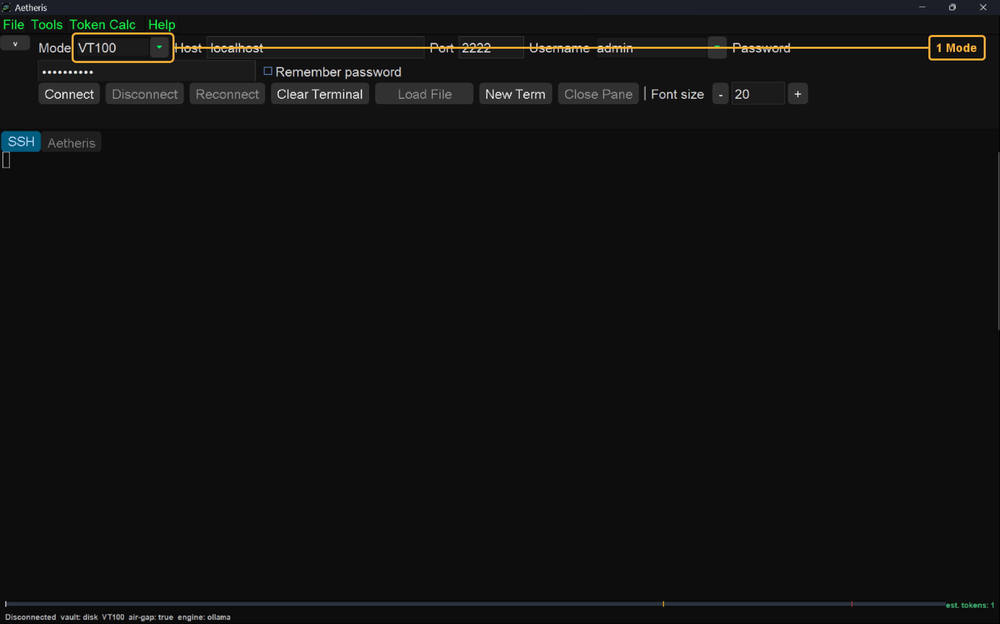
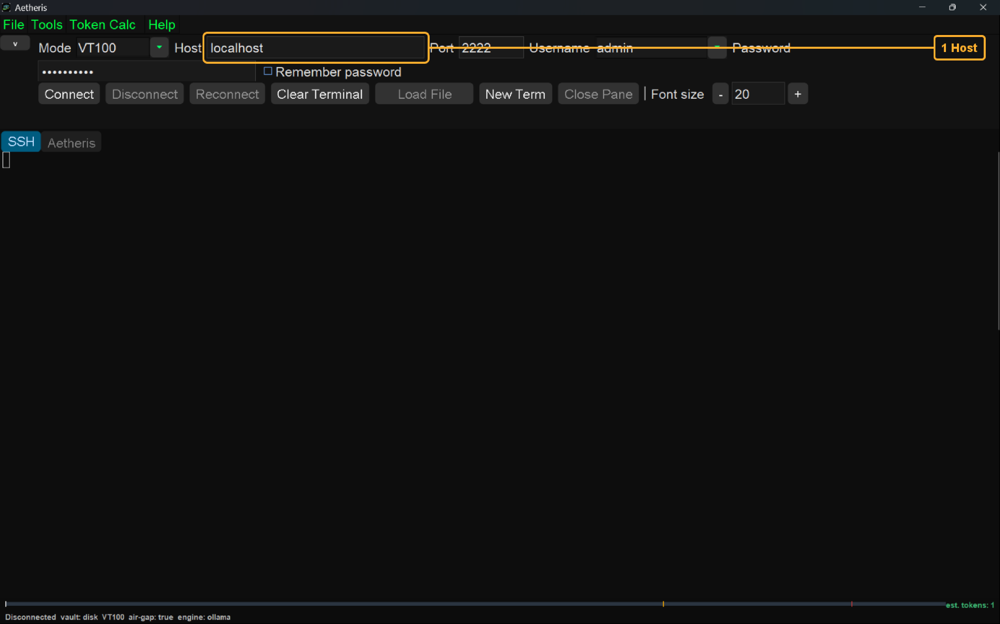
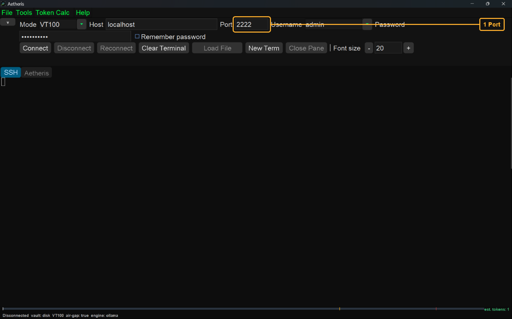
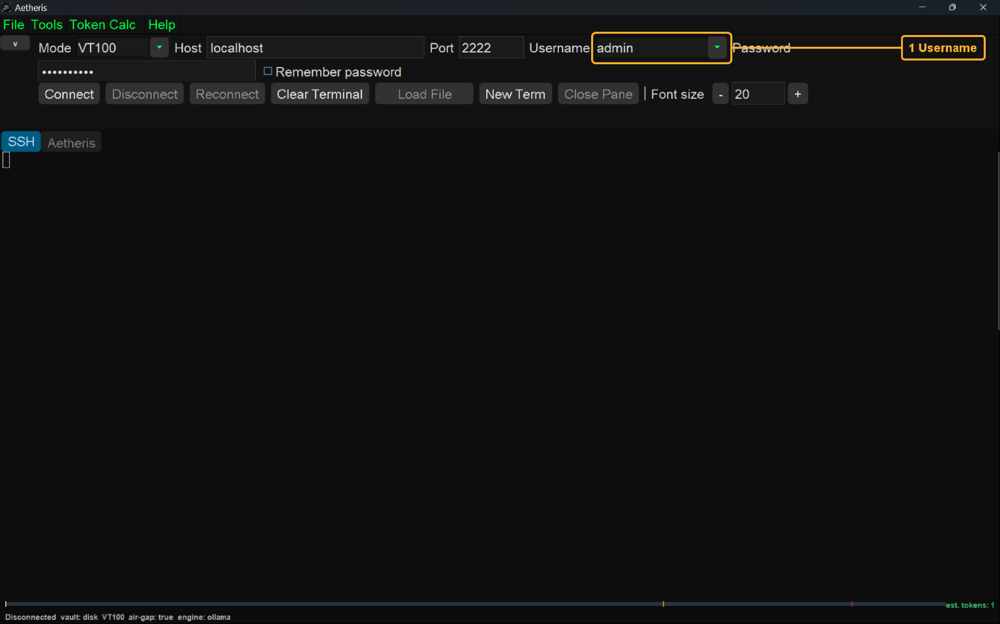
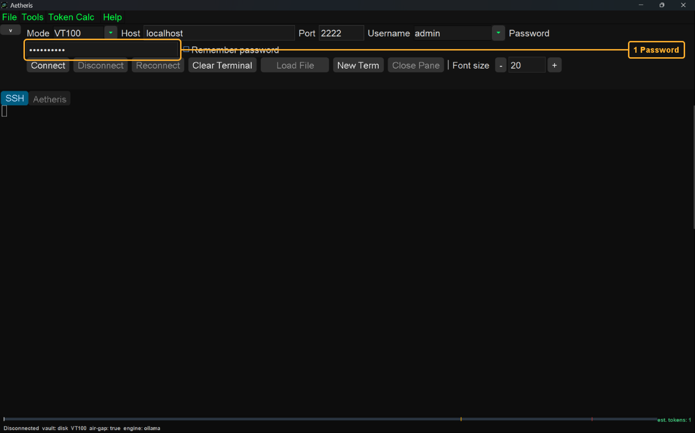
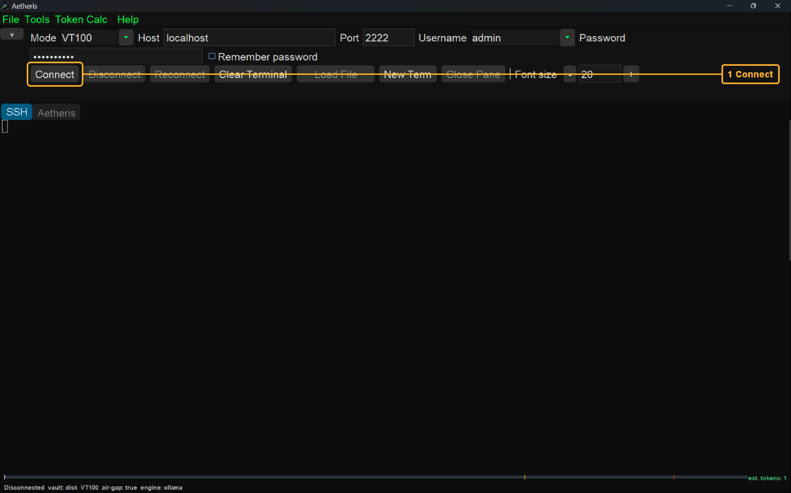
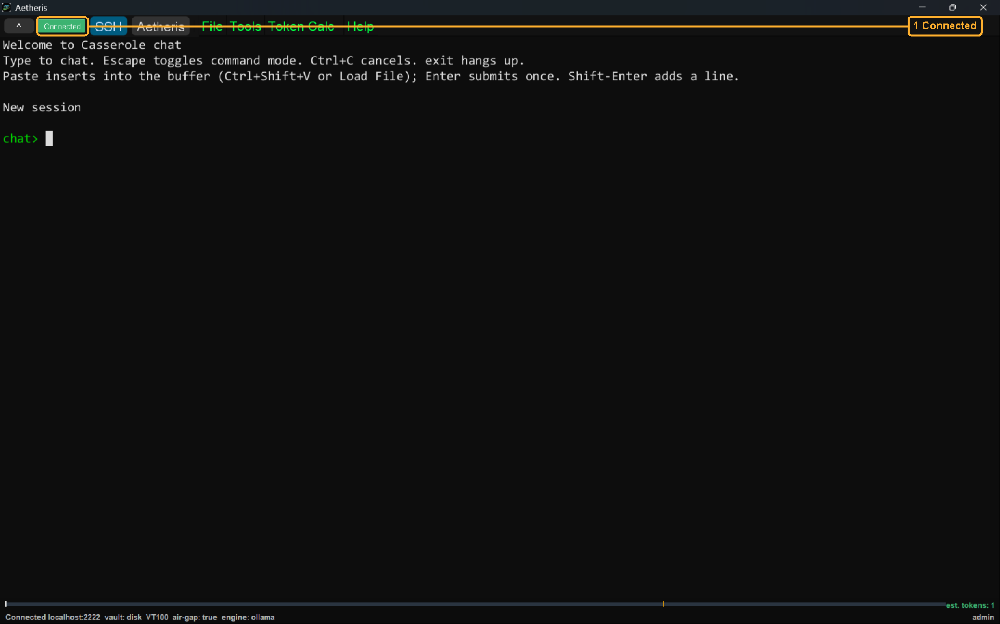

# Connect to the Server

Connect to the Server is the path that opens the session on [the desk](../the-desk/README.md). A session is one login from this window to the host. [The terminal](../the-terminal/README.md) and [the canvas](../the-canvas/README.md) both use that session.

The screen-shots for this book are in the [images](images/README.md) folder. Each screen-shot is the window when the window fills the screen. The font size is 20. The picture on this page is 30 percent larger than the doubled copy. The doubled copy is the original screen-shot with the width doubled and the height doubled. The doubled copy and the original screen-shot are in the [archaeology](images/archaeology/README.md) folder.

Start the server first. This guide does not describe that start with a screen-shot. The server process is the fast path on the [server page](../../../casserole-server/README.md#fast-path). The account is on the [root page](../../../README.md#accounts).

The steps on this window are Mode, Host, Port, Username, Password, and Connect. Mode is the kind of terminal. Host is the machine. Port is the number the server listens on. Username and Password are the account. Connect opens the session with those fields. The chip reads Connected when the session is up. The chip is the word on the connection bar that means the login succeeded.

| |
| --- |
| <h2>Mode</h2>    Mode is highlighted. Mode is the kind of terminal this window asks the server to open. VT100 is the kind in this screen-shot. VT100 is also the kind a fresh window selects. The other kind in the list is Standard PTY. Standard PTY asks for a pseudoterminal the server calls xterm-256color. The screen-shots in this book show VT100. |
| <h2>Host</h2>    Host is highlighted. Host is the machine this session connects to. A fresh window writes localhost in Host. localhost means this same machine. Leave localhost when the Casserole server is running on this machine. Replace localhost with the name, or the numeric address, of the other machine when the server runs there. This screen-shot shows localhost because the server in the picture was running on this same machine. |
| <h2>Port</h2>    Port is highlighted. Port is the number the server listens on for the SSH login. SSH is the encrypted login a terminal uses to reach a host. A fresh window writes 22 in Port. 22 is the port SSH uses when the field has never been set. The Casserole server listens on 2222. Change 22 to 2222 before you press Connect. This screen-shot already shows 2222. Letters in that field are read as 22. |
| <h2>Username</h2>    Username is highlighted. Username is the account name the session sends. A fresh window writes the name of the person signed in on this computer. That name is the Java user.name property. The drop-down list keeps account names this window has used before. The server accepts a name that is on its roster. A roster name uses letters, digits, a dot, an underscore, or a hyphen. This screen-shot shows admin. admin is the demo account on the [root page](../../../README.md#accounts). |
| <h2>Password</h2>    Password is highlighted. Password is the secret that belongs to that username. The field shows dots in place of the characters you type. The demo secret for admin is on the [root page](../../../README.md#accounts). Remember password is unchecked in this screen-shot. A checked box stores the secret in ssh-client.yaml. That file is in the .casserole folder under your home directory. Leave the box unchecked so the secret stays in this field for the session. The roster requires a password for each name. |
| <h2>Connect</h2>    Connect is highlighted. The button has not been pressed in this screen-shot. Connect opens the SSH session with Host, Port, Username, and Password as they stand. The press also saves those fields on this machine. The password is written only when Remember password is checked. Disconnect, Reconnect, and Load File stay disabled until the chip reads Connected. |
| <h2>Connected</h2>    Connected is highlighted. The green chip is the word Connected. The chip means the SSH session is up. The green chat> line is the host prompt. The line New session means this account had no saved messages to bring back. A later visit can print Restored, a count, and the username. The status line at the bottom names the host and the port that answered. This screen-shot answered localhost on port 2222. How that process is started is the fast path on the [server page](../../../casserole-server/README.md#fast-path). |
