# The canvas

The canvas is the notebook of cards. A card is one turn. The canvas depends on a session from [the desk](../the-desk/README.md). A session is one login from that window to the host. The notebook Import button loaded the demo canvas named on the [server page](../../../casserole-server/README.md).

The screen-shots for this book are in the [images](images/README.md) folder. Each screen-shot is the window when the window fills the screen. The Font size spinner is set to 20. The card that has focus is named before the click. The picture on this page is 30 percent larger than the doubled copy. The doubled copy is the original screen-shot with the width doubled and the height doubled. The doubled copy and the original screen-shot are in the [archaeology](images/archaeology/README.md) folder.

The letter I marks the card as included. The letter E marks the card as excluded. The letter P sends the prompt only. The letter O sends the reply only. Ctrl+Shift with I, E, P, or O writes that one mark. The padlock does not change those four letters.

The padlock activates when the server allows locks. How this window activates it is [The locked head](../../../aetheris/java/README.md#the-locked-head). The count and the keys are [The Reichenbach sink](../../../casserole-server/README.md#the-reichenbach-sink).

Group, Join, and Ungroup sit on the card. Group starts a set of cards that will share one joined reply. Join brings another card into that set. Ungroup returns a card to an ordinary turn. Ctrl+Shift+G duplicates a group.

View opens the View window over the maximized desk. The window shows one card's reply, and the reply is read-only. Ctrl+F shows the find bar. Esc hides it.

The vault file stays on the machine. A vault is the file that keeps the canvases for the connected user. It is not a server key.

The inspector is on the right of the notebook. It lists the working set of the card that has focus. The working set is the list of text that would be sent to the model for that card. Run sends only as far as that card. The inspector is what you see of that list before the send.

| |
| --- |
| <h2>Imported cards</h2>  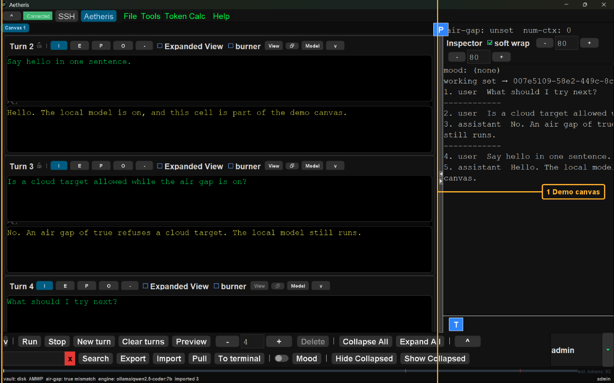  The imported cards are highlighted. A card is one turn on the notebook. The file is the demo canvas named on the [server page](../../../casserole-server/README.md). The file holds a hello, an air-gap question, and an empty next prompt. The notebook Import button loaded that file. The screen-shot shows Turn 2, Turn 3, and Turn 4. A starter card sits above this screen-shot. File Import on the desk only opened the chooser. |
| <h2>Included</h2>  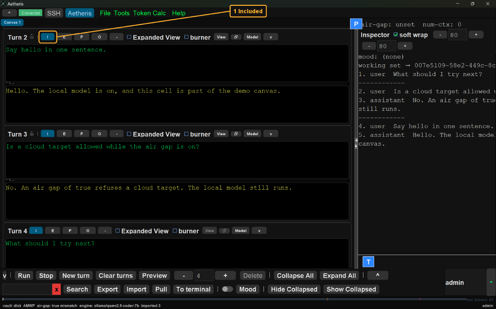  Included, the letter I of this card, is highlighted. The letter I marks the card as included. An included card keeps its prompt and its reply. Ctrl+Shift+I writes that mark. The letter E marks the card as excluded. An excluded card drops its prompt and its reply. The letter P sends the prompt only. The letter O sends the reply only. Ctrl+Shift with E, P, or O writes that one mark. The padlock does not change those four letters. |
| <h2>Padlock</h2>  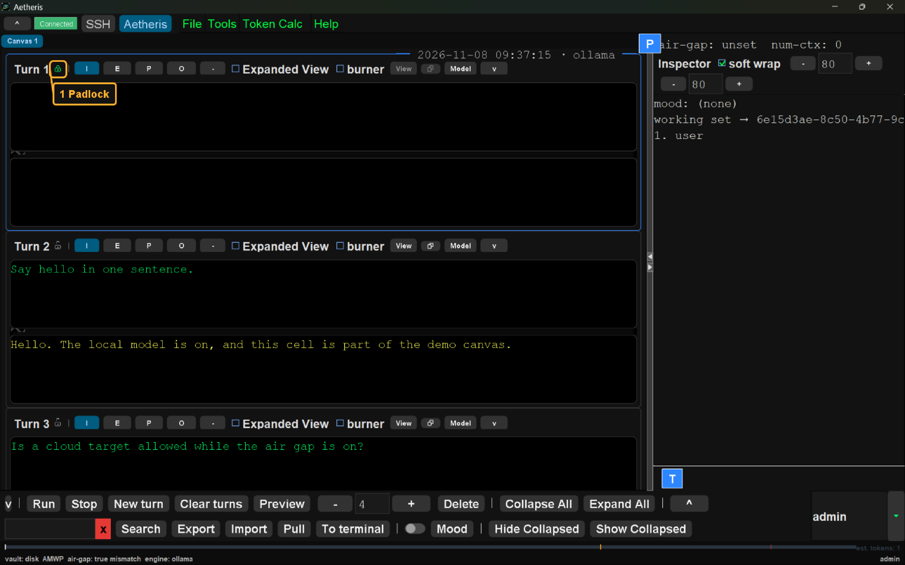  The padlock is highlighted. The padlock is the lock for this card. A closed green padlock means the card is locked. An open grey padlock means the card is unlocked. The count is the published head-count of 3. That count is how many cards, from the top, may be locked. A card you have excluded is skipped by that count. The lock in this screen-shot is closed. A press on the next open padlock in that run locks the card. A press on the last locked padlock unlocks that card. Any other press in the run leaves the locks as they stand. How this window activates it is [The locked head](../../../aetheris/java/README.md#the-locked-head). The count and the keys are [The Reichenbach sink](../../../casserole-server/README.md#the-reichenbach-sink). |
| <h2>Group</h2>  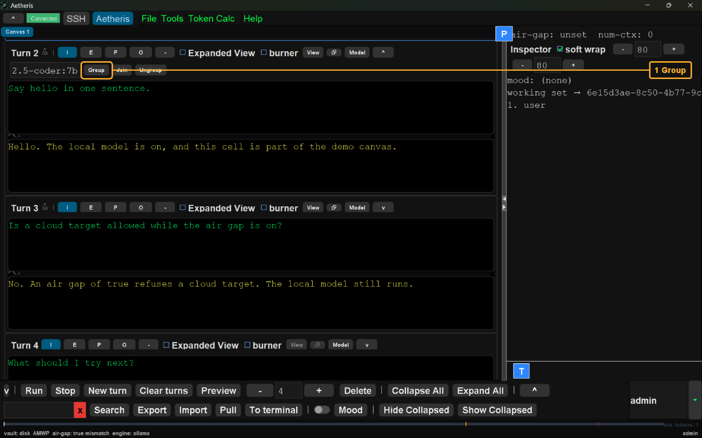  Group is highlighted. Group starts a join on this card. This card becomes the first member. A merge card is added under it. Run sends each member on its own. The merge card is not sent. Join adds the card you click after a member has focus. Ungroup removes this card from the group. Join and Ungroup are on the same card. Ctrl+Shift+G duplicates a group. |
| <h2>Find</h2>  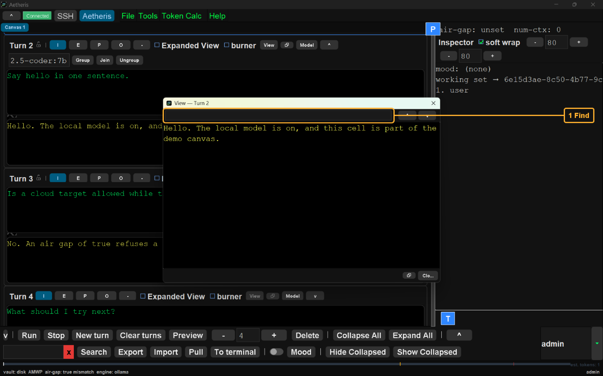  The find bar is highlighted. View opens a window on one card's reply. View opened this window on Turn 2. Ctrl+F shows the find bar. Typing in the bar highlights matches in that reply. The bar does not change the reply text. Esc hides the bar. |
| <h2>Working set</h2>  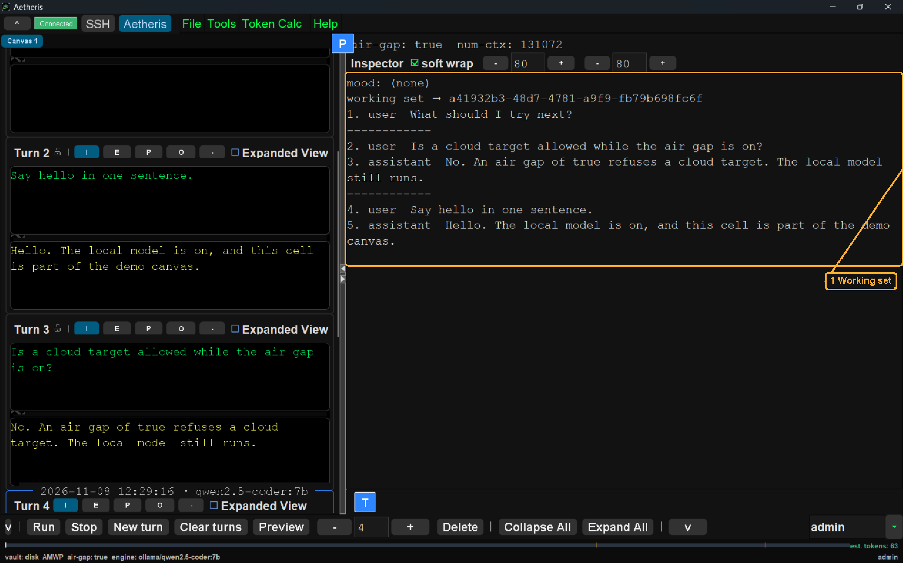  The working set is highlighted. The list is the text that would be sent to the model for the card that has focus. This screen-shot has Turn 4 selected. The newest block is that card's prompt. The reply on that card stays on the card. A dashed line separates one card from the next. An earlier included card keeps its prompt and its reply. The list is newest first. The send uses those earlier cards first, starting with the oldest. The send then adds this card's prompt. The line mood: (none) means no mood is set. This list is what you see before that send. How Run sends that card is [The turn](../the-turn/README.md). |
| <h2>Selected card</h2>  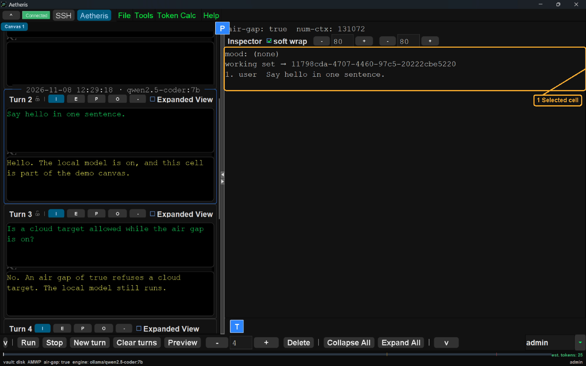  The working set of Turn 2 is highlighted. Turn 2 is the selected card. The list holds that card's prompt. The reply stays on the card. Turn 3 and Turn 4 stay on the notebook. They are not in this working set. Run would stop at Turn 2. |
| <h2>Excluded</h2>  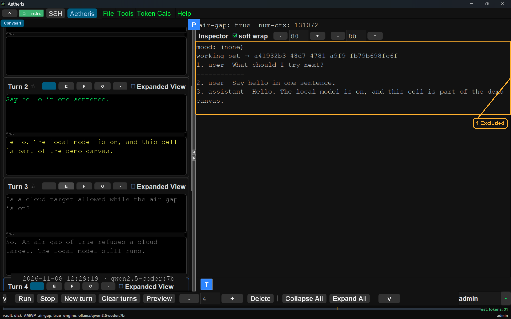  The working set with Turn 3 excluded is highlighted. Turn 3 is marked E. The card stays on the notebook. Its prompt and its reply are gray. Those lines are absent from the list. Turn 4 is the selected card. The list keeps Turn 4's prompt and the earlier included card. |
| <h2>Facts</h2>  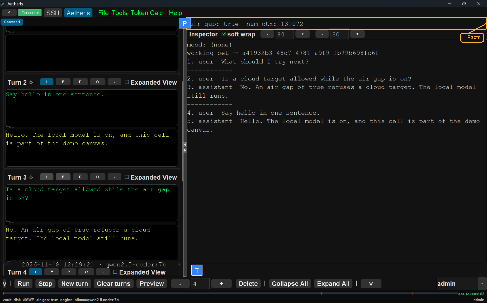  The facts line is highlighted. This screen-shot reads air-gap true. This screen-shot reads num-ctx 131072. The host reported those two facts for this session. The line sits above the inspector controls. It is not part of the working set. |
| <h2>Soft wrap</h2>  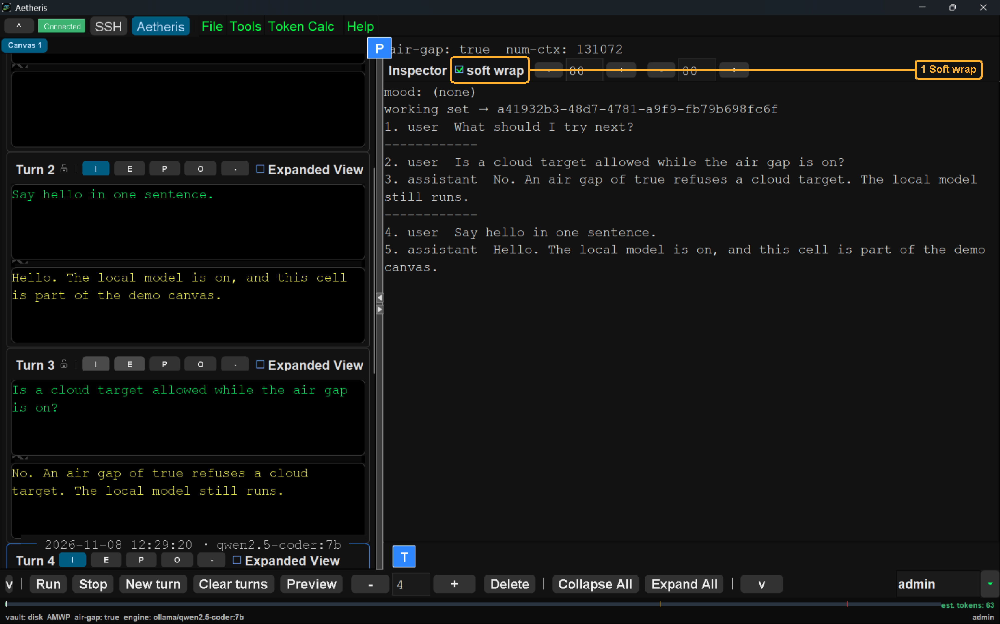  Soft wrap is highlighted. The box starts checked. A checked box folds a long inspector line at the wrap-column count. An unchecked box keeps each line on one row. The inspector then scrolls sideways. The choice applies to the inspector only. |
| <h2>Wrap columns</h2>  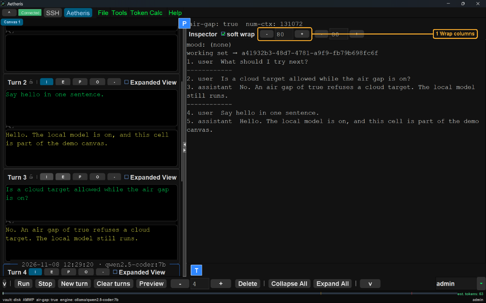  The wrap-column count is highlighted. This screen-shot shows 80. The count is the first spinner. Soft wrap folds a line after this many characters. The count is saved with the shell. The shell is the saved layout for this window. The smallest count is 1. |
| <h2>Line length</h2>  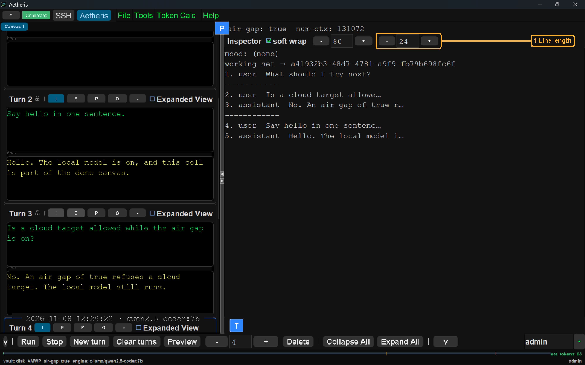  The line-length count is highlighted. This screen-shot shows 24. The count is the second spinner. Preview shortens each kept line to this count. A shortened line ends with an ellipsis. The cards keep their full text. The send uses that text. The count is saved with the shell. The shell is the saved layout for this window. The smallest count is 1. |
| <h2>Token window</h2>  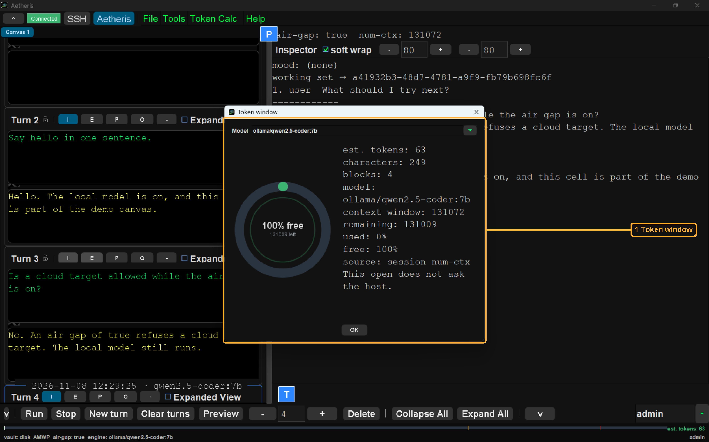  The token window is highlighted. T opens this window. The window names the model. This screen-shot names ollama/qwen2.5-coder:7b. The estimate in this screen-shot is 63. The character count in this screen-shot is 249. The block count in this screen-shot is 4. The context window in this screen-shot is 131072. The remaining count in this screen-shot is 131009. This screen-shot shows 0 percent used. This screen-shot shows 100 percent free. The source is the session num-ctx. The window says this open does not ask the host. This open does not send. The footer shows the same estimate. OK closes the window. |
| <h2>Divider</h2>  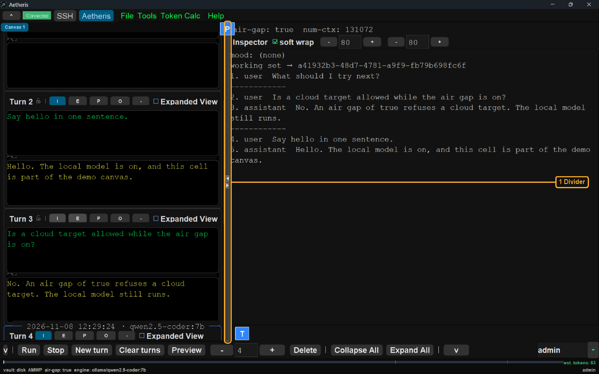  The divider is highlighted. Drag moves the bar. The notebook and the inspector share the width. The upper arrow hides the notebook. The inspector then takes the width. The lower arrow hides the inspector. The notebook then takes the width. The letter P is the pin. The pin is not an inspector control. |
