# The conversation Canvas

The conversation canvas is one notebook in use. A notebook is the set of cards on the canvas in front. This book depends on a session from [the desk](../the-desk/README.md). The account is the Accounts section on the [root page](../../../README.md#accounts).

The marks, the padlock, the group, and the inspector are [The canvas](../the-canvas/README.md). How Run sends is [The turn](../the-turn/README.md).

A fresh canvas holds Canvas 1. Canvas 1 is the name a new vault gives its first canvas. That canvas starts with one included card. An included card is a card whose mark is the letter I, so a later Run can send it. This book stays on the letter I.

The inspector sits on the right of the notebook. In these screen-shots the inspector stays under 30 percent of the width. The canvas and the cards keep the rest of the width.

New turn adds the next included card and puts the cursor in its prompt. The prompt is the text you type for that turn. The heatbar estimates that text as you type. A heatbar is the thin mark that shows the estimate against the context window. Run sends the focused card to its model. The reply appears on that card. Delete removes the card that has focus.

| |
| --- |
| <h2>Starter</h2>  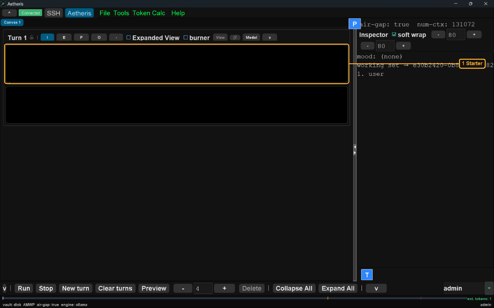  The input pane is highlighted. A fresh canvas holds one card. That card is Turn 1 on Canvas 1. The prompt is empty. The letter I is the mark on this card. The reply pane is empty. Delete stays disabled while this card is the only card. The inspector on the right lists that empty card. |
| <h2>New turn</h2>  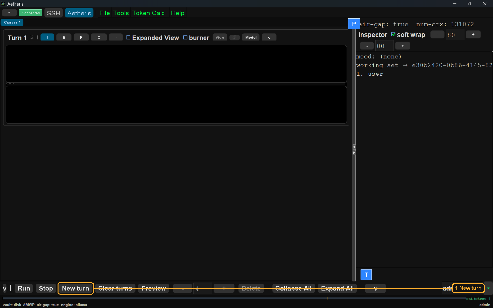  New turn is highlighted. The button is on the footer. The footer is the bar at the bottom of the canvas. The picture shows the button before you click it. Turn 1 is still the only card. The letter I stays the mark on that card. A press adds the next included card. |
| <h2>New card</h2>  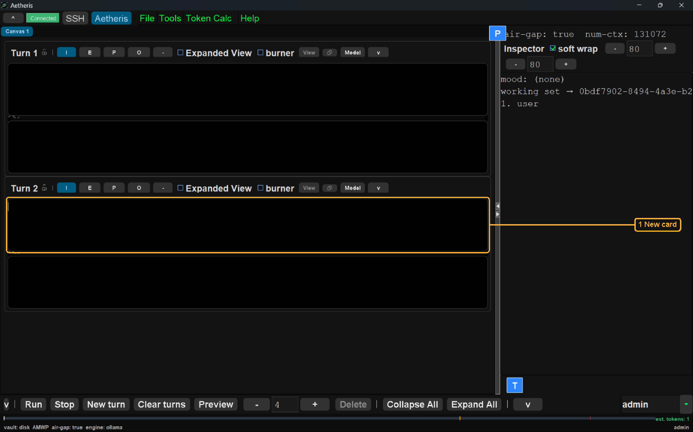  The input pane is highlighted. New turn added Turn 2. The prompt is empty. The letter I is the mark on this card. Turn 2 has focus. A new turn starts included. The inspector lists that empty card. |
| <h2>Input</h2>    The input pane is highlighted. The prompt on Turn 2 holds Say ready. The reply pane is empty. The letter I stays the mark on that card. Each typed character is its own change. The heatbar for this prompt reads est. tokens: 3. |
| <h2>Heatbar</h2>  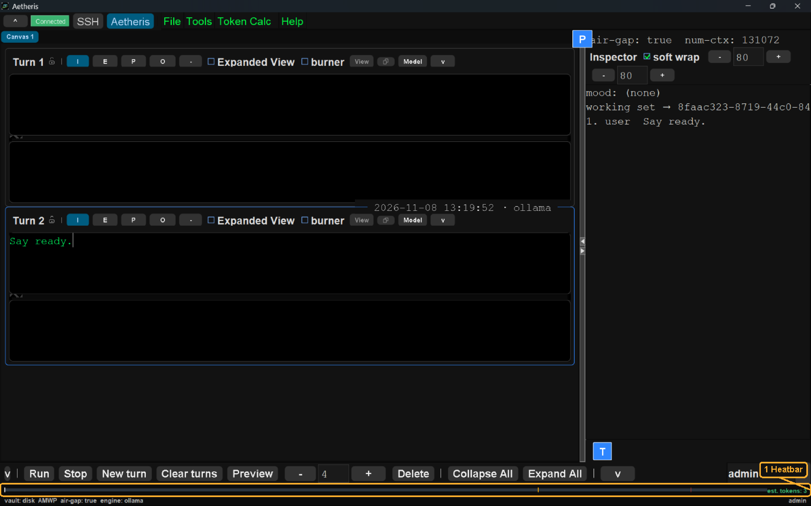  The heatbar is highlighted. The word in this screen-shot is est. tokens: 3. The count is the keystroke estimate for Say ready. The bar does not ask the host. Amber begins at 70 percent of the window. Red begins at 90 percent of the window. The needle rests on the estimate. A short prompt leaves a small fill. |
| <h2>More text</h2>  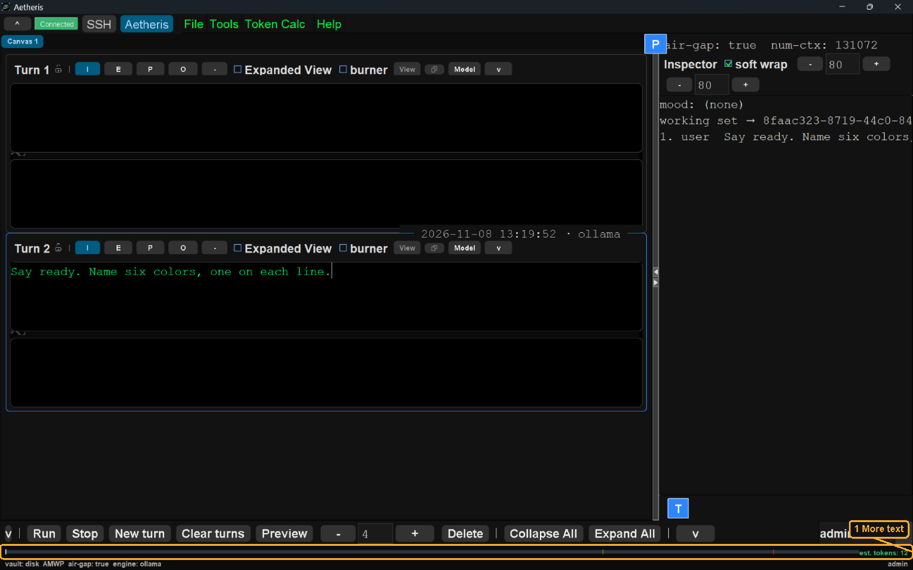  The heatbar is highlighted. The prompt holds a second sentence. That sentence is Name six colors, one on each line. The word in this screen-shot is est. tokens: 12. The count moved when the prompt grew. The bar does not ask the host. |
| <h2>Token Calc</h2>  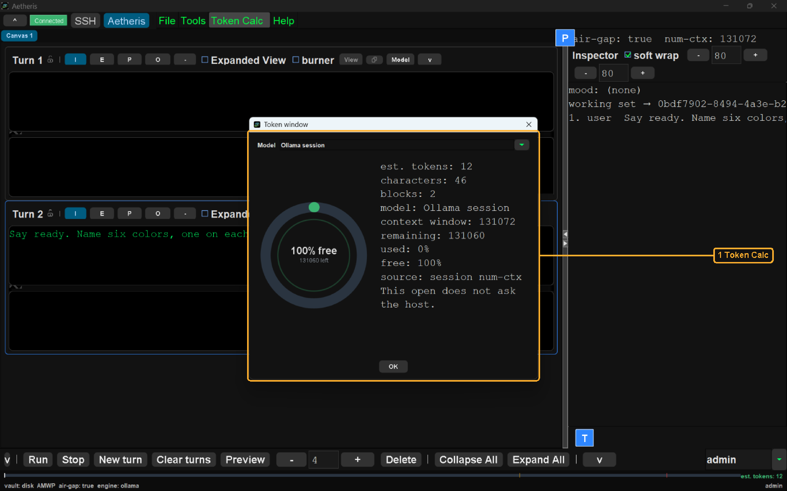  The token window is highlighted. Token Calc sits on the menu bar. This screen-shot names the model Ollama session. The estimate in this screen-shot is 12. The character count in this screen-shot is 46. The block count in this screen-shot is 2. The context window in this screen-shot is 131072. The remaining count in this screen-shot is 131060. This screen-shot shows 0 percent used. This screen-shot shows 100 percent free. The source is the session num-ctx. The window says this open does not ask the host. This open does not send. |
| <h2>Included</h2>  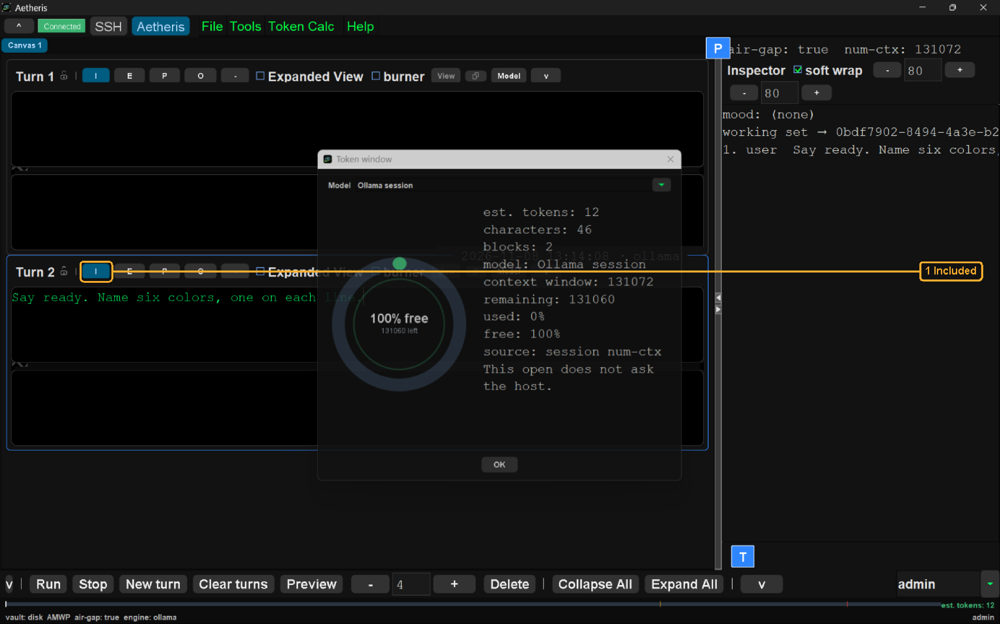  The letter I is highlighted. The letter I marks this card as included. This book stays on that mark. An included card keeps its prompt and its reply. The letters E, P, and O are in [The canvas](../the-canvas/README.md). Ctrl+Shift+I writes the same mark. |
| <h2>Undo</h2>  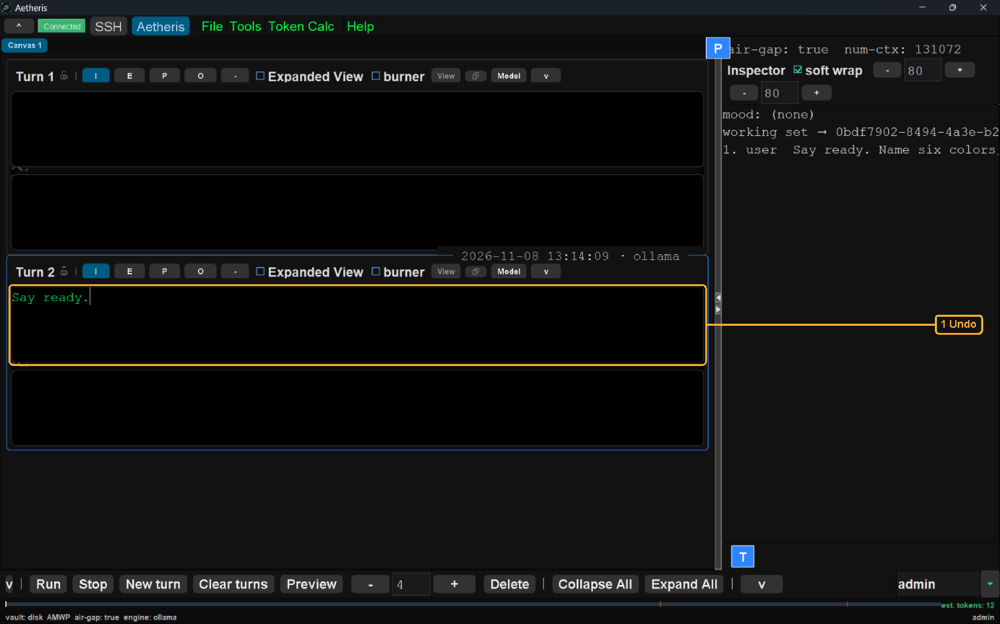  The input pane is highlighted. Ctrl+Z undoes one character of the prompt. This screen-shot is after 35 of those keystrokes. The second sentence is gone. The prompt again holds Say ready. Redo is Shift+Ctrl+Z on the same prompt. |
| <h2>Redo</h2>  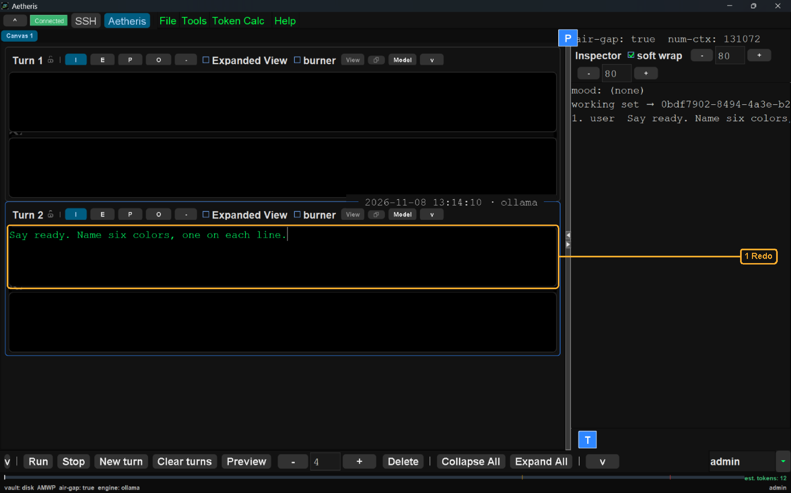  The input pane is highlighted. Shift+Ctrl+Z redoes one character of the prompt. This screen-shot is after 35 of those keystrokes. The second sentence is back. The prompt holds both sentences. Undo and redo stay on the prompt. |
| <h2>Rows</h2>  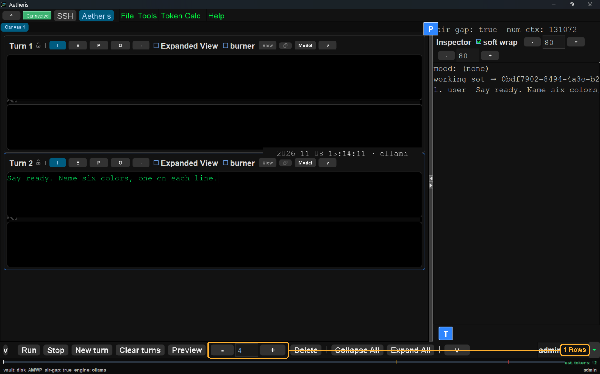  The row count is highlighted. This screen-shot shows 4. The count is on the footer. The prompt keeps this many lines. An unchecked reply keeps this many lines. This spinner is not the wrap-column count. The wrap-column count is in [The canvas](../the-canvas/README.md). |
| <h2>Short rows</h2>  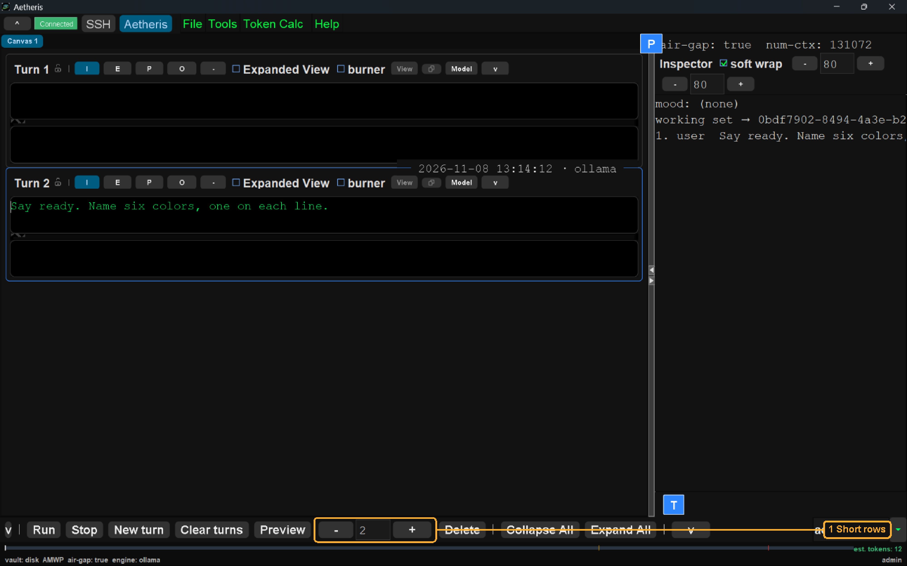  The row count is highlighted. This screen-shot shows 2. Two presses of minus set that count. The prompt keeps its text. The prompt pane keeps two lines. An unchecked reply keeps two lines. |
| <h2>Run</h2>  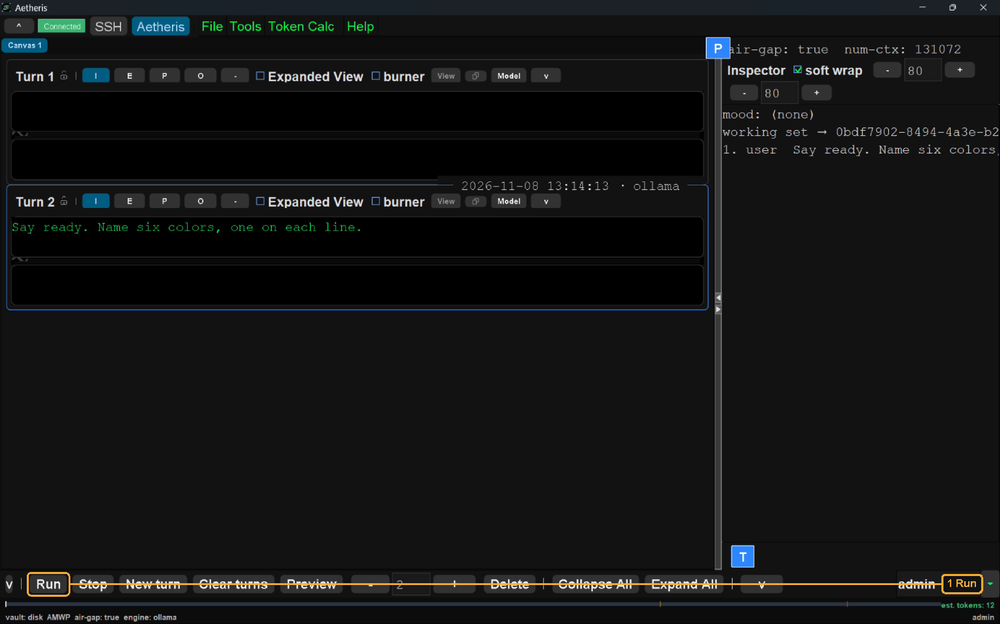  Run is highlighted. The picture shows the button before you click it. Turn 2 has focus. The reply pane is empty. Run sends the focused card. How Run sends is [The turn](../the-turn/README.md). The inspector lists the working set of that card. |
| <h2>Reply</h2>  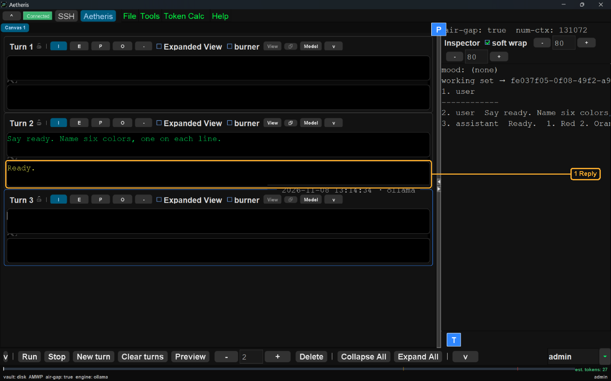  The reply pane is highlighted. The reply in this screen-shot is eight lines. The footer row count is 2. The pane shows the first line. The rest of the reply is clipped. A reply on the last card appends an empty card. That empty card is Turn 3. The heatbar in this screen-shot reads est. tokens: 27. The words the model returned are not the point of this screen-shot. The screen-shot shows where the reply sits on the card. |
| <h2>Expanded</h2>  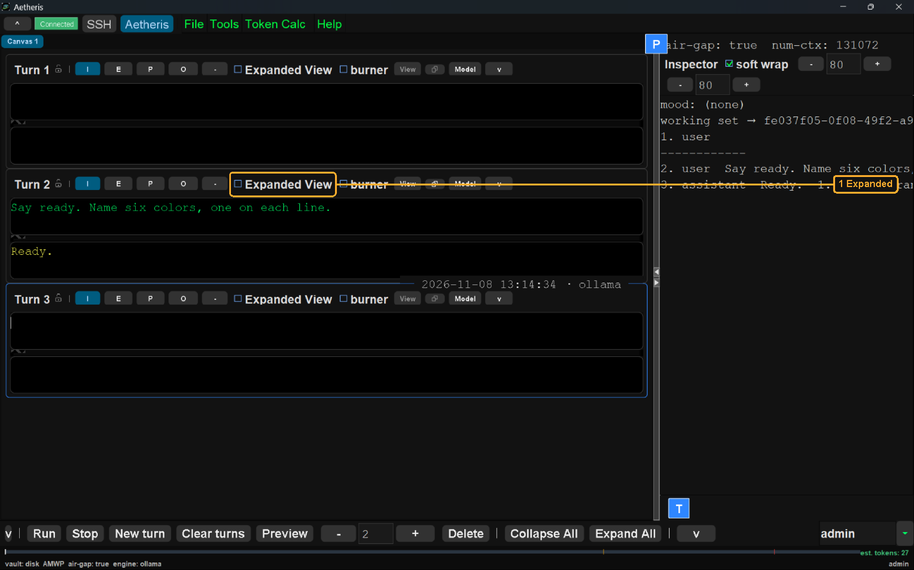  Expanded View is highlighted. The box on Turn 2 is unchecked. The reply stays at the footer row count. The pane still shows the first line. Turn 3 is the empty card under this one. Collapse All sits on the footer. This box is the Expanded View of one card. |
| <h2>Whole reply</h2>  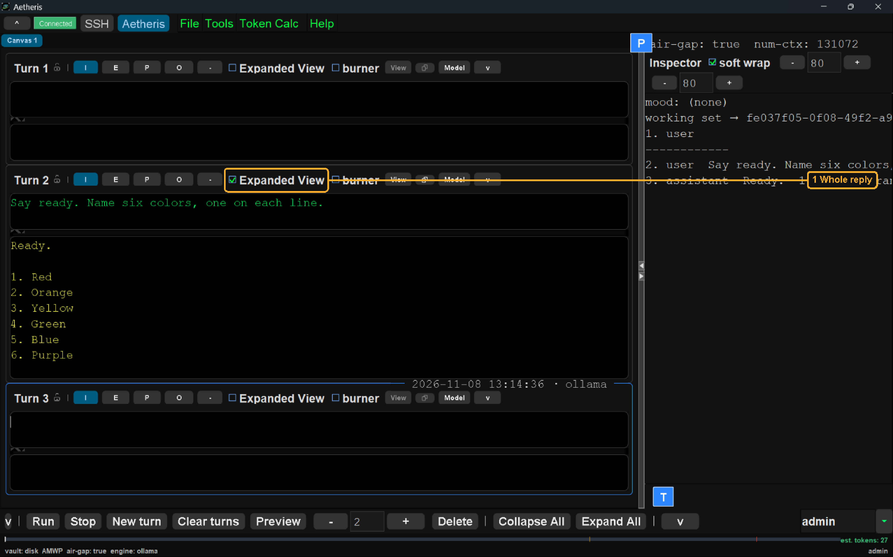  Expanded View is highlighted. The box on Turn 2 is checked. The whole reply is visible. The reply is still eight lines. The footer row count is still 2. Turn 3 stays empty. A new card copies the Expanded View of the card before it. Turn 3 was added before this box was checked. |
| <h2>Delete</h2>  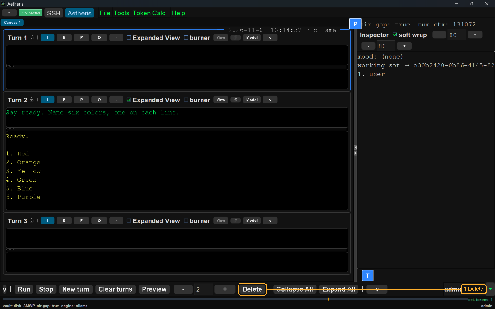  Delete is highlighted. Turn 1 has focus. Turn 1 is the empty starter. The conversation is Turn 2. Turn 3 is the empty card the reply appended. Delete removes the card that has focus. The heatbar in this screen-shot reads est. tokens: 1. Later cards are outside this working set. Remaining turns are numbered from 1. Clear turns is the other button on the footer. A grouped card would remove the group. This screen-shot has no group. Groups are in [The canvas](../the-canvas/README.md). |
| <h2>Removed</h2>  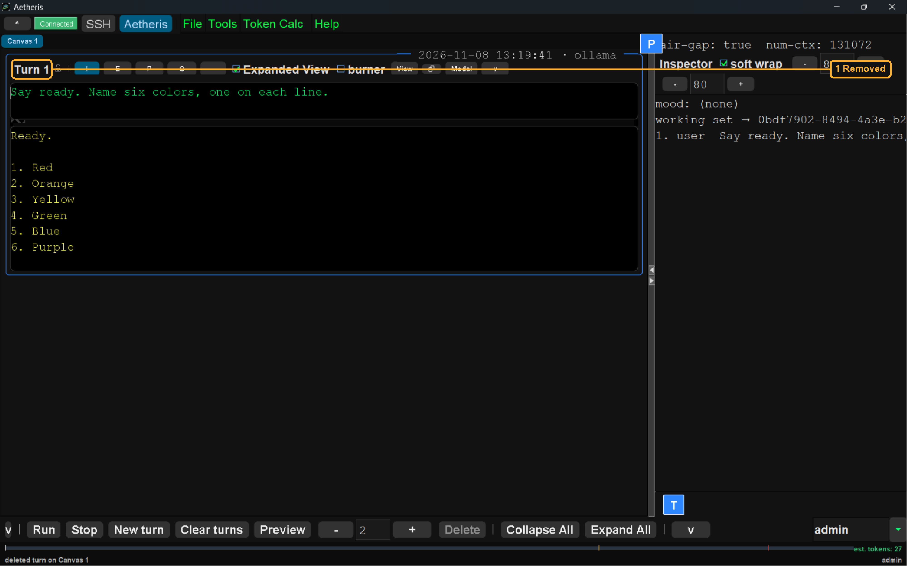  Turn 1 is highlighted. The conversation remains as Turn 1. The empty starter is gone. The appended empty card is gone. The prompt still holds both sentences. Expanded View stays checked. The whole reply stays visible. Delete is disabled. The status line reads deleted turn on Canvas 1. The heatbar in this screen-shot reads est. tokens: 27. |
