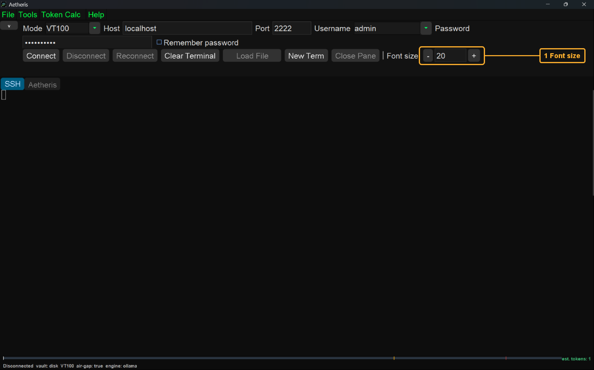
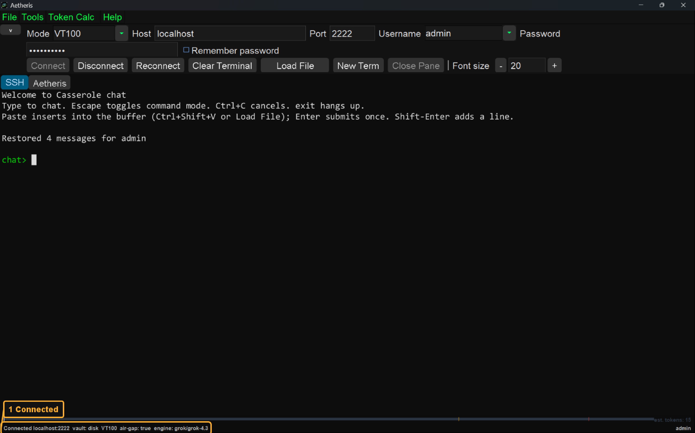
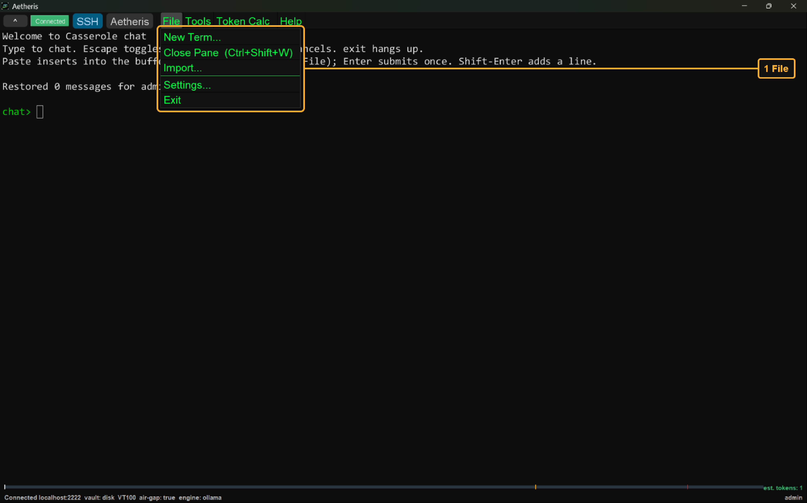
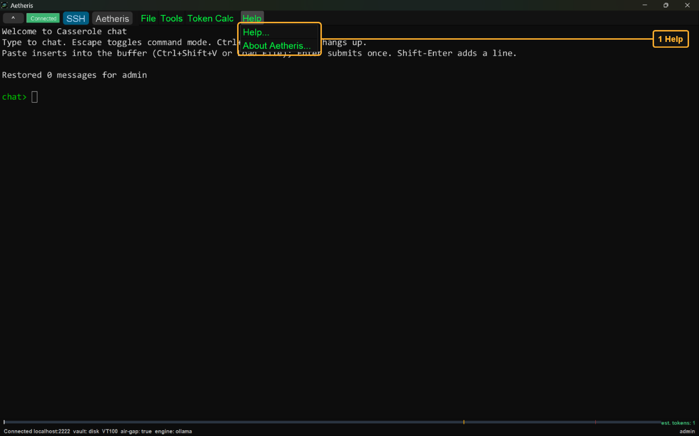
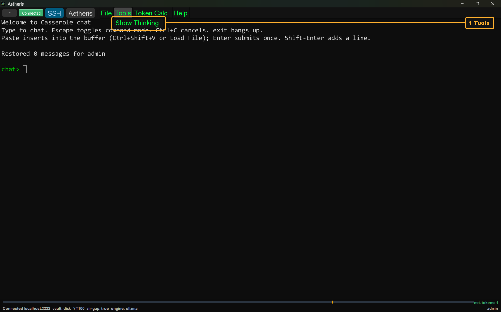
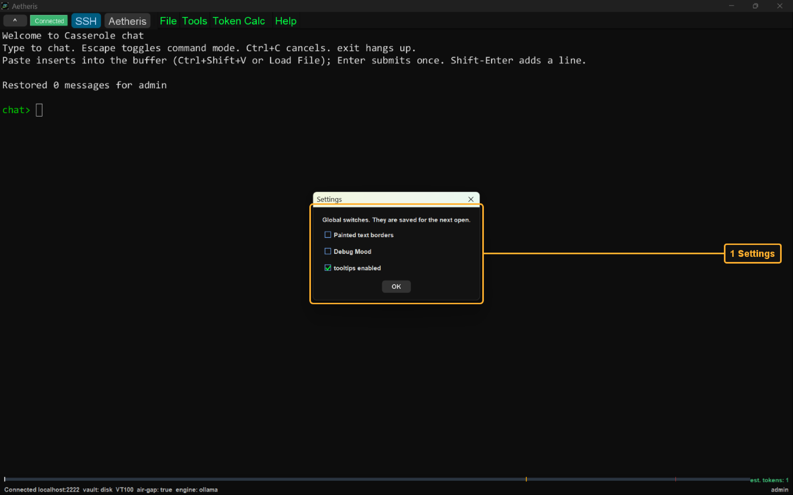
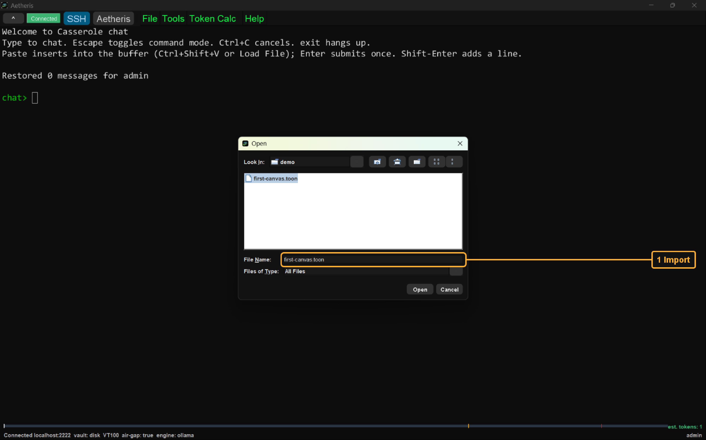
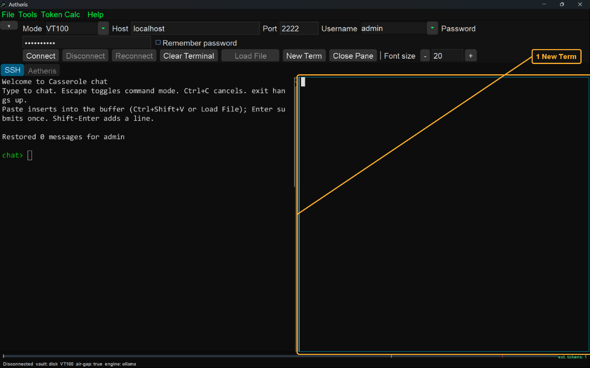
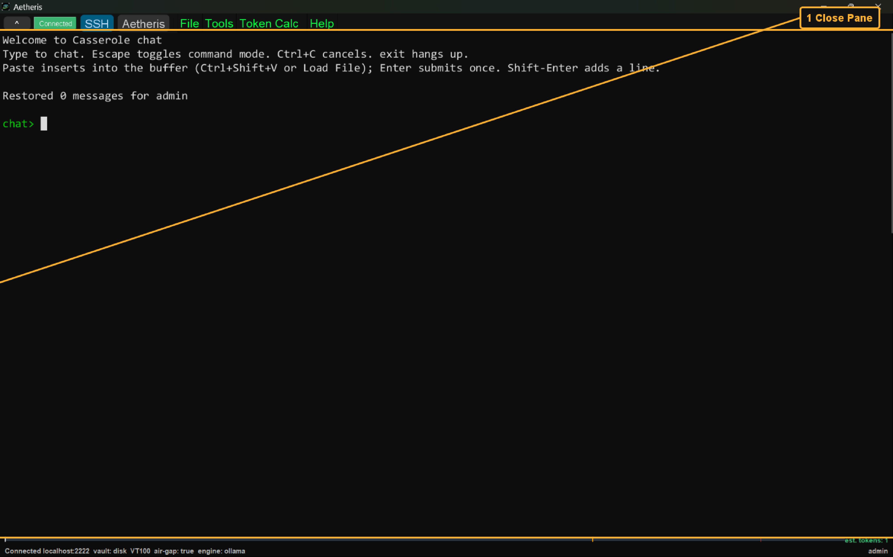

# The desk

The desk is this Java window. Swing is the toolkit that draws it. The other books begin after a session is opened here. A session is one login from this window to the host. [The terminal](../the-terminal/README.md) and [the canvas](../the-canvas/README.md) both require that session.

The screen-shots for this book are in the [images](images/README.md) folder. Each screen-shot is the window when the window fills the screen. The font size is 20 in every one of them. The picture on this page is 30 percent larger than the doubled copy. The doubled copy is the original screen-shot with the width doubled and the height doubled. The doubled copy and the original screen-shot are in the [archaeology](images/archaeology/README.md) folder.

The connection bar is the row of fields and buttons that opens the session. It carries Mode, Host, Port, Username, Password, Remember password, Connect, Disconnect, Reconnect, Clear Terminal, Load File, New Term, Close Pane, and Font size. Mode in these screen-shots is VT100. VT100 is the terminal kind a fresh window selects. Host, Port, Username, and Password are the demo values on the [root page](../../../README.md). The server process those values reach is the fast path on the [server page](../../../casserole-server/README.md#fast-path). The steps that open the session are [Connect to the Server](../connect-to-the-server/README.md).

The File menu opens New Term, Close Pane (Ctrl+Shift+W), Import, Settings, and Exit. Help opens the help text and About Aetheris. About Aetheris is the dialog that shows the about text and the Aetheris picture. Tools opens Show Thinking. Show Thinking reveals the thinking pane of the tab in front. Token Calc sits on the menu bar. Token Calc opens the token window for that tab. A dialog screen-shot is this same window with that dialog open on top.

File, Import opens the demo canvas named on the [server page](../../../casserole-server/README.md). That dialog reads a file into the focused terminal. It does not put cards on the notebook. The notebook Import button loads that file onto the canvas. [The canvas](../the-canvas/README.md) shows the cards.

New Term opens a second terminal pane beside the focused pane, or under it. The new pane has no session. Close Pane on that extra pane leaves one pane. The last pane stays.

| |
| --- |
| <h2>Font size</h2>    Font size is highlighted. Font size is the type size for this window, in points. The control is minus, the value, and plus. The value runs from 8 to 36, one step at a time. A fresh window writes 20 when no size is stored. A stored size is kept. The control stops at 8 and at 36. This screen-shot shows 20. The same size goes to the bar, the menus, every terminal pane, and the canvas. |
| <h2>Connected</h2>    Connected is highlighted. The green chip is the word Connected. The chip means the SSH session on this bar is up. Host, port, username, and password are the demo values on the [root page](../../../README.md). The password field shows dots. The steps that fill those fields are [Connect to the Server](../connect-to-the-server/README.md). The server process is the fast path on the [server page](../../../casserole-server/README.md#fast-path). |
| <h2>File menu</h2>    The File menu is highlighted. The menu is open in this screen-shot. The menu opens New Term, Close Pane, Import, Settings, and Exit. New Term asks Horizontal or Vertical. Close Pane is also Ctrl+Shift+W. The last pane stays. Import opens a file chooser. Settings opens the global switches for this window. Exit asks before the window closes. |
| <h2>Help menu</h2>    The Help menu is highlighted. The menu is open in this screen-shot. The menu opens Help and About Aetheris. Help opens the help text for this window. About Aetheris opens the about text and the Aetheris picture. Both dialogs sit over this same window. |
| <h2>Tools menu</h2>    The Tools menu is highlighted. The menu is open in this screen-shot. The menu opens Show Thinking. Show Thinking reveals the thinking pane of the tab in front. Token Calc sits on the menu bar. Token Calc is not an item inside this menu. Token Calc opens the token window for the tab in front. A terminal pane reports the length of the session text and the count of non-blank rows. The canvas tab opens the notebook token window. |
| <h2>Settings</h2>    Settings is highlighted. The dialog is the global switches for this window. The switches are saved for the next open. Painted text borders paints a frame on the canvas text panes. Debug Mood shows the mood detail in the inspector. The checkbox tooltips enabled turns hover text on. Each switch stores itself when you change it. The file is aetheris-settings.yaml in the .casserole folder under your home directory. Escape closes the dialog. |
| <h2>Import</h2>    The demo canvas file in the Import dialog is highlighted. The dialog is the file chooser that File opens. That file is the demo canvas named on the [server page](../../../casserole-server/README.md). The file holds a hello, an air-gap question, and an empty next prompt. This dialog does not put those cards on the notebook. The notebook Import button loads that file. [The canvas](../the-canvas/README.md) shows the loaded cards. |
| <h2>New Term</h2>    The second terminal pane is highlighted. New Term asks Horizontal, Vertical, or Cancel. Horizontal places the new pane beside the focused pane. Vertical places the new pane under the focused pane. Ctrl+Shift+D splits side by side. Ctrl+Shift+E splits one above the other. This screen-shot shows that new pane. The new pane has no session. The pane you split keeps the session it already had. |
| <h2>Close Pane</h2>    The remaining terminal pane is highlighted. Close Pane closes the focused pane. The key is Ctrl+Shift+W. The last pane stays. A window with one pane does not close it. This screen-shot shows the pane that remained. That pane keeps its session. |
