# The merge cell

The merge cell is a group of cards that share one joined reply. It depends on a session from [the desk](../the-desk/README.md). The marks and the inspector are [The canvas](../the-canvas/README.md). How Run sends one card is [The turn](../the-turn/README.md).

This book begins with an empty canvas. The one Group screen-shot in The canvas stays in that book.

This book has fourteen screen-shots. Each screen-shot is the window when the window fills the screen. The Font size spinner is set to 20. The screen-shots are in the [images](images/README.md) folder. The picture on this page is 30 percent larger than the doubled copy. The doubled copy is the original screen-shot with the width doubled and the height doubled. The doubled copy and the original screen-shot are in the [archaeology](images/archaeology/README.md) folder.

One member is Ollama. Ollama is the local model host. The other member is the Grok API id grok-4.3. The id is not grok-4.2. The id is not grok-4.20. The pool is not the model these screen-shots use. The pool is a separate chat. A model is not selected through the pool. The Model button on the card bar opens Model Config. The text pane on the card does not open that dialog. Family is the group of models this card uses. Family Ollama uses the row the host list shows. In these screen-shots that row is deepseek-r1:1.5b. Family Grok uses the row grok-4.3. The execution-target field shows the target this card would send. That field is not the selection. It does not open Model Config.

Group starts a join on the focused card. That card becomes member 1. A merge card is added under it. A second ordinary card is the other input. Run sends each member on its own. The merge card is not sent. Join adds the card you click after a member has focus. The new member keeps its own model. When every member has completed, the merge card holds the joined replies, each under a JOIN line. A failed or cancelled member fails the merge and leaves that reply blank. The inspector lists the member prompts as one user line and the merge reply as the assistant line. Ungroup removes the card from the group. When the last member leaves, the merge card returns to an ordinary turn. Add Cell is on the merge card only. The new member is empty. The merge card still holds the joined replies.

| |
| --- |
| <h2>Group</h2>  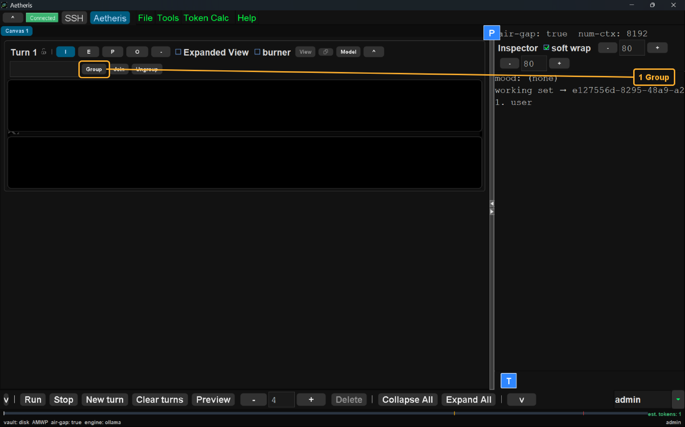  Group is highlighted. The picture shows the control before you click it. The card is an ordinary turn. Join and Ungroup are on that card. |
| <h2>Merge</h2>  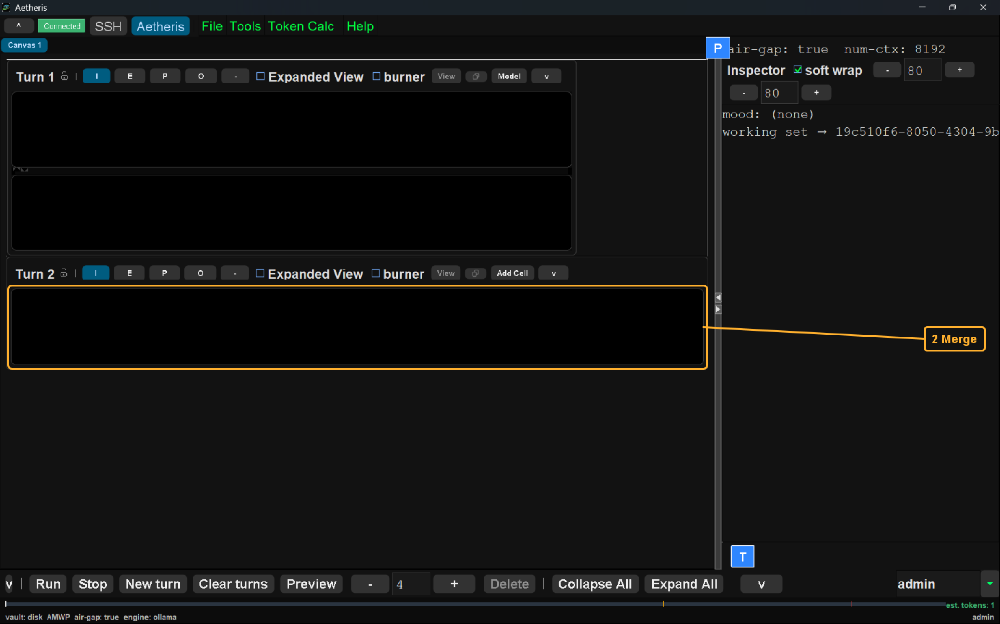  The merge card is highlighted. This card is member 1. A merge card is under it. Run has not been pressed. The merge card is not sent. |
| <h2>Second</h2>  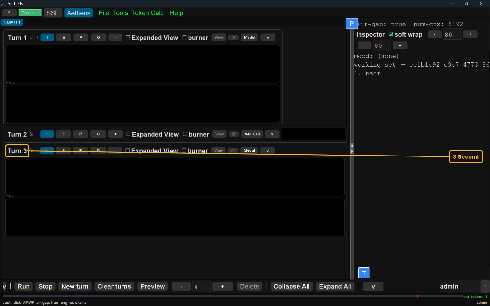  Turn 3 is highlighted. It is a second ordinary card. It is not in the group yet. The merge card is folded. |
| <h2>Ollama</h2>  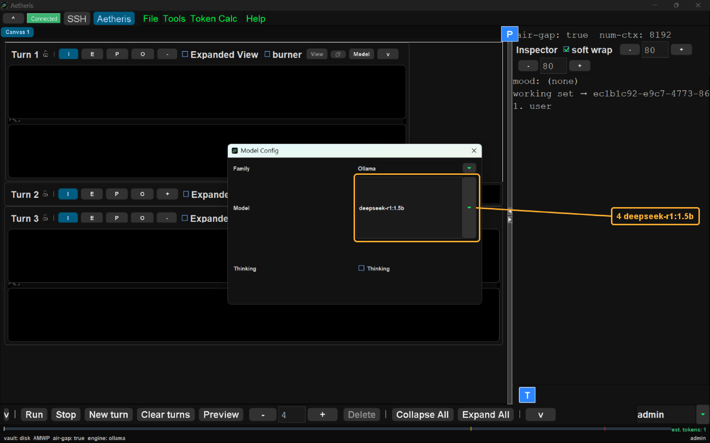  The model row deepseek-r1:1.5b is highlighted. Family is Ollama. Thinking is unchecked. |
| <h2>grok-4.3</h2>  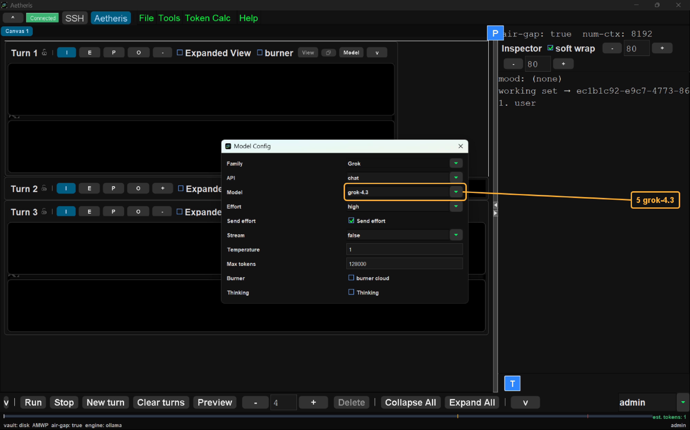  The model row grok-4.3 is highlighted. Family is Grok. The pool row is not the choice. |
| <h2>Join</h2>  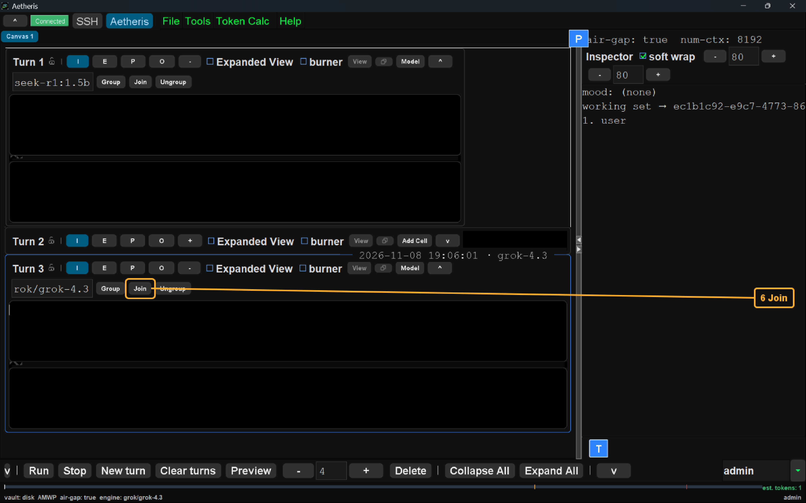  Join is highlighted on the second card. That card's caption is grok-4.3. The first card's target shows the end of the Ollama model name. The picture shows the control before you click it. |
| <h2>Joined</h2>  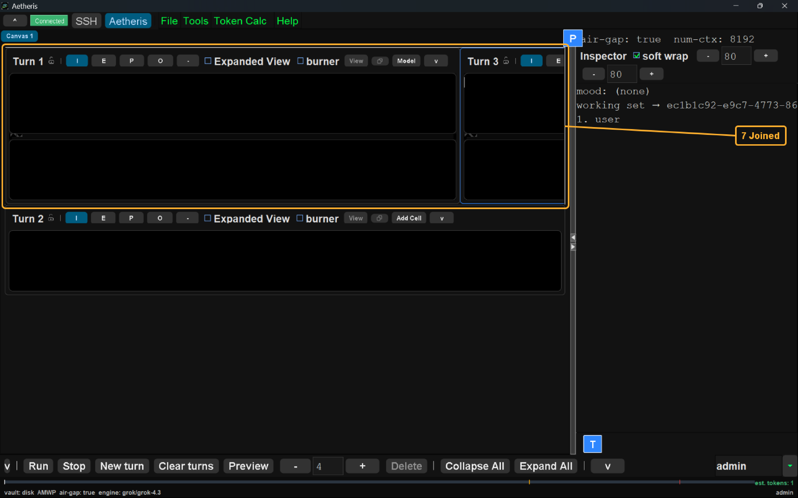  The two members are highlighted. They sit side by side. The merge card is under them. |
| <h2>Run</h2>  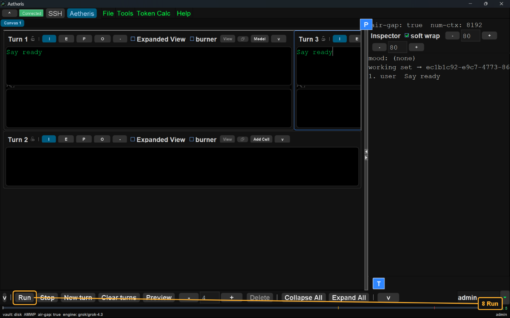  Run is highlighted. Both members hold Say ready. The picture shows the control before you click it. The merge card is not the card that is sent. |
| <h2>Replies</h2>  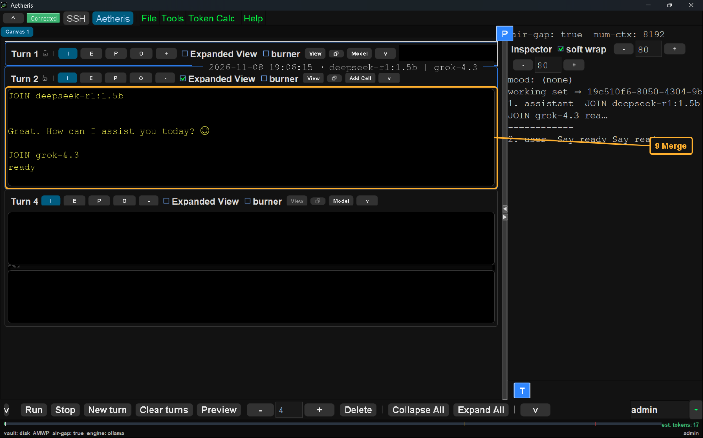  The merge reply is highlighted. The caption is deepseek-r1:1.5b \| grok-4.3. The reply holds JOIN deepseek-r1:1.5b and JOIN grok-4.3. |
| <h2>Inspector</h2>  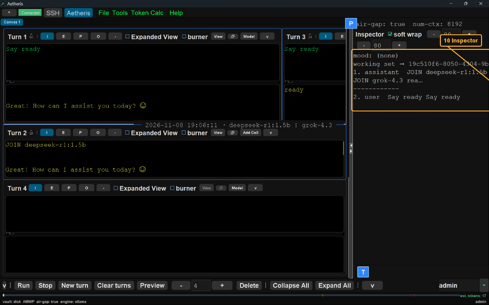  The inspector is highlighted. The member prompts are one user line, Say ready Say ready. The assistant line opens with JOIN deepseek-r1:1.5b. The merge caption is deepseek-r1:1.5b \| grok-4.3. |
| <h2>Add Cell</h2>  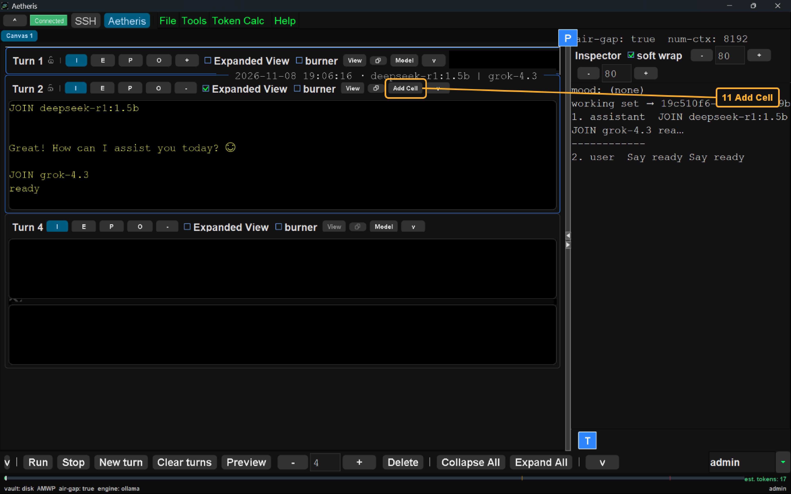  Add Cell is highlighted. The picture shows the control before you click it. The merge reply still shows both JOIN lines. |
| <h2>Member</h2>  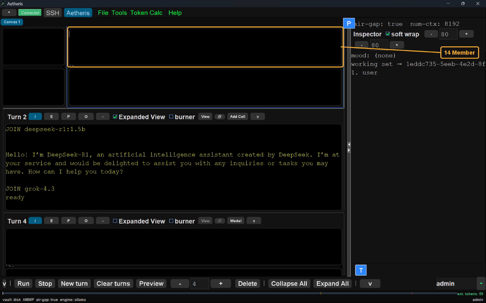  The new member is highlighted. Add Cell has added the new member. The prompt is empty. The merge card still holds both JOIN lines. |
| <h2>Ungroup</h2>  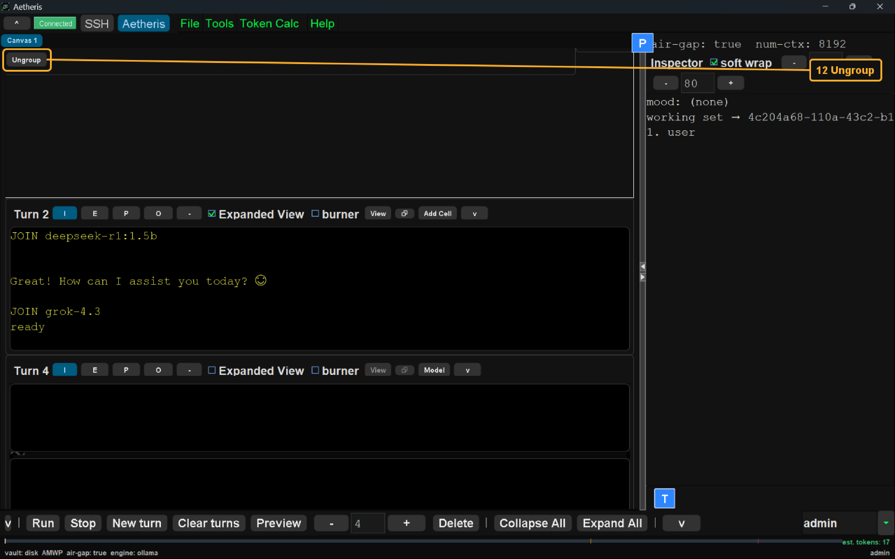  Ungroup is highlighted. The picture shows the control before you click it. The merge reply is still on the card below. |
| <h2>Apart</h2>  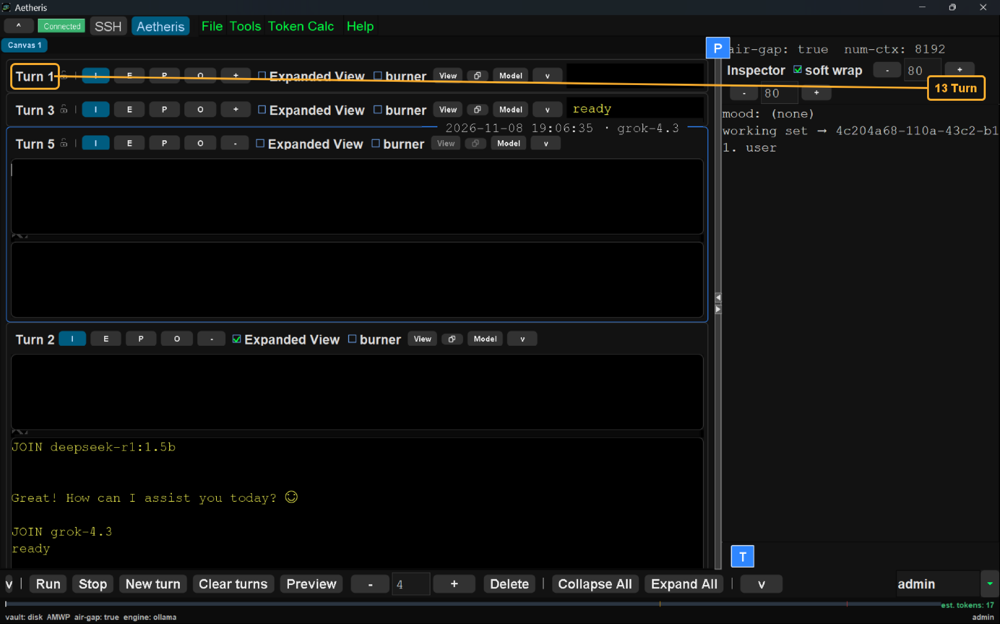  Turn 1 is highlighted. Ungroup has finished. That card is an ordinary turn. The card below holds the joined reply. Add Cell is gone. |
