# The terminal

The terminal is the VT100 session on [the desk](../the-desk/README.md). VT100 is the terminal kind a fresh window selects. This book does not require [the canvas](../the-canvas/README.md). The canvas is the notebook of turns.

This book has twenty-nine screen-shots. A conversation is the chat on this session. Escape switches the session between that chat and command mode. Command mode is the layer where a command runs. The words the model returned are not the point of a screen-shot. The screen-shot shows the prompt, the key, and the command.

The host that owns the line is the fast path on the [server page](../../../casserole-server/README.md#fast-path). The host is the server side that runs the model and prints the prompt.

Ctrl+C in this pane sends the interrupt to the host. It is not copy. Copy in this pane is Ctrl+Shift+C. Ctrl+V opens the paste dialog over the maximized window. The dialog title is Edit paste. Enter inserts a newline in that dialog. Ctrl+Enter accepts the text and sends it to the terminal.

The server remains a host when this window is closed. This guide does not describe that fact with a screen-shot. The account of the host is on the [server page](../../../casserole-server/README.md).

| |
| --- |
| <h2>Terminal pane</h2>  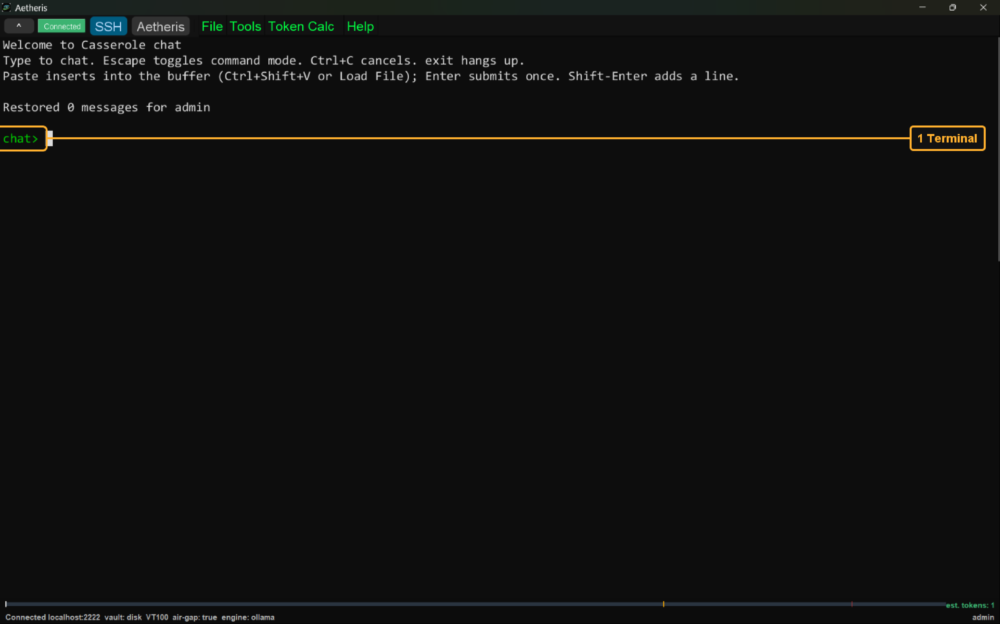  The terminal pane is highlighted. This pane is where you type to the host. The host prompt is visible. The green chat> line is that prompt. Enter sends the line you typed. The host that owns the line is the fast path on the [server page](../../../casserole-server/README.md#fast-path). |
| <h2>Interrupt</h2>  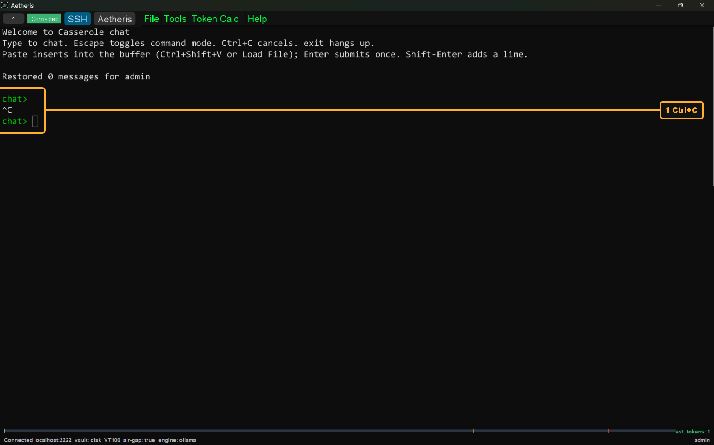  The interrupt is highlighted. Ctrl+C in this pane is the interrupt. The key sends the interrupt to the host. It is not copy. Copy in this pane is Ctrl+Shift+C. Ctrl+C does not put text on the clipboard. |
| <h2>Paste</h2>  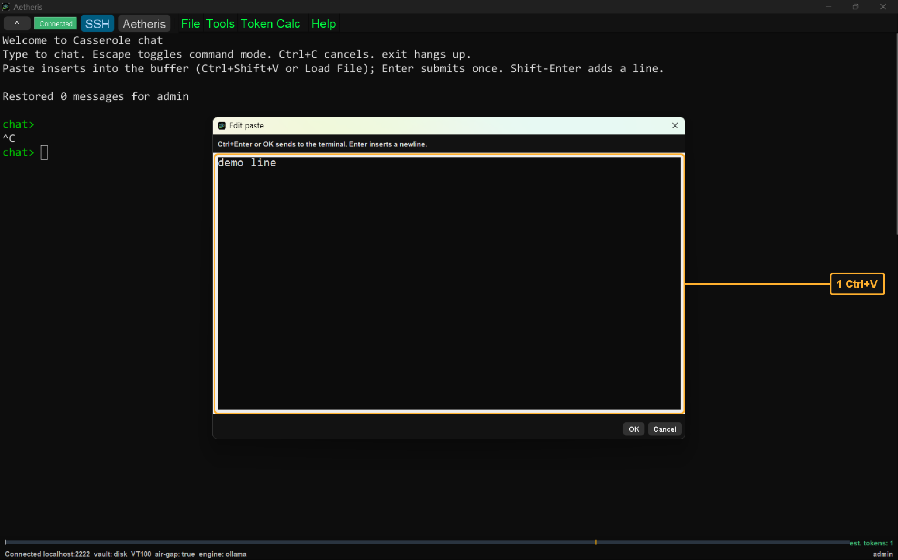  The paste dialog is highlighted. The dialog title is Edit paste. Ctrl+V opens this dialog. Ctrl+Shift+V opens it too. The dialog starts with the text on the clipboard. Enter inserts a newline. Ctrl+Enter accepts. OK accepts the same way. Accept sends the text to the terminal. Cancel drops the text. |

## A conversation

A conversation is the chat on this terminal. The green `chat>` line is the prompt. You type on that line. Enter sends the line. An empty Enter reprints `chat>` and does not send. Shift-Enter adds a line in the buffer. Enter submits once.

The host prints a rule, then the reply, then `chat>` returns. The rule names the time and the model. The model on the rules in these screen-shots is `grok/grok-4.3`. The same session keeps the earlier turns. `chat start` is the command that clears those turns. That command is later in this book.

| |
| --- |
| <h2>The line</h2>  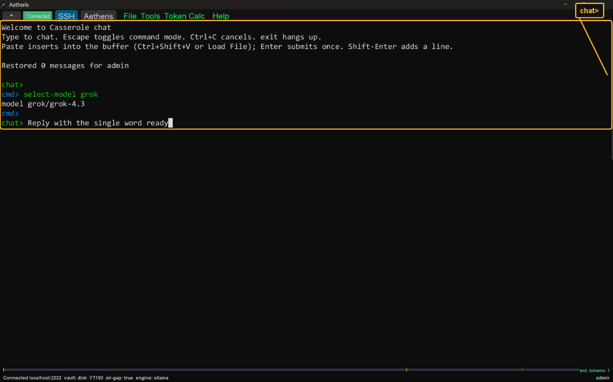  The typed line is highlighted. The prompt is the green chat>. The line sits in the buffer. Enter has not been pressed. The line in this screen-shot is Reply with the single word ready. Enter sends that line. |
| <h2>The reply</h2>  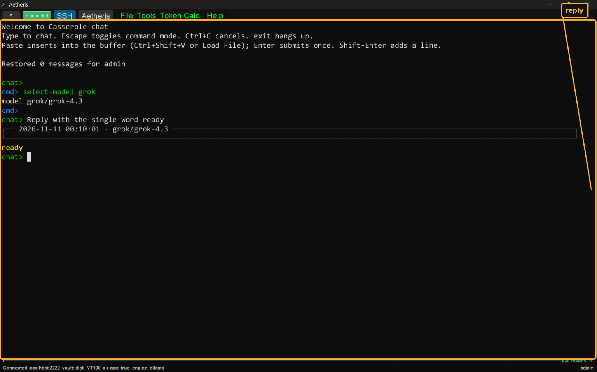  The reply is highlighted. Enter sent the line. A rule names the time and the model. The model on this rule is grok/grok-4.3. The reply sits under the rule. The green chat> has returned. The words the model returned are not the point of this screen-shot. The screen-shot shows where the reply sits. |
| <h2>The next line</h2>  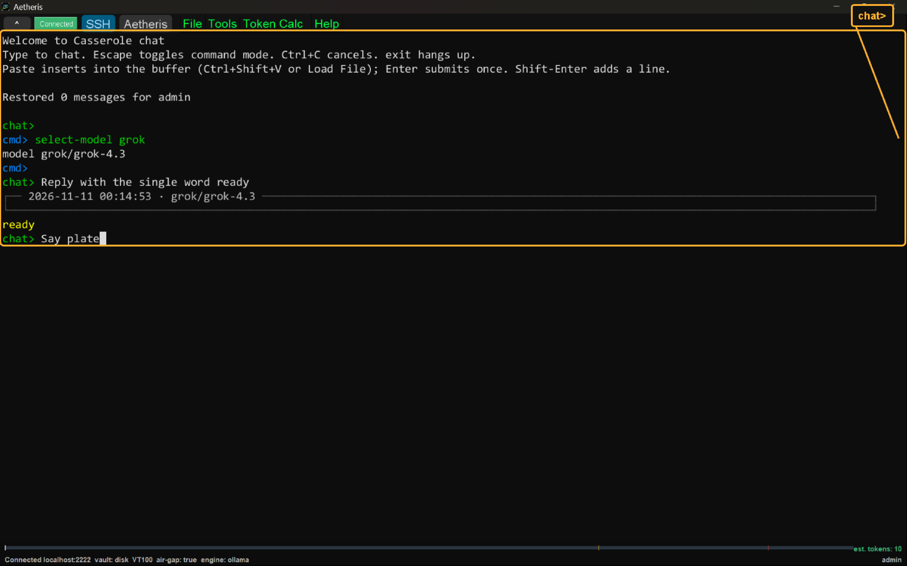  The next line is highlighted. The first reply is still above it. The new line sits at the green chat>. Enter has not been pressed. The line in this screen-shot is Say plate. The session was not reset. |
| <h2>The same session</h2>  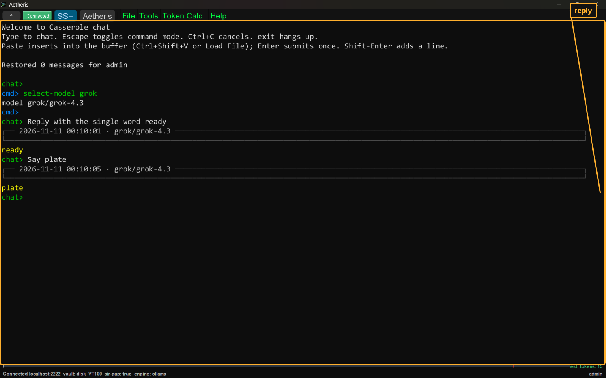  The second reply is highlighted. Enter sent the second line. The first turn is still above the new rule. The model on this rule is grok/grok-4.3. The reply sits under that rule. The green chat> has returned. The session was not reset. |

## Escape

Escape is the key that switches this terminal between chat and command mode. One press from the green `chat>` lands on the blue `cmd>` prompt. One press from `cmd>` returns to `chat>` while the session is active. After `chat stop`, one press from `cmd>` lands on `idle>`. A bare Escape drops the line you had not sent.

Escape on the Settings dialog closes that dialog. Esc in the View window hides the find bar. The Escape key in this book is the terminal switch.

The command you type at `cmd>` is green. The `cmd>` prompt is blue. The `chat>` prompt is green.

| |
| --- |
| <h2>Command mode</h2>  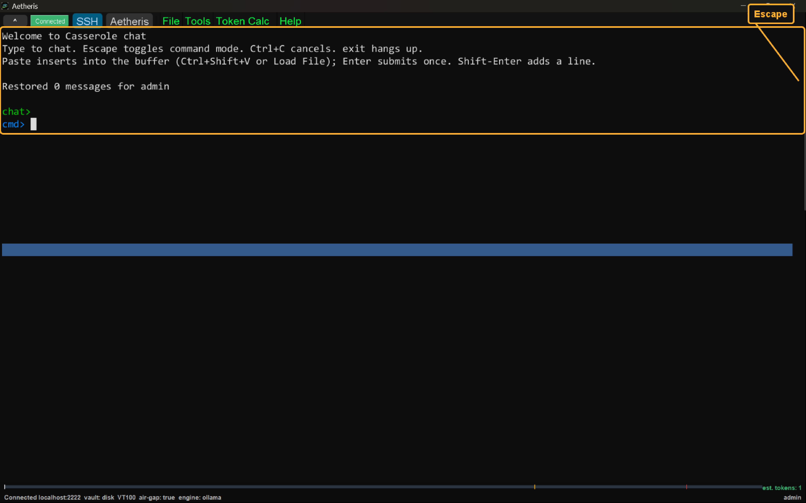  Escape is highlighted. The prompt changed from the green chat> to the blue cmd>. The lines above welcome the session. They say Escape toggles command mode, Ctrl+C cancels, and exit hangs up. Paste inserts into the buffer. Enter submits once. Shift-Enter adds a line. This session restored 0 messages for admin. |
| <h2>Back to chat</h2>  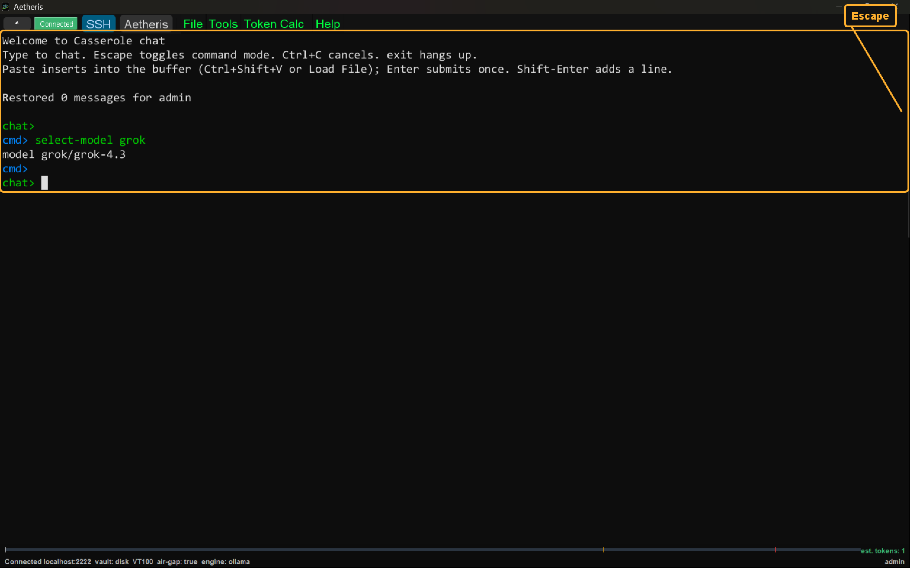  Escape is highlighted. The prompt returned to the green chat>. The finished command stays on the screen above the prompt. The session is still active. The next line you type is chat. |
| <h2>Idle</h2>  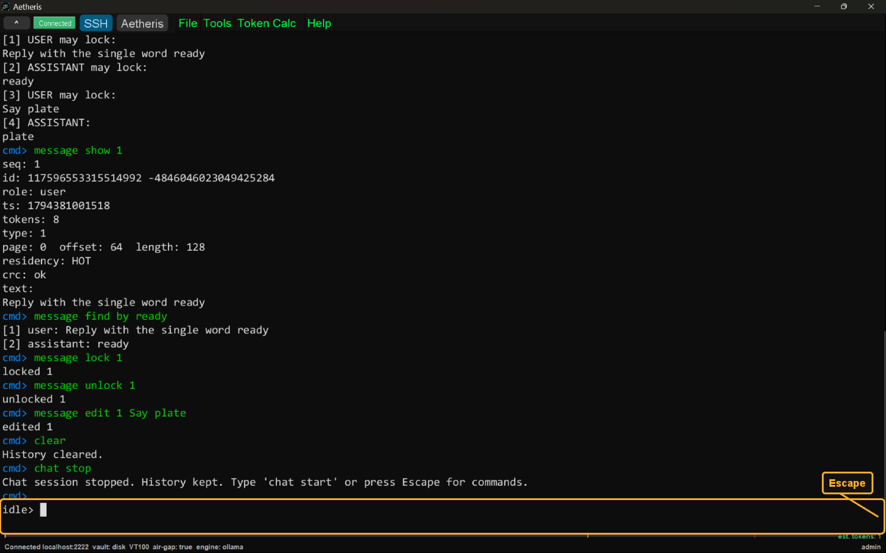  Escape is highlighted. The prompt is idle>. chat stop left the history. The line above says to type chat start, or to press Escape for commands. This press landed on idle>. The history stays. |

## Command mode

Command mode is the layer under the blue `cmd>` prompt. A command is a line you type there. Enter runs it. The prompt stays `cmd>` when the command finishes. `chat start` is the command that leaves command mode and returns the terminal to `chat>`.

An empty Enter in command mode reprints `cmd>`. A name the host does not know is written in red. The words are `Unknown command:`. This book does not show those two lines with a screen-shot.

Ctrl+C in this mode clears the line you are typing, or cancels a reply that is still arriving. The interrupt plate is earlier in this book.

An alias is another name for the same command. The sentence names the alias.

The commands, in the order of these screen-shots, are help, help for one command, status, message list, message show, message find, message lock, message unlock, message edit, clear, chat stop, chat start, ollama, ollama load, ollama stop, swap, select-model, the Model Config dialog, and exit.

## Help

`help` lists every command. The alias is `?`. The last line of the list says Escape toggles command mode, and Ctrl+C cancels a line or an in-flight reply.

| |
| --- |
| 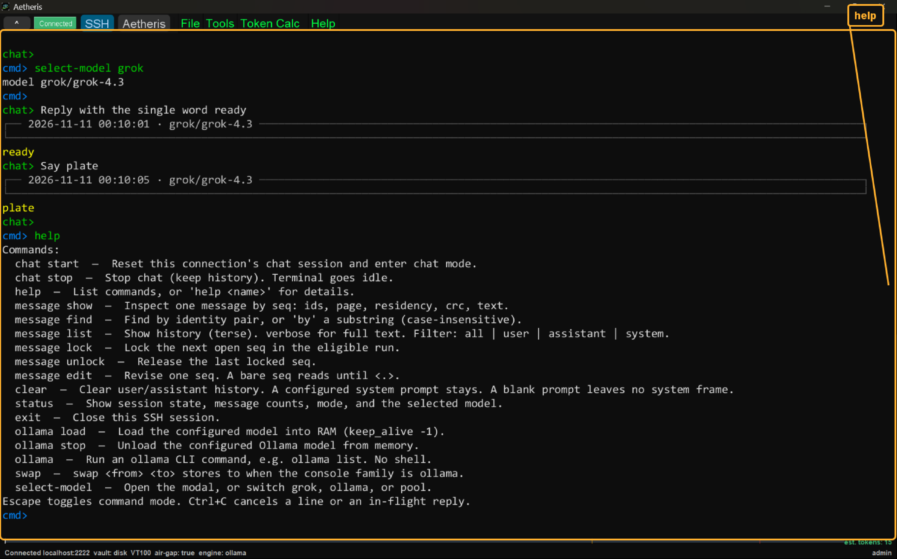  Help is highlighted. help lists every command. The alias is ?. chat start resets this connection's chat session and enters chat mode. chat stop stops chat and keeps the history, and the terminal goes idle. help with a name prints the detail for that command. message show inspects one message by its seq. The card names the ids, the page, the residency, the crc, and the text. message find finds by an identity pair, or by a substring, and the search ignores case. message list shows the history in a short form. verbose prints the full text. The filters are all, user, assistant, and system. message lock locks the next open seq in the eligible run. message unlock releases the last locked seq. message edit revises one seq. A bare seq reads until a line that is only a dot. clear clears user and assistant history. A configured system prompt stays. A blank prompt leaves no system frame. status shows the session state, the message counts, the mode, and the selected model. exit closes this SSH session. ollama load loads the configured model into RAM. The list names keep_alive -1. ollama stop unloads the configured Ollama model from memory. ollama runs an ollama command, for example ollama list, and there is no shell. swap takes a from word and a to word, and stores the to word when the console family is ollama. select-model opens the modal, or switches grok, ollama, or pool. The last line says Escape toggles command mode, and Ctrl+C cancels a line or an in-flight reply. The prompt stays cmd>. |

## One command

`help` and a name print the detail for that one command. This screen-shot asks for `chat start`.

| |
| --- |
| <h2>chat start</h2>  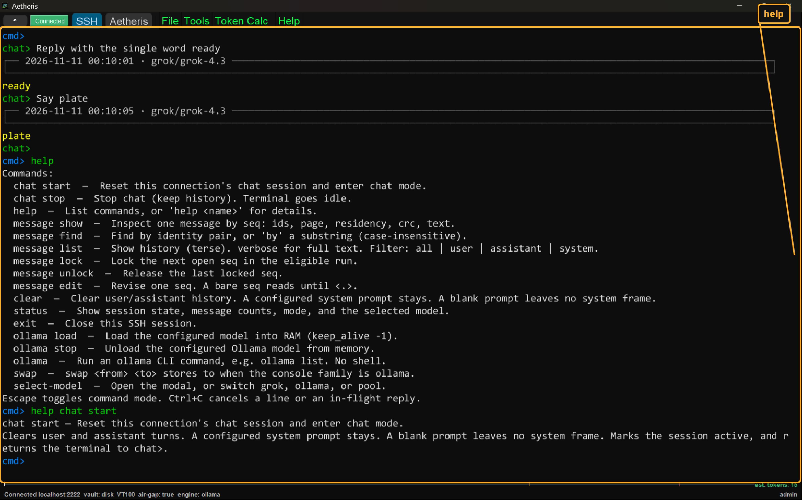  Help for one command is highlighted. The line is help chat start. The detail says chat start resets this connection's chat session and enters chat mode. It clears user and assistant turns. A configured system prompt stays. A blank prompt leaves no system frame. It marks the session active, and it returns the terminal to chat>. The list above is the list help printed. The prompt stays cmd>. |

## Status

`status` shows the session state, the message counts, the mode, and the selected model. Family is the group of models this console uses. The model line is the choice inside that group.

| |
| --- |
| 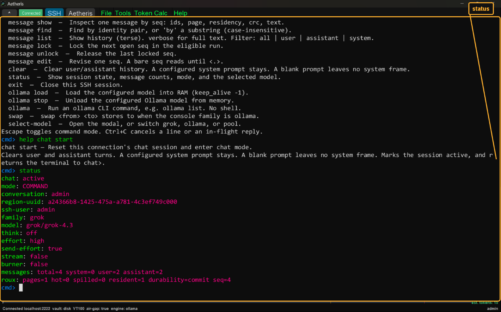  Status is highlighted. This screen-shot shows chat active and mode COMMAND. The conversation is admin. The region-uuid line is present. The ssh-user is admin. The family is grok. The model is grok/grok-4.3. Think is off. Effort is high. Send effort is true. Stream is false. Burner is false. The message counts on this screen-shot are this session. They read total 4, system 0, user 2, and assistant 2. The roux line on this screen-shot reads pages 1, hot 0, spilled 0, resident 1, durability commit, and seq 4. The window status line reads engine: ollama. The family line in the command is the console family. The prompt stays cmd>. |

## Message list

`message list` shows the history. The alias is `messages`. The role names are the uppercase names USER, ASSISTANT, and SYSTEM. A seq that can still be locked carries the mark `may lock`. `verbose` prints the full text. The filters are all, user, assistant, and system.

| |
| --- |
| 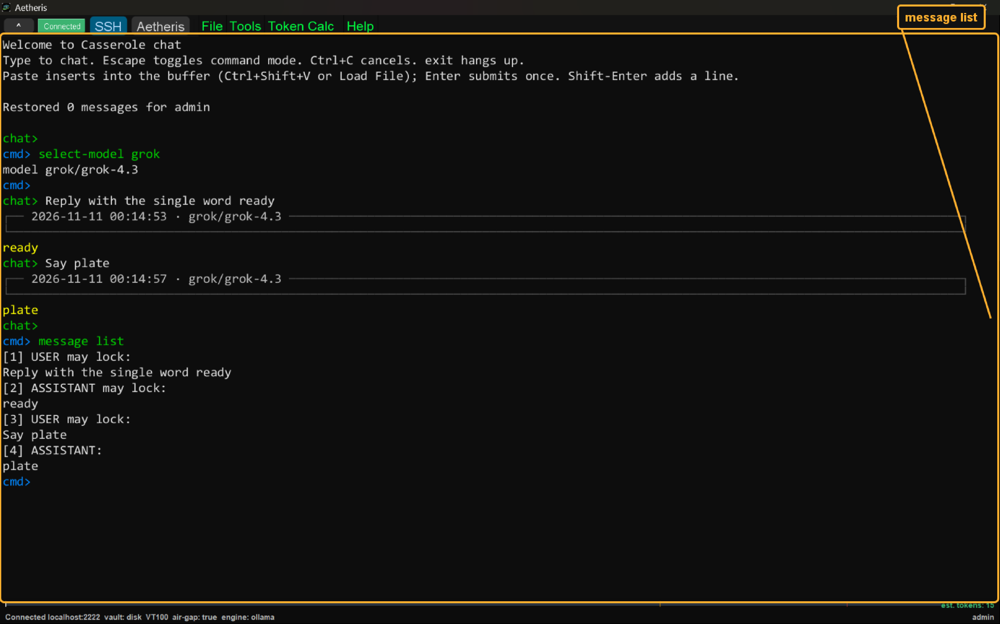  Message list is highlighted. The list is four seqs. Seq 1 is USER and carries may lock. Seq 2 is ASSISTANT and carries may lock. Seq 3 is USER and carries may lock. Seq 4 is ASSISTANT and has no may-lock mark. The mark appears on a seq that can still be locked. This screen-shot shows that mark on the first three. The prompt stays cmd>. |

## Message show

`message show` and a seq inspect that one message. The card names the seq, the id, the role, the time, the token count, the type, the page, the residency, the crc, and the text.

| |
| --- |
| 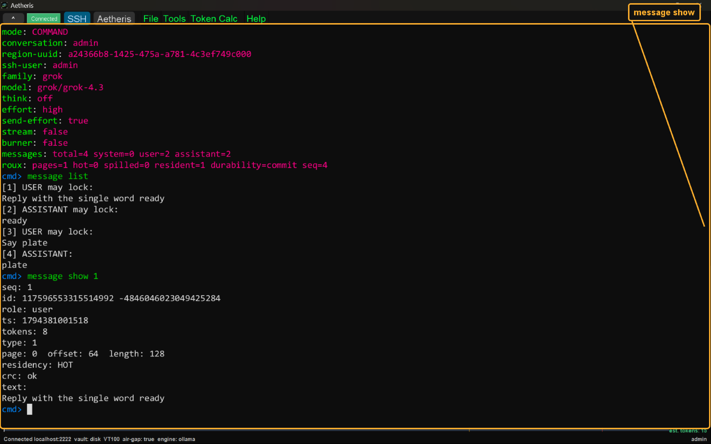  Message show is highlighted. The line is message show 1. The card is seq 1. The role is user. Residency reads HOT. crc reads ok. The text is the line that was sent. The id line and the time line are this message. The page line names the offset and the length. The prompt stays cmd>. |

## Message find

`message find by` and a substring search the history. The search ignores case. A hit prints the seq, the role in lowercase, and the text.

| |
| --- |
| 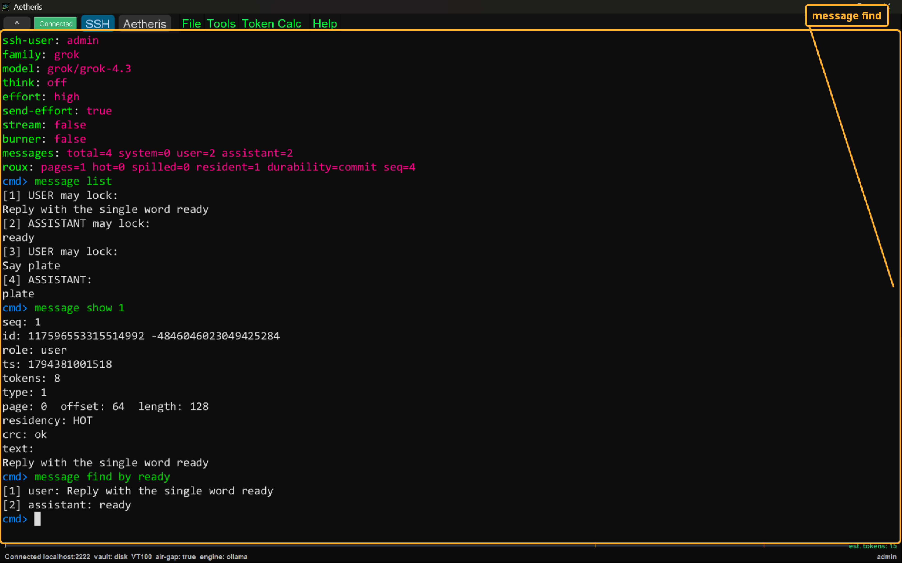  Message find is highlighted. The line is message find by ready. The host printed two hits. The role names are lowercase. Seq 1 is user. Seq 2 is assistant. The prompt stays cmd>. |

## Message lock

`message lock` and a seq lock that seq. The host writes `locked` and the seq.

| |
| --- |
| 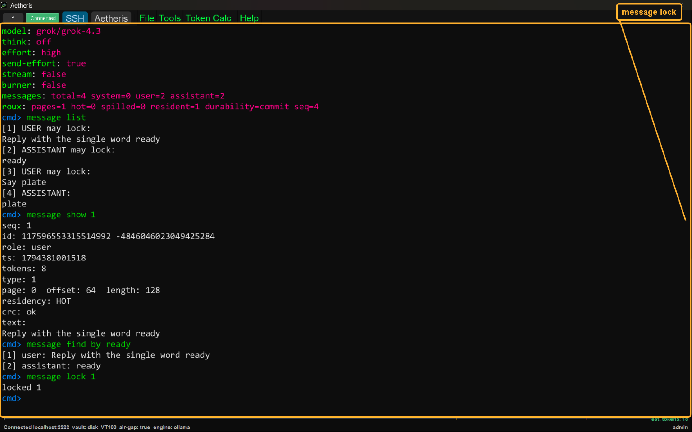  Message lock is highlighted. The line is message lock 1. The host wrote locked 1. The list above was printed before this lock. The prompt stays cmd>. |

## Message unlock

`message unlock` releases the last locked seq. The host writes `unlocked` and the seq.

| |
| --- |
| 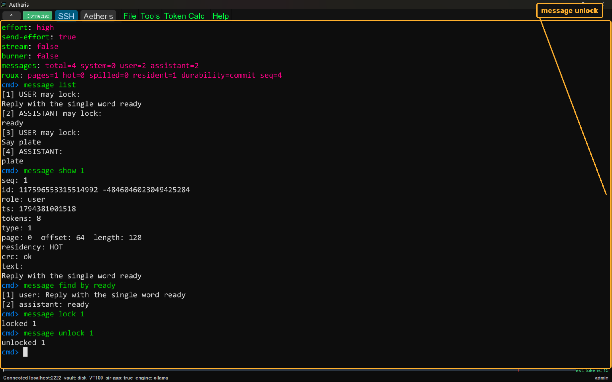  Message unlock is highlighted. The line is message unlock 1. The host wrote unlocked 1. The prompt stays cmd>. |

## Message edit

`message edit`, a seq, and the new text revise that seq. A bare seq reads until a line that is only a dot. The host writes `edited` and the seq.

| |
| --- |
| 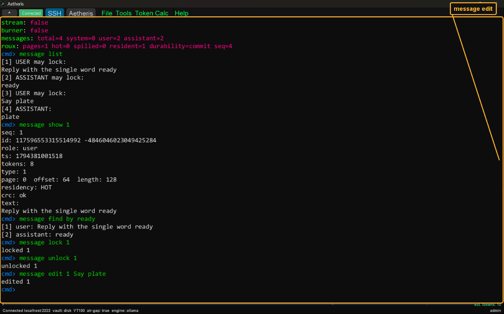  Message edit is highlighted. The line is message edit 1 Say plate. The host wrote edited 1. The show card above was printed before this edit. The prompt stays cmd>. |

## Clear

`clear` clears the user and assistant history. The alias is `history clear`. A configured system prompt stays. A blank prompt leaves no system frame. The session stays.

| |
| --- |
| 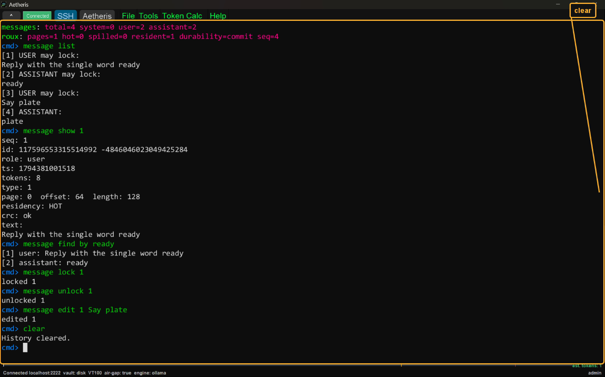  Clear is highlighted. The host wrote History cleared. The session stays. The prompt stays cmd>. |

## Chat stop

`chat stop` stops the chat and keeps the history. The prompt stays `cmd>` until Escape lands on `idle>`.

| |
| --- |
| 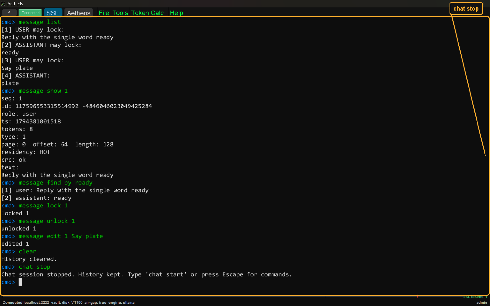  Chat stop is highlighted. The host wrote Chat session stopped. History kept. Type 'chat start' or press Escape for commands. The prompt stays cmd>. |

## Chat start

`chat start` resets this connection's chat session and enters chat mode. It clears user and assistant turns. A configured system prompt stays. A blank prompt leaves no system frame. It marks the session active, and it returns the terminal to `chat>`.

| |
| --- |
| 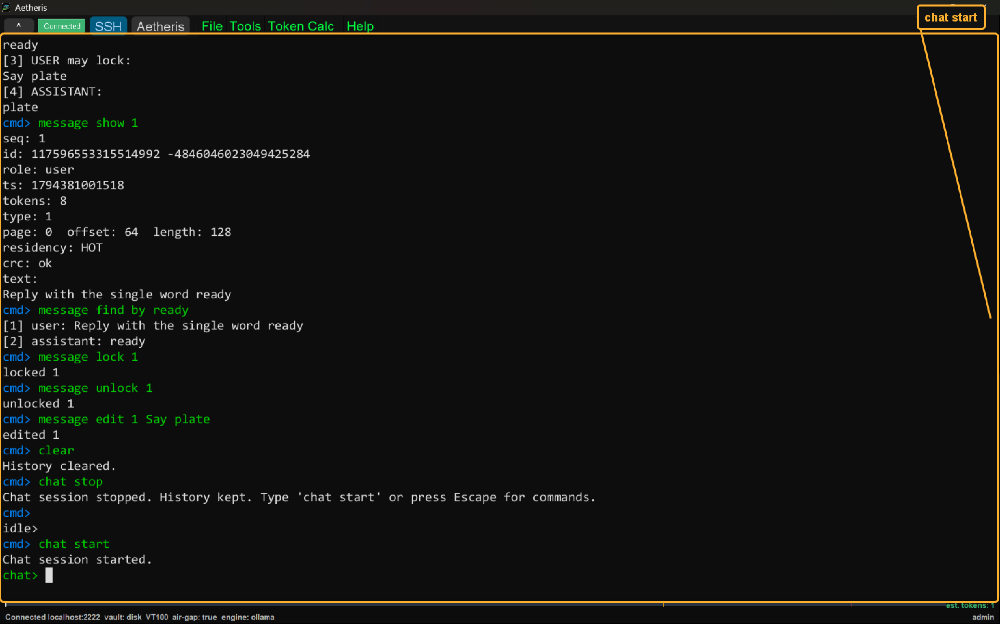  Chat start is highlighted. The idle> prompt is above this command. The host wrote Chat session started. The prompt returned to the green chat>. |

## Ollama

`ollama` runs an ollama command. There is no shell. `ollama list` prints the name, the id, the size, and the modified time.

| |
| --- |
| 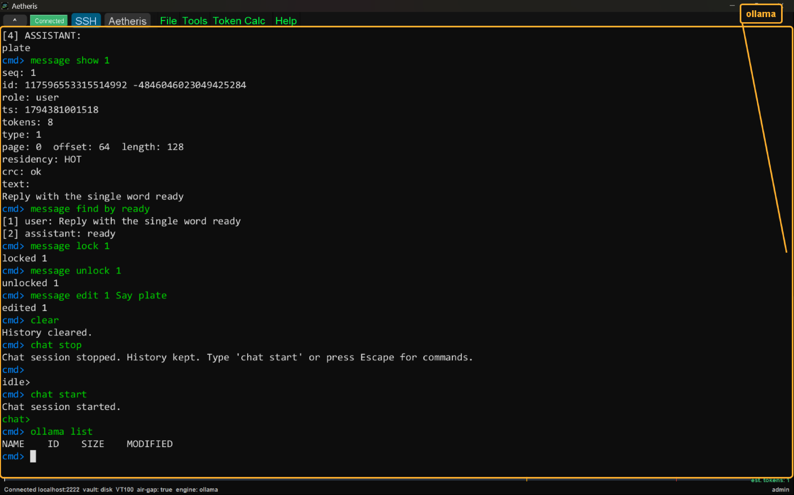  Ollama is highlighted. The green chat> is above this command. The line is ollama list. The host printed the header NAME, ID, SIZE, and MODIFIED. No model row is under that header. The prompt stays cmd>. |

## Ollama load

`ollama load` loads the configured model into RAM. The alias is `ollama start`. The host keeps that model until `ollama stop`.

| |
| --- |
| 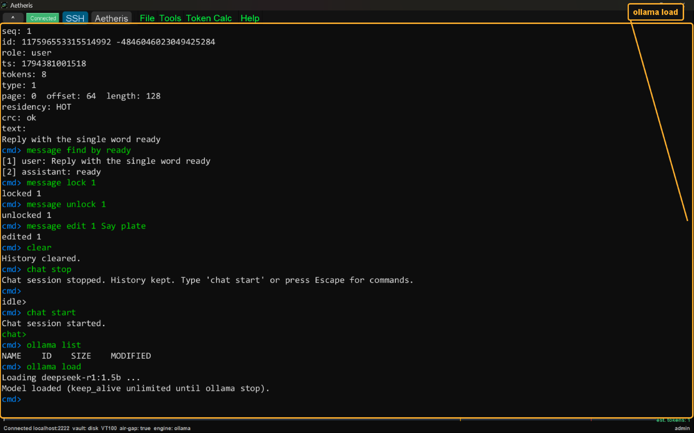  Ollama load is highlighted. The host wrote Loading deepseek-r1:1.5b, then Model loaded (keep_alive unlimited until ollama stop). The prompt stays cmd>. |

## Ollama stop

`ollama stop` asks the host to unload the configured Ollama model.

| |
| --- |
| 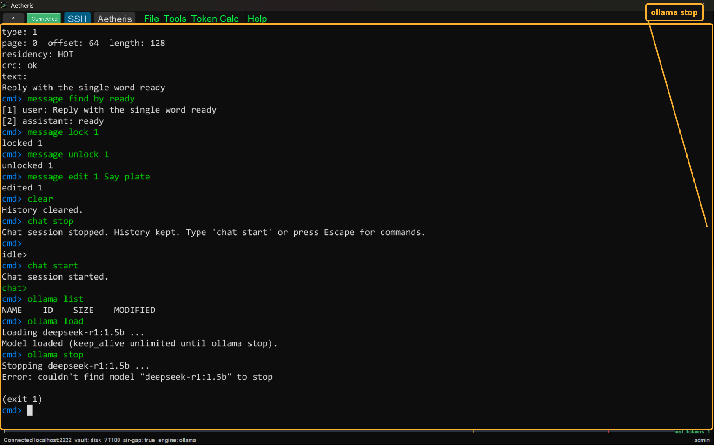  Ollama stop is highlighted. The host wrote Stopping deepseek-r1:1.5b. The next line is an error. The host could not find deepseek-r1:1.5b to stop. The line after the error is (exit 1). The prompt stays cmd>. |

## Swap

`swap` takes a from word and a to word. When the console family is ollama, the to word is stored. When the family is grok, the host names that family and leaves the target.

| |
| --- |
| 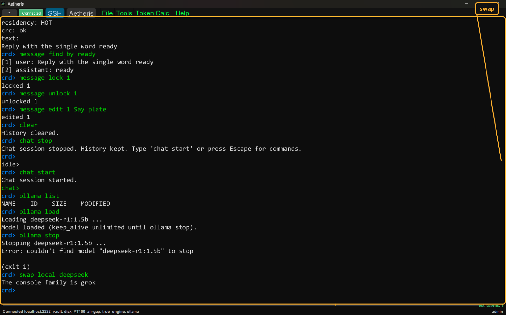  Swap is highlighted. The line is swap local deepseek. The from word is local. The to word is deepseek. The host wrote The console family is grok. The target stays. The prompt stays cmd>. |

## Select model

`select-model` and a family switch the console. The families are grok, ollama, and pool. A line with no family opens Model Config.

| |
| --- |
| 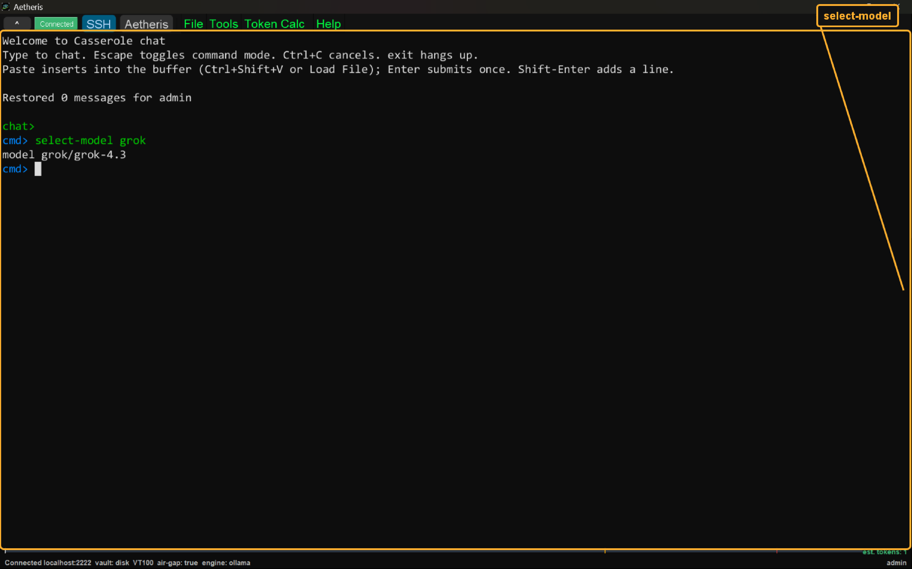  Select model is highlighted. The line is select-model grok. The host wrote model grok/grok-4.3. The prompt stays cmd>. |

## Model Config

A bare `select-model` opens the modal. The terminal prints `Model Config`. The dialog title is Model Config.

| |
| --- |
| 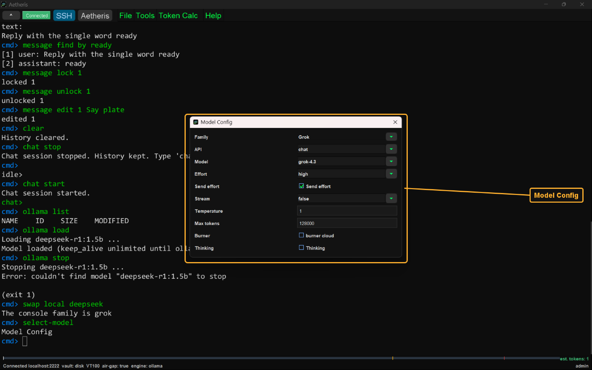  Model Config is highlighted. The dialog title is Model Config. Family is Grok. API is chat. Model is grok-4.3. Effort is high. Send effort is checked. Stream is false. Temperature is 1. Max tokens is 128000. Burner cloud is unchecked. Thinking is unchecked. The terminal behind the dialog reads Model Config. |

## Exit

`exit` closes this SSH session. The alias is `quit`. The host writes `Goodbye.` The window then says the remote host closed the connection.

| |
| --- |
| 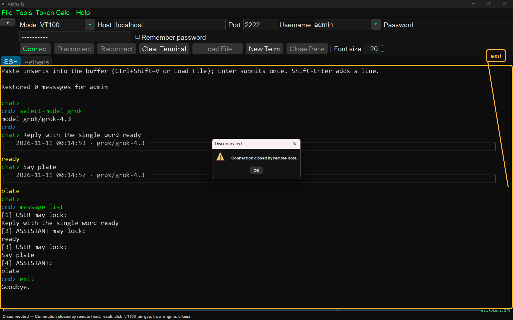  Exit is highlighted. The line is exit. The host wrote Goodbye. A dialog titled Disconnected says Connection closed by remote host. The status line reads Disconnected — Connection closed by remote host. The connection bar is open. Mode is VT100. Host is localhost. Port is 2222. Username is admin. The password field shows dots. The Font size spinner is 20. |
