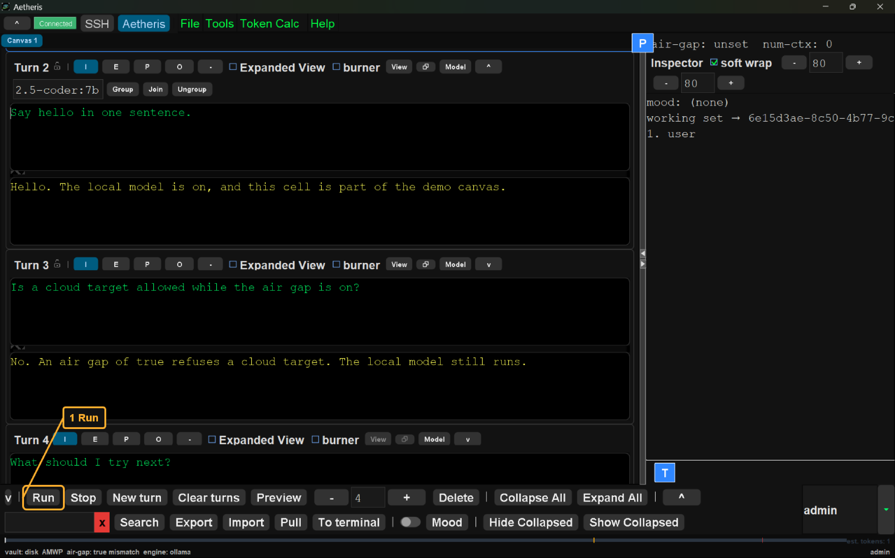
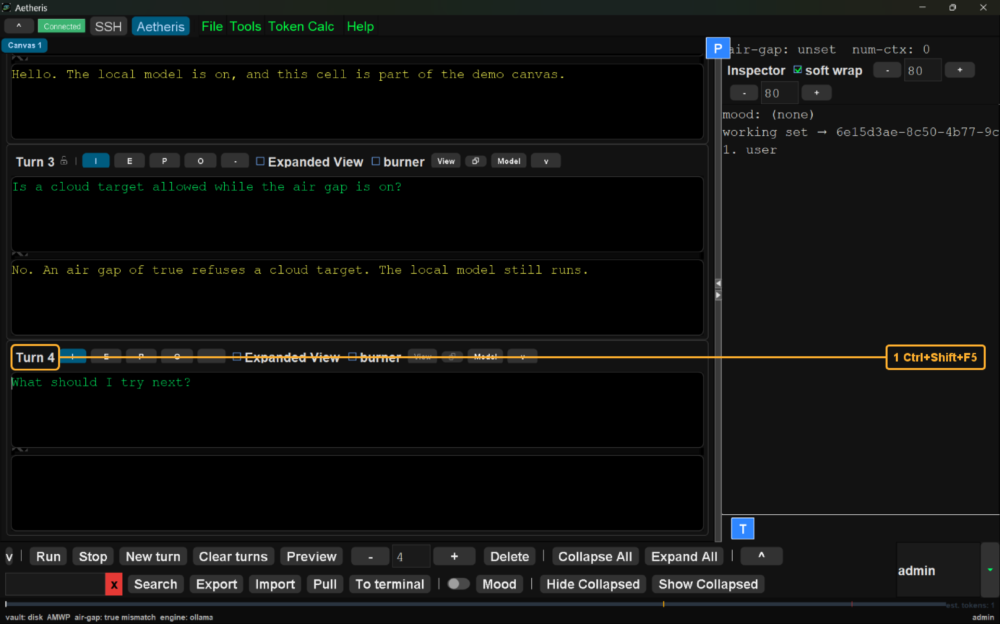

# The turn

The turn is the act of sending one card to its model. This book depends on [the canvas](../the-canvas/README.md). The canvas already depends on [the desk](../the-desk/README.md). [The terminal](../the-terminal/README.md) is the other book. It is the place you type to the host, and this book does not send from that pane.

Ctrl+Enter runs the focused card when the main view is showing. The main view is the notebook itself, with no View window open over it. Ctrl+Shift+F5 runs the chain. The chain sends the earlier cards the prompt names, and then this card.

The head is the run of cards the padlock can hold. The allowance is how many tokens the head may hold. The fill is how full that allowance is. The lock count is how many cards may be locked. Those three rules are [The Reichenbach sink](../../../casserole-server/README.md#the-reichenbach-sink). The value recorded here for managed-tokens is 0. This book does not include a screen-shot of the allowance. The refusal line is `The head is over the allowance.` That line is the link from this page to the sink.

The model path is on the [root page](../../../README.md). The air-gap refusal of a remote target is on that page and on the [server page](../../../casserole-server/README.md).

| |
| --- |
| <h2>Run</h2>    Run is highlighted. Run sends the focused card on the session from the desk. Ctrl+Enter does that send when the main view is showing. An open View window does not send. When no card has focus, the last card is the one that runs. The words the model returns are not the point of this screen-shot. The screen-shot shows the button, the key, and the menu around that send. |
| <h2>Chain</h2>    Turn 4, the focused card, is highlighted. The card that has focus is named before the key. Ctrl+Shift+F5 runs the chain from that card. The chain sends this card after any earlier card the prompt names. A prompt names an earlier card as {{cell[N].output}}, where N is that card's turn number. In that token, cell means the card. Run sends the one focused card. The chain sends the named cards in order, and then this one. |
